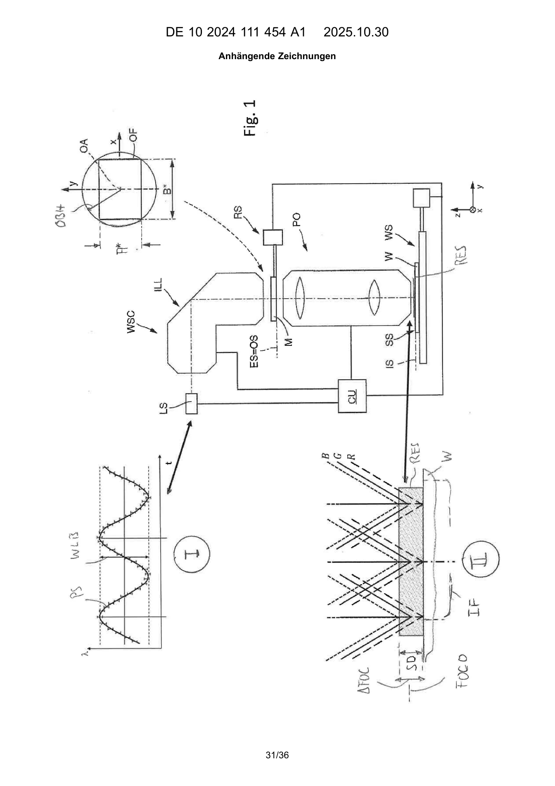
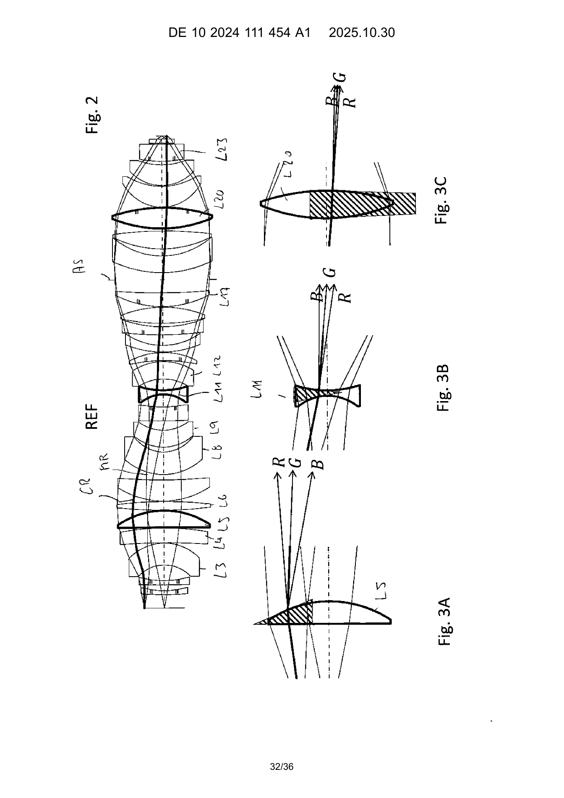
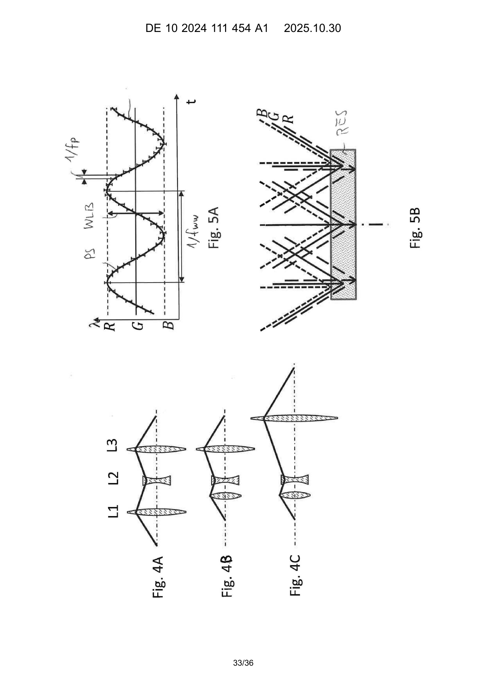
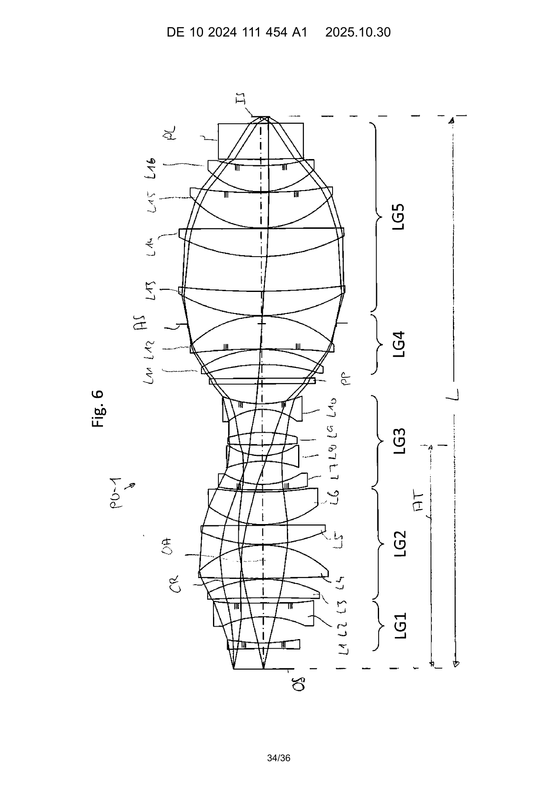
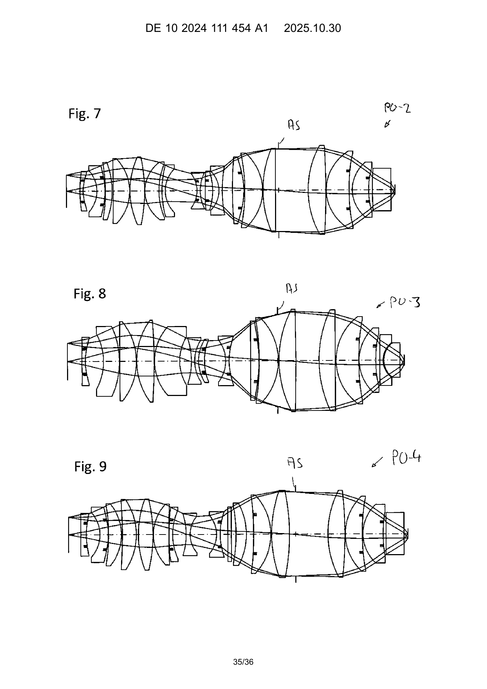
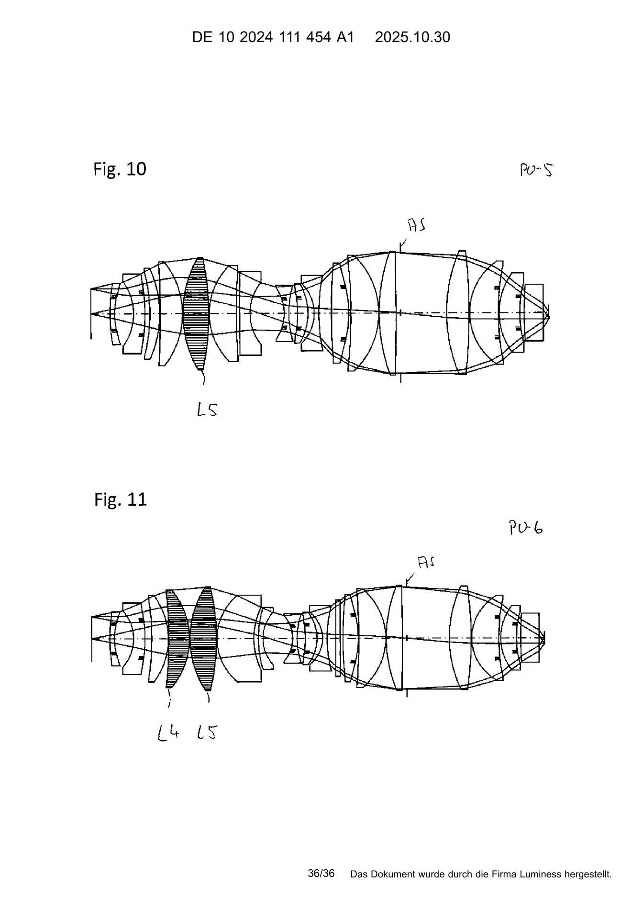

# DE102024111454A1 · Projektionsbelichtungsverfahren, Projektionsobjektiv und Projektionsbelichtungsanlage für die Mikrolithographie

| 字段 | 内容 |
| --- | --- |
| 申请人／公开日 | Carl Zeiss SMT GmbH／2025-10-30 |
| 原件 | 德文，36 页。[DPMA 登记](https://register.dpma.de/DPMAregister/pat/register?AKZ=1020241114541) · [本地原件](original.pdf) |
| 原件 SHA-256 | d849fc6e6e67888edd57be924bda60c46c9efc7aa149c5253094ced1c5cfef38 |
| 处理 | 2026-11-03 下载德国公开公报到本地，用本地 MineU 4.0.12（standard，OCR）逐页转写。第 30 页裁出权利要求区域再由同一本地 MineU 转写并对照原页校正；第 31–36 页附图使用公报原图纸保留图号。 |
| 校对范围 | 首页、第四实施例段 0135–0138、表 9、9A 及图 9。表内的跨行科学记数法应以对应原页为准。 |

[资料卡和计算入口](README.md)

## PDF 第 1 页

[对应原页](original.pdf#page=1)

(19)

Deutsches
Patent- und Markenamt

(10) DE 10 2024 111 454 A1 2025.10.30

(12)

### Offenlegungsschrift

(21) Aktenzeichen: 10 2024 111 454.1
(22) Anmeldetag: 24.04.2024
(43) Offenlegungstag: 30.10.2025

(71) Anmelder:
Carl Zeiss SMT GmbH, 73447 Oberkochen, DE

(74) Vertreter:
Patentanwälte Ruff, Wilhelm, Beier, Dauster &
Partner mbB, 70174 Stuttgart, DE

(72) Erfinder:
Epple, Alexander, Dr., 73447 Oberkochen, DE (51) Int Cl.: G03F 7/20 (2006.01)
G02B 27/00 (2006.01)
G02B 13/14 (2006.01)
G02B 9/60 (2006.01)

(56) Ermittelter Stand der Technik:
US 6 829 040 B1
US 2007 / 0 109 659 A1
US 2008 / 0 043 345 A1
US 2009 / 0 147 231 A1
US 2010 / 0 323 299 A1
US 2023 / 0 208 094 A1

Prüfungsantrag gemäß § 44 PatG ist gestellt.
Die folgenden Angaben sind den vom Anmelder eingereichten Unterlagen entnommen.

(54) Bezeichnung: Projektionsbelichtungsverfahren, Projektionsobjektiv und Projektionsbelichtungsanlage für die Mikrolithographie

(57) Zusammenfassung: Bei einem Projektionsbelichtungsverfahren zur Belichtung eines im Bereich einer Bildebene eines Projektionsobjektivs angeordneten Substrats mit mindestens einem Bild eines im Bereich einer Objektebene des Projektionsobjektivs angeordneten Musters mit Strahlung aus einem Wellenlängenbereich um eine Design-Wellenlänge < 260 nm wird ein Substrat (SUB) mit einer relativ dicken strahlungsempfindlichen Fotolackschicht (RS) beschichtet und mithilfe eines Projektionsobjektivs (PO) belichtet, das bei der Design-Wellenlänge einen Fokus in einer Design-Fokusposition (FOCO) und für andere Wellenlängen aus dem Wellenlängenbereich versetze Fokuspositionen aus einem axial ausgedehnten Fokusbereich ( $\Delta$ FOC) um die Design-Fokusposition (FOCO) erzeugt. Das Projektionsobjektiv ist als ein Eintaillen-System bzw. Zweibauchsystem ausgebildet. Während eines Belichtungszeitintervalls werden unterschiedliche Wellenlängen aus dem Wellenlängenbereich um die Design-Wellenlänge genutzt derart, dass eine axiale Ausdehnung des Fokusbereichs mindestens so groß wie die Schichtdicke ist. Das Projektionsobjektiv ist bezüglich der chromatischen Queraberration CHV derart optisch korrigiert, dass im Bereich der Design-Wellenlänge der Abbildungsmaßstab im Wesentlichen unabhängig von der Wellenlänge ist, so dass bei einer Änderung der Wellenlänge um 1 Pikometer eine Position eines zu einem Objektpunkt gehörenden Bildpunkts für alle Bildpunkte innerhalb eines Bildfeldes höchstens 2 nm variiert.

## PDF 第 2 页

[对应原页](original.pdf#page=2)

### DE 10 2024 111 454 A1 2025.10.30

### Beschreibung

### ANWENDUNGSGEBIET UND STAND DER TECHNIK

[0001] Die Erfindung betrifft ein Projektionsbelichtungsverfahren zur Belichtung eines im Bereich einer Bildebene eines Projektionsobjektivs angeordneten Substrates mit mindestens einem Bild eines im Bereich einer Objektebene des Projektionsobjektivs angeordneten Musters sowie eine zur Durchführung des Verfahrens geeignete Projektionsbelichtungsanlage und ein darin verwendbares Projektionsobjektiv.

[0002] Zur Herstellung von Halbleiterbauelementen und anderen fein strukturierten Bauteilen, wie z.B. strukturierten Komponenten für die Mikrosystemtechnik, werden heutzutage überwiegend mikrolithografische Projektionsbelichtungsverfahren eingesetzt. Hochintegrierte Halbleiterbauelemente weisen typischerweise eine Mehrzahl von Schichten (Layern) auf, von denen nur einige wenige Schichten sehr fein, z.B. auf der Skala einiger Dutzend Nanometer, strukturiert sind, während andere Schichten deutlich größere Strukturen besitzen. Erstere Schichten realisieren insbesondere die eigentliche Hauptfunktion des Halbleiterbauelements, wie z.B. Berechnungen und Speicherung von Daten, während letztere Schichten z.B. der Adressierung und Stromversorgung dienen. Strukturen mit relativ groben typischen Dimensionen gibt es auch im Bereich der Mikrosystemtechnik, wie z.B. bei mikroelektromechanischen Systemen (MEMS) oder bei mikro-opto-elektromechanischen Systemen (MOEMS). Halbleiterbauelemente werden typischerweise aus einem Substrat eines Halbleiters hergestellt, während in der Mikrosystemtechnik auch andere Substratmaterialien, insbesondere Metalle und glasartige Stoffe, verwendet werden.

[0003] Bei der mikrolithographischen Projektionsbelichtung werden in der Regel Masken (Retikel) verwendet, die das Muster einer abzubildenden Struktur tragen, z.B. ein Linienmuster einer Schicht (layer) eines Halbleiter-Bauelements. Eine Maske wird in eine Projektionsbelichtungsanlage zwischen einem Beleuchtungssystem und einem Projektionsobjektiv im Bereich der Objektebene des Projektionsobjektivs positioniert und mit einer vom Beleuchtungssystem bereitgestellten Beleuchtungsstrahlung beleuchtet. Die durch die Maske und das Muster veränderte Strahlung läuft als Projektionsstrahlung durch das Projektionsobjektiv, welches das Muster der Maske auf das zu belichtende Substrat abbildet. Bei dem Substrat kann es sich z.B. um einen Halbleiterwafer handeln. Das zu belichtende Substrat trägt an seiner zu strukturierenden Seite eine strahlungsempfindliche (d.h. photosensitive) Schicht aus Fotolack bzw. Resist. Diese Schicht wird als Fotolackschicht oder auch als Resistschicht bezeichnet.

[0004] Eines der Ziele bei der Entwicklung von Projektionsbelichtungsanlagen besteht darin, Strukturen mit zunehmend kleineren Abmessungen auf dem Substrat lithographisch zu erzeugen. Die Größe der erzeugbaren Strukturen hängt maßgeblich vom Auflösungsvermögen des verwendeten Projektionsobjektivs ab und lässt sich einerseits durch Verringerung der Wellenlänge der für die Projektion verwendeten Projektionsstrahlung und andererseits durch Erhöhung der im Prozess genutzten bildseitigen numerischen Apertur NA des Projektionsobjektivs steigern. Viele moderne Projektionsobjektive arbeiten bei Design-Wellenlängen von weniger als 260 nm im tiefen Ultraviolettbereich (DUV) oder im Vakuumultraviolettbereich (VUV).

[0005] Projektionsobjektive sind für ihre jeweilige Design-Wellenlänge optisch korrigiert und erzeugen bei der Design-Wellenlänge einen Fokus in einer Design-Fokusposition. Wenn die chromatische Längsaberration CHL (engl: Axial Chromatic Aberration AX) der Systeme nicht vollständig korrigiert ist, werden bei Abweichungen von der Design-Wellenlänge axial versetze Fokuspositionen aus einem Fokusbereich um die Design-Fokusposition erzeugt.

[0006] Damit beim Belichtungsprozess ein möglichst vorlagengetreues Abbild des Musters auf das Substrat übertragen wird, sollte die strahlungsempfindliche Schicht an der Substratoberfläche während des Belichtungszeitintervalls im bildseitigen Fokusbereich des Projektionsobjektivs liegen. Insbesondere sollte die auf der Substratoberfläche angeordnete Schicht im Bereich der Schärfentiefe (depth of focus, DOF) des Projektionsobjektivs liegen. Nach einer gängigen Definition gibt die Schärfentiefe den Abstand relativ zur Ebene besten Fokus an, bei dem die Intensität eines Punktbildes mindestens 80% der Intensität in der Ebene besten Fokus beträgt. Dies ist äquivalent zur Bedingung, dass sich der Durchmesser des Punktbildes praktisch nicht verändertt. Die Schärfentiefe beträgt die Hälfte der Rayleigh-Einheit RU, die als RU = λ/NA² definiert ist, wobei λ die Arbeitswellenlänge der Projektionsbelichtungsanlage und NA die bildseitige numerische Apertur des Projektionsobjektivs ist; der Bereich, in welchem die Schärfentiefenbedingung erfüllt ist, besitzt dementsprechend eine Gesamtdicke gleich der Rayleigh-Einheit RU. Im Allgemeinen wird die Schärfentiefe geringer, je höher das Auflösungsvermögen des Projektionsobjektivs ist.

## PDF 第 3 页

[对应原页](original.pdf#page=3)

[0007] Eine weitere Verkleinerung der Strukturgrößen auf Computerchips wird technisch und physikalisch immer schwieriger und kostspieliger. Als Alternative zur besseren Ausnutzung der Fläche des Wafers kann die dritte Dimension ausgenutzt werden, indem Strukturen nicht nur auf bzw. an der Oberfläche des Wafers, sondern in Tiefenrichtung in den Wafer hinein erzeugt werden.

[0008] Die dritte Dimension wird z.B. genutzt, um eine dreidimensionale Stapelung von Flashspeicher-Strukturen zu erzeugen, z.B. bei der Herstellung von 3D-NAND Flashspeichern. 3D-NAND ist eine Art nichtflüchtiger (non-volatile) Flash-Speicher, bei dem die Speicherzellen vertikal in mehreren Schichten gestapelt sind. Bei der Herstellung von 3D-NANDs müssen relativ dicke Resist-Schichten belichtet werden. Hierfür reicht die Schärfentiefe üblicher Standard-Scanner in der Regel nicht aus.

[0009] Es gibt bereits Vorschläge für Verfahren zur Belichtung relativ dicker Fotolackschichten.

[0010] Die Anmeldung US 2007/0013889 A1 beschreibt eine Projektionsbelichtungsanlage mit einem Beleuchtungssystem zum Erzeugen eines Strahlenbündels, eine Anordnung von einzeln steuerbaren Elementen, die dazu dienen, dem Strahlbündel ein Muster in seinem Querschnitt zu verleihen, einem Substrattisch zum Tragen eines Substrats und ein Projektionssystem zum Projizieren des gemusterten Strahls auf einen Zielabschnitt des Substrats. Das Strahlenbündel umfasst eine Vielzahl von Strahlkomponenten. Dazu gehören eine erste Strahlkomponente mit einem ersten Frequenzspektrum um eine erste Frequenz und mindestens eine zweite Strahlkomponente mit einem zweiten Frequenzspektrum um eine zweite Frequenz. Die zweite Frequenz unterscheidet sich von der ersten Frequenz. Das Projektionssystem fokussiert die erste und zweite Strahlkomponente in unterschiedlichen Höhen in Bezug auf den Substrattisch.

[0011] Bei dem Projektionsbelichtungsverfahren und der Projektionsbelichtungsanlage der US 4,937,619 A wird ein Substrat mit Beleuchtungslicht unterschiedlicher Wellenlänge belichtet, wobei sich durch die chromatische Längsaberration des Projektionsobjektivs die Lage der Fokusfläche relativ zur Substratoberfläche mit der Wellenlänge ändert.

[0012] Bei dem Projektionsbelichtungsverfahren und der Projektionsbelichtungsanlage der US 5,303,002 wird ein Substrat gleichzeitig mit schmalbandigen Pulsen eng benachbarter unterschiedlicher Wellenlängen belichtet. Aufgrund der chromatischen Längsaberration des Projektionsobjektivs wird eine effektive Vergrößerung der Schärfentiefe erreicht.

### AUFGABE UND LÖSUNG

[0013] Es ist eine Aufgabe der Erfindung, ein Projektionsbelichtungsverfahren bereitzustellen, das es erlaubt, eine relativ dicke strahlungsempfindliche Fotolackschicht auf einem zu belichtenden Substrat so zu belichten, dass über die gesamte Dicke der Schicht ein belichtetes Volumen mit positionsrichtigen, scharfen Konturen erzeugbar ist. Es ist eine weitere Aufgabe, eine zur Durchführung des Verfahrens geeignete Projektionsbelichtungsanlage und ein dafür verwendbares Projektionsobjektiv bereitzustellen.

[0014] Zur Lösung dieser Aufgabe stellt die Erfindung ein Projektionsbelichtungsverfahren mit den Merkmalen von Anspruch 1 bereit. Weiterhin werden ein dioptrisches Projektionsobjektiv gemäß Anspruch 9 und eine Projektionsbelichtungsanlage gemäß Anspruch 14 bereitgestellt, die zur Durchführung des Projektionsbelichtungsverfahrens verwendet werden können. Vorteilhafte Weiterbildungen sind in den abhängigen Ansprüchen angegeben. Der Wortlaut sämtlicher Ansprüche wird durch Bezugnahme zum Inhalt der Beschreibung gemacht.

[0015] Im Rahmen der Durchführung des Projektionsbelichtungsverfahrens wird ein zu belichtendes Substrat mit einer strahlungsempfindlichen Fotolackschicht beschichtet, die eine Schichtdicke aufweist.

[0016] Bei dem Projektionsbelichtungsverfahren wird das mit der Fotolackschicht bedeckte Substrat, welches im Bereich der Bildebene eines Projektionsobjektivs angeordnet ist, mit mindestens einem Bild eines Musters belichtet, welches im Bereich der zur Bildebene optisch konjugierten Objektebene des Projektionsobjektivs angeordnet ist. In der Regel wird eine Maske (reticle) verwendet, die das Muster trägt. Es ist auch möglich, eine steuerbare Mustererzeugungseinrichtung zu verwenden, um das abzubildende Muster zu erzeugen.

## PDF 第 4 页

[对应原页](original.pdf#page=4)

[0017] Zur Belichtung wird Strahlung aus einem Wellenlängenbereich um eine Design-Wellenlänge von weniger als 260 nm (Nanometer) verwendet. Der Begriff „Design-Wellenlänge“ bezeichnet diejenige Wellenlänge, für die der optische Aufbau des Projektionsobjektivs hinsichtlich optischer Aberrationen ausgelegt ist.

[0018] Projektionsobjektive der in dieser Anmeldung betrachteten Art arbeiten bei Design-Wellenlängen von weniger als 260 nm im tiefen Ultraviolettbereich (DUV) oder im Vakuumultraviolettbereich (VUV). Hier stehen leistungsfähige Laserlichtquellen zur Verfügung, insbesondere KrF-Excimer-Laser mit einer Wellenlänge von ca. 248 nm und ArF -Laser mit einer Wellenlänge von ca. 193 nm. Außerdem sind bei diesen Wellenlängen relativ hohe Auflösungen zu erreichen.

[0019] In der Projektionsbelichtungsanlage bzw. beim Projektionsbelichtungsverfahren wird ein Projektionsobjektiv verwendet, das bezüglich der chromatischen Längsaberration CHL derart optisch korrigiert ist, dass bei der Design-Wellenlänge ein Fokus in einer Design-Fokusposition und für andere Wellenlängen aus einem Wellenlängenbereich um die Design-Wellenlänge versetzte Fokuspositionen aus einem axial ausgedehnten Fokusbereich um die Design-Fokusposition erzeugt werden. Das Projektionsobjektiv hat somit endliche Werte für die chromatischen Längsaberration CHL.

[0020] Das Substrat wird in Bezug auf das Projektionsobjektiv derart angeordnet, dass die Design-Fokusposition im Bereich der Fotolackschicht liegt.

[0021] In einer Belichtungsoperation wird das mit der Fotolackschicht beschichtete Substrat mittels des Projektionsobjektivs mit wenigstens einem Bild des Musters belichtet. Dabei werden unter Steuerung einer Steuereinheit innerhalb eines Belichtungszeitintervalls unterschiedliche Wellenlängen aus dem Wellenlängenbereich um die Design-Wellenlänge erzeugt und derart genutzt, dass eine axiale Ausdehnung des genutzten Fokusbereichs mindestens so groß wie die Schichtdicke ist. Dabei wird ausgenutzt, dass das Projektionsobjektiv einen endlichen Wert für die chromatische Längsaberration CHL hat.

[0022] Dadurch ergibt sich als gewünschter Effekt eine axiale Vergrößerung des effektiv genutzten Fokusbereichs, was einer Vergrößerung der effektiven Schärfentiefe (Depth of Focus, DOF) entspricht. Dadurch wird es möglich, auch relativ dicke Fotolackschichten über ihre gesamte Tiefe mit hinreichend fokussierter Strahlung zu belichten.

[0023] Gemäß einer Formulierung der beanspruchten Erfindung wird als Projektionsobjektiv ein dioptrisches Projektionsobjektiv mit einem verkleinernden Abbildungsmaßstab β verwendet. Das Projektionsobjektiv ist für eine Design-Wellenlänge < 260 nm ausgelegt und als ein Eintaillen-System bzw. als ein Zweibauch-System ausgebildet. Das Projektionsobjektiv weist entlang einer optischen Achse zwischen der Objektebene und der Bildebene eine unmittelbar auf die Objektebene folgende erste Linsengruppe mit negativer Brechkraft; eine unmittelbar auf die erste Linsengruppe folgende zweite Linsengruppe mit positiver Brechkraft; eine unmittelbar auf die zweite Linsengruppe folgende dritte Linsengruppe mit negativer Brechkraft zur Erzeugung einer Taille um einen Bereich minimaler Randstrahlhöhen zwischen der Objektebene und der Bildebene; eine unmittelbar auf die dritte Linsengruppe folgende vierte Linsengruppe mit positiver Brechkraft; und eine unmittelbar auf die vierte Linsengruppe folgende fünfte Linsengruppe mit positiver Brechkraft auf, wobei zwischen der vierten und der fünften Linsengruppe eine Aperturblende angebracht ist. Die erste Linsengruppe weist mehr Linsen mit negativer Brechkraft als Linsen mit positiver Brechkraft auf.

[0024] Die erste Linsengruppe kann z.B. frei von Linsen mit positiver Brechkraft sein und lediglich durch eine einzige Negativlinse gebildet sein oder genau zwei Linsen mit negativer Brechkraft aufweisen.

[0025] Damit ist eine Brechkraftfolge N-P-N-P-P realisierbar, wobei „P“ für eine Linsengruppe mit insgesamt positiver Brechkraft und „N“ für eine Linsengruppe mit insgesamt negativer Brechkraft steht. Das Projektionsobjektiv ist so ausgebildet, dass außer den genannten fünf Linsengruppen keine weiteren Linsengruppen vorhanden sind. Wird ein Projektionsobjektiv als Ein-Taillensystem ausgelegt, kann bei insgesamt kompakten Baumassen die Petzvalkorrektur sichergestellt werden.

[0026] Gemäß dem Vorschlag des Erfinders ist vorgesehen, dass das Projektionsobjektiv bezüglich der chromatischen Queraberration CHV derart optisch korrigiert sein sollte, dass im Bereich der Design-Wellenlänge der Abbildungsmaßstab derart im Wesentlichen unabhängig von der Wellenlänge ist, dass bei einer Änderung der Wellenlänge um 1 Pikometer eine laterale Position eines zu einem Objektpunkt gehörenden Bildpunkts für alle Bildpunkte innerhalb eines Bildfeldes um höchstens 2 nm variiert.

## PDF 第 5 页

[对应原页](original.pdf#page=5)

[0027] Gemäß einer anderen Formulierung gilt bei solchen Projektionsobjektiven für die chromatische Queraberration des Projektionsobjektivs im gesamten Bildfeld, insbesondere auch am Rand bzw. in einer Ecke des abgebildeten Bildfelds, die Bedingung

$$
\left| C H V \right| <   2 \frac {n m}{p m}
$$

[0028] Die chromatischen Queraberration CHV wird häufig auch als Farbquerfehler oder Farbvergrößerungsfehler bezeichnet und bewirkt, dass Teilbilder für unterschiedliche Wellenlängen unterschiedlich groß abgebildet werden. Der Farbquerfehler führt somit zu einer Abhängigkeit des Abbildungsmaßstabs von der Wellenlänge. Man spricht auch von der chromatischen Vergrößerungsdifferenz (CHV) oder von einer wellenlängenabhängigen Verzeichnung. Der Farbquerfehler äußert sich somit in der Abhängigkeit der Bildhöhe eines außeraxialen Bildpunkts von der Wellenlänge. Dies hat zur Folge, dass der Farbquerfehler im Belichtungsprozess auf der optischen Achse (Bildhöhe =0) keine Auswirkung hat, zum Rand des Bildfeldes jedoch immer stärker bemerkbar ist. Anders ausgedrückt ergibt sich bezüglich der Auswirkungen auf die Bilderzeugung eine Feldabhängigkeit.

[0029] Aufgrund eines besonders guten Korrekturzustands bei der chromatischen Queraberration CHV wird erreicht, dass sich bei der Veränderung der Wellenlänge keine wesentliche Veränderung des wirksamen Abbildungsmaßstabes ergibt. Nochmals anders ausgedrückt wird sich das fokussierte Bild eines Strukturelements des Musters bei der Veränderung der Wellenlänge innerhalb der Fotolackschicht aufgrund des Vorhandenseins der chromatischen Längsaberration im Wesentlichen parallel zur optischen Achse des Projektionsobjektivs bzw. im Wesentlichen senkrecht zur Substratoberfläche verlagern und praktisch nicht seitlich auswandern, und zwar nicht nur im Bereich der optischen Achse, sondern über das gesamte Bildfeld.

[0030] Damit ist es z.B. möglich, mittels einer gezielten Veränderung der Wellenlänge des Projektionslichts mithilfe einer relativ dicken Fotolackschicht im gesamten Bildfeld Löcher und/oder andere Strukturen, wie z.B. Gräben, zu erzeugen, die im Wesentlichen senkrecht zur Substratoberfläche verlaufen.

[0031] Das Projektionsobjektiv ist durch die weitestgehende Reduzierung des Farbquerfehlers besonders für Verfahren des Multi-Focal Imaging geeignet, bei dem eine Tiefenvariation der Fokuslage durch Änderung der Wellenlänge der benutzten Strahlung erreicht wird.

[0032] Die chromatische Längsaberration liegt bei vielen Ausführungsbeispielen bei mehr als 150 nm/pm, es kann auch die Bedingung CHL> 300 nm/pm gelten. Dies hängt vom Wellenlängenbereich sowie der Dispersion der verwendeten Linsenmaterialien (eines oder mehrere) ab. Damit kann die axiale Fokusposition durch Wellenlängenveränderung ausreichend stark variiert werden.

[0033] Bei manchen Prozessen wird das Substrat mit einer Fotolackschicht beschichtet, die eine Schichtdicke von mehr als 1 µm aufweist, wobei vorzugsweise die Schichtdicke im Bereich von 5 µm bis 20 µm liegt, gegebenenfalls auch darüber.

[0034] Gemäß einer Weiterbildung wird die Wellenlänge der Strahlung während eines Belichtungszeitintervalls um mindestens ± 20 pm um die Design-Wellenlänge variiert, um bei der gegebenen chromatischen Längsaberration auch relativ dicke Fotolackschichten über die komplette Dickenrichtung konturscharf und lagerichtig zu belichten.

[0035] Wird beim Multi-Focal Imaging ein Projektionsobjektiv der hier vorgestellten Art verwendet, das zwar einen endlichen Wert für die chromatische Längsaberration hat, bezüglich der chromatischen Queraberration aber weitestgehend korrigiert ist, ist es möglich, Multi-Focal Imaging zu betreiben, ohne die axiale Position des zu belichtenden Substrats während des Belichtungszeitintervalls zu ändern. Bei bevorzugten Varianten des Projektionsbelichtungsverfahrens bleibt demnach eine Axialposition des Musters und/oder eine Axialposition des Substrats während des Belichtungszeitintervalls konstant. Auf entsprechende Manipulatoren, die eine axiale Verlagerung des Substrats erlauben würde, kann somit verzichtet werden.

[0036] Es können unterschiedliche Ansätze genutzt werden, um die Tauglichkeit eines Projektionsobjektivs für die beschriebenen Verfahren zu optimieren.

[0037] Manche Ausführungsformen zeichnen sich dadurch aus, dass alle transparenten Optikteile, insbesondere also alle Linsen und gegebenenfalls zusätzlich vorhandene plattenförmige Elemente, aus demselben

## PDF 第 6 页

[对应原页](original.pdf#page=6)

optischen Material gefertigt sind, insbesondere aus synthetischem Quarzglas (fused silica). Solche „Einmaterialsysteme“ haben unter anderem fertigungstechnische Vorteile, weil alle optischen Flächen mit ähnlichen Prozessen bearbeitet werden können. Außerdem ist es bei Einmaterialsystemen relativ einfach möglich, Änderungen der Abbildungseigenschaften aufgrund von Luftdruckschwankungen allein durch leichte Änderungen der Wellenlänge zu kompensieren, so dass die optische Abbildungsleistung auch bei veränderlichen Umgebungsbedingungen relativ stabil gehalten werden kann. Bei einem Einmaterialsystem aus synthetischem Quarzglas kommt hinzu, dass dieses Material in sehr hoher Qualität zu vertretbaren Kosten verfügbar ist und sich gut bearbeiten lässt, so dass Fertigungsfehler gering gehalten werden können.

[0038] Gemäß den Erkenntnissen des Erfinders ist bei solchen Projektionsobjektiven eine Korrektur der chromatischen Queraberration CHV dann besonders gut zu erreichen, wenn die Durchmesser der vor und hinter der Taille ausgebildeten Bäuche sich in signifikanter Weise voneinander unterscheiden. Dabei sollte einerseits der dem Objekt nähere erste Bauch einen etwas kleineren Durchmesser aufweisen als der der Bildebene nähere zweite Bauch Andererseits sollten sich die Durchmesser weder zu stark noch zu wenig voneinander unterscheiden. Besonders günstig ist es, wenn bei einem Projektionsobjektiv mit Objekthöhe OBH und bildseitiger numerischer Apertur NA die zweite Linsengruppe einen maximalen optisch freien Linsendurchmesser  $D_{2}$  und die vierte und fünfte Linsengruppe einen maximalen optisch freien Linsendurchmesser  $D_{4,5}$  aufweist und für ein normiertes Durchmesserverhältnis

$$
A = 1 0 0 \cdot \frac {N A}{O B H} \cdot \frac {D _ {2}}{D _ {4 , 5}}
$$

die folgende Bedingung gilt:

$$
1. 0 5 <   A <   1. 3 4
$$

[0039] Dieser Lehre liegen u.a. die folgenden Erkenntnisse zugrunde. Bei einem Projektionsobjektiv für die Mikrolithografie muss die Petzval-Summe zwingend korrigiert sein, um die notwendige Korrektur der Aberrationen über das gesamte Bildfeld hinweg sicherstellen zu können. Wird ein Projektionsobjektiv als Eintaillensystem bzw. als Zweibauchsystem ausgelegt, kann bei insgesamt kompakten Baumaßen ein wichtiger Beitrag zur Petzval-Korrektur geleistet werden.

[0040] Für Einmaterialsysteme kann gezeigt werden, dass bei einem Zweibauchsystem, dessen Petzval-Summe ausreichend gut korrigiert sein soll, eine Durchmesseränderung eines der Bäuche eine gegenläufige Durchmesseränderung des jeweils anderen Bauchs bedingt. Details werden bei den Ausführungsbeispielen noch erläutert. Wenn nun unter dieser Randbedingung das Projektionsobjektiv auch bezüglich des Farbquerfehlers sehr gut korrigiert sein soll, so ist dies über eine Verringerung der Hauptstrahlhöhe im ersten, dem Objekt näheren Bauch grundsätzlich möglich. Dies verringert die prismatischen Wirkungen von Linsen mit positiver Brechkraft des ersten, objektnäheren Bauchs auf den Hauptstrahl und führt so zu einer Verringerung der chromatischen Queraberration CHV. Als Konsequenz bleibt hier als Lehre festzuhalten, dass die Linsendurchmesser im objektnahen ersten Bauch kleiner werden sollten als diejenigen im bildnahen zweiten Bauch.

[0041] Zu beachten ist weiterhin, dass der maximale optisch freie Linsendurchmesser  $D_{4,5}$  des bildnahen Bauchs maßgeblich von der numerischen Apertur NA getrieben wird und daher zunimmt, wenn die NA zunimmt. Um Systeme mit unterschiedlicher numerischer Apertur vergleichen zu können, ist es daher sinnvoll, den jeweiligen Durchmesserwert durch die numerische Apertur zu teilen. Analog hierzu wird der maximale optisch freie Linsendurchmesser des objektnahen Bauchs ( $D_{2}$ ) stark von der Objekthöhe OBH getrieben, so dass auch hier eine Normierung auf die Objekthöhe sinnvoll ist. Daher wird der Parameter

$$
\left| \begin{array}{c} \frac {D _ {2}}{O B H} \\ \frac {D _ {4 , 5}}{N A} \end{array} = \frac {N A}{O B H} \cdot \frac {D _ {2}}{D _ {4 , 5}} \right|
$$

eingeführt, aus dem sich durch Multiplikation mit dem Wert 100 das normierte Durchmesserverhältnis A ergibt.

[0042] Um nun den Farbquerfehler möglichst weitgehend zu korrigieren, sollten sich Durchmesser weder zu stark noch zu gering voneinander unterscheiden. Beste Ergebnisse sind nach den Erkenntnissen des Erfinders erzielbar, wenn die Bedingung

## PDF 第 7 页

[对应原页](original.pdf#page=7)

$$
1. 0 5 <   A <   1. 3 4
$$

eingehalten wird. Wird die untere Grenze signifikant unterschritten, so ergibt sich eine ungünstig starke Überkorrektur von CHV. Wird andererseits die obere Grenze signifikant überschritten, so dass die maximalen Durchmesser etwa gleich groß oder gar derjenige des ersten Bauchs größer als derjenige des zweiten Bauchs wird, so hat das regelmäßig eine zu starke Unterkorrektur zur Folge.

[0043] Nach den Erfahrungen des Erfinders kann es insbesondere so sein, dass der Farbquerfehler ausreichend gut korrigiert sein kann, wenn das normierte Durchmesserverhältnis A im Bereich zwischen 1.10 und 1.30 liegt oder sogar in einem noch engeren Bereich zwischen 1.15 und 1.25, so dass die Bedingungen 1.10 < A < 1.30 und/oder 1.15 < A < 1.25 gelten.

[0044] Es hat sich herausgestellt, dass es in vielen Fällen günstig ist, wenn die erste Linsengruppe mindestens zwei Linsen mit negativer Brechkraft aufweist. Die Strahlaufweitung zur Bildung des ersten Bauchs kann dadurch mithilfe von vier optisch wirksamen Linsenflächen erreicht werden, wodurch unter anderem zu große Inzidenzwinkel und dadurch bedingte Abbildungsfehler gering gehalten werden können.

[0045] Vorzugsweise sollte ein weiteres Kriterium erfüllt sein, welches den sogenannten Taillenabstand betrifft. Der Taillenabstand ist der parallel zur optischen Achse gemessene Abstand zwischen der Objektebene und einem Einschnürungsort minimaler Randstrahlhöhe im Bereich der Taille. Für ein Abstandsverhältnis AT/L zwischen dem Taillenabstand AT und dem Objekt-Bild-Abstand L des Projektionsobjektivs sollte vorzugsweise die Bedingung 0,4 < AT/L ≤ 0,5 erfüllt sein, um einen bezüglich der Korrektur chromatischer Queraberrationen günstigen Aufbau zu erhalten. Insbesondere sollte die Bedingung 0,4 < AT/L ≤ 0,45 erfüllt sein.

[0046] Das Projektionsobjektiv ist vorzugsweise als Trockenobjektiv ausgelegt, also als ein Projektionsobjektiv mit einer bildseitigen numerischen Apertur NA < 1. Bei bevorzugten Ausführungsformen liegt die bildseitige numerische Apertur NA im Bereich von 0,6 bis 0,95. Dadurch kann ein guter Kompromiss zwischen ausreichend feiner Auflösung und hinreichend großer Schärfentiefe erreicht werden, der sich als vorteilhaft für das Multi-Focal Imaging herausgestellt hat.

[0047] Es ist auch möglich, Linsen des Projektionsobjektivs aus wenigstens zwei oder genau zwei unterschiedlichen Materialien zu fertigen, beispielsweise indem die Mehrzahl der Linsen aus synthetischem Quarzglas hergestellt wird und eine kleinere Anzahl, z.B. eine oder zwei oder drei Linsen, aus einem optischen Material mit kleinerer Dispersion. Wird beispielsweise im objektnahen ersten Bauch in einer oder mehreren Sammellinsen ein Material mit kleinerer Dispersion verwendet, ist der Effekt auf die chromatische Aufspaltung des Hauptstrahls in diesen Linsen weniger stark ausgeprägt als in Materialien größerer Dispersion. Demensprechend kann der Durchmesser des objektseitigen Bauchs größer werden und dadurch der Durchmesser des bildseitigen Bauchs bei gleicher Petzvalkorrektur kleiner werden. Dies führt insgesamt zu einem System, bei dem der maximal auftretende Durchmesser minimal ist, was der Kompaktheit des Gesamtsystems förderlich ist.

[0048] Bei manchen Ausführungsformen ist vorgesehen, dass zumindest alle Linsen der ersten Linsengruppe, der dritten Linsengruppe, der vierten Linsengruppe und der fünften Linsengruppe aus demselben optischen Material bestehen, insbesondere aus synthetischem Quarzglas. Ein zweites Material, beispielsweise Calciumfluorid (bzw. Flussspat) kann verwendet werden, um eine Sammellinse oder zwei Sammellinsen oder mehr Sammellinsen in der zweiten Linsengruppe daraus zu fertigen.

[0049] Gemäß einer anderen Formulierung der Nutzung mehrerer Materialien ist vorzugsweise ein Projektionsobjektiv vorgesehen, bei dem die Mehrheit der Linsen aus einem ersten Material mit einer Abbe-Zahl  $v_{1}$  und mindestens eine Linse aus einem zweiten Material mit einer Abbe-Zahl  $v_{2} > v_{1}$  besteht und bei dem  $H_{i}$  die maximale Strahlhöhe des Hauptstrahls am Ort der i-ten Linse ist, wobei für alle Linsen j des zweiten Materials der Betrag der Hauptstrahlhöhe, also  $H_{j}$ , größer als 0,75 x OBH ist. Wenn diese Bedingung eingehalten wird, kann erreicht werden, dass der Durchmesser des ersten und des zweiten Bauches sich aneinander annähern und ggf. wieder gleich groß werden können, was für die Kompaktheit förderlich ist.

[0050] Gemäß einer Weiterbildung ist in manchen Ausführungsformen vorgesehen, dass der maximal auftretende Inzidenzwinkel  $i_{max}$  eines Lichtstrahls an der Linse unmittelbar vor der Blendenposition und der Linse unmittelbar hinter der Blendenposition die Bedingung 2 sin  $i_{max} < NA$  ist. Anders ausgedrückt sollten starken Menisken im Blendenraum möglichst vermieden werden. Man spart Material, da große Inzidenzwinkel im kol-

## PDF 第 8 页

[对应原页](original.pdf#page=8)

limierten Teil immer stark hohle Flächen bedingen, was zu materialintensiven Menisken führt. Weiterhin ergibt sich ein Gewinn an Sensitivität bei den Linsen, z.B. was die Zentrier-Sensitivität der Linse angeht.

[0051] Die Erfindung betrifft auch eine Projektionsbelichtungsanlage, die zur Durchführung des Verfahrens geeignet ist, sowie ein darin verwendbares Projektionsobjektiv. Eigenschaften bevorzugter Ausführungsformen sind oben schon in Verbindung mit den Projektionsbelichtungsverfahren beschrieben, worauf hier Bezug genommen wird.

### KURZBESCHREIBUNG DER ZEICHNUNGEN

[0052] Weitere Vorteile und Aspekte der Erfindung ergeben sich aus den Ansprüchen und aus der Beschreibung von Ausführungsbeispielen der Erfindung, die nachfolgend anhand der Figuren erläutert sind.

Fig. 1 zeigt ein Ausführungsbeispiel einer Mikrolithografie-Projektionsbelichtungsanlage, die für Multi-Focal Imaging (MFI) geeignet ist und dazu genutzt werden kann, sowie Details zur Veranschaulichung einer sinusförmigen Wellenlängenvariation (Detail I) und zur Bildentstehung in einer dicken Resistschicht (Detail II);

Fig. 2 zeigt ein Referenzsystem des Standes der Technik;

Fig. 3A bis 3C zeigen schematisch Strahlverläufe für unterschiedliche Wellenlängen;

Fig. 4A bis 4C zeigen schematische Strahlverläufe in einem Zweibauchsystem;

Fig. 5A zeigt ein Wellenlängen-Zeit-Diagramm (λ/t-Diagramm) mit einer zeitlichen Abfolge einzelnen Pulse, deren Schwerpunktwellenlängen im Wesentlichen gemäß einer sinusförmigen Zeitfunktion variieren;

Fig. 5B zeigt schematisch Auswirkungen der chromatischen Queraberration auf die Bildgröße bei Veränderung der Wellenlänge;

Fig. 6 bis 11 zeigen unterschiedliche Ausführungsbeispiele (erstes bis sechstes Ausführungsbeispiel) für dioptrische Projektionsobjektive mit geringem Farbquerfehler.

### DETAILLLIERTE BESCHREIBUNG DER AUSFÜHRUNGSBEISPIELE

[0053] Verschiedene Aspekte der in dieser Anmeldung adressierten technischen Probleme und deren Lösung werden nachfolgend anhand der Nutzung von rein refraktiven (dioptrischen) Projektionsobjektiven bei den Wellenlängen 248nm (DUV) und 193nm (VUV) erläutert.

[0054] In Fig. 1 ist ein Beispiel einer Mikrolithografie-Projektionsbelichtungsanlage WSC gezeigt, die bei der Herstellung von Halbleiter-Bauelementen und anderen feinstrukturierten Komponenten einsetzbar ist und zur Erzielung von Auflösungen bis zu Bruchteilen von Mikrometern mit Licht bzw. elektromagnetischer Strahlung aus dem tiefen Ultraviolettbereich (DUV) arbeitet.

[0055] Die Projektionsbelichtungsanlage als Ganzes soll bei Bedarf dafür verwendet werden können, eine relativ dicke strahlungsempfindliche Fotolackschicht RES auf einem zu belichtenden Substrat W so zu belichten, dass innerhalb des gesamten belichteten Bildfeldes über die gesamte Dicke der Schicht ein belichtetes Volumen mit positionsrichtigen, scharfen Konturen erzeugt werden kann.

[0056] Als Lichtquelle LS dient ein durchstimmbarer KrF-Excimer-Laser mit einer Haupt-Arbeitswellenlänge von ca. 248 nm. Andere UV-Laserlichtquellen bzw. Arbeitswellenlänge sind ebenfalls möglich, z.B. ein ArF-Laser, der bei ca. 193 nm emittiert. Die Lichtquelle LS arbeitet im Pulsbetrieb und emittiert im Betrieb gepulste Strahlung, also eine zeitliche Abfolge von Pulsen PS (siehe Doppel-T-Striche in Detail I), mit einer Pulsfrequenz im Kilohertz-Bereich (d.h. bei mindestens einem kHz, z.B. bei ca. 6 kHz). Jeder Puls kann durch seine Schwerpunktswellenlänge und seine spektrale Bandbreite bzw. spektrale Pulsbreite charakterisiert werden. Die Schwerpunktwellenlänge ist diejenige Wellenlänge, die im Puls mit maximaler Intensität vorliegt. Die spektrale Bandbreite eines Pulses sei gegeben durch die Halbwertsbreite (Full Width at Half Maximum, FWHM) der Intensitätsverteilung um die Schwerpunktswellenlänge des Pulses.

[0057] Der Begriff „Lichtquelle“ soll hier nicht nur die primäre Lichtquelle umfassen, von der Licht emittiert wird, sondern auch ggf. vorhandene Einrichtungen wie Filter, Blenden, Bandbreiten-Einengungsmodule, Wellenlängen-Veränderungsmodule oder dergleichen, die dazu dienen, die Charakteristik des von der primären Lichtquelle abgegebenen Lichts vor Eintritt in das Beleuchtungssystem zu verändern.

## PDF 第 9 页

[对应原页](original.pdf#page=9)

[0058] Die Lichtquelle kann Pulse unterschiedlicher Wellenlängen aus einem Wellenlängenbereich WLB vom mindestens ± 20 pm (Pikometer) um seine Haupt-Arbeitswellenlänge emittieren. Dazu weist die Lichtquelle LS einen Resonator sowie verstellbare Einrichtungen auf, die optische Eigenschaften des Resonators verändern. Eine Wellenlängeneinstellung kann z.B. erreicht werden, indem im Resonator ein drehbares Gitter oder Etalon angebracht und/oder oder die Resonatorlänge variiert wird. Dadurch kann nur Licht eines schmalen Frequenzbereichs zurück in den Resonator reflektiert werden und zur induzierten Emission beitragen. Licht anderer Wellenlängen wird aus dem Resonator hinausreflektiert. Durch Drehen von Gitter oder Etalon kommen nacheinander verschiedene Frequenzen zur Rückkopplung, und die Wellenlänge (Schwerpunktswellenlänge) der Pulse des Laserlichts kann durchgestimmt werden.

[0059] Der Wechsel zwischen unterschiedlichen Schwerpunktswellenlängen innerhalb des Wellenlängenbereichs kann relativ schnell erfolgen, so dass innerhalb eines Bruchteils einer Sekunde zehn oder mehr Pulse, ggf. sogar einhundert oder mehr Pulse unterschiedlicher Schwerpunktswellenlängen aus dem Wellenlängenbereich emittiert werden können.

[0060] Ein der Lichtquelle LS nachgeschaltetes Beleuchtungssystem ILL erzeugt in seiner Austrittsfläche ES ein großes, scharf begrenztes und im Wesentlichen homogen ausgeleuchtetes Beleuchtungsfeld, welches an die Telezentrie-Erfordernisse des im Lichtweg dahinter angeordneten Projektionsobjektivs PO angepasst ist. Das Beleuchtungssystem ILL hat Einrichtungen zur Einstellung unterschiedlicher Beleuchtungsmodi (Beleuchtungs-Settings) und kann beispielsweise zwischen konventioneller on-axis-Beleuchtung mit unterschiedlichem Kohärenzgrad σ und außeraxialer Beleuchtung (off-axis illumination) umgeschaltet werden. Die außeraxialen Beleuchtungsmodi umfassen beispielsweise eine annulare Beleuchtung oder eine Dipol-Beleuchtung oder eine Quadrupol-Beleuchtung oder eine andere multipolare Beleuchtung.

[0061] Diejenigen optischen Komponenten, die das Licht der Lichtquelle LS empfangen und aus dem Licht Beleuchtungsstrahlung formen, die auf das in der Austrittsebene ES liegende Beleuchtungsfeld bzw. auf das Retikel M gerichtet ist, gehören zum Beleuchtungssystem ILL der Projektionsbelichtungsanlage.

[0062] Hinter dem Beleuchtungssystem ist eine Einrichtung RS zum Halten und Manipulieren der Maske M (Retikel) so angeordnet, dass das am Retikel angeordnete Muster PAT im Bereich der Objektebene OS des Projektionsobjektives PO liegt, welche mit der Austrittsebene ES des Beleuchtungssystems zusammenfällt und hier auch als Retikelebene OS bezeichnet wird. Die Maske ist parallel zu dieser Ebene zum Scannerbetrieb in einer Scan-Richtung (y-Richtung) senkrecht zur optischen Achse OA (z-Richtung) mit Hilfe eines Scanantriebs bewegbar.

[0063] Die Einrichtung RS umfasst eine integrierte Hubeinrichtung, um die Maske in Bezug auf die Objektebene in z-Richtung, also senkrecht zur Objektebene, linear zu verfahren, sowie eine integrierte Kippeinrichtung zur Verkippung der Maske um eine in x-Richtung verlaufende Kippachse.

[0064] Hinter der Retikelebene OS folgt das Projektionsobjektiv PO, das als Reduktionsobjektiv ausgelegt ist und bei einer bildseitigen numerischen Apertur NA < 1 ein Bild des an der Maske M angeordneten Musters in reduziertem Maßstab, beispielsweise im Maßstab 1:4 ( $|\beta| = 0.25$ ) oder 1:5 ( $|\beta| = 0.20$ ), auf ein mit einer Foto-resistschicht bzw. Fotolackschicht RES belegtes Substrat W abbildet, dessen lichtempfindliche Substratoberfläche SS im Bereich der Bildebene IS des Projektionsobjektivs PO liegt.

[0065] Das zu belichtende Substrat, bei dem es sich im Beispielsfall um einen Halbleiterwafer W handelt, wird durch eine Einrichtung WS gehalten, die einen Scannerantrieb umfasst, um den Wafer synchron mit dem Retikel M senkrecht zur optischen Achse OA in einer Scanrichtung (y-Richtung) zu bewegen.

[0066] Die Einrichtung WS umfasst weiterhin eine Hubeinrichtung, um das Substrat in Bezug auf die Bildebene in z-Richtung linear zu verfahren, sowie eine Kippeinrichtung zur Verkippung des Substrats um eine in x-Richtung verlaufende Kippachse.

[0067] Die Einrichtung WS, die auch als „Waferstage“ bezeichnet wird, sowie die Einrichtung RS, die auch als „Retikelstage“ bezeichnet wird, sind Bestandteil einer Scannereinrichtung, die über eine Scan-Steuereinrichtung gesteuert wird, welche bei der Ausführungsform in die zentrale Steuereinrichtung CU der Projektionsbelichtungsanlage integriert ist.

[0068] Das vom Beleuchtungssystem ILL erzeugte Beleuchtungsfeld definiert das bei der Projektionsbelichtung genutzte effektive Objektfeld OF. Dieses ist im Beispielsfall rechteckförmig, hat eine parallel zur y-Rich-

## PDF 第 10 页

[对应原页](original.pdf#page=10)

tung gemessene Höhe A\* und eine senkrecht dazu (in x-Richtung) gemessene Breite B\* < A\*. Das effektive Objektfeld liegt zentriert zur optischen Achse OA (on-axis Feld).

[0069] Das zum effektiven Objektfeld optisch konjugierte effektive Bildfeld IF in der Bildfläche IS hat die gleiche Form und das gleiche Aspektverhältnis zwischen Höhe B und Breite A wie das effektive Objektfeld, die absolute Feldgröße ist jedoch bei verkleinernd wirkenden Projektionsobjektiven (mit  $(\left|\beta\right| < 1)$  um den Abbildungsmaßstab  $\beta$  des Projektionsobjektivs reduziert, d.h. A =  $\left|\beta\right|A^{*}$  und B =  $\left|\beta\right|B^{*}$ .

[0070] Der zur optischen Achse OA zentrierte Kreis, der das effektive Objektfeld OF umschließt und dessen Ecken tangiert, gibt in dem rotationssymmetrischen System die Größe des Objektfeldes an, innerhalb dessen die Korrektur der optischen Aberrationen an allen Feldpunkten der Spezifikation entsprechen muss. Das trifft dann auch für alle Feldpunkte im effektiven Objektfeld zu. Die Korrektur von Aberrationen wird aufwändiger, je größer dieses Objektfeld sein muss. Die Größe des Kreises wird hier durch den Objektfeldradius OBH bzw. den halben Objektfelddurchmesser OBH parametrisiert, der gleichzeitig der maximalen Feldhöhe eines Objektfeldpunkts entspricht und daher auch als Objekthöhe OBH bezeichnet wird.

[0071] Der Objektfeldpunkt maximaler Feldhöhe wird in einen Bildfeldpunkt abgebildet, der eine entsprechende Feldhöhe hat, die der maximalen Feldhöhe im Bildfeld IF entspricht.

[0072] Das Projektionsobjektiv und die Projektionsbelichtungsanlage als Ganzes sollen u.a. dafür verwendet werden können, bei der Erzeugung von 3D-Strukturen unter Verwendung relativ dicker Fotolackschichten im gesamten effektiven Bildfeld Löcher zu erzeugen, die exakt vertikal im Fotolack (Resist) ausgebildet sind.

[0073] Das Projektionsobjektiv hat eine nicht korrigierte chromatische Längsaberration (CHL, engl: Axial Chromatic Aberration AX). Das hat zur Folge, dass der Fokus des Projektionsobjektivs entlang der optischen Achse wandert, wenn sich die Wellenlänge der zum Belichten verwendeten Strahlung ändert.

[0074] Im nominellen Betrieb wird normalerweise mit Licht eines schmalbandigen Lasers belichtet. Dieser weist eine zentrale Wellenlänge (Hauptwellenlänge) und eine endliche Bandbreite auf. Dabei ist die Bandbreite zumeist sehr gering, meist deutlich unter einem Pikometer (pm).

[0075] Als Folge der Laserbandbreite und der nicht korrigierten chromatischen Längsaberration überlagern sich im Fotolack (Resist) somit ein ausfokussiertes Bild von der Hauptwellenlänge mit den zunehmend defokussierten Bildern der Nebenwellenlängen. Diese führen dazu, dass der Kontrast der abgebildeten Strukturen leicht erniedrigt wird, die reine Auflösung leidet jedoch nicht darunter.

[0076] Die Fotolackschicht bzw. der Resist, in dem die Strukturen abgebildet werden sollen, hat eine endliche Schichtdicke. Diese ist häufig größer als die sogenannte Tiefenschärfe (depth of focus, DOF) des Projektionsobjektivs, so dass das Bild an der Oberseite und der Unterseite der Resistschicht gegenüber der Mitte deutlich defokussiert sein kann. Dieser Effekt wird umso stärker ausgeprägt, je dicker der Resist ist und je größer die bildseitige numerische Apertur NA des Projektionsobjektivs ist, da mit zunehmender NA die Tiefenschärfe sinkt.

[0077] Hinzu kommt, dass bei manchen heutigen Anwendungen mit relativ dicken Fotolackschichten gearbeitet wird und in diese regelrecht senkrechte „Löcher“ hineinbelichtet werden sollen.

[0078] Eine Möglichkeit, solche Löcher in den Fotolack zu belichten, wäre, den Wafer während des Belichtungsprozesses, also während eines Belichtungszeitintervalls, sukzessive durch den Fokus zu bewegen, so dass die beste Einstellebene zunächst an der Oberseite, dann in der Mitte und schließlich auf der Unterseite der Resistschicht zu liegen kommt. Dies erfordert jedoch eine hochfrequente mechanische Hubbewegung des Wafers, die nur mit hohem technischen Aufwand zu realisieren ist.

[0079] Eine andere Möglichkeit hierfür ist das sogenannte. „Multi-Focal Imaging“ (MFI). Hierbei nutzt man genau die Tatsache aus, dass die CHL des Projektionsobjektivs nicht korrigiert ist. Typische Werte für CHL können z.B. in der Größenordnung weniger 100 nm/pm liegen. Verschiebt man die Laserwellenlänge während der Belichtung innerhalb eines Wellenlängenbereichs um die Design-Wellenlänge des Projektionsobjektivs leicht zu kleineren oder größeren Wellenlängen, so wandert das Bild ebenfalls durch den Resist hindurch, ganz analog zu einer mechanischen Hubbewegung des Wafers. Dies es erlaubt es, Löcher in den Fotolack zu belichten, ohne die Axialposition des Wafers zu verändern.

## PDF 第 11 页

[对应原页](original.pdf#page=11)

[0080] Zur Illustration zeigt das Detail II von Fig. 1 die Bildentstehung in einer dicken Resistschicht RES. Das Projektionsobjektiv PO erzeugt bei seiner Design-Wellenlänge (hier ca. 248 nm) einen Fokus in einer Design-Fokusposition FOC0 und für andere Wellenlängen aus dem Wellenlängenbereich WLB versetze Fokuspositionen aus einem axial ausgedehnten Fokusbereich ΔFOC um die Design-Fokusposition FOC0.

[0081] Sollen die Löcher möglichst exakt senkrecht zur Substratoberfläche im Resist erzeugt werden, so ist dafür zu sorgen, dass die sogenannte Chromatische Queraberration (CHV, engl. Lateral Color LAT), d.h. die Änderung des Abbildungsmaßstabs mit der Wellenlänge, möglichst gut korrigiert ist. Wird nämlich die Fotolack-Oberseite bei einer leichten Verstimmung der Laserwellenlänge zur kurzwelligen Seite hin belichtet, die Mitte bei der Hauptwellenlänge und die Unterseite bei einer Verstimmung zum langwelligen Ende des Wellenlängenbereichs, so würde eine signifikante CHV dazu führen, dass das Bild auf der Oberseite, der Mitte und der Unterseite der Fotolackschicht unterschiedliche Größen hätte. „Schiefe“ Löcher im Fotolack wären eine zwangsläufige Folge davon.

[0082] In dieser Anmeldung werden systematische Ansätze vorgestellt und umgesetzt, um Projektionsobjektive bereitzustellen, bei denen der Farbquerfehler weitestgehend korrigiert ist.

[0083] Zunächst wird anhand von Fig. 2 bis Fig. 5B erläutert, wie die chromatische Vergrößerungsdifferenz refraktiver Systeme zustande kommt.

[0084] In Fig. 2 ist ein repräsentatives dioptrisches Lithographieobjektiv aus dem Stand der Technik (WO 2003/075096 A1, erstes Ausführungsbeispiel) dargestellt, das hier als Referenzsystem REF dient Es handelt sich um ein für 193 nm ausgelegtes Projektionsobjektiv mit einer bildseitigen NA von 0.85. Das Objektiv weist zwei Bäuche (Linsen L3 bis L8 sowie Linsen L17 bis L23) aus vornehmlich sammelnden Linsen und eine starke Taille (Linsen L9 bis L12) aus vornehmlich zerstreuenden Linsen auf. Alle Linsen bestehen aus demselben Material, was hier auch als „Einmaterialsystem“ bezeichnet wird. Das Material ist hier synthetisches Quarzglas.

[0085] Im Linsenschnitt ist der Hauptstrahl CR des Feldrands fett eingezeichnet. Ferner sind die Linsen L5, L11 und L20 (von der Objektebene OS aus gezählt) fett eingezeichnet.

[0086] Linse L5 ist eine Sammellinse im ersten Bauch des Objektivs. Der Hauptstrahl hat hier eine große Höhe (d.h. lateraler Abstand zur optischen Achse). Die Brechung des Hauptstrahls durch die Linse kann man sich durch die Brechung an einem Prisma ersetzt denken, dieses ist fett schraffiert in die Zeichnung miteingezeichnet. (vgl. Fig. 3A)

[0087] Als direkte Folge der Dispersion des Linsenmaterials Quarz wird der „blaue“ Hauptstrahl „B“ stärker und der „rote“ Hauptstrahl „R“ schwächer als der „grüne“ Hauptstrahl „G“ gebrochen. Dasselbe geschieht an den benachbarten, sammelnden Optikteilen, insbesondere L4, L6, L7. (Mit „blau“ sei das Licht bei kürzeren Wellenlängen als der Hauptwellenlänge („grün“) bezeichnet; analog soll „rot“ das längerwellige Licht bezeichnen).

[0088] Die Aufspaltung des Hauptstrahls durch die einzelnen Linsen ist umso stärker (i) je stärker die Brechkraft der Linse ist, (ii) je höher die Hauptstrahlhöhe am Ort der Linse ist; und (iii) je größer die Dispersion des Linsenmaterials ist (bzw. je kleiner die Abbezahl).

[0089] Als Konsequenz läuft der „blaue“ Hauptstrahl B hinter dem ersten Bauch „unterhalb“, der „rote“ Hauptstrahl R „oberhalb“ des „grünen“ Hauptstrahls G durch das Design durch.

[0090] Der Effekt wird teilweise durch die zerstreuenden Linsen der Taille korrigiert, wie am Beispiel der Linse L11 dargestellt, an denen wiederum der „blaue“ Hauptstrahl B stärker und der „rote“ Hauptstrahl R schwächer als der „grüne“ Hauptstrahl G abgelenkt werden.

[0091] Analog führen die Sammellinsen hinter der Aperturblende AS, wo der Hauptstrahl die optische Achse durchtritt, zu einer Kompensation der chromatischen Aufspaltung der Sammellinsen des ersten Bauchs, wie exemplarisch am Beispiel der Linse L20 dargestellt. Allerdings ist die Hauptstrahlhöhe am Ort der Linse L20 bereits so gering, dass die Sammellinse nur noch einen kleinen ablenkenden Effekt auf den Hauptstrahl hat und somit nur noch sehr wenig kompensierend wirkt.

## PDF 第 12 页

[对应原页](original.pdf#page=12)

[0092] Es stellt sich heraus, dass die chromatische Aufspaltung der Hauptstrahlhöhe im ersten Bauch durch die Linsen der Taille und die Linsen hinter der Blende nicht mehr vollständig kompensiert werden kann. Daher durchtritt der „blaue“ Hauptstrahl B die Bildebene in einem größeren Abstand zur optischen Achse als der „grüne“ Hauptstrahl G. Analog trifft der „rote“ Hauptstrahl R in einem kleineren Abstand zur optischen Achse auf die Bildebene auf. Die Konsequenz ist, dass das „blaue“ Bild etwas größer, das „rote“ Bild etwas kleiner als das „grüne“ ist. Es entsteht somit eine chromatische Vergrößerungsdifferenz, die sog. CHV. (vgl. Fig. 5B). Die chromatische Vergrößerungsdifferenz CHV kann in einem Höhenunterschied der Hauptstrahl-durchstoßpunkte je Wellenlängenintervall im Bildraum angegeben werden, etwa in nm/pm.

[0093] Im betrachteten Fall des Projektionsobjektivs in Fig. 2 ergibt sich eine CHV von 8.5 nm/pm am äußersten Feldrand (halbe Felddiagonale). Die halbe Felddiagonale beträgt also für die Abbildung bei den kurzen Wellenlängen 8.5 nm/pm mehr als bei der „grünen“ bzw. der mittleren Wellenlänge. Angenommen, der Fotolack hätte eine Dicke von 1 μm, so müsste man bei einer CHL von rund 400 nm/pm die Wellenlänge um rund 2.5 pm ändern, um das Bild vom oberen Rand des Resists zum unteren zu verschieben. Dann würde sich die Größe des Bildes (volle Diagonale) zwischen Ober- und -unterseite der Fotolackschicht um etwa 2.5 · 17 nm ≈ 42 nm unterscheiden. Dies würde in der Ecke des Belichtungsfeldes zu deutlich schiefen Löchern führen und wäre nicht akzeptabel.

[0094] Zum weiteren Verständnis der nachfolgenden Lösungen soll hier noch auf den Zusammenhang zwischen den Durchmessern der einzelnen Linsengruppen und der Korrektur der Petzvalsumme eingegangen werden.

[0095] Bei einem Projektionssystem für die Mikrolithographie muss die Petzvalsumme zwingend korrigiert sein, um die notwendige Korrektur der Aberrationen über das gesamte Bildfeld hinweg sicherstellen zu können.

[0096] In den Fig. 4A bis 4C ist ein Projektionssystem schematisch als ein Zweibauchsystem dargestellt, nämlich mit einer Sammellinse L1, einer Zerstreuungslinse L2 und einer weiteren Sammellinse L3, etwa in Form eines einfachen Triplets. Die Einzelbrechkräfte der Linsen seien so gewählt, dass die Petzvalsumme des Systems korrigiert sei.

[0097] Nun soll der Durchmesser des ersten Bauchs reduziert werden. Dies kann dadurch erreicht werden, dass die Brechkraft der ersten Gruppe deutlich erhöht wird (Fig. 3B). Allerdings hat dies massiven Einfluss auf die Korrektur der Petzvalsumme, die nun unterkorrigiert sein wird, da zu viel positive Brechkraft im System vorliegt.

[0098] Die einzige Möglichkeit, die Petzvalsumme in dieser vereinfachten Betrachtungsweise wieder zu korrigieren, ist, die Brechkraft der dritten Linsengruppe zu verringern. Dies bedingt jedoch, dass diese Linsengruppe im Durchmesser größer werden muss, um denselben Beitrag zur Gesamtbrechkraft des Systems liefern zu können. Das ist in Fig. 4C schematisch dargestellt.

[0099] Somit bedingt eine Durchmesseränderung eines der zwei Bäuche eine gegenläufige Durchmesseränderung des anderen Bauches.

[0100] Eine daraus ableitbare Lehre besagt, dass die CHV nur dann korrigierbar ist, wenn der Durchmesser des dem Objekt näheren vorderen Bauches relativ klein ist. Dies hat zur Folge, dass der Durchmesser des dem Bild näheren hinteren Bauches größer als der des vorderen Bauches ist. Anders ausgedrückt: Wenn beide Bäuche (im hier vorliegenden Fall von NA 0.8 oder 0.85) gleiche Durchmesser haben, ist die CHV unterkorrigiert. Verringert man den Durchmesser des ersten Bauches, so kommt man zu einer Situation, wo die CHV korrigiert ist. Verringert man weiter, so wird sie überkorrigiert sein.

[0101] Die Fig. 5A und 5B veranschaulichen die Zusammenhänge nochmals auf andere Weise. Fig. 5A zeigt in einem Wellenlängen-Zeit-Diagramm (I/t-Diagramm) die zeitliche Abfolge einzelner Pulse, die durch senkrechte Doppel-T-Striche repräsentiert werden. Die Schwerpunktwellenlängen der einzelnen Pulse variieren im Wesentlichen gemäß einer sinusförmigen Zeitfunktion. Entsprechend der Pulsfrequenz  $f_{P}$  des Lasers liegt zwischen unmittelbar aufeinanderfolgenden Pulsen ein zeitlicher Pulsabstand  $1/f_{P}$ . Die spektrale Bandbreite der Pulse liegt bei ca. 0,35 nm und ist durch die Strichlänge überproportional dargestellt. Die spektrale Bandbreite  $\Delta\lambda$  des Wellenlängenbereichs WLB, in welchem die Pulswellenlängen variieren, liegt bei ca. 35 pm und ist damit um zwei Größenordnungen größer als die spektrale Pulsbreite. Die spektrale Bandbreite  $\Delta\lambda$  entspricht der Amplitude der dargestellten Sinusfunktion. Die Wellenlängen der Pulse variieren periodisch mit

## PDF 第 13 页

[对应原页](original.pdf#page=13)

einer Wellenlängenwechselfrequenz  $f_{ww}$ , deren Reziprokwert  $1/f_{ww}$  der Periodenlänge der Sinusfunktion auf der Zeitachse entspricht.

[0102] In Fig. 5B ist ein Querschnitt durch den Resist auf dem Wafer schematisch dargestellt. Bei der („grünen“) Hauptwellenlänge (durchgezogen) liegt die beste Einstellebene etwa in der Mitte des Resists, die „rote“ Einstellebene (lang gestrichelt) ist auf der Unterseite des Resists, die „blaue“ (kurz gestrichelt) auf der Oberseite. Am Feldrand resultieren durch eine unkorrigierte CHV „schiefe“ Löcher. Als akzeptabler Grenzwert für die Korrektur der CHV gilt in dieser Anmeldung etwa die Größenordnung

$$
\boxed {C H V <   \frac {2 n m}{p m}}
$$

[0103] In manchen Fällen kann es ggf. ausreichen, wenn die Bedingung CHV < 3pm/nm gilt, besonders bevorzugt ist es, wenn CHV < 1pm/nm.

[0104] Nachfolgend werden anhand der Fig. 6 bis 11 unterschiedliche Ausführungsbeispiele für Projektionsobjektive dargestellt, die im Rahmen der hier beanspruchten Erfindung verwendet werden können, um Muti-Focal Imaging (MFI) zu ermöglichen. Bei MFI durch Wellenlängenschieben nutzt man die chromatische Läng-saberration von Projektionssystemen dazu aus, durch Verstimmen der Laserwellenlänge die beste Einstellebene durch eine „dicke“ Fotolackschicht während der Belichtung hindurchzuschieben.

[0105] Bei der folgenden Beschreibung von Projektionsobjektiven bezeichnet der Begriff „optische Achse“ OA eine gerade Linie durch die Krümmungsmittelpunkte der gekrümmten Linsenflächen. Das Objekt ist in den Beispielen eine Maske (Retikel) mit dem Muster einer integrierten Schaltung, es kann sich auch um ein anderes Muster, beispielsweise eines Gitters, handeln. Das Bild wird in den Beispielen auf einen mit einer Fotolackschicht versehenen Wafer projiziert, der als Substrat dient. Es sind auch andere Substrate, beispielsweise Elemente für Flüssigkeitskristallanzeigen oder Substrate für optische Gitter möglich.

[0106] Manche Besonderheiten können anhand der Verläufe und der Verhältnisse zwischen Hauptstrahlen und Randstrahlen der Abbildung veranschaulicht werden. Als Hauptstrahl CR (engl. „Chief Ray“) wird hier ein Strahl bezeichnet, der von einem Randpunkt des Objektfeldes startet und die optische Achse im Bereich einer Pupillenebene, d.h. im Bereich einer zur Anbringung einer Aperturblende AS geeigneten Blendenposition schneidet. Ein Randstrahl MR (engl. „Marginal Ray“) im Sinne der vorliegenden Anmeldung führt von der Mitte des Objektfeldes zum Rand der Aperturblende. Der senkrechte Abstand dieser Strahlen zur optischen Achse ergibt die entsprechende Strahlhöhe. Soweit in dieser Anmeldung auf eine „Randstrahlhöhe“ (marginal ray height, MRH) oder eine „Hauptstrahlhöhe“ (chief ray height CRH) Bezug genommen wird, so sind hiermit die paraxiale Randstrahlhöhe und die paraxiale Hauptstrahlhöhe (in Zeichnungen nicht zu erkennen) gemeint. Der Begriff „Blendenbereich“ bezeichnet einen Bereich um die Blendenposition (also vor und hinter der Blendenposition), in welchem für ein Strahlhöhenverhältnis |CRH / MRH| zwischen der Hauptstrahlhöhe CRH und der Randstrahlhöhe MRH der Abbildung kleiner als eins ist. Im Blendenbereich treten somit relativ große Randstrahlhöhen auf.

[0107] Die Spezifikationen der in den Zeichnungsfiguren gezeigten Projektionsobjektive sind in den am Ende der Beschreibung zusammengestellten Tabellen angegeben, deren Nummerierung jeweils der Nummerierung der entsprechenden Zeichnungsfigur entspricht.

[0108] In den Tabellen 6, 6A bis 11, 11A ist die Spezifikation des jeweiligen Designs in tabellarischer Form zusammengefasst. Dabei gibt Spalte „SURF“ die Nummer einer brechenden oder auf andere Weise ausgezeichneten Fläche, Spalte „RADIUS“ den Radius r der Fläche (in mm), Spalte „THICKNESS“ den als Dicke bezeichneten Abstand d der Fläche zur nachfolgenden Fläche (in mm) und Spalte „MATERIAL“ das Material der optischen Komponenten an. Spalten „INDEX1“, INDEX2“ und „INDEX3“ geben den Brechungsindex des Materials bei den Wellenlängen λ0 (INDEX1), λ0 - 1nm (INDEX2) und λ0 + 1 nm (INDEX3) (λ0 = Design-Wellenlänge) an. In Spalte „SEMIDIAM“ sind die nutzbaren, freien Radien bzw. die halben freien optischen Durchmesser der Linsen (in mm) bzw. der optischen Elemente angegeben. Der Radius r=0 (in der Spalte „RADIUS“) entspricht einer Planfläche. Einige optische Flächen sind asphärisch. Tabellen mit Zusatz „A“ geben die entsprechenden Asphärendaten an, wobei sich die asphärischen Flächen nach der folgenden Vorschrift berechnen:

$$
\mathrm{p} (\mathrm{h}) = \left[ \left((1 / \mathrm{r}) \mathrm{h} ^ {2}\right) / \left(1 + \operatorname{SQRT} \left(1 - (1 + \mathrm{K}) (1 / \mathrm{r}) ^ {2} \mathrm{h} ^ {2}\right)\right) \right] + \mathrm{C} 1 ^ {*} \mathrm{h} ^ {4} + \mathrm{C} 2 ^ {*} \mathrm{h} ^ {6} + \dots
$$

## PDF 第 14 页

[对应原页](original.pdf#page=14)

[0109] Dabei gibt der Kehrwert (1/r) des Radius die Flächenkrümmung und h den Abstand eines Flächenpunktes von der optischen Achse (d.h. die Strahlhöhe) an. Somit gibt p(h) die Pfeilhöhe, d.h. den Abstand des Flächenpunktes vom Flächenscheitel in z-Richtung (Richtung der optischen Achse). Die Koeffizienten K, C1, C2, ... sind in den Tabellen mit Zusatz „A“ wiedergegeben.

[0110] Bei der folgenden Beschreibung von Ausführungsbeispielen werden für gleiche oder entsprechende Merkmale in allen Figuren dieselben Bezugszeichen verwendet. Linsen werden in ihrer Reihenfolge von der Objektebene OS zur Bildebene IS durchnummeriert, so dass z.B. die Linse L1 die unmittelbar auf die Objektebene folgende erste Linse ist. Aus Gründen der Übersichtlichkeit werden nicht alle Linsen mit Bezugszeichen versehen.

### Erstes Ausführungsbeispiel (N802; λ=193)

[0111] Fig. 6 zeigt einen schematischen meridionalen Linsenschnitt eines ersten Ausführungsbeispiels eines dioptrischen Projektionsobjektivs PO-1 (Bezeichnung N802) mit ausgewählten Strahlbündeln zur Verdeutlichung des Abbildungsstrahlengangs bzw. Projektionsstrahlengangs der im Betrieb durch das Projektionsobjektiv verlaufenden Projektionsstrahlung.

[0112] Das Projektionsobjektiv ist als verkleinernd wirkendes Abbildungssystem dafür vorgesehen, bei einer Design-Wellenlänge von ca. 193 nm ein in seiner Objektebene OS angeordnetes Muster einer Maske in reduziertem Maßstab, nämlich im Maßstab -1:4 (Abbildungsmaßstab β= -0.25), auf seine parallel zur Objektebene ausgerichtete Bildebene IS direkt, d.h. ohne Erzeugung eines Zwischenbildes, abzubilden.

[0113] Es handelt sich um ein reines Quarz-Design mit NA 0.85. Die wafersitige Feldgröße entspricht einem typischen Scanner Feld von 26 × 8 mm². Bei einem Abbildungsmaßstab von β = -0.25 bedeutet dies, daß der Objektkreis einen halben Durchmesser von OBH = 54.41 mm besitzt. Innerhalb dieses Objektkreises sind die Aberrationen der Abbildung für den lithographischen Belichtungsprozess ausreichend korrigiert.

[0114] Zwischen der Objektebene und der Bildebene liegt die einzige Pupillenebene des Abbildungssystems dort, wo der Hauptstrahl CR der optischen Abbildung die optische Achse OA schneidet. Im Bereich der Pupilenebene ist die Aperturblende AS des Systems angebracht. Die zur Anbringung der Aperturblende geeignete Position wird hier daher auch als Blendenposition BP bezeichnet.

[0115] Um die Blendenposition herum erstreckt sich ein Blendenbereich, in welchem für ein Strahlhöhenverhältnis zwischen der Hauptstrahlhöhe CRH und der Randstrahlhöhe MRH der Abbildung die Bedingung |CRH / MRH| < 1 gilt. Die Randstrahlhöhe ist hier also größer als die Hauptstrahlhöhe. Der optische Aufbau kann wie folgt charakterisiert werden.

[0116] Unmittelbar auf die Objektebene OS folgt eine erste Linsengruppe LG1 mit negativer Brechkraft, die im Beispiel durch zwei Linsen L1 und L2 gebildet wird. Linse L1 ist eine bikonkave Negativlinse und L2 ist eine weitere bikonkave Negativlinse. Die erste Linsengruppe weist somit mehr Linsen mit negativer Brechkraft (nämlich zwei) als Linsen mit positiver Brechkraft (nämlich null) auf. Die erste Linsengruppe bereitet durch Divergenzerhöhung die Bildung eines Bauchs im nachfolgenden Strahlengang vor. Eine solche Negativgruppe in unmittelbarer Nähe der Objektebene ermöglicht die Ausbildung eines nachfolgenden Bauchs auf axial kurzer Länge und ist somit förderlich für eine kompakte Bauform.

[0117] Unmittelbar auf die erste Linsengruppe LG1 folgt eine zweite Linsengruppe LG2 mit positiver Brechkraft. Diese zweite Linsengruppe umfasst die vier Linsen L3 bis L6, die jeweils positive Brechkraft aufweisen. Die zweite Linsengruppe sammelt die von der ersten Linsengruppe kommenden Strahlen und bildet dadurch wenigstens annähernd einen Bauch im Projektionsstrahlengang.

[0118] Unmittelbar auf die zweite Linsengruppe LG2 folgt eine dritte Linsengruppe LG3 mit negativer Brechkraft. Diese dritte Linsengruppe umfasst die vier Linsen L7 bis L10 und erzeugt im Projektionsstrahlengang eine Taille um ein lokales Minimum der Randstrahlhöhe zwischen der Objektebene OS und der Bildebene IS. Linsen L7, L8 und L10 sind jeweils bikonkave Negativlinsen, Linse L9 dagegen eine bikonvexe Positivlinse.

[0119] Auf die dritte Linsengruppe LG3 folgt eine vierte Linsengruppe LG4 mit positiver Brechkraft und zwei Linsen L11 bis L12, die jeweils Positiv-Meniskuslinsen mit konkaven Eintrittsflächen sind. Die Linsen der vier-

## PDF 第 15 页

[对应原页](original.pdf#page=15)

ten Linsengruppe sind zwischen der dritten Linsengruppe LG3 und der zur Anbringung einer Aperturblende AS geeigneten Blendenposition angeordnet.

[0120] Zwischen der dritten und der vierten Linsengruppe ist im Design eine brechkraftlose Planplatte PP vorgesehen, mit deren Hilfe ggf. Abbildungseigenschaften manipuliert werden können.

[0121] Zwischen der Blendenposition und der Bildebene IS befindet sich eine fünfte Linsengruppe LG5 mit insgesamt positiver Brechkraft. Die fünfte Linsengruppe umfasst vier mit positiver Brechkraft behaftete Linsen L13 bis L16 in Form bildseitig konkaver Meniskuslinsen. Zwischen der letzten Linse L16 mit deutlicher Brechkraft und der Bildebene ist eine nahezu oder vollständig brechkraftfreie planparallele Platte PL als optischer und mechanischer Abschluss des Projektionsobjektivs vorgesehen.

[0122] Das Projektionsobjektiv ist somit durch die Brechkraftfolge N-P-N-P-P gekennzeichnet, wobei „P“ für eine Linsengruppe mit positiver Brechkraft und „N“ für eine Linsengruppe mit negativer Brechkraft steht. Es gibt zwischen einem objektnahen ersten Bauch (bei LG2) und einen bildnahen zweiten Bauch (bei LG 4 und LG5) nur eine einzige ausgeprägte Taille im Bereich der negativen dritten Linsengruppe LG3. Diese Auslegung als Ein-Taillensystem trägt zur Petzvalkorrektur bei. Der erste Bauch liegt in der LG2, der zweite Bauch in der LG4 und LG5, daher seien die Durchmesser mit D₂ und D₄,₅ bezeichnet

[0123] Alle Linsen bestehen aus synthetischem Quarzglas (SiO₂), so dass ein Einmaterialsystem vorliegt.

[0124] Das Projektionsobjektiv enthält sieben asphärische rotationssymmetrische Linsenflächen (Asphären), die bei der Erreichung des notwendigen Aberrationsniveaus helfen. nämlich die Linsenflächen SRF 2, 4, 13, 20, 25, 33 und 35.

[0125] In allen Ausführungsbeispielen ist in der Bildebene eine Fotolackschicht aus einem Resistmaterial mit der hypothetischen Brechzahl n = 1.70 vorhanden. Das Bild entsteht dann in einer Tiefe von 500nm in diesem Material und der Defokus von ± 500nm findet ausschließlich in diesem Material statt. Dies ist insbesondere wichtig, um die beim Defokus entstehende sphärische Aberration richtig bewerten zu können.

[0126] Der maximale optisch freie Durchmesser des ersten Bauches beträgt  $D_{2}=233.4$  mm, der des zweiten Bauches  $D_{4,5}=300.9$  mm. Damit haben beide Bäuche einen signifikant unterschiedlichen Durchmesser. Für das normierte Durchmesserverhältnis

$$
A = 1 0 0 \cdot \frac {N A}{O B H} \cdot \frac {D _ {2}}{D _ {4 , 5}}
$$

gilt damit: $A = 1.21$.

[0127] Eine Strahldurchrechnung zeigt, dass der chromatische Querfehler am Rand des Objektkreises  $CHV = -0.93 \frac{nm}{pm}$  beträgt, d.h. der Durchstoßpunkt des Hauptstrahls durch die Bildebene variiert maximal um knapp einen nm in der Höhe bei einer Verstimmung des Lasers um 1 pm. Weiterhin kann noch die Variation des Wellenfrontkipps (Zernike Z3) mit der Wellenlänge berechnet werden. Auch dieser liegt mit  $\frac{dZ3}{d\lambda} = 0.15 \frac{nm}{pm}$  deutlich unter der Schwelle von  $1 \frac{nm}{pm}$ .

$$
\text {Zweites Ausführungsbeispiel (N803):}
$$

[0128] Das zweite Ausführungsbeispiel (Projektionsobjektiv PO-2) in Fig. 7 unterscheidet sich nur wenig vom ersten Ausführungsbeispiel. Es weist dieselben Parameter ( $\lambda = 193$ nm, OBH = 54.41 mm, NA = 0.85) wie das erste Ausführungsbeispiel auf. Signifikanter Unterschied ist, dass die Aperturblende um eine Linse weiter in Richtung auf die Bildebene verschoben wurde. Dadurch liegt die Blende im kollimierten Teil des Abbildungsstrahlengangs und ist somit unempfindlicher, was die Toleranzen angeht. So wirkt sich etwa ein durch Schwerkraft bedingter Durchhang der Blendenlamellen deutlich weniger stark auf die numerische Apertur aus.

[0129] Die maximalen optischen freien Durchmesser der Linsen betragen im erstem Bauch  $D_{2}=224.9$  mm sowie im zweiten Bauch  $D_{4,5}=297.4$  mm. Damit haben beide Bäuche einen signifikant unterschiedlichen

## PDF 第 16 页

[对应原页](original.pdf#page=16)

Durchmesser. Für das normierte Durchmesserverhältnis A gilt damit : A = 1,18. Die chromatische Queraberration beträgt CHV = -0.59 $\frac{nm}{pm}$, die Variation des Wellenfrontkipps mit der Wellenlänge $\frac{dZ3}{d\lambda}$ = -0.34 $\frac{nm}{pm}$

### Drittes Ausführungsbeispiel (N804):

[0130] Das dritte Ausführungsbeispiel (Fig. 8) ist aus dem ersten Beispiel entstanden Die Blendenposition befindet sich im deutlich nicht-kollimierten Teil des Designs.

[0131] Insgesamt weist das dritte Ausführungsbeispiel weniger Optikteile auf als das erste Ausführungsbeispiel. Unter anderem wurde auf die Planparallele Platte zwischen der LG3 und der LG4 verzichtet.

[0132] Um mehr Designfreiheitsgrade zu bekommen, wurde die nahezu planparallele Platte des letzten Optikteils in ersten Ausführungsbeispiel (Fig. 6) in eine brechkraftstarke negative und eine brechkraftstarke positive Linse aufgespalten. Dies hat ermöglicht, eine weitere Linse im ersten Bauch des Designs einzusparen.

[0133] Auch weist dieses Design ein sogenannte „biasphärische“ Linse L1 auf. Hier sind beide Linsenflächen asphärisch ausgebildet. Diese Eigenschaft hat jedoch keinen Einfluss auf die Korrektur der chromatischen Queraberration.

[0134] Die maximalen optische freien Durchmesser der Linsen betragen  $D_{2}=233.0$  mm sowie im zweiten Bauch  $D_{4,5}=300.9$  mm. Damit haben beide Bäuche einen signifikant unterschiedlichen Durchmesser. Für das normierte Durchmesserverhältnis A gilt A=1,21. Die chromatische Queraberration beträgt

 $CHV=-0.90\frac{nm}{pm}$ , die Variation des Wellenfrontkipps mit der Wellenlänge  $\frac{dZ3}{d\lambda}=0.34\frac{nm}{pm}$ .

### Viertes Ausführungsbeispiel (N801):

[0135] Das vierte Ausführungsbeispiel (Fig. 9) ist für die Wellenlänge λ = 248 nm ausgelegt.

[0136] Das vierte Ausführungsbeispiel hat bei gleichem Objektkreis OBH = 54.41 mm eine etwas kleinere numerische Apertur von NA = 0.80. Dies wird mit 17 Optikteilen (16 Linsen und eine Planplatte) erreicht, aufgeteilt wiederum auf fünf Linsengruppen. Es handelt sich um ein ausgeprägtes Eintaillensystem bzw. Zweibauchsystem. Die Aperturblende liegt im kollimierten Teil des Designs.

[0137] Im Design ist wieder zwischen LG3 und LG4 eine Planplatte zur Manipulation von Abbildungseigenschaften im Betrieb vorhanden.

[0138] Die maximalen optisch freien Durchmesser der Linsen sind etwas kleiner als bei den vorangegangenen, höheraperturigen Ausführungsbeispielen und betragen im ersten Bauch  $D_{2}=216.4$  mm sowie im zweiten Bauch  $D_{4,5}=265.0$  mm. Für das normierte Durchmesserverhältnis A gilt: A=1,20. Die chromatische Queraberration beträgt CHV=-0.32 CHV=-0.32  $\frac{nm}{pm}$ , die Variation des Wellenfrontkipps mit der Wellenlänge  $\frac{dZ3}{d\lambda}=-0.62\frac{nm}{pm}$ .

### Fünftes Ausführungsbeispiel (N805):

[0139] Bisher handelte es sich bei den Ausführungsbeispielen stets um Einmaterialsysteme, bei denen die Korrektur der chromatischen Queraberration dadurch erreicht wurde, dass die Hauptstrahlhöhe in den Sammellinsen des ersten Bauchs und damit deren Durchmesser verringert wurde. Zur Erfüllung der Petzvalbedingung war es dafür unerlässlich, dass der Durchmesser des zweiten Bauches steigt.

[0140] In den beiden nachfolgenden Ausführungsbeispielen soll eine andere Variante der Korrektur dargestellt werden. Dazu wird in den Sammellinsen des ersten Bauches, welche für die chromatische Queraberration verantwortlich sind, optisches Material mit einer geringeren Dispersion verwendet. Insbesondere bietet sich hier Flussspat (CaF₂) an. Dieses besitzt eine kleinere Dispersion als Quarzglas und führt somit bei gleicher Brechkraft der Linse zu einer weniger starken Aufspaltung des „blauen“ und „roten“ Hauptstrahls im ersten Bauch.

## PDF 第 17 页

[对应原页](original.pdf#page=17)

[0141] In Fig. 10 ist das fünfte Ausführungsbeispiel PO-5 dargestellt. Das Design ist aus dem zweiten Ausführungsbeispiel hervorgegangen. Es hat dieselben Spezifikationen was Wellenlänge ( $\lambda = 193$  nm), Objektkreis (OBH = 54.41 mm), numerische Apertur (NA 0.85) und Blendenlage angeht.

[0142] Im ersten Bauch ist in der brechkraftstärksten Linse L5, die gleichzeitig die größte Hauptstrahlhöhe aufweist, das Quarz durch Flussspat ersetzt worden. Die Flussspat-Linse ist im Linsenschnitt schraffiert dargestellt.

[0143] Durch diese Maßnahme ist es möglich, den Durchmesser des ersten Bauchs leicht zu erhöhen, ohne die CHV ansteigen zu lassen. Die geringere Dispersion des Flussspats gegenüber Quarz erlaubt nun wieder eine größere Hauptstrahlhöhe, ohne sich negativ auf die CHV auszuwirken.

[0144] Mit einer Durchmessererhöhung des ersten Bauchs kann der Durchmesser des zweiten Bauches und damit der maximale Linsendurchmesser des Designs dann deutlich reduziert werden.

[0145] Es ergeben sich die beiden maximalen optisch freien Durchmesser  $D_{2} = 240.5$  mm (erster Bauch) sowie  $D_{4,5} = 265.9$  mm (zweiter Bauch). Für das normierte Durchmesserverhältnis A gilt: A = 1,41.

[0146] Es ist ersichtlich, dass hier der Wert für A außerhalb desjenigen Bereichs liegt, der für Einmaterialsysteme eingehalten werden sollte, um ausreichend kleine Werte für CHV zu erhalten. Gleichwohl ist das Projektionsobjektiv für MFI geeignet Es ergeben sich die Werte  $CHV = -0,47 \frac{nm}{pm}$  und  $\frac{dZ3}{d\lambda} = -0.39 \frac{nm}{pm}$

Sechstes Ausführungsbeispiel (N806):

[0147] Mit den Maßnahmen des fünften Ausführungsbeispiels konnte der maximale Linsendurchmesser bereits von  $D_{2}=300$  mm auf  $D_{2}=265$  mm sehr stark reduziert werden, dieser ist aber immer noch signifikant größer als der maximale Durchmesser im ersten Bauch. Eine weitere Angleichung würde erneut zu einem größeren Durchmesser des ersten Bauchs und damit zu einem Anstieg der CHV führen.

[0148] Es sei denn, man bildet eine weitere Sammellinse im ersten Bauch als Flußspatlinse aus. Genau dies ist im sechsten Ausführungsbeispiel (Fig. 11) durchgeführt worden. Nun konnte erreicht werden, dass beide Bäuche annähernd denselben und damit global minimalen Durchmesser aufweisen.

[0149] Es ergeben sich folgende Parameter:  $D_{2}=252.8$  mm,  $D_{4,5}=255.9$  mm. Für das normierte Durchmessserverhältnis A gilt: A=1,54. Damit ergeben sich die Werte CHV=-0,88  $\frac{nm}{pm}$  und  $\frac{dZ3}{d\lambda}=-0.1\frac{nm}{pm}$

[0150] Zwar kann durch die Verwendung des zweiten Materials in den fünften und sechsten Ausführungsbeispielen der chromatische Vergrößerungsfehler bei kleineren maximalen Linsendurchmessern erreicht werden, andererseits handelt man sich an anderer Stelle Nachteile ein. So ist beispielsweise die Kompensation einer Änderung des Luftdrucks, die zu Aberrationen in der Abbildung führt, nicht mehr alleine mit einer Verstimmung der Belichtungswellenlänge erreichbar, sondern würde ein komplettes Manipulatorkonzept mit verschiebbaren Linsen (Z-Manipulatoren) erfordern.

[0151] Ferner ist die Verwendung von Flussspat als Material nachteilig was Kosten und Bearbeitbarkeit der Optikteile angeht. Dies alles muss gegen den Vorteil des kompakteren Designs abgewogen werden.

[0152] Eine Auswirkung auf die chromatische Längsaberration hat die Verwendung des zweiten Materials nur indirekt. Durch die Möglichkeit eines kompakteren zweiten Bauchs und damit des Blendenbereichs ist die dort entstehende chromatische Längsaberration deutlich kleiner als bei den ersten Ausführungsbeispie- len. In der folgenden Tabelle 1 sind einige Eigenschaften der Ausführungsbeispiele übersichtlich zusammengestellt. Die Tabellen 6, 6A bis 11, 11A zeigen die Designdaten der Ausführungsbeispiele.

Tabelle 1

| EMB | 1 | 2 | 3 | 4 | 5 | 6 |
| --- | --- | --- | --- | --- | --- | --- |
| Name | N802 | N803 | N804 | N801 | N805 | N806 |
| #CaF2 | 0 | 0 | 0 | 0 | 1 | 2 |
| NA | 0,85 | 0,85 | 0,85 | 0,8 | 0,85 | 0,85 |

## PDF 第 18 页

[对应原页](original.pdf#page=18)

| OBH | 54,41 | 54,41 | 54,41 | 54,41 | 54,41 | 54,41 |
| --- | --- | --- | --- | --- | --- | --- |
| D2 | 233,4 | 224,9 | 233 | 216,4 | 240,5 | 252,8 |
| D4,5 | 300,9 | 297,4 | 300,9 | 265 | 265,9 | 255,9 |
| CHV | -0,93 | -0,59 | -0,90 | -0,32 | -0,47 | -0,88 |
| DZ3/DL | 0,15 | -0,34 | 0,34 | -0,62 | -0,39 | 0,10 |
| AT/L | 0,39 | 0,40 | 0,41 | 0,36 | 0,42 | 0,44 |
| 100*(D1/OBH)/(D2/NA) | 1,21 | 1,18 | 1,21 | 1,20 | 1,41 | 1,54 |

Tabelle 6 (N802)

| SURF | RADIUS | THICKNESS | MATERIAL | INDEX1 | INDEX2 | INDEX3 | SEMIDIAM. |
| --- | --- | --- | --- | --- | --- | --- | --- |
| 0 | 0,000000 | 37,095915 |  |  |  |  |  |
| 1 | -1801,567647 | 10,000000 | SILUV | 1,560970 | 1,562593 | 1,559387 | 62,7 |
| 2 | 247,791161 | 47,403216 |  |  |  |  | 65,4 |
| 3 | -176,795005 | 25,000006 | SILUV | 1,560970 | 1,562593 | 1,559387 | 73,9 |
| 4 | -2241,915919 | 9,736871 |  |  |  |  | 90,8 |
| 5 | -1909,464386 | 33,391908 | SILUV | 1,560970 | 1,562593 | 1,559387 | 94,3 |
| 6 | -222,504188 | 1,405928 |  |  |  |  | 100,1 |
| 7 | 2798,489725 | 60,497164 | SILUV | 1,560970 | 1,562593 | 1,559387 | 113,5 |
| 8 | -169,741295 | 0,999873 |  |  |  |  | 116,7 |
| 9 | 281,843612 | 35,237767 | SILUV | 1,560970 | 1,562593 | 1,559387 | 111,7 |
| 10 | -24139,323731 | 1,125473 |  |  |  |  | 109,4 |
| 11 | 161,657280 | 59,104335 | SILUV | 1,560970 | 1,562593 | 1,559387 | 98,3 |
| 12 | 601,078759 | 3,888392 |  |  |  |  | 83,5 |
| 13 | 1080,909959 | 10,000000 | SILUV | 1,560970 | 1,562593 | 1,559387 | 80,7 |
| 14 | 132,981706 | 42,100660 |  |  |  |  | 68,9 |
| 15 | -188,208735 | 10,000000 | SILUV | 1,560970 | 1,562593 | 1,559387 | 63,6 |
| 16 | 109,503038 | 19,448701 |  |  |  |  | 59,2 |
| 17 | 957,687338 | 22,515449 | SILUV | 1,560970 | 1,562593 | 1,559387 | 59,9 |
| 18 | -219,394431 | 41,637039 |  |  |  |  | 61,1 |
| 19 | -99,622366 | 10,000000 | SILUV | 1,560970 | 1,562593 | 1,559387 | 60,7 |
| 20 | 180,820142 | 36,244985 |  |  |  |  | 71,8 |
| 21 | 0,000000 | 10,000000 | SILUV | 1,560970 | 1,562593 | 1,559387 | 90,2 |
| 22 | 0,000000 | 25,022928 |  |  |  |  | 94,6 |
| 23 | -337,519194 | 27,567570 | SILUV | 1,560970 | 1,562593 | 1,559387 | 102,0 |
| 24 | -205,287500 | 1,004242 |  |  |  |  | 109,2 |
| 25 | -1512,096436 | 59,390918 | SILUV | 1,560970 | 1,562593 | 1,559387 | 124,5 |
| 26 | -188,288570 | -13,535416 |  |  |  |  | 129,9 |
| 27 | 0,000000 | 14,535368 |  |  |  |  | 135,4 |
| 28 | 299,954004 | 43,864747 | SILUV | 1,560970 | 1,562593 | 1,559387 | 150,4 |
| 29 | 1278,805650 | 62,943131 |  |  |  |  | 149,8 |

## PDF 第 19 页

[对应原页](original.pdf#page=19)

| 30 | 329,536654 | 50,480054 | SILUV | 1,560970 | 1,562593 | 1,559387 | 148,7 |
| --- | --- | --- | --- | --- | --- | --- | --- |
| 31 | 63817,526982 | 0,999901 |  |  |  |  | 146,0 |
| 32 | 171,322812 | 63,736876 | SILUV | 1,560970 | 1,562593 | 1,559387 | 128,7 |
| 33 | 1006,193420 | 1,497399 |  |  |  |  | 120,7 |
| 34 | 136,298934 | 47,057280 | SILUV | 1,560970 | 1,562593 | 1,559387 | 95,4 |
| 35 | 447,525837 | 11,485791 |  |  |  |  | 79,8 |
| 36 | 2433,298640 | 65,115652 | SILUV | 1,560970 | 1,562593 | 1,559387 | 75,6 |
| 37 | 0,000000 | 12,000000 |  |  |  |  | 34,0 |
| 38 | 0,000000 | 0,000000 |  |  |  |  | 14,5 |

Tabelle 6A (N802)

<table><tr><td>Asphe- ric</td><td colspan="7">Coeffs</td></tr><tr><td>SRF</td><td>2</td><td>4</td><td>13</td><td>20</td><td>25</td><td>33</td><td>35</td></tr><tr><td>K</td><td>0</td><td>0</td><td>0</td><td>0</td><td>0</td><td>0</td><td>0</td></tr><tr><td>C1</td><td>-2,172572E-07</td><td>9,840490E-08</td><td>7,530239E-08</td><td>-2,383911E-08</td><td>-5,066280E-09</td><td>5,361526E-09</td><td>6,250467E-08</td></tr><tr><td>C2</td><td>1,257717E-11</td><td>-6,485095E-13</td><td>-1,881738E-12</td><td>-9,262569E-12</td><td>3,721287E-14</td><td>5,897267E-14</td><td>1,277336E-12</td></tr><tr><td>C3</td><td>-2,772547E-16</td><td>-2,545511E-16</td><td>2,055517E-16</td><td>6,120367E-16</td><td>-7,748396E-19</td><td>1,340850E-17</td><td>-1,879886E-16</td></tr><tr><td>C4</td><td>8,367686E-20</td><td>-7,689387E-21</td><td>-6,483873E-21</td><td>-5,237600E-22</td><td>-1,218288E-22</td><td>-1,368803E-22</td><td>1,471066E-20</td></tr><tr><td>C5</td><td>-5,378019E-24</td><td>1,887923E-24</td><td>6,110542E-26</td><td>-2,346699E-24</td><td>6,371468E-27</td><td>-1,128733E-26</td><td>-5,351504E-25</td></tr><tr><td>C6</td><td>4,409622E-28</td><td>-6,512644E-29</td><td>4,738343E-29</td><td>1,040804E-28</td><td>-2,093149E-31</td><td>6,096958E-31</td><td>-6,290002E-29</td></tr></table>

Tabelle 7A (N803)

<table><tr><td>Asphe- ric</td><td colspan="7">Coeffs</td></tr><tr><td>SRF</td><td>2</td><td>4</td><td>15</td><td>17</td><td>22</td><td>31</td><td>33</td></tr><tr><td>K</td><td>0</td><td>0</td><td>0</td><td>0</td><td>0</td><td>0</td><td>0</td></tr><tr><td>C1</td><td>-2,795021E-07</td><td>4,596349E-08</td><td>1,412156E-08</td><td>1,276388E-07</td><td>3,260227E-08</td><td>1,696896E-08</td><td>6,005302E-08</td></tr><tr><td>C2</td><td>1,052675E-11</td><td>2,155609E-12</td><td>9,322849E-12</td><td>7,152831E-12</td><td>8,346274E-13</td><td>-7,394466E-15</td><td>2,879824E-12</td></tr><tr><td>C3</td><td>-6,976868E-16</td><td>6,874794E-18</td><td>1,249977E-15</td><td>-3,378653E-16</td><td>1,097533E-19</td><td>-5,198585E-18</td><td>-2,162243E-16</td></tr><tr><td>C4</td><td>3,059007E-20</td><td>-5,835651E-22</td><td>-4,349142E-20</td><td>4,115142E-20</td><td>-4,976747E-22</td><td>7,848683E-22</td><td>5,890386E-21</td></tr><tr><td>C5</td><td>1,801350E-24</td><td>-7,354665E-25</td><td>2,249205E-23</td><td>-7,079313E-24</td><td>-1,369288E-26</td><td>-3,103405E-26</td><td>-2,713809E-25</td></tr><tr><td>C6</td><td>-8,002294E-29</td><td>2,713059E-29</td><td>-2,285891E-27</td><td>8,449942E-28</td><td>9,631831E-31</td><td>7,184192E-31</td><td>-1,253132E-28</td></tr></table>

## PDF 第 20 页

[对应原页](original.pdf#page=20)

Tabelle 8A (N804)

<table><tr><td>Asphe-ric</td><td colspan="7">Coeffs</td></tr><tr><td>SRF</td><td>1</td><td>2</td><td>14</td><td>16</td><td>18</td><td>27</td><td>29</td></tr><tr><td>K</td><td>0</td><td>0</td><td>0</td><td>0</td><td>0</td><td>0</td><td>0</td></tr><tr><td>C1</td><td>-6,646169E-08</td><td>-2,785609E-07</td><td>1,494037E-07</td><td>-8,649987E-08</td><td>2,163253E-08</td><td>1,280267E-08</td><td>5,470253E-08</td></tr><tr><td>C2</td><td>-1,136958E-12</td><td>1,027464E-11</td><td>5,047235E-12</td><td>-1,899580E-12</td><td>2,996942E-13</td><td>-1,562438E-13</td><td>1,901781E-12</td></tr><tr><td>C3</td><td>-9,468806E-16</td><td>-1,552591E-15</td><td>-6,375030E-17</td><td>4,137511E-16</td><td>-2,643446E-18</td><td>5,696697E-18</td><td>-2,522665E-16</td></tr><tr><td>C4</td><td>1,104076E-19</td><td>2,153582E-19</td><td>-8,715727E-21</td><td>-3,693487E-20</td><td>2,601707E-23</td><td>3,119806E-22</td><td>2,034692E-20</td></tr><tr><td>C5</td><td>-7,302269E-24</td><td>-2,001144E-23</td><td>-4,981402E-24</td><td>2,511585E-24</td><td>-7,503732E-27</td><td>-2,076773E-26</td><td>-9,979693E-25</td></tr><tr><td>C6</td><td>-1,352231E-28</td><td>8,407273E-28</td><td>-7,611770E-28</td><td>-9,239067E-29</td><td>4,252314E-31</td><td>5,122757E-31</td><td>6,062721E-30</td></tr></table>

Tabelle 7 (N803)

<table><tr><td>SURF</td><td colspan="2">RADIUS</td><td>THICKNESS</td><td>MATERIAL</td><td>INDEX1</td><td>INDEX2</td><td>INDEX3</td><td>SEMIDIAM.</td></tr><tr><td></td><td>0</td><td>0,000000</td><td>41,600817</td><td></td><td></td><td></td><td></td><td></td></tr><tr><td></td><td>1</td><td>497,687233</td><td>10,000000</td><td>SILUV</td><td>1,560970</td><td>1,562593</td><td>1,559387</td><td>65,0</td></tr><tr><td></td><td>2</td><td>142,040110</td><td>42,275282</td><td></td><td></td><td></td><td></td><td>66,6</td></tr><tr><td></td><td>3</td><td>-112,497932</td><td>25,000006</td><td>SILUV</td><td>1,560970</td><td>1,562593</td><td>1,559387</td><td>68,9</td></tr><tr><td></td><td>4</td><td>-244,842803</td><td>0,999929</td><td></td><td></td><td></td><td></td><td>85,9</td></tr><tr><td></td><td>5</td><td>-601,517846</td><td>20,595844</td><td>SILUV</td><td>1,560970</td><td>1,562593</td><td>1,559387</td><td>90,1</td></tr><tr><td></td><td>6</td><td>-302,777727</td><td>3,569481</td><td></td><td></td><td></td><td></td><td>95,4</td></tr><tr><td></td><td>7</td><td>-3748,734700</td><td>48,588349</td><td>SILUV</td><td>1,560970</td><td>1,562593</td><td>1,559387</td><td>104,3</td></tr><tr><td></td><td>8</td><td>-171,845557</td><td>0,999855</td><td></td><td></td><td></td><td></td><td>108,0</td></tr><tr><td></td><td>9</td><td>302,862447</td><td>44,100554</td><td>SILUV</td><td>1,560970</td><td>1,562593</td><td>1,559387</td><td>112,5</td></tr><tr><td></td><td>10</td><td>-590,344227</td><td>0,999913</td><td></td><td></td><td></td><td></td><td>111,3</td></tr><tr><td></td><td>11</td><td>128,872012</td><td>42,258600</td><td>SILUV</td><td>1,560970</td><td>1,562593</td><td>1,559387</td><td>96,3</td></tr><tr><td></td><td>12</td><td>253,467257</td><td>9,505787</td><td></td><td></td><td></td><td></td><td>88,4</td></tr><tr><td></td><td>13</td><td>355,753140</td><td>10,000000</td><td>SILUV</td><td>1,560970</td><td>1,562593</td><td>1,559387</td><td>85,8</td></tr><tr><td></td><td>14</td><td>112,481995</td><td>97,543260</td><td></td><td></td><td></td><td></td><td>73,1</td></tr><tr><td></td><td>15</td><td>-99,191605</td><td>10,000000</td><td>SILUV</td><td>1,560970</td><td>1,562593</td><td>1,559387</td><td>57,5</td></tr><tr><td></td><td>16</td><td>146,311157</td><td>15,381554</td><td></td><td></td><td></td><td></td><td>60,2</td></tr><tr><td></td><td>17</td><td>-2781,386817</td><td>22,177693</td><td>SILUV</td><td>1,560970</td><td>1,562593</td><td>1,559387</td><td>61,9</td></tr><tr><td></td><td>18</td><td>-241,934506</td><td>19,419363</td><td></td><td></td><td></td><td></td><td>64,3</td></tr><tr><td></td><td>19</td><td>-99,222084</td><td>10,000000</td><td>SILUV</td><td>1,560970</td><td>1,562593</td><td>1,559387</td><td>64,9</td></tr><tr><td></td><td>20</td><td>479,052515</td><td>30,559904</td><td></td><td></td><td></td><td></td><td>80,8</td></tr><tr><td></td><td>21</td><td>1563,735687</td><td>34,039313</td><td>SILUV</td><td>1,560970</td><td>1,562593</td><td>1,559387</td><td>106,8</td></tr></table>

## PDF 第 21 页

[对应原页](original.pdf#page=21)

| 22 | -262,866216 | 2,884660 |  |  |  |  | 112,2 |
| --- | --- | --- | --- | --- | --- | --- | --- |
| 23 | -680,871439 | 53,594641 | SILUV | 1,560970 | 1,562593 | 1,559387 | 118,8 |
| 24 | -180,134944 | 0,999919 |  |  |  |  | 124,8 |
| 25 | 390,567827 | 38,191889 | SILUV | 1,560970 | 1,562593 | 1,559387 | 139,8 |
| 26 | -1295929,612200 | 10,000900 |  |  |  |  | 139,6 |
| 27 | 0,000000 | 90,472463 |  |  |  |  | 139,3 |
| 28 | 333,855127 | 54,341397 | SILUV | 1,560970 | 1,562593 | 1,559387 | 148,7 |
| 29 | -2528,396527 | 0,999940 |  |  |  |  | 146,8 |
| 30 | 160,145152 | 69,612791 | SILUV | 1,560970 | 1,562593 | 1,559387 | 129,8 |
| 31 | 1002,504002 | 9,432516 |  |  |  |  | 121,6 |
| 32 | 128,510163 | 49,860765 | SILUV | 1,560970 | 1,562593 | 1,559387 | 92,2 |
| 33 | 345,152006 | 11,435794 |  |  |  |  | 74,0 |
| 34 | 1628,183567 | 56,557071 | SILUV | 1,560970 | 1,562593 | 1,559387 | 70,0 |
| 35 | 0,000000 | 12,000000 |  |  |  |  | 34,0 |
| 36 | 0,000000 | 0,000000 |  |  |  |  | 14,4 |

Tabelle 8 (N804)

| NA | 0,85 |  |  |  |  |  |  |
| --- | --- | --- | --- | --- | --- | --- | --- |
| OBH/mm | 54,41 |  |  |  |  |  |  |
| WL/nm | 193,000000 | 192,000000 | 194 |  |  |  |  |
| SURF | RADIUS | THICKNESS | MATERIAL | INDEX1 | INDEX2 | INDEX3 | SEMIDIAM. |
|  | 0 | 0,000000 | 43,309344 |  |  |  |  |
|  | 1 | 1275,287278 | 10,000000 | SILUV | 1,560970 | 1,562593 | 1,559387 |
|  | 2 | 147,083520 | 54,647951 |  |  |  | 67,9 |
|  | 3 | -170,384322 | 46,651838 | SILUV | 1,560970 | 1,562593 | 1,559387 |
|  | 4 | -254,560374 | 1,043606 |  |  |  | 98,9 |
|  | 5 | 37945,429064 | 48,434337 | SILUV | 1,560970 | 1,562593 | 1,559387 |
|  | 6 | -190,903146 | 0,998858 |  |  |  | 112,2 |
|  | 7 | 207,613374 | 51,392391 | SILUV | 1,560970 | 1,562593 | 1,559387 |
|  | 8 | -1709,633623 | 1,146638 |  |  |  | 114,2 |
|  | 9 | 151,681279 | 75,069658 | SILUV | 1,560970 | 1,562593 | 1,559387 |
|  | 10 | 137,414113 | 35,280972 |  |  |  | 69,0 |
|  | 11 | -212,764737 | 10,000000 | SILUV | 1,560970 | 1,562593 | 1,559387 |
|  | 12 | 114,351433 | 11,818846 |  |  |  | 60,4 |
|  | 13 | 121,538934 | 17,654562 | SILUV | 1,560970 | 1,562593 | 1,559387 |
|  | 14 | 201,504081 | 62,501847 |  |  |  | 60,1 |
|  | 15 | -104,218326 | 10,000000 | SILUV | 1,560970 | 1,562593 | 1,559387 |
|  | 16 | 184,219314 | 62,878482 |  |  |  | 72,9 |
|  | 17 | -78318,914936 | 24,536410 | SILUV | 1,560970 | 1,562593 | 1,559387 |
|  | 18 | -405,050719 | 0,999941 |  |  |  | 118,0 |
|  | 19 | -756,675229 | 56,715462 | SILUV | 1,560970 | 1,562593 | 1,559387 |
|  | 20 | -179,124680 | -1,850152 |  |  |  | 126,8 |
|  | 21 | 0,000000 | 3,858665 |  |  |  | 137,2 |

## PDF 第 22 页

[对应原页](original.pdf#page=22)

| SURF | RADIUS | THICKNESS | MATERIAL | INDEX1 | INDEX2 | INDEX3 | SEMIDIAM. |
| --- | --- | --- | --- | --- | --- | --- | --- |
| 22 | 330,220183 | 50,608604 | SILUV | 1,560970 | 1,562593 | 1,559387 | 150,4 |
| 23 | -5304,695532 | 69,157002 |  |  |  |  | 150,5 |
| 24 | 358,368043 | 47,962631 | SILUV | 1,560970 | 1,562593 | 1,559387 | 149,3 |
| 25 | -89900,036323 | 2,582405 |  |  |  |  | 146,8 |
| 26 | 163,226523 | 67,212720 | SILUV | 1,560970 | 1,562593 | 1,559387 | 129,1 |
| 27 | 905,338900 | 1,011184 |  |  |  |  | 120,9 |
| 28 | 130,850133 | 49,400132 | SILUV | 1,560970 | 1,562593 | 1,559387 | 95,1 |
| 29 | 452,101830 | 11,695989 |  |  |  |  | 79,2 |
| 30 | 5794,437206 | 9,999894 | SILUV | 1,560970 | 1,562593 | 1,559387 | 74,5 |
| 31 | 65,774439 | 2,343655 |  |  |  |  | 51,6 |
| 32 | 64,565814 | 48,113990 | SILUV | 1,560970 | 1,562593 | 1,559387 | 50,7 |
| 33 | 2153,205998 | 12,822177 |  |  |  |  | 34,9 |
| 34 | 0,000000 | 0,000000 |  |  |  |  | 14,5 |

Tabelle 9 (N801)

按公报第 22 页补回表头工况：NA＝0,8；OBH/mm＝54,41；WL/nm＝248,413／247,413／249,413（对应 INDEX1／INDEX2／INDEX3）。

| SURF | RADIUS | THICKNESS | MATERIAL | INDEX1 | INDEX2 | INDEX3 | SEMIDIAM. |
| --- | --- | --- | --- | --- | --- | --- | --- |
| 0 | 0,000000 | 36,256345 |  |  |  |  |  |
| 1 | -7545,802046 | 16,394597 | SILUV | 1,508427 | 1,508989 | 1,507873 | 62,2 |
| 2 | 195,401276 | 40,525127 |  |  |  |  | 65,7 |
| 3 | -106,240051 | 24,661067 | SILUV | 1,508427 | 1,508989 | 1,507873 | 68,2 |
| 4 | -222,418004 | 0,999911 |  |  |  |  | 85,2 |
| 5 | -581,048057 | 36,901781 | SILUV | 1,508427 | 1,508989 | 1,507873 | 89,6 |
| 6 | -159,344574 | 2,849526 |  |  |  |  | 95,0 |
| 7 | -1623,677265 | 40,531814 | SILUV | 1,508427 | 1,508989 | 1,507873 | 104,1 |
| 8 | -202,751553 | 5,947740 |  |  |  |  | 107,0 |
| 9 | 319,890251 | 42,863400 | SILUV | 1,508427 | 1,508989 | 1,507873 | 108,2 |
| 10 | -481,822145 | 0,999938 |  |  |  |  | 106,9 |
| 11 | 139,847506 | 45,280438 | SILUV | 1,508427 | 1,508989 | 1,507873 | 92,8 |
| 12 | 1823,279904 | 1,632813 |  |  |  |  | 87,1 |
| 13 | 1808,544170 | 9,999911 | SILUV | 1,508427 | 1,508989 | 1,507873 | 84,0 |
| 14 | 187,744222 | 40,100245 |  |  |  |  | 73,3 |
| 15 | -219,871175 | 11,964898 | SILUV | 1,508427 | 1,508989 | 1,507873 | 64,2 |
| 16 | 89,200130 | 78,254424 |  |  |  |  | 55,5 |
| 17 | -93,794331 | 10,837649 | SILUV | 1,508427 | 1,508989 | 1,507873 | 57,9 |
| 18 | 201,274876 | 22,248232 |  |  |  |  | 70,1 |
| 19 | 0,000000 | 10,000000 | SILUV | 1,508427 | 1,508989 | 1,507873 | 78,4 |
| 20 | 0,000000 | 13,447133 |  |  |  |  | 82,8 |
| 21 | -513,494613 | 30,142521 | SILUV | 1,508427 | 1,508989 | 1,507873 | 87,3 |
| 22 | -209,360837 | 21,300168 |  |  |  |  | 95,1 |

[表格的原始排版，含带符号数据](figures/page-22.png)

## PDF 第 23 页

[对应原页](original.pdf#page=23)

| SURF | RADIUS | THICKNESS | MATERIAL | INDEX1 | INDEX2 | INDEX3 | SEMIDIAM. |
| --- | --- | --- | --- | --- | --- | --- | --- |
| 23 | -1280,748131 | 50,623626 | SILUV | 1,508427 | 1,508989 | 1,507873 | 114,7 |
| 24 | -181,471967 | 2,577650 |  |  |  |  | 119,6 |
| 25 | 410,837563 | 52,298586 | SILUV | 1,508427 | 1,508989 | 1,507873 | 132,5 |
| 26 | -695,861736 | 18,672911 |  |  |  |  | 132,5 |
| 27 | 0,000000 | 95,440149 |  |  |  |  | 129,4 |
| 28 | 296,583993 | 50,327726 | SILUV | 1,508427 | 1,508989 | 1,507873 | 132,4 |
| 29 | -1203,568272 | 0,999899 |  |  |  |  | 130,7 |
| 30 | 164,735548 | 49,832932 | SILUV | 1,508427 | 1,508989 | 1,507873 | 114,7 |
| 31 | 797,638491 | 1,901339 |  |  |  |  | 108,6 |
| 32 | 127,013874 | 59,300475 | SILUV | 1,508427 | 1,508989 | 1,507873 | 89,3 |
| 33 | 409,578089 | 9,052378 |  |  |  |  | 67,9 |
| 34 | -4555,157977 | 52,832689 | SILUV | 1,508427 | 1,508989 | 1,507873 | 63,7 |
| 35 | 0,000000 | 12,000000 |  |  |  |  | 30,0 |
| 36 | 0,000000 | 0,000000 |  |  |  |  | 13,6 |

Tabelle 9A (N801)

<table><tr><td>Asphe- ric</td><td colspan="7">Coeffs</td></tr><tr><td>SRF</td><td>2</td><td>4</td><td>13</td><td>18</td><td>23</td><td>31</td><td>33</td></tr><tr><td>K</td><td>0</td><td>0</td><td>0</td><td>0</td><td>0</td><td>0</td><td>0</td></tr><tr><td>C1</td><td>-2,296859E-07</td><td>6,265633E-08</td><td>6,091516E-08</td><td>-2,023295E-08</td><td>-1,153765E-08</td><td>6,788870E-09</td><td>1,601034E-08</td></tr><tr><td>C2</td><td>8,415344E-12</td><td>1,671297E-12</td><td>-2,491697E-12</td><td>-8,984407E-12</td><td>1,191801E-13</td><td>5,385447E-13</td><td>-3,918263E-12</td></tr><tr><td>C3</td><td>-4,883106E-16</td><td>-4,487144E-17</td><td>1,807254E-16</td><td>5,867186E-16</td><td>-3,027702E-18</td><td>-9,060659E-18</td><td>-2,662625E-17</td></tr><tr><td>C4</td><td>6,946562E-20</td><td>-7,425219E-21</td><td>-8,438785E-21</td><td>-1,085002E-21</td><td>-2,766922E-22</td><td>5,757882E-22</td><td>1,524403E-21</td></tr><tr><td>C5</td><td>-6,973876E-24</td><td>4,988708E-26</td><td>3,222084E-25</td><td>-2,935485E-24</td><td>1,585572E-26</td><td>-1,795416E-26</td><td>-1,879411E-24</td></tr><tr><td>C6</td><td>7,975924E-28</td><td>2,574016E-30</td><td>2,915166E-30</td><td>1,671143E-28</td><td>-7,240064E-31</td><td>1,226747E-30</td><td>2,132522E-28</td></tr></table>

Tabelle 10A (N805)

下列同页另一实施例表头按原页复核：SRF 为面号，K 为圆锥常数。

| SRF | 2 | 4 | 15 | 17 | 22 | 31 | 33 |
| --- | --- | --- | --- | --- | --- | --- | --- |
| K | 0 | 0 | 0 | 0 | 0 | 0 | 0 |
| C1 | -2,853862E-07 | 4,125629E-08 | 1,054437E-08 | 7,479618E-08 | 4,498055E-08 | 8,747636E-09 | 5,289038E-08 |
| C2 | 1,051384E-11 | 1,203378E-12 | -5,649856E-12 | 2,222991E-11 | 1,828709E-12 | 1,830438E-12 | 1,828326E-12 |
| C3 | -7,005247E-16 | -3,042525E-17 | 2,360609E-15 | 5,132944E-17 | 1,862196E-17 | -1,451256E-16 | 4,670260E-16 |

[表格的原始排版，含带符号数据](figures/page-23.png)

## PDF 第 24 页

[对应原页](original.pdf#page=24)

| C4 | 2,108010E-20 | -5,452821E-22 | 4,174745E-19 | -2,129828E-19 | -7,307739E-22 | 1,092802E-20 | -1,606157E-19 |
| --- | --- | --- | --- | --- | --- | --- | --- |
| C5 | 3,201391E-24 | -3,843786E-25 | -3,545055E-23 | -1,633935E-23 | -1,967869E-25 | -4,821555E-25 | 8,107895E-24 |
| C6 | -3,354491E-28 | 2,362136E-29 | -1,000158E-27 | 5,818445E-27 | 7,643721E-30 | 1,274782E-29 | -5,584437E-28 |

Tabelle 11A (N806)

<table><tr><td>Asphe-ric</td><td colspan="7">Coeffs</td></tr><tr><td>SRF</td><td>2</td><td>4</td><td>15</td><td>17</td><td>24</td><td>33</td><td>35</td></tr><tr><td>K</td><td>0</td><td>0</td><td>0</td><td>0</td><td>0</td><td>0</td><td>0</td></tr><tr><td>C1</td><td>-2,855875E-07</td><td>4,103940E-08</td><td>2,280515E-08</td><td>8,305944E-08</td><td>4,698386E-08</td><td>1,262590E-08</td><td>3,398555E-08</td></tr><tr><td>C2</td><td>1,208918E-11</td><td>8,977720E-13</td><td>-4,634274E-12</td><td>2,356288E-11</td><td>1,779856E-12</td><td>2,706847E-12</td><td>1,410127E-12</td></tr><tr><td>C3</td><td>-8,400367E-16</td><td>-3,505280E-17</td><td>3,107830E-15</td><td>-3,328017E-16</td><td>1,295932E-17</td><td>-2,676922E-16</td><td>6,941917E-16</td></tr><tr><td>C4</td><td>3,864689E-20</td><td>-8,215364E-22</td><td>4,562325E-19</td><td>-2,601272E-19</td><td>-1,178502E-21</td><td>2,445622E-20</td><td>-2,510647E-19</td></tr><tr><td>C5</td><td>1,553010E-24</td><td>-1,846155E-25</td><td>-5,267940E-23</td><td>5,723008E-24</td><td>-1,622355E-25</td><td>-1,297547E-24</td><td>1,669482E-23</td></tr><tr><td>C6</td><td>-2,605246E-28</td><td>1,424500E-29</td><td>2,231069E-27</td><td>3,954176E-27</td><td>7,242374E-30</td><td>3,989222E-29</td><td>-7,575221E-28</td></tr></table>

Tabelle 10 (N805)

<table><tr><td>SURF</td><td colspan="2">RADIUS</td><td>THICKNESS</td><td>MATERIAL</td><td>INDEX1</td><td>INDEX2</td><td>INDEX3</td><td>SEMIDIAM.</td></tr><tr><td></td><td>0</td><td>0,000000</td><td>43,022069</td><td></td><td></td><td></td><td></td><td></td></tr><tr><td></td><td>1</td><td>413,001454</td><td>10,000000</td><td>SILUV</td><td>1,560970</td><td>1,562593</td><td>1,559387</td><td>65,5</td></tr><tr><td></td><td>2</td><td>134,656310</td><td>41,700392</td><td></td><td></td><td></td><td></td><td>67,0</td></tr><tr><td></td><td>3</td><td>-120,152727</td><td>25,000006</td><td>SILUV</td><td>1,560970</td><td>1,562593</td><td>1,559387</td><td>69,2</td></tr><tr><td></td><td>4</td><td>-332,753827</td><td>10,329816</td><td></td><td></td><td></td><td></td><td>86,4</td></tr><tr><td></td><td>5</td><td>-372,609384</td><td>21,241312</td><td>SILUV</td><td>1,560970</td><td>1,562593</td><td>1,559387</td><td>91,5</td></tr><tr><td></td><td>6</td><td>-240,023284</td><td>1,150639</td><td></td><td></td><td></td><td></td><td>97,5</td></tr><tr><td></td><td>7</td><td>-2356,622638</td><td>47,514470</td><td>SILUV</td><td>1,560970</td><td>1,562593</td><td>1,559387</td><td>107, 8</td></tr><tr><td></td><td>8</td><td>-182,797536</td><td>0,999908</td><td></td><td></td><td></td><td></td><td>111,7</td></tr><tr><td></td><td>9</td><td>244,389555</td><td>55,897135</td><td>CAFUV</td><td>1,501395</td><td>1,502371</td><td>1,500439</td><td>120,3</td></tr><tr><td></td><td>10</td><td>-574,406848</td><td>0,999933</td><td></td><td></td><td></td><td></td><td>119,0</td></tr><tr><td></td><td>11</td><td>145,075425</td><td>59,468766</td><td>SILUV</td><td>1,560970</td><td>1,562593</td><td>1,559387</td><td>102,8</td></tr><tr><td></td><td>12</td><td>1219,560996</td><td>7,210372</td><td></td><td></td><td></td><td></td><td>92,5</td></tr><tr><td></td><td>13</td><td>13397,993948</td><td>23,253400</td><td>SILUV</td><td>1,560970</td><td>1,562593</td><td>1,559387</td><td>89,0</td></tr><tr><td></td><td>14</td><td>105,375325</td><td>75,057103</td><td></td><td></td><td></td><td></td><td>66,9</td></tr><tr><td></td><td>15</td><td>-97,973259</td><td>10,000000</td><td>SILUV</td><td>1,560970</td><td>1,562593</td><td>1,559387</td><td>57,1</td></tr></table>

## PDF 第 25 页

[对应原页](original.pdf#page=25)

| 16 | 216,495064 | 18,967002 |  |  |  |  | 59,9 |
| --- | --- | --- | --- | --- | --- | --- | --- |
| 17 | -220,220991 | 22,501118 | SILUV | 1,560970 | 1,562593 | 1,559387 | 61,1 |
| 18 | -127,832803 | 13,809803 |  |  |  |  | 63,9 |
| 19 | -89,753681 | 10,000000 | SILUV | 1,560970 | 1,562593 | 1,559387 | 64,2 |
| 20 | 408,203087 | 26,620316 |  |  |  |  | 80,7 |
| 21 | 1365,219068 | 38,210116 | SILUV | 1,560970 | 1,562593 | 1,559387 | 101,7 |
| 22 | -217,525534 | 4,545120 |  |  |  |  | 108,2 |
| 23 | -1036,101641 | 60,968968 | SILUV | 1,560970 | 1,562593 | 1,559387 | 118,9 |
| 24 | -170,499581 | 0,999795 |  |  |  |  | 124,5 |
| 25 | 397,348901 | 36,574707 | SILUV | 1,560970 | 1,562593 | 1,559387 | 133,0 |
| 26 | -6516,101090 | 9,999992 |  |  |  |  | 132,2 |
| 27 | 0,000000 | 100,958906 |  |  |  |  | 131,1 |
| 28 | 340,864799 | 49,344047 | SILUV | 1,560970 | 1,562593 | 1,559387 | 132,8 |
| 29 | -1187,915129 | 0,999980 |  |  |  |  | 130,6 |
| 30 | 135,311533 | 62,871167 | SILUV | 1,560970 | 1,562593 | 1,559387 | 111,2 |
| 31 | 681,559178 | 1,294973 |  |  |  |  | 102,3 |
| 32 | 145,390121 | 45,038534 | SILUV | 1,560970 | 1,562593 | 1,559387 | 85,4 |
| 33 | 274,557895 | 9,598176 |  |  |  |  | 64,0 |
| 34 | 982,925827 | 41,852128 | SILUV | 1,560970 | 1,562593 | 1,559387 | 60,1 |
| 35 | 0,000000 | 12,000000 |  |  |  |  | 33,9 |
| 36 | 0,000000 | 0,000000 |  |  |  |  | 14,4 |

Tabelle 11 (N806)

NA 0,85
OBH/mm 54,41
WL/nm 193

<table><tr><td>SURF</td><td colspan="2">RADIUS</td><td>THICKNESS</td><td>MATERIAL</td><td>INDEX1</td><td>INDEX2</td><td>INDEX3</td><td>SEMIDIAM.</td></tr><tr><td></td><td>0</td><td>0,000000</td><td>41,478745</td><td></td><td></td><td></td><td></td><td></td></tr><tr><td></td><td>1</td><td>510,801201</td><td>10,000000</td><td>SILUV</td><td>1,560970</td><td>1,562593</td><td>1,559387</td><td>64,9</td></tr><tr><td></td><td>2</td><td>137,168566</td><td>42,699404</td><td></td><td></td><td></td><td></td><td>66,7</td></tr><tr><td></td><td>3</td><td>-113,960155</td><td>25,000006</td><td>SILUV</td><td>1,560970</td><td>1,562593</td><td>1,559387</td><td>69,0</td></tr><tr><td></td><td>4</td><td>-337,390968</td><td>14,927372</td><td></td><td></td><td></td><td></td><td>87,9</td></tr><tr><td></td><td>5</td><td>-729,410246</td><td>35,641125</td><td>SILUV</td><td>1,560970</td><td>1,562593</td><td>1,559387</td><td>100,2</td></tr><tr><td></td><td>6</td><td>-198,302789</td><td>1,006344</td><td></td><td></td><td></td><td></td><td>105,9</td></tr><tr><td></td><td>7</td><td>-1255,796902</td><td>45,115666</td><td>CAFUV</td><td>1,501395</td><td>1,502371</td><td>1,500439</td><td>116,3</td></tr><tr><td></td><td>8</td><td>-204,647413</td><td>1,000588</td><td></td><td></td><td></td><td></td><td>119,7</td></tr><tr><td></td><td>9</td><td>257,763562</td><td>58,306602</td><td>CAFUV</td><td>1,501395</td><td>1,502371</td><td>1,500439</td><td>126,4</td></tr><tr><td></td><td>10</td><td>-590,030636</td><td>0,999730</td><td></td><td></td><td></td><td></td><td>124,9</td></tr><tr><td></td><td>11</td><td>147,986180</td><td>82,573387</td><td>SILUV</td><td>1,560970</td><td>1,562593</td><td>1,559387</td><td>106,1</td></tr><tr><td></td><td>12</td><td>195,606092</td><td>10,144257</td><td></td><td></td><td></td><td></td><td>77,3</td></tr><tr><td></td><td>13</td><td>291,896841</td><td>10,000000</td><td>SILUV</td><td>1,560970</td><td>1,562593</td><td>1,559387</td><td>74,9</td></tr><tr><td></td><td>14</td><td>104,664561</td><td>65,470471</td><td></td><td></td><td></td><td></td><td>64,4</td></tr><tr><td></td><td>15</td><td>-92,954368</td><td>10,000000</td><td>SILUV</td><td>1,560970</td><td>1,562593</td><td>1,559387</td><td>56,8</td></tr></table>

## PDF 第 26 页

[对应原页](original.pdf#page=26)

| SURF | RADIUS | THICKNESS | MATERIAL | INDEX1 | INDEX2 | INDEX3 | SEMIDIAM. |
| --- | --- | --- | --- | --- | --- | --- | --- |
| 16 | 213,863699 | 17,963718 |  |  |  |  | 59,8 |
| 17 | -247,284531 | 25,511934 | SILUV | 1,560970 | 1,562593 | 1,559387 | 61,0 |
| 18 | -116,334595 | 11,998044 |  |  |  |  | 63,8 |
| 19 | -88,725208 | 10,000000 | SILUV | 1,560970 | 1,562593 | 1,559387 | 63,8 |
| 20 | 363,800968 | 18,725275 |  |  |  |  | 79,4 |
| 21 | 0,000000 | 10,000000 | SILUV | 1,560970 | 1,562593 | 1,559387 | 88,3 |
| 22 | 0,000000 | 5,999801 |  |  |  |  | 93,0 |
| 23 | 1111,085949 | 34,111440 | SILUV | 1,560970 | 1,562593 | 1,559387 | 102,5 |
| 24 | -233,252702 | 0,999893 |  |  |  |  | 107,5 |
| 25 | -1500,790208 | 59,770895 | SILUV | 1,560970 | 1,562593 | 1,559387 | 115,8 |
| 26 | -170,528090 | 0,999887 |  |  |  |  | 121,1 |
| 27 | 378,468783 | 35,490740 | SILUV | 1,560970 | 1,562593 | 1,559387 | 127,9 |
| 28 | -9238,284368 | 9,999912 |  |  |  |  | 127,1 |
| 29 | 0,000000 | 94,187957 |  |  |  |  | 125,8 |
| 30 | 327,675779 | 48,445456 | SILUV | 1,560970 | 1,562593 | 1,559387 | 126,4 |
| 31 | -990,163242 | 0,999660 |  |  |  |  | 124,3 |
| 32 | 127,864191 | 60,052181 | SILUV | 1,560970 | 1,562593 | 1,559387 | 104,7 |
| 33 | 679,611438 | 3,947134 |  |  |  |  | 95,6 |
| 34 | 141,607034 | 34,577191 | SILUV | 1,560970 | 1,562593 | 1,559387 | 78,6 |
| 35 | 270,061330 | 9,315131 |  |  |  |  | 63,3 |
| 36 | 1028,396765 | 40,540088 | SILUV | 1,560970 | 1,562593 | 1,559387 | 59,3 |
| 37 | 0,000000 | 12,000000 |  |  |  |  | 33,9 |
| 38 | 0,000000 | 0,000000 |  |  |  |  | 14,3 |

## PDF 第 27 页

[对应原页](original.pdf#page=27)

### ZITATE ENTHALTEN IN DER BESCHREIBUNG

Diese Liste der vom Anmelder aufgeführten Dokumente wurde automatisiert erzeugt und ist ausschließlich zur besseren Information des Lesers aufgenommen. Die Liste ist nicht Bestandteil der deutschen Patent- bzw. Gebrauchsmusteranmeldung. Das DPMA übernimmt keinerlei Haftung für etwaige Fehler oder Auslassungen.

Zitierte Patentliteratur

\- US 5,303,002 [0012]

## PDF 第 28 页

[对应原页](original.pdf#page=28)

### Patentansprüche

1. Projektionsbelichtungsverfahren zur Belichtung eines im Bereich einer Bildebene eines Projektionsobjektivs angeordneten Substrats mit mindestens einem Bild eines im Bereich einer Objektebene des Projektionsobjektivs angeordneten Musters mit Strahlung aus einem Wellenlängenbereich um eine Design-Wellenlänge, umfassend.

Beschichten des Substrats (SUB) mit einer strahlungsempfindlichen Fotolackschicht (RS), die eine Schichtdicke (SD) aufweist;

Bereitstellen eines Projektionsobjektivs (PO), das bei der Design-Wellenlänge einen Fokus in einer Design-Fokusposition (FOCO) und für andere Wellenlängen aus dem Wellenlängenbereich versetze Fokuspositionen aus einem axial ausgedehnten Fokusbereich (ΔFOC) um die Design-Fokusposition (FOCO) erzeugt,

Anordnen des Substrats in Bezug auf das Projektionsobjektiv derart, dass die Design-Fokusposition im Bereich der Fotolackschicht liegt;

Belichten des mit der Fotolackschicht beschichteten Substrats mit dem Bild des Musters mittels des Projektionsobjektivs (PO), wobei innerhalb eines Belichtungszeitintervalls unter Steuerung einer Steuereinheit unterschiedliche Wellenlängen aus dem Wellenlängenbereich um die Design-Wellenlänge genutzt werden derart, dass eine axiale Ausdehnung des Fokusbereichs mindestens so groß wie die Schichtdicke ist,

wobei als Projektionsobjektiv ein für eine Design-Wellenlänge < 260 nm ausgelegtes dioptrisches Projektionsobjektiv (PO) mit einem verkleinernden Abbildungsmaßstab β verwendet wird, das als ein Eintaillen-System ausgebildet ist und entlang einer optischen Achse (AX) zwischen der Objektebene und der Bildebene: eine unmittelbar auf die Objektebene folgende erste Linsengruppe (LG1) mit negativer Brechkraft; eine unmittelbar auf die erste Linsengruppe folgende zweite Linsengruppe (LG2) mit positiver Brechkraft; eine unmittelbar auf die zweite Linsengruppe folgende dritte Linsengruppe (LG3) mit negativer Brechkraft zur Erzeugung einer Taille (TL) um einen Bereich minimaler Randstrahlhöhen zwischen der Objektebene (OS) und der Bildebene (IS); eine unmittelbar auf die dritte Linsengruppe folgende vierte Linsengruppe (LG4) mit positiver Brechkraft; und eine unmittelbar auf die vierte Linsengruppe folgende fünfte Linsengruppe (LG5) mit positiver Brechkraft aufweist, wobei die erste Linsengruppe (LG1) mehr Linsen mit negativer Brechkraft als Linsen mit positiver Brechkraft aufweist und wobei zwischen der vierten und der fünften Linsengruppe eine Aperturblende angebracht ist;

wobei das Projektionsobjektiv bezüglich einer chromatischen Queraberration CHV derart optisch korrigiert ist, dass im Bereich der Design-Wellenlänge der Abbildungsmaßstab derart im Wesentlichen unabhängig von der Wellenlänge ist, dass bei einer Änderung der Wellenlänge um 1 Pikometer eine Position eines zu einem Objektpunkt gehörenden Bildpunkts für alle Bildpunkte innerhalb eines Bildfeldes höchstens 2 nm lateral variiert.

2. Projektionsbelichtungsverfahren nach Anspruch 1, dadurch gekennzeichnet, dass das Substrat mit einer Fotolackschicht beschichtet wird, die eine Schichtdicke von mehr als 1 µm aufweist, wobei vorzugsweise die Schichtdicke im Bereich von 5 µm bis 20 µm liegt.

3. Projektionsbelichtungsverfahren nach Anspruch 1 oder 2, dadurch gekennzeichnet, dass die Wellenlänge der Strahlung während des Belichtungszeitintervalls um mindestens ± 20 pm um die Design-Wellenlänge variiert wird.

4. Projektionsbelichtungsverfahren nach einem der vorhergehenden Ansprüche, dadurch gekennzeichnet, dass eine Axialposition des Musters und/oder eine Axialposition des Substrats während des Belichtungszeitintervalls konstant bleibt.

5. Projektionsbelichtungsverfahren nach einem der vorhergehenden Ansprüche, dadurch gekennzeichnet, dass ein Projektionsobjektiv mit einer Objekthöhe OBH und einer bildseitigen numerischen Apertur NA verwendet wird, wobei

(i) alle transparenten Optikteile aus demselben optischen Material, insbesondere aus synthetischem Quarzglas, gefertigt sind;

(ii) die zweite Linsengruppe (LG2) einen maximalen optisch freien Linsendurchmesser  $D_{2}$  und die vierte und fünfte Linsengruppe (LG4, LG5) einen maximalen optisch freien Linsendurchmesser  $D_{4,5}$  aufweist und (iii) für ein normiertes Durchmesserverhältnis

$$
A = 1 0 0 \cdot \frac {N A}{O B H} \cdot \frac {D _ {2}}{D _ {4 , 5}}
$$

die folgende Bedingung gilt:

## PDF 第 29 页

[对应原页](original.pdf#page=29)

$$
1. 0 5 <   A <   1. 3 4
$$

6. Projektionsbelichtungsverfahren nach einem der vorhergehenden Ansprüche, dadurch gekennzeichnet, dass die Bedingung 1.10 < A < 1.30, insbesondere die Bedingung 1.15 < A < 1.25 gilt.

7. Projektionsbelichtungsverfahren nach einem der Ansprüche 1 bis 4, dadurch gekennzeichnet, dass ein Projektionsobjektiv verwendet wird, worin Linsen des Projektionsobjektivs aus wenigstens zwei oder genau zwei unterschiedlichen Materialien gefertigt sind, wobei vorzugsweise eine Mehrzahl der Linsen aus synthetischem Quarzglas hergestellt ist und eine kleinere Anzahl, insbesondere eine oder zwei oder drei Linsen, aus einem optischen Material mit kleinerer Dispersion, insbesondere Kalziumfluorid, wobei vorzugsweise die zweite Linsengruppe eine oder mehreren Sammellinsen aus einem Material aufweisen, das eine kleinerer Dispersion als Quarzglas aufweist.

8. Projektionsbelichtungsverfahren nach Anspruch 7, dadurch gekennzeichnet, dass eine Mehrheit der Linsen aus einem ersten Material mit einer Abbe-Zahl $v_1$ und mindestens eine Linse aus einem zweiten Material mit einer Abbe-Zahl $v_2 > v_1$ besteht, wobei $H_i$ die maximale Strahlhöhe des Hauptstrahls am Ort der i-ten Linse ist, wobei für alle Linsen j des zweiten Materials der Betrag der Hauptstrahlhöhe, also $H_j$, größer als 0,75 x OBH ist.

9. Dioptrisches Projektionsobjektiv zur Abbildung eines im Bereich einer Objektebene des Projektionsobjektivs angeordneten Musters in eine zur Objektebene optisch konjugierte Bildebene des Projektionsobjektivs mit Strahlung aus einem Wellenlängenbereich um eine Design-Wellenlänge < 260 nm in einem verkleinernden Abbildungsmaßstab β, wobei das Projektionsobjektiv bei der Design-Wellenlänge einen Fokus in einer Design-Fokusposition (FOCO) und für andere Wellenlängen aus dem Wellenlängenbereich versetze Fokuspositionen aus einem axial ausgedehnten Fokusbereich (ΔFOC) um die Design-Fokusposition (FOCO) erzeugt, wobei

das Projektionsobjektiv als ein Eintaillen-System mit einer Objekthöhe OBH und einer bildseitigen numerischen Apertur NA ausgebildet ist und entlang einer optischen Achse (AX) zwischen der Objektebene und der Bildebene eine unmittelbar auf die Objektebene folgende erste Linsengruppe (LG1) mit negativer Brechkraft; eine unmittelbar auf die erste Linsengruppe folgende zweite Linsengruppe (LG2) mit positiver Brechkraft; eine unmittelbar auf die zweite Linsengruppe folgende dritte Linsengruppe (LG3) mit negativer Brechkraft zur Erzeugung einer Taille (TL) um einen Bereich minimaler Randstrahlhöhen zwischen der Objektebene (OS) und

der Bildebene (IS); eine unmittelbar auf die dritte Linsengruppe folgende vierte Linsengruppe (LG4) mit positiver Brechkraft; und eine unmittelbar auf die vierte Linsengruppe folgende fünfte Linsengruppe (LG5) mit positiver Brechkraft aufweist, wobei die erste Linsengruppe (LG1) mehr Linsen mit negativer Brechkraft als Linsen mit positiver Brechkraft aufweist und wobei zwischen der vierten und der fünften Linsengruppe eine Aperturblende angebracht ist; dadurch gekennzeichnet, dass

(i) alle transparenten Optikteile aus demselben optischen Material, insbesondere aus synthetischem Quarzglas, gefertigt sind;

(ii) die zweite Linsengruppe (LG2) einen maximalen optisch freien Linsendurchmesser  $D_{2}$  und die vierte und fünfte Linsengruppe (LG4, LG5) einen maximalen optisch freien Linsendurchmesser  $D_{4,5}$  aufweist und (iii) für ein normiertes Durchmesserverhältnis

$$
A = 1 0 0 \cdot \frac {N A}{O B H} \cdot \frac {D _ {2}}{D _ {4 , 5}}
$$

die folgende Bedingung gilt:

$$
1. 0 5 <   A <   1. 3 4
$$

10. Projektionsobjektiv nach Anspruch 9, dadurch gekennzeichnet, dass die Bedingung 1.10 < A < 1.30" insbesondere Bedingung 1.15 < A < 1.25 gilt.

11. Projektionsobjektiv nach Anspruch 9 oder 10, dadurch gekennzeichnet, dass das Projektionsobjektiv bezüglich einer chromatischen Queraberration CHV derart optisch korrigiert ist, dass im Bereich der Design-Wellenlänge der Abbildungsmaßstab derart im Wesentlichen unabhängig von der Wellenlänge ist, dass bei einer Änderung der Wellenlänge um 1 Pikometer eine Position eines zu einem Objektpunkt gehörenden Bildpunkts für alle Bildpunkte innerhalb eines Bildfeldes innerhalb des gesamten Bildfeldes um höchstens 2 nm lateral variiert.

## PDF 第 30 页

[对应原页](original.pdf#page=30)

12. Projektionsobjektiv nach einem der Ansprüche 10 oder 11, dadurch gekennzeichnet, dass das Projektionsobjektiv eine bildseitige numerische Apertur NA < 1 aufweist, wobei vorzugsweise die Bedingung 0,6 < NA < 0,95 gilt.

13. Projektionsobjektiv nach einem der Ansprüche 10 bis 12, dadurch gekennzeichnet, dass die erste Linsengruppe (LG1) mindestens zwei Linsen (L1, L2) mit negativer Brechkraft aufweist.

14. Projektionsbelichtungsanlage zur Belichtung eines im Bereich einer Bildebene eines Projektionsobjektivs angeordneten Substrats mit mindestens einem Bild eines im Bereich einer Objektebene des Projektionsobjektivs angeordneten Musters einer Maske mit Strahlung aus einem Wellenlängenbereich um eine Design-Wellenlänge < 260 nm umfassend:
eine wellenlängen-variable Lichtquelle (LS) zur Abgabe einer Abfolge von Strahlung unterschiedlicher Wellenlängen aus dem Wellenlängenbereich um die Design-Wellenlänge;
ein Beleuchtungssystem (ILL) zum Empfang der Strahlung und zur Erzeugung einer auf die Maske (M) gerichteten Beleuchtungsstrahlung;
ein Projektionsobjektiv (PO) zur Erzeugung eines Bildes des Musters im Bereich der Bildfläche (IS) des Projektionsobjektivs,
dadurch gekennzeichnet, dass
die Lichtquelle dazu ausgebildet ist, unter Steuerung einer Steuereinheit innerhalb eines Belichtungszeitintervalls unterschiedliche Wellenlängen aus dem Wellenlängenbereich um die Design-Wellenlänge abzugeben und
das Projektionsobjektiv (PO) gemäß einem der Ansprüche 1 bis 13 ausgebildet ist.

原页末行：Es folgen 6 Seiten Zeichnungen.

## PDF 第 31 页

[对应原页](original.pdf#page=31)

## PDF 第 32 页

[对应原页](original.pdf#page=32)

## PDF 第 33 页

[对应原页](original.pdf#page=33)

## PDF 第 34 页

[对应原页](original.pdf#page=34)

## PDF 第 35 页

[对应原页](original.pdf#page=35)

## PDF 第 36 页

[对应原页](original.pdf#page=36)

