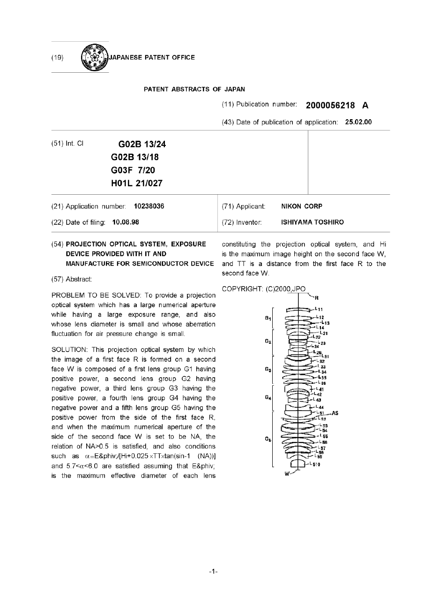
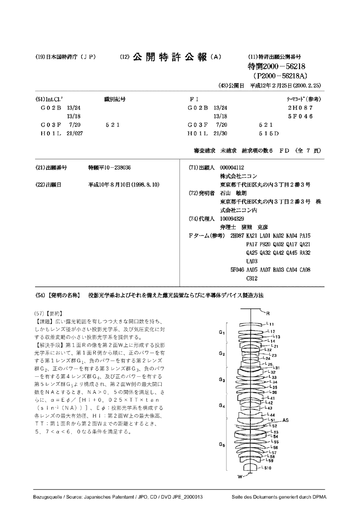
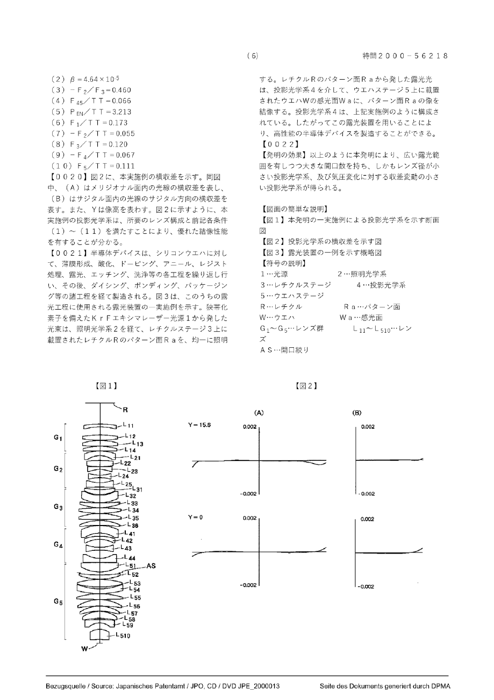
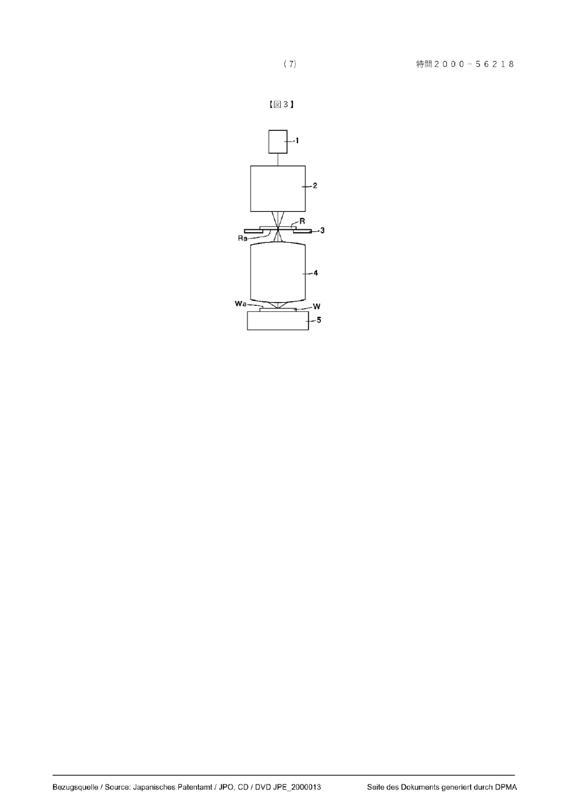

# JP2000056218A · 投影光学系およびそれを備えた露光装置ならびに半導体デバイス製造方法

| 字段 | 记录 |
| --- | --- |
| 申请人／公开日 | 株式会社ニコン（Nikon）／2000-02-25 |
| 来源 | [德国专利商标局 DEPATISnet 原件浏览器](https://depatisnet.dpma.de/DepatisNet/depatisnet?action=pdf&docid=JP002000056218A) · [本版本 PDF](original.pdf) · [日文检索文本](https://patents.google.com/patent/JP2000056218A/ja) |
| 本地 PDF 的来历 | 从 DPMA 公开阅读器按顺序下载各单页 PDF，未改页面内容，合为 8 页。第 1 页是数据库所附英文文摘，第 2 页起为日文公报；下文一律用物理页序。 |
| 文件指纹（合本 SHA-256） | `d9f8f0c00e660d032ff321ce4baaaeb4cb0de28a80084bd598ebd674fc800e7a` |
| 转写 | 2026-11-03，本地 MineU 4.0.12，standard／OCR；覆盖第 1–8 页，纯图页同样保留。内嵌 OCR 图块改为同页的原始扫描图，保留整张图及图号。 |
| 校对范围 | 已核对公开号、页序及报告采用的图和数值；其余为可检索的 OCR 初稿，双栏次序、表格、上下标及日文字形未经逐字校勘，工程输入以原页为准。 |

[中文研究摘录](README.md)

## PDF 第 1 页

[对应原页](original.pdf#page=1)

(11) Publication number: 2000056218 A

(43) Date of publication of application: 25.02.00

| (51) Int. Cl | G02B 13/24G02B 13/18G03F 7/20H01L 21/027 |  |
| --- | --- | --- |

(21) Application number: 10238036

(22) Date of filing: 10.08.98

(54) PROJECTION OPTICAL SYSTEM, EXPOSURE DEVICE PROVIDED WITH IT AND MANUFACTURE FOR SEMICONDUCTOR DEVICE

(57) Abstract:

PROBLEM TO BE SOLVED: To provide a projection optical system which has a large numerical aperture while having a large exposure range, and also whose lens diameter is small and whose aberration fluctuation for air pressure change is small.

SOLUTION: This projection optical system by which the image of a first face R is formed on a second face W is composed of a first lens group G1 having positive power, a second lens group G2 having negative power, a third lens group G3 having the positive power, a fourth lens group G4 having the negative power and a fifth lens group G5 having the positive power from the side of the first face R, and when the maximum numerical aperture of the side of the second face W is set to be NA, the relation of NA>0.5 is satisfied, and also conditions such as  $\alpha\equiv E\&phiv;/[Hi+0.025\times TT\times\tan(\sin-1\quad(NA))]$  and  $5.7<\alpha<6.0$  are satisfied assuming that E&amp;phiv; is the maximum effective diameter of each lens (71) Applicant: NIKON CORP

(72) Inventor: ISHIYAMA TOSHIRO

constituting the projection optical system, and Hi is the maximum image height on the second face W, and TT is a distance from the first face R to the second face W.

COPYRIGHT: (C)2000,JPO

## PDF 第 2 页

[对应原页](original.pdf#page=2)

### (12) 公開特許公報 (A)

(19)日本国特許庁（J P）

(11)特許出願公開番号

特開2000-56218

(P2000-56218A)

(43)公開日 平成12年2月25日(2000.2.25)

<table><tr><td colspan="2">(51)Int.Cl.7</td><td>識別記号</td><td colspan="3">F I</td><td>テーマコート*(参考)</td></tr><tr><td>G 0 2 B</td><td>13/24</td><td></td><td>G 0 2 B</td><td>13/24</td><td></td><td>2 H 0 8 7</td></tr><tr><td></td><td>13/18</td><td></td><td></td><td>13/18</td><td></td><td>5 F 0 4 6</td></tr><tr><td>G 0 3 F</td><td>7/20</td><td>5 2 1</td><td>G 0 3 F</td><td>7/20</td><td>5 2 1</td><td></td></tr><tr><td>H 0 1 L</td><td>21/027</td><td></td><td>H 0 1 L</td><td>21/30</td><td>5 1 5 D</td><td></td></tr></table>

審査請求 未請求 請求項の数6 FD（全7頁）

| (21)出願番号 | 特願平10-238036 | (71)出願人 000004112株式会社ニコン |
| --- | --- | --- |
| (22)出願日 | 平成10年8月10日(1998.8.10) | 東京都千代田区丸の内3丁目2番3号(72)発明者 石山 敏朗東京都千代田区丸の内3丁目2番3号 株式会社ニコン内(74)代理人 100094329弁理士 猪熊 克彦Fターム(参考) 2H087 KA21 LA01 NA02 NA04 PA15PA17 PB20 QA02 QA17 QA21QA25 QA32 QA42 QA45 RA32UA035F046 AA05 AA07 BA03 CA04 CA08CB12 |

(54) 【発明の名称】 投影光学系およびそれを備えた露光装置ならびに半導体デバイス製造方法

### (57)【要約】

【課題】広い露光範囲を有しつつ大きな開口数を持ち、しかもレンズ径が小さい投影光学系、及び気圧変化に対する収差変動の小さい投影光学系を提供する。

【解決手段】第1面Rの像を第2面W上に形成する投影光学系において、第1面R側から順に、正のパワーを有する第1レンズ群 $G_{1}$ 、負のパワーを有する第2レンズ群 $G_{2}$ 、正のパワーを有する第3レンズ群 $G_{3}$ 、負のパワーを有する第4レンズ群 $G_{4}$ 、及び正のパワーを有する第5レンズ群 $G_{5}$ より構成され、第2面W側の最大開口数をNAとするとき、NA＞0.5の関係を満足し、さらに、 $\alpha\equiv E\phi/[Hi+0.025\times TT\times tan(sin^{-1}(NA))]$ 、 $E\phi$ :投影光学系を構成する各レンズの最大有効径、Hi:第2面W上の最大像高、TT:第1面Rから第2面Wまでの距離とするとき、5.7＜α＜6.0なる条件を満足する。

## PDF 第 3 页

[对应原页](original.pdf#page=3)

### 【特許請求の範囲】

【請求項1】第1面の像を第2面上に形成する投影光学系において、

前記第1面側から順に、正のパワーを有する第1レンズ群、負のパワーを有する第2レンズ群、正のパワーを有する第3レンズ群、負のパワーを有する第4レンズ群、及び正のパワーを有する第5レンズ群より構成され、前記第2面側の最大開口数をNAとするとき、NA＞0.5の関係を満足し、さらに、

α ≡ E φ / [H i + 0, 0 2 5 × T T × t a n (s i n -1 (N A)) ]

E φ:投影光学系を構成する各レンズの最大有効径

Hi : 前記第2面上の最大像高

T T:前記第1面から第2面までの距離とするとき、

5. $7 < \alpha < 6$. 0 $\cdots$ (1)

なる条件を満足することを特徴とする投影光学系。

【請求項2】第1面の像を第2面上に形成する投影光学系において、

前記第1面側から順に、正のパワーを有する第1レンズ群、負のパワーを有する第2レンズ群、正のパワーを有する第3レンズ群、負のパワーを有する第4レンズ群、及び正のパワーを有する第5レンズ群より構成され、前記第2面側の最大開口数をNAとするとき、NA＞0.5の関係を満足し、さらに、

$\beta \equiv | (T_{C3h} - T_{C3}) / [Hi \cdot tan(s in ^{-1}(NA))]|$

$T_{C3}$ :投影光学系の3次のコマ収差係数の合計

$T_{C3h}$  : 硝材のまわりの気体の屈折率が1.  $0 \times 10^{-5}$  だけ変化した場合の、投影光学系の3次のコマ収差係数の合計

Hi:前記第2面上の最大像高とするとき、

$\beta < 1, 0 \times 10^{-4} \dots (2)$

なる条件を満足することを特徴とする投影光学系。

【請求項3】前記第1レンズ群は少なくとも2枚の正レンズを含み、前記第2レンズ群は少なくとも3枚の負レンズを含み、前記第3レンズ群は少なくとも3枚の正レンズを含み、前記第4レンズ群は少なくとも3枚の負レンズを含み、前記第5レンズ群は少なくとも5枚の正レンズを含み、

負のパワーを有するメニスカス形状の空気レンズを、前記第1レンズ群に少なくとも1つ、前記第2レンズ群に少なくとも1つ、前記第3レンズ群に少なくとも1つ、及び前記第5レンズ群に少なくとも2つ有し、

空気間隔を隔てて互いに向かい合う1対の凹面を、前記第2レンズ群に少なくとも1組、及び前記第4レンズ群に少なくとも1組有することを特徴とする請求項1又は2記載の投影光学系。

【請求項4】以下の条件を満足することを特徴とする請求項1、2又は3記載の投影光学系。

$0.3 < -F_{2} / F_{3} < 0.6 \dots (3)$

0.  $0\ 2 < F_{45} / T\ T < 0$ . 1 5  $\cdots$  (4)

$P_{EN}/TT>3$  .... (5)

0.  $1\ 0 < F_{1} / T \  T < 0$ . 2 0  $\cdots$  (6)

0. 0 1 < -F₂/T T < 0. 1 0 … (7)

0.  $05 < F_{3} / T T < 0$ . 20  $\cdots$  (8)

0. 0 2 < -F₄/T T < 0. 1 5 … (9)

0.  $0\ 5 < F_{5} / T \ T < 0$ . 2 0  $\cdots$  (1 0)

但し、 $F_{i}$ :前記第 i レンズ群の焦点距離（i = 1～5）

$F_{45}$ :前記第4レンズ群と第5レンズ群との合成の焦点距離

$P_{EN}$ :像面側から光軸に平行な近軸光束を入射させた場合に全光学系によって作られる焦点位置と物体側レンズ第1面との距離である。

【請求項5】狭帯化された紫外域の光源と、該光源からの光によって前記第1面を照明する照明光学系と、請求項1～4のいずれか1項記載の投影光学系とを備えることを特徴とする投影露光装置。

【請求項6】前記第1面に投影原版上のパターン面を配置し、前記第2面に半導体デバイス基板の感光面を配置し、請求項5記載の投影露光装置を用いて前記パターンを前記感光面に転写する工程を含むことを特徴とする半導体デバイスの製造方法。

### 【発明の詳細な説明】

### 【0001】

【発明の属する技術分野】本発明は、マスク上の回路パターンを感光基板上に投影転写するために好適な投影光学系と、この投影光学系を備えた露光装置ならびに半導体デバイスの製造方法に関するものである。

### 【0002】

【発明が解決しようとする課題】従来より、半導体デバイスの製造には投影露光装置が用いられており、同装置に使用される投影光学系としては、物体側、像側の両側が実質的にテレセントリックな光学系が提案されている。半導体デバイスの製造分野では、大量の情報を回路パターンに書き込むために、より広い露光範囲と、より細かいパターンを転写することができる高解像な投影光学系が求められている。このうち後者、すなわち投影光学系の解像力を高めるためには、使用波長を短波長化するか、あるいは像側開口数を大きくする必要がある。しかしながら半導体デバイスの製造分野では、より高解像な投影光学系が常に求められているために、例えばKrFレーザーなどの短波長の光源を用いる露光装置においても、より大きな開口数を有する投影光学系が必要となっている。

【0003】ここで、従来より提案されている開口数が比較的大きい投影光学系では、レンズ径も比較的大きくなっており、したがって小型軽量かつ安価な投影光学系とはいえなかった。また従来より提案されている開口数

## PDF 第 4 页

[对应原页](original.pdf#page=4)

が比較的大きい投影光学系は、使用環境、特に気圧の変化を必ずしも十分に考慮した設計とはいえなかった。そこで本発明は、広い露光範囲を有しつつ大きな開口数を持ち、しかもレンズ径が小さい投影光学系、及び気圧変化に対する収差変動の小さい投影光学系と、これを備えた露光装置ならびに半導体デバイスの製造方法を提供することを課題とする。

【0004】

【課題を解決するための手段】本発明は上述の課題を解決するためになされたものであり、すなわち、第1面の像を第2面上に形成する投影光学系において、第1面側から順に、正のパワーを有する第1レンズ群、負のパワーを有する第2レンズ群、正のパワーを有する第3レンズ群、負のパワーを有する第4レンズ群、及び正のパワーを有する第5レンズ群より構成され、第2面側の最大開口数をNAとするとき、NA＞0.5の関係を満足し、さらに、

$\alpha \equiv E \phi / [H i + 0, 025 \times T T \times t a n (s i n \cdot ^{1}(N A))]$

E φ:投影光学系を構成する各レンズの最大有効径
H i:第2面上の最大像高
T T:第1面から第2面までの距離
とするとき、

5.  $7 < \alpha < 6$ . 0  $\cdots$  (1)

なる条件を満足することを特徴とする投影光学系である。

【0005】本発明はまた、第1面の像を第2面上に形成する投影光学系において、第1面側から順に、正のパワーを有する第1レンズ群、負のパワーを有する第2レンズ群、正のパワーを有する第3レンズ群、負のパワーを有する第4レンズ群、及び正のパワーを有する第5レンズ群より構成され、第2面側の最大開口数をNAとするとき、NA＞0.5の関係を満足し、さらに、

$\beta \equiv | (T_{C3h} - T_{C3}) / [Hi \cdot tan(s in ^{-1}(NA))]|$

$T_{C3}$  : 投影光学系の3次のコマ収差係数の合計
 $T_{C3h}$  : 硝材のまわりの気体の屈折率が1.  $0 \times 10^{-5}$  だけ変化した場合の、投影光学系の3次のコマ収差係数の合計

とするとき、

$\beta < 1$ $0\times 10^{-4}\dots (2)$

なる条件を満足することを特徴とする投影光学系である。

【0006】本発明の投影光学系において、正の屈折力を有する第1レンズ群は、第1面からテレセントリックに出射した光束を開口絞りへと導くために必要な光学系であると同時に、第2、第4、第5レンズ群で発生する負の歪曲収差を補償する働きをする。負の屈折力を有する第2レンズ群は、第4レンズ群とともにペッツバール和を負の方向に補正する働きを持つ。第3レンズ群は、第5レンズ群とともに物体の実像を形成させるための正の屈折力を有している。第4レンズ群は、上述のように負のペッツバール和を発生させるとともに、第3および第5レンズ群によって発生する負の球面収差を補正する働きを持つ。第5レンズ群は上述のように正の屈折力を持ち、第4レンズ群との組み合わせによって大きな開口数の光束を良好な収差状態で結像させている。

【0007】（1）式は、本発明の投影光学系において、十分な光学性能を実現する上で、光軸と垂直方向の必要なスケールファクターを規定するものである。

（1）式の上限を越える場合には、全長に対して、レンズ径が大きくなり、正レンズ群である第1レンズ群、第3レンズ群、あるいは第5レンズ群が大きくなり、他のレンズ群のスペースが小さくなり、結果として収差補正に十分なレンズ配置を実現できなくなり、十分な光学性能を達成できなくなるので好ましくない。逆に下限を越えると、負のパワーのレンズ群に対して、正レンズ群である第1レンズ群、第3レンズ群、あるいは第5レンズ群のパワーが大きくなり、高次の球面収差、コマや歪曲収差が特に悪化し、十分な光学性能を達成できなくなるので好ましくない。

【0008】（2）式は、多少の大気圧変化に対しても光学性能が余り変化しない、いわゆるロバストネス設計を実現するための1つの条件となるものである。具体的には、大気圧変化時のコマの変化が小さいことを意味する。本発明のように、高NA、広フィールドのレンズにおいても3次収差の領域で、（2）式の上限を越えないことが好ましい。また、7.0×10^-5よりも小さいことがさらに望ましい。硝材のまわりの気体の屈折率変化が1.0×10^-5というのは、空気の場合、34.38hpaの変化に相当する。なお、本発明による効果を一層享受するためには、（1）式の場合も（2）式の場合も、NA>0.55であることが好ましい。

【0009】次に、本発明の第1～第5レンズ群は、それぞれ正・負・正・負・正の屈折力を持つが、より具体的なレンズ構成としては、第1レンズ群は少なくとも2枚の正レンズを含み、第2レンズ群は少なくとも3枚の負レンズを含み、第3レンズ群は少なくとも3枚の正レンズを含み、第4レンズ群は少なくとも3枚の負レンズを含み、第5レンズ群は少なくとも5枚の正レンズを含むことが好ましい。また、負のパワーを有するメニスカス形状の空気レンズを、第1レンズ群に少なくとも1つ、第2レンズ群に少なくとも1つ有することが好ましい。この2つの空気レンズによって、高次の歪曲収差を補正することが可能となり、解像力向上にともなう位置ずれ誤差を良好に補正することが可能となる。また、上記空気レンズを、第3レンズ群に少なくとも1つ、さらに第5レンズ群に少なくとも2つ有することが好ましい。これらの空気レンズによって、大きな開口数を達成するときに生じる高次の球面収差を補正することがで

## PDF 第 5 页

[对应原页](original.pdf#page=5)

き、同時に、ペッツパール和の補正とサジタル方向のコマ収差を補正することができる。更に、空気間隔を隔てて互いに向かい合う1対の凹面（すなわち、両凸形状の空気レンズ）を、第2レンズ群に少なくとも1組、及び第4レンズ群に少なくとも1組有することが好ましい。両凸形状の空気レンズは負のパワーを持つから、これによって、より効果的にペッツパール和の補正を行うことが可能となる。

【0010】次に、本発明においては、

$F_{i}$ : 第 i レンズ群の焦点距離 (i = 1 \~ 5)

$F_{45}$  : 第4レンズ群と第5レンズ群との合成の焦点距離
 $P_{EN}$  : レンズ第1面から近軸入射瞳位置までの距離の絶対値

$P_{EX}$  : レンズ最終面から近軸射出瞳位置までの距離の絶対値

とするとき、
0. 3 < -F₂/F₃< 0. 6    …… (3)
0. 02 < F₄₅/TT < 0. 15    …… (4)
PEN/TT > 3        …… (5)
0. 10 < F₁/TT < 0. 20    …… (6)
0. 01 < -F₂/TT < 0. 10    …… (7)
0. 05 < F₃/TT < 0. 20    …… (8)
0. 02 < -F₄/TT < 0. 15    …… (9)
0. 05 < F₅/TT < 0. 20    …… (10)
なる各条件を満たすことが好ましい。

【0011】（3）式は、第2レンズ群と第3レンズ群との屈折力比を示している。第2レンズ群は負のパワーを有し、第3レンズ群は正のパワーを有するから、両レンズ群は、いわゆる逆望遠系の構成となっている。そして（3）式は、縮小投影するために第1面の広い範囲に描かれたパターンを、像面湾曲と歪曲収差の良好に補正された像として結像するための条件となる。（3）式の上限を越えると、相対的に第3レンズ群のパワーが強くなることを意味しており、ペッツバール和が正となりすぎて像面を良好に補正することが難しくなるとともに、正の歪曲収差と外コマが大きく発生してそれらを良好に補正することが難しくなるため好ましくない。逆に下限を越えると、相対的に第2レンズ群の負のパワーが強くなることを意味しており、負の歪曲収差が発生してこれを良好に補正することが難しくなるため好ましくない。
【0012】（4）式は、第1面から第3レンズ群まで導いた光束を大きな開口数で結像するための条件式である。（4）式の上限を越えると、第4レンズ群と第5レンズ群の合成の正のパワーが小さいことを意味しており、全体の系に対する第4、5レンズ群の相対的な寸法が大きくなる。従って、レンズ径が大きくなりコストの増大を招くため好ましくない。逆に下限を越えると、第4、5レンズ群の合成の正のパワーが強くなり、高次の球面収差およびコマ収差が大きく発生して、その修正が困難となるため好ましくない。（5）式は、物体側に実質的にテレセントリックな光学系となるための条件であり、（5）式の下限を越えると、物体側のテレセントリシティーが悪くなってしまうため好ましくない。

【0013】（6）～（10）式は、各レンズ群の適正なパワーを規定した条件式である。先ず、（6）式の上限を越える場合には、第2、第4、第5レンズ群で発生する負の歪曲収差を、第1レンズ群で補正しきれないため好ましくない。逆に下限を越えると、高次の正の歪曲収差の発生する原因となるため好ましくない。（7）式の上限を越える場合には、ペッツバール和の補正が不十分となり、像の平坦性の悪化を招く。逆に下限を越えると、正の歪曲収差の発生が大きくなり、良好な補正が困難となる。

【0014】（8）式の上限を越える場合には、第3レンズ群が第2レンズ群との間で形成する逆望遠系のテレ比が大くなって全系の長大化を招き、第3レンズ群での正の歪曲収差の発生量が小さくなり、第2、第4および第5レンズ群で発生する負の歪曲収差の補正が難しくなるため好ましくない。逆に下限を越えると、高次の球面収差およびコマが発生し、像の悪化を招き好ましくない。（9）式の上限を越える場合には、ペッツバール和の補正が不十分となり、像の平坦性の悪化を招くため好ましくない。逆に下限を越えると、高次の球面収差の発生原因となり、コントラストの悪化を招くため好ましくない。（10）式の上限を越える場合には、全系の長大化およびレンズ径の拡大を招き好ましくない。逆に下限を越えると、高次の球面収差およびコマが発生し、像の悪化を招き好ましくない。

【0015】

【発明の実施の形態】以下に、本発明を図面を参照して詳細に説明する。図1は本発明による投影光学系の一実施例を示し、この投影光学系は、光源としてKrFエキシマレーザーを用い、レチクルRのパターン面（第1面）の像をウエハWの感光面（第2面）上に投影して露光するものである。像側最大開口数NAと最大像高Hiは、

NA = 0.6，Hi = 15.6

である。すべてのレンズは単一の硝材、すなわち合成石英（SiO₂）によって形成されており、レチクルR側から順に、正のパワーを有する第1レンズ群G₁、負のパワーを有する第2レンズ群G₂、正のパワーを有する第3レンズ群G₃、負のパワーを有する第4レンズ群G₄、及び正のパワーを有する第5レンズ群G₅より構成されている。開口絞りASは、第5レンズ群G₅の内部に配置されている。

【0016】第1レンズ群 $G_{1}$ は、レチクル側に凸の負メニスカスレンズ $L_{11}$ 、2枚の両凸レンズ $L_{12}$ 、 $L_{13}$ 、レチクル側に凸の正メニスカスレンズ $L_{14}$ からなる。第2レンズ群 $G_{2}$ は、レチクル側に凸の負メニスカスレンズ $L_{21}$ 、両凸レンズ $L_{22}$ 、3枚の両凹レンズ $L_{23}$ 、

> 校对注：[0015] 的 NA 与 Hi 已按原页补正，保留该实施例的 0.6。

## PDF 第 6 页

[对应原页](original.pdf#page=6)

$L_{24}$ 、 $L_{25}$ からなる。第3レンズ群 $G_{3}$ は、ウエハ側に凸の正メニスカスレンズ $L_{31}$ 、ウエハ側に凸の負メニスカスレンズ $L_{32}$ 、ウエハ側に凸の正メニスカスレンズ $L_{33}$ 、2枚の両凸レンズ $L_{34}$ 、 $L_{35}$ 、レチクル側に凸の正メニスカスレンズ $L_{36}$ からなる。第4レンズ群 $G_{4}$ は、レチクル側に凸の2枚の負メニスカスレンズ $L_{41}$ 、 $L_{42}$ 、2枚の両凹レンズ $L_{43}$ 、 $L_{44}$ からなる。第5レンズ群 $G_{5}$ は、両凸レンズ $L_{51}$ 、ウエハ側に凸の正メニスカスレンズ $L_{52}$ 、両凸レンズ $L_{53}$ 、ウエハ側に凸の負メニスカスレンズ $L_{54}$ 、両凸レンズ $L_{55}$ 、レチクル側に凸の3枚の正メニスカスレンズ $L_{56}$ 、 $L_{57}$ 、 $L_{58}$ 、レチクル側に凸の負メニスカスレンズ $L_{59}$ 、レチクル側に凸の正メニスカスレンズ $L_{510}$ からなる。

【0017】第1レンズ群 $G_{1}$ のレンズ $L_{11}$ と $L_{12}$ の間と、第2レンズ群 $G_{2}$ のレンズ $L_{21}$ と $L_{22}$ の間と、第3レンズ群 $G_{3}$ のレンズ $L_{31}$ と $L_{32}$ の間と、第5レンズ群 $G_{5}$ のレンズ $L_{53}$ と $L_{54}$ の間、レンズ $L_{58}$ と $L_{59}$ の間、及びレンズ $L_{59}$ と $L_{510}$ の間には、それぞれ負のパワーを有するメニスカス形状の空気レンズが形成されている。また、第2レンズ群 $G_{2}$ のレンズ $L_{23}$ と $L_{24}$ の間、及びレンズ $L_{24}$ と $L_{25}$ の間と、第4レンズ群 $G_{4}$ のレンズ $L_{42}$ と $L_{43}$ の間、及びレンズ $L_{43}$ と $L_{44}$ の間には、それぞれ両凸形状の空気レンズが形成されている。

【0018】以下の表1に、本実施例の諸元を示す。同表の「レンズ諸元」中、第1欄NoはレチクルR側からの各レンズ面の番号、第2欄rは各レンズ面の曲率半径、第3欄dは各レンズ面から次のレンズ面までの光軸上の距離、第4欄は各レンズ面から次のレンズ面までを満たすレンズ（空欄は空気）の番号を表わす。すべてのレンズの硝材は合成石英（SiO₂）であり、使用波長（248nm）での合成石英の屈折率nは、

n = 1.50839

である。また同表の「条件式対応値」に、前記各条件式（1）～（10）中のパラメータの値を示す。

【0019】 【表1】［レンズ諸元］

| No | r | d | 記号 |
| ---: | ---: | ---: | --- |
| 0 | ∞ | 94.501 | R |
| 1 | 438.073 | 14.953 | L11 |
| 2 | 290.853 | 40.476 |  |
| 3 | 515.350 | 27.925 | L12 |
| 4 | -533.779 | 1.000 |  |
| 5 | 305.875 | 27.353 | L13 |
| 6 | -2348.928 | 1.000 |  |
| 7 | 291.146 | 23.686 | L14 |
| 8 | 5262.567 | 1.000 |  |
| 9 | 230.426 | 23.306 | L21 |
| 10 | 112.011 | 23.631 |  |
| 11 | 551.356 | 31.189 | L22 |
| 12 | -374.157 | 1.000 |  |
| 13 | -1904.480 | 13.000 | L23 |
| 14 | 143.197 | 28.445 |  |
| 15 | -193.810 | 13.146 | L24 |
| 16 | 213.435 | 25.837 |  |
| 17 | -148.749 | 22.250 | L25 |
| 18 | 1930.957 | 12.771 |  |
| 19 | -329.954 | 25.363 | L31 |
| 20 | -160.613 | 4.353 |  |
| 21 | -148.096 | 36.175 | L32 |
| 22 | -200.524 | 1.000 |  |
| 23 | -1144.407 | 24.036 | L33 |
| 24 | -277.849 | 1.000 |  |
| 25 | 913.713 | 27.552 | L34 |
| 26 | -479.834 | 1.000 |  |
| 27 | 317.375 | 30.233 | L35 |
| 28 | -2536.708 | 4.954 |  |
| 29 | 253.380 | 23.626 | L36 |
| 30 | 733.176 | 1.611 |  |
| 31 | 200.343 | 38.616 | L41 |
| 32 | 135.503 | 16.352 |  |
| 33 | 256.300 | 15.507 | L42 |
| 34 | 141.036 | 39.855 |  |
| 35 | -205.055 | 14.048 | L43 |
| 36 | 277.857 | 41.804 |  |
| 37 | -131.839 | 20.061 | L44 |
| 38 | 15879.623 | 2.553 |  |
| 39 | 4924.264 | 44.809 | L51 |
| 40 | -189.817 | 4.227 |  |
| 41 | − | 10.507 | AS |
| 42 | -724.632 | 21.780 | L52 |
| 43 | -284.121 | 1.000 |  |
| 44 | 396.251 | 38.791 | L53 |
| 45 | -415.739 | 9.179 |  |
| 46 | -284.360 | 23.359 | L54 |
| 47 | -429.489 | 1.000 |  |
| 48 | 376.707 | 28.828 | L55 |
| 49 | -2838.854 | 1.000 |  |
| 50 | 210.569 | 31.094 | L56 |
| 51 | 638.916 | 1.000 |  |
| 52 | 176.158 | 25.161 | L57 |
| 53 | 297.003 | 1.000 |  |
| 54 | 139.276 | 35.532 | L58 |
| 55 | 341.229 | 7.148 |  |
| 56 | 799.317 | 16.377 | L59 |
| 57 | 80.997 | 31.519 |  |
| 58 | 85.368 | 51.298 | L510 |
| 59 | 718.626 | 19.200 |  |
| 60 | ∞ | — | W |

［条件式対応値］ (1) α = 5.964

> 校对注：按原页补回折射率 n，表 1 跨栏接续为面 0–60；依据日文原页，面 41 为光阑，面 59 后至晶圆为 19.200。

## PDF 第 7 页

[对应原页](original.pdf#page=7)

(2) $\beta = 4.64 \times 10^{-5}$

(3) $-F_{2} / F_{3} = 0.460$

(4) $F_{45} / T T = 0.066$

(5) $P_{EN} / T T = 3.213$

(6) $F_{1} / T T = 0.173$

(7) $-F_{2} / T T = 0.055$

(8) $F_{3} / T T = 0.120$

(9) $-F_{4} / T T = 0.067$

(10) $F_{5} / T T = 0.111$

【0020】図2に、本実施例の横収差を示す。同図中、（A）はメリジオナル面内の光線の横収差を表し、（B）はサジタル面内の光線のサジタル方向の横収差を表す。また、Yは像高を表わす。図2に示すように、本実施例の投影光学系は、所要のレンズ構成と前記各条件（1）～（11）を満たすことにより、優れた結像性能を有することが分かる。

【0021】半導体デバイスは、シリコンウエハに対して、薄膜形成、酸化、ドーピング、アニール、レジスト処理、露光、エッチング、洗浄等の各工程を繰り返し行い、その後、ダイシング、ボンディング、パッケージング等の諸工程を経て製造される。図3は、このうちの露光工程に使用される露光装置の一実施例を示す。狭帯化素子を備えたKrFエキシマレーザー光源1から発した光束は、照明光学系2を経て、レチクルステージ3上に載置されたレチクルRのパターン面Raを、均一に照明する。レチクルRのパターン面Raから発した露光光は、投影光学系4を介して、ウエハステージ5上に載置されたウエハWの感光面Waに、パターン面Raの像を結像する。投影光学系4は、上記実施例のように構成されている。したがってこの露光装置を用いることにより、高性能の半導体デバイスを製造することができる。
【0022】

【発明の効果】以上のように本発明により、広い露光範囲を有しつつ大きな開口数を持ち、しかもレンズ径が小さい投影光学系、及び気圧変化に対する収差変動の小さい投影光学系が得られる。

### 【図面の簡単な説明】

【図1】本発明の一実施例による投影光学系を示す断面図

【図2】投影光学系の横収差を示す図

### 【符号の説明】

1…光源 2…照明光学系
3…レチクルステージ 4…投影光学系
5…ウェハステージ
R…レチクル R a…パターン面
W…ウェハ Wa…感光面
G₁～G₅…レンズ群 L₁₁～L₅₁₀…レンズ
A S…開口絞り

【図1】

【図2】

(B)

## PDF 第 8 页

[对应原页](original.pdf#page=8)

【図3】

