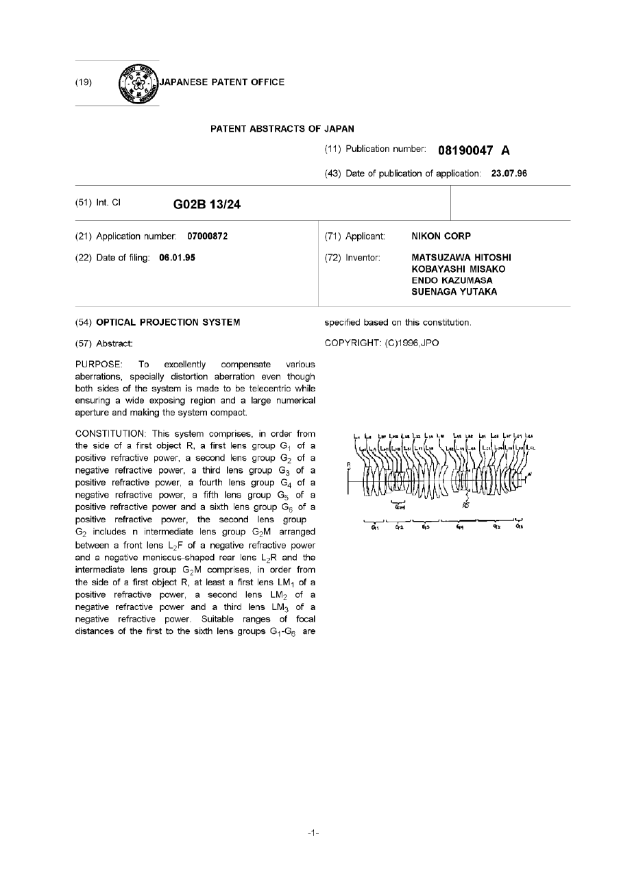
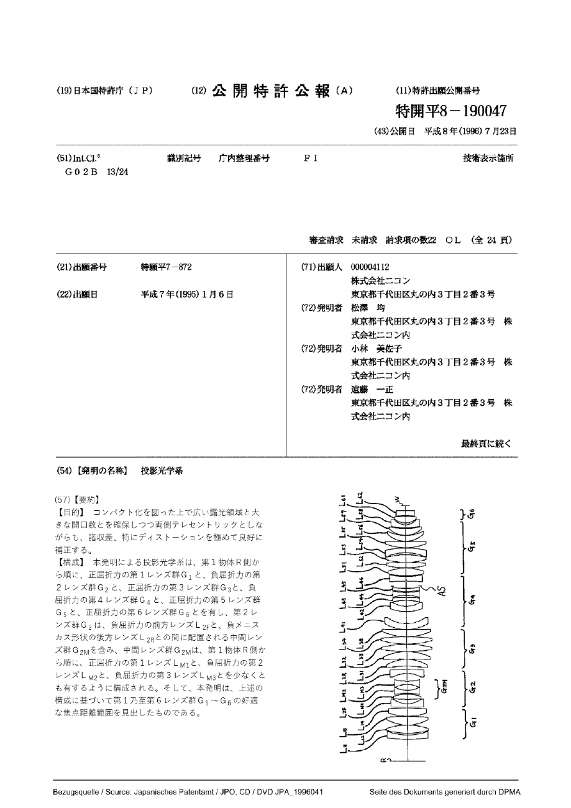
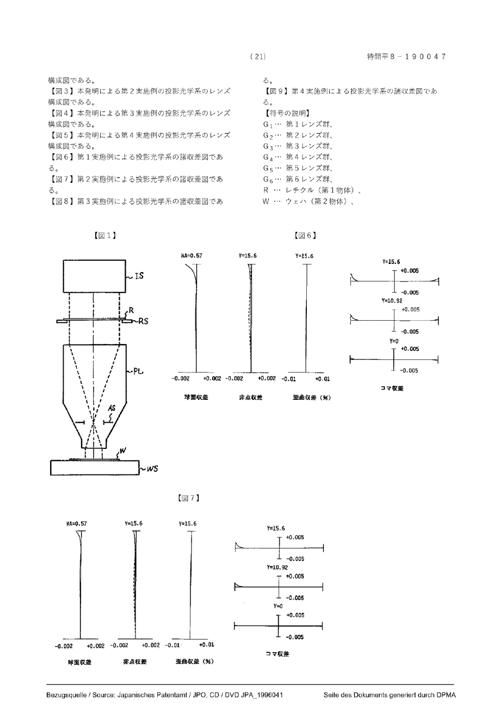
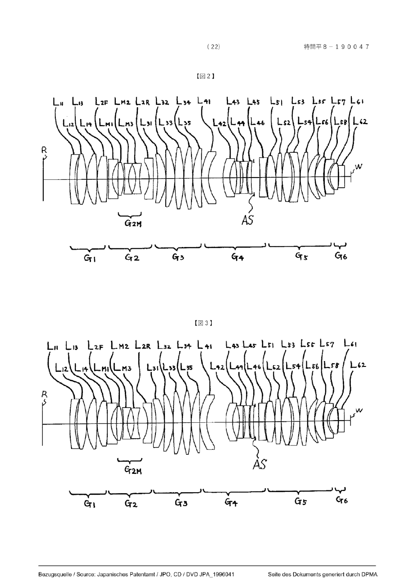
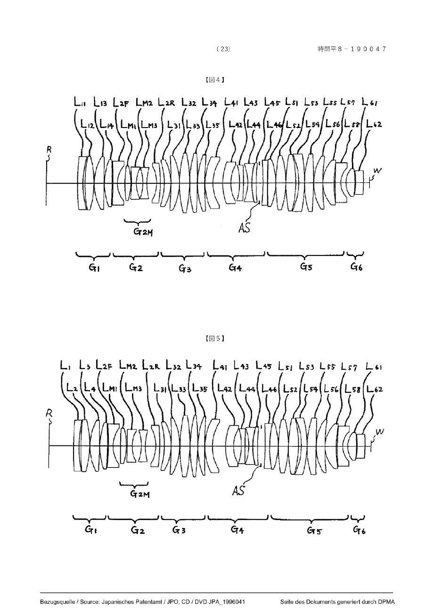
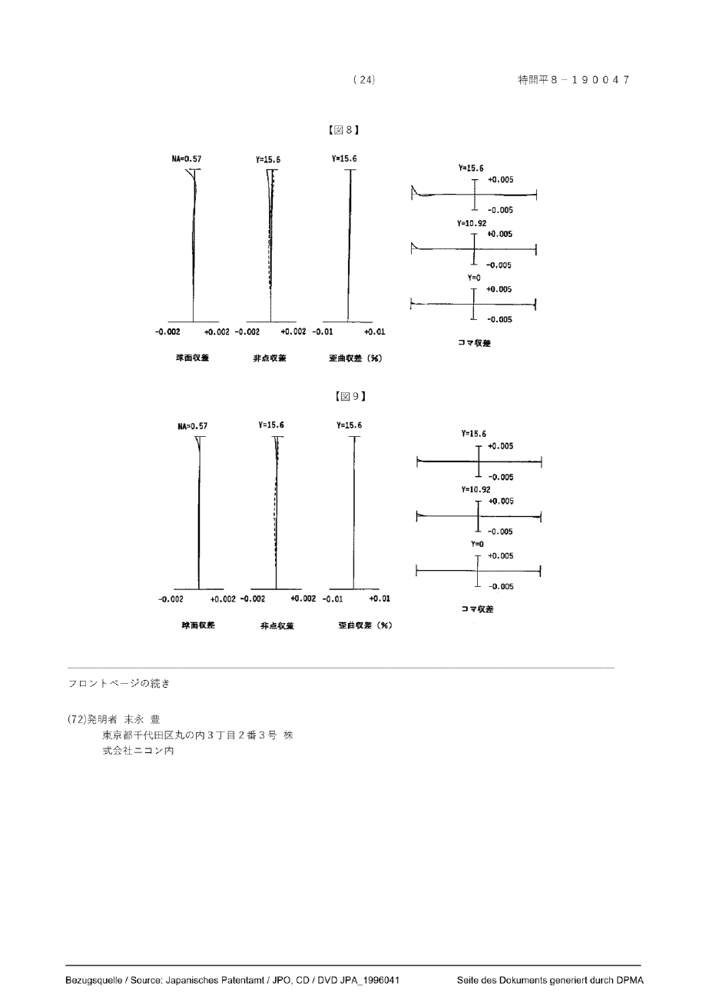

# JPH08190047A · 投影光学系

| 字段 | 记录 |
| --- | --- |
| 申请人／公开日 | 株式会社ニコン（Nikon）／1996-07-23 |
| 来源 | [德国专利商标局 DEPATISnet 原件浏览器](https://depatisnet.dpma.de/DepatisNet/depatisnet?action=pdf&docid=JP000H08190047A) · [本版本 PDF](original.pdf) · [日文检索文本](https://patents.google.com/patent/JPH08190047A/ja) |
| 本地 PDF 的来历 | 从 DPMA 公开阅读器按顺序下载各单页 PDF，未改页面内容，合为 25 页。第 1 页是数据库所附英文文摘，第 2 页起为日文公报；下文一律用物理页序。 |
| 文件指纹（合本 SHA-256） | `b12c2bcc304a71499f7807dbba649efe8a85d926bd403f8155c47ce7f47c9757` |
| 转写 | 2026-11-03，本地 MineU 4.0.12，standard／OCR；覆盖第 1–25 页，纯图页同样保留。内嵌 OCR 图块改为同页的原始扫描图，保留整张图及图号。 |
| 校对范围 | 已核对公开号、页序及报告采用的图和数值；其余为可检索的 OCR 初稿，双栏次序、表格、上下标及日文字形未经逐字校勘，工程输入以原页为准。 |

[中文研究摘录](README.md)

## PDF 第 1 页

[对应原页](original.pdf#page=1)

(11) Publication number: 08190047 A

(43) Date of publication of application: 23.07.96

<table><tr><td colspan="2">(51) Int. CI G02B 13/24</td><td></td></tr><tr><td>(21) Application number: 07000872(22) Date of filing: 06.01.95</td><td colspan="2">(71) Applicant: NIKON CORP(72) Inventor: MATSUZAWA HITOSHI KOBAYASHI MISAKO ENDO KAZUMASA SUENAGA YUTAKA</td></tr></table>

(54) OPTICAL PROJECTION SYSTEM

specified based on this constitution.

### (57) Abstract:

PURPOSE: To excellently compensate various aberrations, specially distortion aberration even though both sides of the system is made to be telecentric while ensuring a wide exposing region and a large numerical aperture and making the system compact.

COPYRIGHT: (C)1996,JPO

CONSTITUTION: This system comprises, in order from the side of a first object R, a first lens group  $G_{1}$  of a positive refractive power, a second lens group  $G_{2}$  of a negative refractive power, a third lens group  $G_{3}$  of a positive refractive power, a fourth lens group  $G_{4}$  of a negative refractive power, a fifth lens group  $G_{5}$  of a positive refractive power and a sixth lens group  $G_{6}$  of a positive refractive power, the second lens group  $G_{2}$  includes n intermediate lens group  $G_{2}M$  arranged between a front lens  $L_{2}F$  of a negative refractive power and a negative meniscus-shaped rear lens  $L_{2}R$  and the intermediate lens group  $G_{2}M$  comprises, in order from the side of a first object R, at least a first lens  $LM_{1}$  of a positive refractive power, a second lens  $LM_{2}$  of a negative refractive power and a third lens  $LM_{3}$  of a negative refractive power. Suitable ranges of focal distances of the first to the sixth lens groups  $G_{1}-G_{6}$  are

## PDF 第 2 页

[对应原页](original.pdf#page=2)

### (12) 公開特許公報 (A)

(19)日本国特許庁（J P）

(11)特許出願公開番号

特開平8-190047

(43)公開日 平成8年(1996)7月23日

| (51)Int.Cl.$^{6}$G 0 2 B 13/24 | 識別記号 | 庁内整理番号 | F I | 技術表示箇所 |
| --- | --- | --- | --- | --- |

審査請求 未請求 請求項の数22 OL (全24頁)

<table><tr><td>(21)出願番号</td><td>特願平7-872</td><td>(71)出願人 000004112株式会社ニコン</td></tr><tr><td rowspan="4">(22)出願日</td><td rowspan="4">平成7年(1995)1月6日</td><td>東京都千代田区丸の内3丁目2番3号</td></tr><tr><td>(72)発明者 松澤 均東京都千代田区丸の内3丁目2番3号 株式会社ニコン内</td></tr><tr><td>(72)発明者 小林 美佐子東京都千代田区丸の内3丁目2番3号 株式会社ニコン内</td></tr><tr><td>(72)発明者 遠藤 一正東京都千代田区丸の内3丁目2番3号 株式会社ニコン内</td></tr><tr><td colspan="2"></td><td>最終頁に続く</td></tr></table>

### (54)【発明の名称】 投影光学系

### (57)【要約】

【目的】コンパクト化を図った上で広い露光領域と大きな開口数とを確保しつつ両側テレセントリックとしながらも、諸収差、特にディストーションを極めて良好に補正する。

【構成】本発明による投影光学系は、第1物体R側から順に、正屈折力の第1レンズ群 $G_{1}$ と、負屈折力の第2レンズ群 $G_{2}$ と、正屈折力の第3レンズ群 $G_{3}$ と、負屈折力の第4レンズ群 $G_{4}$ と、正屈折力の第5レンズ群 $G_{5}$ と、正屈折力の第6レンズ群 $G_{6}$ とを有し、第2レンズ群 $G_{2}$ は、負屈折力の前方レンズ $L_{2F}$ と、負メニスカス形状の後方レンズ $L_{2R}$ との間に配置される中間レンズ群 $G_{2M}$ を含み、中間レンズ群 $G_{2M}$ は、第1物体R側から順に、正屈折力の第1レンズ $L_{M1}$ と、負屈折力の第2レンズ $L_{M2}$ と、負屈折力の第3レンズ $L_{M3}$ とを少なくとも有するように構成される。そして、本発明は、上述の構成に基づいて第1乃至第6レンズ群 $G_{1}$ ～ $G_{6}$ の好適な焦点距離範囲を見出したものである。

## PDF 第 3 页

[对应原页](original.pdf#page=3)

### 【特許請求の範囲】

【請求項1】第1物体の像を第2物体上に投影する投影光学系において、

前記投影光学系は、前記第1物体側から順に、正の屈折力を持つ第1レンズ群と、負の屈折力を持つ第2レンズ群と、正の屈折力を持つ第3レンズ群と、負の屈折力を持つ第4レンズ群と、正の屈折力を持つ第5レンズ群と、正の屈折力を持つ第6レンズ群とを有し、

前記第2レンズ群は、最も前記第1物体側に配置されて前記第2物体側に凹面を向けた負屈折力の前方レンズと、最も前記第2物体側に配置されて前記第1物体側に凹面を向けた負メニスカス形状の後方レンズとの間に配置される中間レンズ群を含み、

前記中間レンズ群は、前記第1物体側から順に、正の屈折力を持つ第1レンズと、負の屈折力を持つ第2レンズと、負の屈折力を持つ第3レンズとを少なくとも有し、前記第1レンズ群の焦点距離を $f_{1}$ とし、前記第2レンズ群の焦点距離を $f_{2}$ とし、前記第3レンズ群の焦点距離を $f_{3}$ とし、前記第4レンズ群の焦点距離を $f_{4}$ とし、前記第5レンズ群の焦点距離を $f_{5}$ とし、前記第6レンズ群の焦点距離を $f_{6}$ とし、前記第1物体から前記第2物体までの距離をLとするとき、以下の条件を満足することを特徴とする投影光学系。

$$
f _ {1} / L <   0. 8\tag{1}
$$

(2) -0. 033 < f₂/L

(3) 0. $01 <   f_{3} / L <   1$ .0

$$
f _ {4} / L <   - 0. \quad 0 0 5
$$

(5) 0. 01 < f₅ / L < 0. 9

(6) $0, 02 < f_{6} / L < 1, 6$

【請求項2】前記第1物体から前記投影光学系全体の第1物体側焦点までの軸上距離を1とし、前記第1物体から前記第2物体までの距離をLとするとき、以下の条件を満足することを特徴とする請求項1記載の投影光学系。

(7) 1. $0 < 1 / L$

【請求項3】前記第4レンズ群は、最も第1物体側に配置される前方レンズ群と、最も第2物体側に配置される後方レンズ群とを有し、

前記第4レンズ群中の前記前方レンズ群と前記第4レンズ群中の前記後方レンズ群との間には、前記第1物体側から順に、第1及び第2の負レンズを有する中間レンズ群が配置され、

前記前方レンズ群は、前記第2物体側に凹面を向けた2枚の負メニスカスレンズを有し、

前記後方レンズ群は、前記第1物体側に凹面を向けた負レンズを有し、

前記第4レンズ群中の前記第1の負レンズの焦点距離を $f_{4A}$ とし、前記第4レンズ群中の前記第2の負レンズの焦点距離を $f_{4B}$ とするとき、以下の条件を満足することを特徴とする請求項1または請求項2記載の投影光学系。

(8) 0. $05 <   f_{4A} / f_{4B} <   20$

【請求項4】前記第2レンズ群中の前方レンズは、前記前方レンズの第1物体側の面の曲率半径を $r_{2Ff}$ とし、前記前方レンズの第2物体側の面の曲率半径を $r_{2Fr}$ とするとき、以下の条件を満足することを特徴とする請求項1乃至請求項3の何れか一項記載の投影光学系。

$$
(9) \quad 1. 0 0 \leq \left(r _ {2 F f} - r _ {2 F r}\right) / \left(r _ {2 F f} + r _ {2 F r}\right) <   5. 0
$$

【請求項5】前記第4レンズ群は、最も前記第1物体側に配置されて前記第2物体側に凹面を向けた負レンズを有する前方レンズ群と、最も第2物体側に配置されて前記第1物体側に凹面を向けた負レンズを有する後方レンズ群とを有し、

前記第4レンズ群中の前記前方レンズ群と前記第4レン

の条件を満足することを特徴とする請求項1乃至請求項4の何れか一項記載の投影光学系。ただし、前記第1物体から前記第2物体までの距離をLとするとき、前記中間レンズ群中の前記負レンズの前記凹面または前記中間レンズ群中の前記正レンズの前記凸面は、

ズ群中の前記後方レンズ群との間には、負レンズと、この負レンズの凹面に隣接する凸面を持つ正レンズとを有する中間レンズ群が配置され、

$$
\mid r _ {4 N} / L \mid <   2. 0\tag{10}
$$

$$
- 0. 9 <   \left(\mathrm{r} _ {4 \mathrm{N}} - \mathrm{r} _ {4 \mathrm{P}}\right) / \left(\mathrm{r} _ {4 \mathrm{N}} + \mathrm{r} _ {4 \mathrm{P}}\right) <   0. 9
$$

$$
\mid r _ {4 P} / L \mid <   2. 0\tag{1 1}
$$

(1 2)

前記中間レンズ群中の負レンズの前記凹面の曲率半径を  $r_{4N}$  とし、前記中間レンズ群中の正レンズの前記凸面の曲率半径を  $r_{4P}$  とするとき、

(14)

の条件の少なくとも一方を満足するように構成される。
【請求項6】前記第2レンズ群中の負の屈折力を持つ第2レンズの焦点距離を $f_{22}$ とし、前記第2レンズ群中の負の屈折力を持つ第3レンズの焦点距離を $f_{23}$ とするとき、以下の条件を満足することを特徴とする請求項1乃

$$
0 <   \left(r _ {5 p} - r _ {5 n}\right) / \left(r _ {5 p} + r _ {5 n}\right) <   1
$$

至請求項5の何れか一項記載の投影光学系。

$$
1 <   \mathrm{f} _ {2 2} / \mathrm{f} _ {2 3} <   1 0
$$

【請求項7】前記第5レンズ群は、負メニスカスレンズと、該負メニスカスレンズの凹面と隣接して配置されかつ該負メニスカスレンズの凹面と対向する凸面を持つ正レンズとを有し、前記第5レンズ群中の前記負メニスカスレンズにおける凹面の曲率半径 $r_{5n}$ とし、前記第5レンズ群中の前記負メニスカスレンズの凹面に隣接して配置された正レンズにおける負メニスカスレンズの凹面と対向する凸面の曲率半径 $r_{5p}$ とするとき、以下の条件を満足することを特徴とする請求項1乃至請求項6の何れか一項記載の投影光学系。

## PDF 第 4 页

[对应原页](original.pdf#page=4)

【請求項8】前記第5レンズ群中の少なくとも1枚の正レンズと、前記第5レンズ群中の少なくとも1枚の正レンズとの間には、前記負メニスカスレンズと前記負メニスカスレンズの凹面に隣接する前記正レンズとが配置されることを特徴とする請求項7記載の投影光学系。

【請求項9】前記第5レンズ群は、最も第2物体側に配置されて第2物体側に凹面を向けた負レンズを有し、第6レンズ群は、最も第1物体側に配置されて第1物体側に凸面を向けたレンズを有し、

前記第5レンズ群の最も第2物体側に配置される負レンズの第2物体側の曲率半径を $r_{5R}$ とし、前記第6レンズ群の最も第1物体側に配置されるレンズの第1物体側の曲率半径を $r_{6F}$ とするとき、以下の条件を満足することを特徴とする請求項1乃至請求項8の何れか一項記載の投影光学系。

$$
(1 5) - 0. 9 0 <   \left(\mathrm{r} _ {5 \mathrm{R}} - \mathrm{r} _ {6 \mathrm{F}}\right) / \left(\mathrm{r} _ {5 \mathrm{R}} + \mathrm{r} _ {6 \mathrm{F}}\right) <   - 0. 0 0 1
$$

【請求項10】前記第5レンズ群と前記第6レンズ群との間のレンズ群間隔を $d_{56}$ とし、前記第1物体と前記第2物体までの距離をLとするとき、以下の条件を満足することを特徴とする請求項1乃至請求項9の何れか一項記載の投影光学系。

$$
\mathrm{d} _ {5 6} / \mathrm{L} <   0. 0 1 7 \tag {16}
$$

【請求項11】前記第6レンズ群の最も第1物体側のレンズ面の曲率半径を $r_{6F}$ とし、第6レンズ群の最も第1物体側のレンズ面から第2物体までの軸上距離を $d_{6}$ とするとき、以下の条件を満足することを特徴とする請求項1乃至請求項10の何れか一項記載の投影光学系。

(17) 0. $50 <   \mathrm{d}_6 / r_{6F} <   1.$ 50

【請求項12】前記第5レンズ群は、最も第2物体側に配置されて第2物体側に凹面を向けた負レンズを有し、前記第5レンズ群中の最も第2物体側に設けられた負レンズにおける第1物体側の曲率半径を $r_{5F}$ 、前記第5レンズ群中の最も第2物体側に設けられた負レンズにおける第2物体側の曲率半径を $r_{5R}$ とするとき、以下の条件を満足することを特徴とする請求項1乃至請求項11の何れか一項記載の投影光学系。

$$
(1 8) \quad 0. 3 0 <   \left(r _ {5 F} - r _ {5 R}\right) / \left(r _ {5 F} + r _ {5 R}\right) <   1. 2 8
$$

【請求項13】前記第2レンズ群中の中間レンズ群における正の屈折力の第1レンズの焦点距離を $f_{21}$ とし、前記第1物体から前記第2物体までの距離をLとするとき、以下の条件を満足することを特徴とする請求項1乃至請求項12の何れか一項記載の投影光学系。

$$
(1 9) \quad 0. 2 3 0 <   f _ {2 1} / L <   0. 4 0
$$

【請求項14】前記第2レンズ群中の最も第1物体側に配置されて前記第2物体側に凹面を向けた負の屈折力を持つ前方レンズの焦点距離を $f_{2F}$ 、前記第2レンズ群中の最も第2物体側に配置されて前記第1物体側に凹面を向けた負の屈折力を持つ後方レンズの焦点距離を $f_{2R}$ とするとき、以下の条件を満足することを特徴とする請求項1乃至13の何れか一項記載の投影光学系。

$$
0 \leq f _ {2 F} / f _ {2 R} <   1 8\tag{20}
$$

【請求項15】前記第2レンズ群中の中間レンズ群は、負の屈折力を持つことを特徴とする請求項1乃至14の何れか一項記載の投影光学系。

【請求項16】前記第1レンズ群は、少なくとも2枚の正レンズを有し、前記第3レンズ群は、少なくとも3枚の正レンズを有し、前記第4レンズ群は、少なくとも3枚の負レンズを有し、前記第5レンズ群は、少なくとも5枚の正レンズ及び少なくとも1枚の負レンズとを有し、前記第6レンズ群は、少なくとも1枚の正レンズを有することを特徴とする請求項1乃至請求項15の何れか一項記載の投影光学系。

$$
1 / | \phi L | <   2 0
$$

【請求項17】前記第6レンズ群は、以下の条件を満足するレンズ面を少なくとも一面有する3枚以下のレンズからなることを特徴とする請求項1乃至請求項16の何れか一項記載の投影光学系。

(2 1)

但し、 $\phi$ :前記レンズ面の屈折力、

L:前記第1物体と前記第2物体までの物像間距離、である。

【請求項18】前記投影光学系のレンズ面の曲率半径をrとし、前記投影光学系のレンズ面間隔をdとし、屈折率をnとするとき、以下の諸元を満足することを特徴とする請求項1乃至17の何れか一項記載の投影光学系。

## PDF 第 5 页

[对应原页](original.pdf#page=5)

|  | r | d | n |
| --- | --- | --- | --- |
| 1 | 758.59372 | 18.01962 | 1.66638 |
| 2 | 273.07409 | 8.00000 |  |
| 3 | 407.25600 | 34.43806 | 1.53627 |
| 4 | -305.98082 | 0.50000 |  |
| 5 | 200.00000 | 36.31512 | 1.53627 |
| 6 | -950.89920 | 0.50000 |  |
| 7 | 251.35670 | 36.00000 | 1.53627 |
| 8 | -1111.20100 | 5.00000 |  |
| 9 | -3000.00000 | 13.00000 | 1.66638 |
| 10 | 103.53326 | 19.34714 |  |
| 11 | 583.43731 | 21.86239 | 1.53627 |
| 12 | -202.73262 | 3.71513 |  |
| 13 | -389.07550 | 13.00000 | 1.53627 |
| 14 | 118.39346 | 25.82991 |  |
| 15 | -119.29984 | 13.00000 | 1.53627 |
| 16 | 228.68065 | 35.35939 |  |
| 17 | -118.78231 | 15.61439 | 1.53627 |
| 18 | -2000.00000 | 15.00000 |  |
| 19 | -534.21970 | 30.58806 | 1.53627 |
| 20 | -172.96367 | 0.50000 |  |
| 21 | -3045.95900 | 30.55054 | 1.53627 |
| 22 | -252.31005 | 0.50000 |  |
| 23 | 787.95642 | 31.33960 | 1.53627 |
| 24 | -470.11486 | 0.50000 |  |
| 25 | 429.05519 | 31.10739 | 1.53627 |
| 26 | -1033.56100 | 0.50000 |  |
| 27 | 276.54228 | 29.82671 | 1.53627 |
| 28 | 3383.80700 | 0.50000 |  |
| 29 | 200.56082 | 25.00000 | 1.53627 |
| 30 | 149.82206 | 51.17799 |  |
| 31 | 191.38232 | 25.00000 | 1.53627 |
| 32 | 122.34204 | 25.15581 |  |
| 33 | -276.65501 | 13.00000 | 1.66638 |
| 34 | -597.90043 | 9.14516 |  |
| 35 | -190.18194 | 13.00000 | 1.66638 |
| 36 | 360.79756 | 3.75310 |  |
| 37 | 434.45763 | 13.00000 | 1.53627 |
| 38 | 643.56408 | 31.17056 |  |
| 39 | -951.39487 | 20.00000 | 1.66638 |
| 40 | 360.75541 | 3.46004 |  |
| 41 | 395.41239 | 33.29191 | 1.53627 |
| 42 | -229.24043 | 0.50000 |  |
| 43 | 405.02177 | 21.76952 | 1.53627 |
| 44 | -1456.27300 | 0.50000 |  |

(4)

| 45 | 334.62149 | 34.87065 | 1.53627 |
| --- | --- | --- | --- |
| 46 | -316.02886 | 8.19653 |  |
| 47 | -226.66975 | 20.00000 | 1.66638 |
| 48 | -421.19119 | 0.50000 |  |
| 49 | 245.00959 | 27.62592 | 1.53627 |
| 50 | -6478.64400 | 0.50000 |  |
| 51 | 118.64887 | 24.82664 | 1.53627 |
| 52 | 182.84804 | 0.50000 |  |
| 53 | 106.97354 | 29.80517 | 1.53627 |
| 54 | 305.86346 | 2.86446 |  |
| 55 | 330.12685 | 13.00000 | 1.66638 |
| 56 | 65.69252 | 7.67289 |  |
| 57 | 76.63392 | 29.80077 | 1.53627 |
| 58 | -405.45793 | 2.41289 |  |
| 59 | -314.04117 | 20.42250 | 1.53627 |
| 60 | 1180.34000 |  |  |

【請求項19】前記投影光学系のレンズ面の曲率半径をrとし、前記投影光学系のレンズ面間隔をdとし、屈折率をnとするとき、以下の諸元を満足することを特徴とする請求項1乃至17の何れか一項記載の投影光学系。

> [待核对：PDF 第 5 页，密集处方表中未引用的面序、半径正负号和末位小数未逐项人工校勘。]

## PDF 第 6 页

[对应原页](original.pdf#page=6)

|  | r | d | n |
| --- | --- | --- | --- |
| 1 | 715.79825 | 18.01962 | 1.66638 |
| 2 | 257.11993 | 8.00000 |  |
| 3 | 402.81202 | 34.43806 | 1.53627 |
| 4 | -298.91362 | 0.50000 |  |
| 5 | 200.00000 | 36.31512 | 1.53627 |
| 6 | -811.20841 | 0.50000 |  |
| 7 | 202.30081 | 36.00000 | 1.53627 |
| 8 | -912.77876 | -0.24598 |  |
| 9 | -3000.00000 | 13.00000 | 1.66638 |
| 10 | 100.16757 | 19.34714 |  |
| 11 | 515.50992 | 21.86239 | 1.53627 |
| 12 | -211.08983 | 3.71513 |  |
| 13 | -334.85048 | 13.00000 | 1.53627 |
| 14 | 119.28367 | 24.34073 |  |
| 15 | -124.53825 | 13.00000 | 1.53627 |
| 16 | 196.56654 | 35.64064 |  |
| 17 | -122.83913 | 15.61439 | 1.53627 |
| 18 | -2000.00000 | 15.00000 |  |
| 19 | -319.01403 | 30.58806 | 1.53627 |
| 20 | -192.95790 | 0.50000 |  |
| 21 | -1320.53000 | 30.55054 | 1.53627 |
| 22 | -229.09627 | 0.50000 |  |
| 23 | 1670.41600 | 31.33960 | 1.53627 |
| 24 | -355.67749 | 0.50000 |  |
| 25 | 505.94351 | 31.10739 | 1.53627 |
| 26 | -669.94239 | 0.50000 |  |
| 27 | 272.78755 | 29.82671 | 1.53627 |
| 28 | -11188.96200 | 0.50000 |  |
| 29 | 205.32433 | 25.00000 | 1.53627 |
| 30 | 156.91075 | 68.35861 |  |
| 31 | 170.81860 | 25.00000 | 1.53627 |
| 32 | 119.41166 | 25.17539 |  |
| 33 | -221.51521 | 13.00000 | 1.66638 |
| 34 | 3749.27900 | 7.91441 |  |
| 35 | -299.53056 | 13.00000 | 1.66638 |
| 36 | 360.79756 | 3.75310 |  |
| 37 | 434.45763 | 13.00000 | 1.53627 |
| 38 | 643.56408 | 18.53967 |  |
| 39 | -6417.33300 | 20.00000 | 1.66638 |
| 40 | 300.16308 | 3.46004 |  |
| 41 | 329.77719 | 33.29191 | 1.53627 |
| 42 | -264.12523 | 0.50000 |  |
| 43 | 804.85248 | 21.76952 | 1.53627 |
| 44 | -784.29788 | 0.50000 |  |

(5)

| 45 | 273.73159 | 34.87065 | 1.53627 |
| --- | --- | --- | --- |
| 46 | -325.58814 | 8.19653 |  |
| 47 | -214.52517 | 20.00000 | 1.66638 |
| 48 | -405.91293 | 0.50000 |  |
| 49 | 396.09997 | 27.62592 | 1.53627 |
| 50 | -579.80514 | 0.50000 |  |
| 51 | 115.71351 | 24.82664 | 1.53627 |
| 52 | 255.34580 | 0.50000 |  |
| 53 | 104.86226 | 29.80517 | 1.53627 |
| 54 | 211.50003 | 2.86446 |  |
| 55 | 312.25500 | 13.00000 | 1.66638 |
| 56 | 66.11566 | 7.67289 |  |
| 57 | 76.78058 | 29.80077 | 1.53627 |
| 58 | -437.18968 | 2.41289 |  |
| 59 | -324.32040 | 20.42250 | 1.53627 |
| 60 | 2434.44700 |  |  |

【請求項20】前記投影光学系のレンズ面の曲率半径をrとし、前記投影光学系のレンズ面間隔をdとし、屈折率をnとするとき、以下の諸元を満足することを特徴とする請求項1乃至17の何れか一項記載の投影光学系。

> [待核对：PDF 第 6 页，密集处方表中未引用的面序、半径正负号和末位小数未逐项人工校勘。]

## PDF 第 7 页

[对应原页](original.pdf#page=7)

|  | r | d | n |
| --- | --- | --- | --- |
| 1 | 835.93450 | 19.00074 | 1.61298 |
| 2 | 349.00002 | 6.60188 |  |
| 3 | 493.73823 | 30.01023 | 1.61536 |
| 4 | -364.99999 | 1.12825 |  |
| 5 | 189.67357 | 32.71424 | 1.61536 |
| 6 | ∞ | 1.25667 |  |
| 7 | 219.68925 | 26.27974 | 1.61536 |
| 8 | -2935.50000 | 2.86486 |  |
| 9 | -1456.03000 | 15.60000 | 1.61298 |
| 10 | 98.87901 | 25.83515 |  |
| 11 | 572.77742 | 19.48735 | 1.48734 |
| 12 | -245.99492 | 3.28431 |  |
| 13 | -517.01308 | 16.35209 | 1.61536 |
| 14 | 118.78195 | 22.95916 |  |
| 15 | -151.83256 | 12.94478 | 1.61536 |
| 16 | 196.86505 | 33.74710 |  |
| 17 | -129.25780 | 12.89677 | 1.61536 |
| 18 | -491.95895 | 13.46314 |  |
| 19 | -246.12435 | 22.58245 | 1.61536 |
| 20 | -166.51997 | 0.39125 |  |
| 21 | -1477.30500 | 28.55306 | 1.61536 |
| 22 | -216.04701 | 0.72991 |  |
| 23 | 425.36937 | 33.51075 | 1.61536 |
| 24 | -524.95999 | 0.96043 |  |
| 25 | 438.35798 | 25.74084 | 1.48734 |
| 26 | -1678.66000 | 0.33363 |  |
| 27 | 292.51673 | 23.69782 | 1.48734 |
| 28 | 1518.72000 | 0.83738 |  |
| 29 | 218.42396 | 26.38775 | 1.48734 |
| 30 | 148.35403 | 33.09868 |  |
| 31 | 203.95726 | 27.76454 | 1.61536 |
| 32 | 133.43801 | 30.67100 |  |
| 33 | -211.86216 | 13.01538 | 1.61298 |
| 34 | -1024.57000 | 15.53690 |  |
| 35 | -160.75584 | 13.15020 | 1.61298 |
| 36 | 270.91502 | 0.55149 |  |
| 37 | 250.92650 | 15.66663 | 1.48734 |
| 38 | 702.02996 | 23.07586 |  |
| 39 | -827.25951 | 15.36200 | 1.61298 |
| 40 | 2298.00000 | 0.73901 |  |
| 41 | 2301.62000 | 27.62162 | 1.48734 |
| 42 | -223.08205 | 0.51051 |  |
| 43 | 488.67440 | 34.23933 | 1.48734 |
| 44 | -319.00802 | 0.49298 |  |

(6)

| 45 | 500.98379 | 34.15684 | 1.61536 |
| --- | --- | --- | --- |
| 46 | -369.12909 | 9.55181 |  |
| 47 | -242.59289 | 18.84686 | 1.61298 |
| 48 | -613.52998 | 0.50392 |  |
| 49 | 347.10206 | 30.00332 | 1.61536 |
| 50 | -1728.40000 | 0.49017 |  |
| 51 | 180.81644 | 30.27184 | 1.48734 |
| 52 | 728.32004 | 0.48766 |  |
| 53 | 119.02258 | 38.20547 | 1.48734 |
| 54 | 609.84003 | 3.61782 |  |
| 55 | 1650.31000 | 19.05217 | 1.61298 |
| 56 | 77.86795 | 17.17240 |  |
| 57 | 81.07073 | 30.61882 | 1.48734 |
| 58 | -335.26499 | 2.16189 |  |
| 59 | -316.96290 | 26.15191 | 1.61536 |
| 60 | -848.55009 |  |  |

【請求項21】前記投影光学系のレンズ面の曲率半径をrとし、前記投影光学系のレンズ面間隔をdとし、屈折率をnとするとき、以下の諸元を満足することを特徴とする請求項1乃至17の何れか一項記載の投影光学系。

> [待核对：PDF 第 7 页，密集处方表中未引用的面序、半径正负号和末位小数未逐项人工校勘。]

## PDF 第 8 页

[对应原页](original.pdf#page=8)

|  | r | d | n |
| --- | --- | --- | --- |
| 1 | 1185.70800 | 19.00074 | 1.61298 |
| 2 | 477.18400 | 6.60188 |  |
| 3 | 1060.88800 | 30.01023 | 1.61536 |
| 4 | -338.64042 | 1.12825 |  |
| 5 | 200.00000 | 32.71424 | 1.61536 |
| 6 | -2276.77900 | 1.25667 |  |
| 7 | 248.82758 | 26.27974 | 1.61536 |
| 8 | -1078.61200 | 3.19741 |  |
| 9 | -726.49629 | 15.60000 | 1.61298 |
| 10 | 110.53957 | 25.83515 |  |
| 11 | 2000.00000 | 19.48735 | 1.48734 |
| 12 | -236.03800 | 3.28431 |  |
| 13 | -3000.00000 | 16.35209 | 1.61536 |
| 14 | 109.86653 | 32.21675 |  |
| 15 | -153.78948 | 12.94478 | 1.61536 |
| 16 | 226.94451 | 35.22505 |  |
| 17 | -132.31662 | 12.89677 | 1.61536 |
| 18 | -830.43817 | 15.00000 |  |
| 19 | -330.52996 | 22.58245 | 1.61536 |
| 20 | -184.59786 | 0.39125 |  |
| 21 | -1874.03800 | 28.55306 | 1.61536 |
| 22 | -221.73570 | 0.72991 |  |
| 23 | 558.10318 | 33.51075 | 1.61536 |
| 24 | -552.83568 | 0.96043 |  |
| 25 | 478.84376 | 25.74084 | 1.48734 |
| 26 | -906.26315 | 0.33363 |  |
| 27 | 287.03514 | 23.69782 | 1.48734 |
| 28 | 2359.17900 | 0.83738 |  |
| 29 | 201.46068 | 26.38775 | 1.48734 |
| 30 | 155.19710 | 46.91024 |  |
| 31 | 198.66962 | 27.76454 | 1.61536 |
| 32 | 122.40099 | 26.77778 |  |
| 33 | -220.19752 | 13.01538 | 1.61298 |
| 34 | 3835.74700 | 12.87579 |  |
| 35 | -180.57897 | 13.15020 | 1.61298 |
| 36 | 270.91501 | 0.55149 |  |
| 37 | 250.92650 | 15.66663 | 1.48734 |
| 38 | 702.02997 | 25.47244 |  |
| 39 | -1387.52600 | 15.36200 | 1.61298 |
| 40 | 404.60733 | 0.73901 |  |
| 41 | 437.56855 | 27.62162 | 1.48734 |
| 42 | -242.82524 | 0.51051 |  |
| 43 | 476.89455 | 34.23933 | 1.48734 |
| 44 | -364.55546 | 0.49298 |  |

(7)

| 45 | 500.11721 | 34.15684 | 1.61536 |
| --- | --- | --- | --- |
| 46 | -381.64661 | 9.55181 |  |
| 47 | -243.22857 | 18.84686 | 1.61298 |
| 48 | -378.77918 | 0.50392 |  |
| 49 | 355.95061 | 30.00332 | 1.61536 |
| 50 | 6474.81200 | 0.49017 |  |
| 51 | 171.50098 | 30.27184 | 1.48734 |
| 52 | 722.00626 | 0.48766 |  |
| 53 | 113.44841 | 38.20547 | 1.48734 |
| 54 | 442.83450 | 3.61782 |  |
| 55 | 730.67537 | 19.05217 | 1.61298 |
| 56 | 73.59136 | 17.17240 |  |
| 57 | 78.92998 | 30.61882 | 1.48734 |
| 58 | -315.11137 | 2.16189 |  |
| 59 | -286.11801 | 26.15191 | 1.61536 |
| 60 | -878.71576 |  |  |

【請求項22】前記投影光学系の倍率は、1/5であることを特徴とする請求項18乃至21の何れか一項記載の投影光学系。

### 【発明の詳細な説明】

### 【0001】

【産業上の利用分野】本発明は、第1物体のパターンを第2物体としての基板等に投影するための投影光学系に関するものであり、特に、第1物体としてのレチクル（マスク）上に形成された半導体用または液晶用のパターンを第2物体としての基板（ウェハ、プレート等）上に投影露光するのに好適な投影光学系に係るものである。

### 【0002】

【従来の技術】集積回路のパターンの微細化が進むに従って、ウェハの焼付けに用いられる投影光学系に対し要求される性能もますます厳しくなってきている。このような状況の中で、投影光学系の解像力の向上については、露光波長λをより短くするか、あるいは投影光学系の開口数（N.A.）を大きくする事が考えられる。

【0003】近年においては、転写パターンの微細化に対応するために、露光用の光源は、g線(436nm)の露光波長の光を発するものからi線(365nm)の露光波長の光を発するものが主として用いられるようになってきており、さらには、より短波長の光を発する光源、例えばエキシマレーザ(KrF:248nm,ArF:193nm)が用いられようとしている。

【0004】そして、以上の各種の露光波長の光によってレチクル上のパターンをウェハ上に投影露光するための投影光学系が提案されている。投影光学系においては、解像力の向上と共に要求されるのは、像歪を少なくすることである。ここで、像歪とは、投影光学系に起因するディストーション（歪曲収差）によるものの他、投影光学系の像側で焼き付けられるウェハの反り等によるものと、投影光学系の物体側で回路パターン等が描かれ

> [待核对：PDF 第 8 页，密集处方表中未引用的面序、半径正负号和末位小数未逐项人工校勘。]

## PDF 第 9 页

[对应原页](original.pdf#page=9)

ているレチクルの反り等によるものがある。

【0005】近年ますます転写パターンの微細化が進み、像歪の低減要求も一段と厳しくなってきている。そこで、ウェハの反りによる像歪への影響を少なくするためには、投影光学系の像側での射出瞳位置を遠くに位置させる、所謂像側テレセントリック光学系が従来より用いられてきた。

【0006】一方、レチクルの反りによる像歪の軽減についても、投影光学系の入射瞳位置を物体面から遠くに位置させる、所謂物体側テレセントリック光学系にすることが考えられ、またそのように投影光学系の入射瞳位置を物体面から比較的遠くに位置させる提案がなされている。それらの例としては、特開昭63-118115号、特開平4-157412号、特開平5-173065号等のものがある。

### 【0007】

【発明が解決しようとする課題】以上の各特許公報にて提案された光学系の中には、物体側と像側とが共にテレセントリックである、所謂両側テレセントリック投影光学系が開示されている。しかしながら、以上の各特許公報にて提案されている両側テレセントリック投影光学系では、解像力に寄与する開口数（N.A.）が十分に大きくなく、さらには各収差、特にディストーションの補正が十分ではなかった。

【0008】本発明は、以上の問題点に鑑みてなされたものであり、コンパクト化を図った上で広い露光領域と大きな開口数とを確保しつつ両側テレセントリックとしながらも、諸収差、特にディストーションを極めて良好に補正し得る高性能な投影光学系を提供することを目的としている。

### 【0009】

【課題を解決するための手段】上述の目的を達成するために、本発明による投影光学系は、以下の構成を有する。本発明による投影光学系は、第1物体の像を第2物体上に投影する投影光学系であって、第1物体側から順に、正の屈折力を持つ第1レンズ群と、負の屈折力を持つ第2レンズ群と、正の屈折力を持つ第3レンズ群と、負の屈折力を持つ第4レンズ群と、正の屈折力を持つ第5レンズ群と、正の屈折力を持つ第6レンズ群とを有し、前記第2レンズ群は、最も前記第1物体側に配置されて前記第2物体側に凹面を向けた負屈折力の前方レンズと、最も前記第2物体側に配置されて前記第1物体側に凹面を向けた負メニスカス形状の後方レンズとの間に配置される中間レンズ群を含み、前記中間レンズ群は、前記第1物体側から順に、正の屈折力を持つ第1レンズと、負の屈折力を持つ第2レンズと、負の屈折力を持つ第3レンズとを少なくとも有するように構成される。そして、本発明による投影光学系は、前記第1レンズ群の焦点距離を $f_{1}$ とし、前記第2レンズ群の焦点距離を $f_{2}$ とし、前記第3レンズ群の焦点距離を $f_{3}$ とし、前記第4レンズ群の焦点距離を $f_{4}$ とし、前記第5レンズ群の焦点距離を $f_{5}$ とし、前記第6レンズ群の焦点距離を $f_{6}$ とし、前記第1物体から前記第2物体までの距離をLとするとき、以下の条件（1）～（6）を満足するように構成したものである。

(1)  $f_{1}/L<0, 8$

(2) -0. 033 < f₂/L

(3) 0. $01 <   f_{3} / L <   1$ .0

(4)  $f_{4}/L<-0.\quad0\quad0\quad5$

(5) 0. 01 < f₅ / L < 0. 9

(6) 0. $02 < f_{6} / L < 1$. 6

本発明の投影光学系は、以上の構成に基づいて、前記第1物体から前記投影光学系全体の第1物体側焦点までの軸上距離を1とし、前記第1物体から前記第2物体までの距離をLとするとき、以下の条件を満足するように構成されることが好ましい。

### (7) 1. 0 < 1 / L

また、前記第4レンズ群は、最も第1物体側に配置される前方レンズ群と、最も第2物体側に配置される後方レンズ群とを有し、前記第4レンズ群中の前記前方レンズ群と前記第4レンズ群中の前記後方レンズ群との間には、第1及び第2の負レンズを有する中間レンズ群が配置され、前記前方レンズ群は、前記第2物体側に凹面を向けた2枚の負メニスカスレンズを有し、前記後方レンズ群は、前記第1物体側に凹面を向けた負レンズを有するように構成されることが好ましく、前記第4レンズ群中の前記第1の負レンズの焦点距離を $f_{4A}$ とし、前記第4レンズ群中の前記第2の負レンズの焦点距離を $f_{4B}$ とするとき、以下の条件を満足するように構成されることが好ましい。

$$
0 5 <   f _ {4 A} / f _ {4 B} <   2 0\tag{8}
$$

また、前記第2レンズ群中の前方レンズは、前記前方レンズの第1物体側の面の曲率半径を $r_{2Ff}$ とし、前記前方レンズの第2物体側の面の曲率半径を $r_{2Fr}$ とするとき、以下の条件を満足することが好ましい。

$$
(9) \quad 1. 0 0 \leq \left(r _ {2 F f} - r _ {2 F r}\right) / \left(r _ {2 F f} + r _ {2 F r}\right) <   5. 0
$$

また、前記第4レンズ群は、最も第1物体側に配置されて前記第2物体側に凹面を向けた負レンズを有する前方レンズ群と、最も第2物体側に配置されて前記第1物体側に凹面を向けた負レンズを有する後方レンズ群とを有し、前記第4レンズ群中の前記前方レンズ群と前記第4レンズ群中の前記後方レンズ群との間には、負レンズ

と、この負レンズの凹面に隣接する凸面を持つ正レンズとを有する中間レンズ群が配置されるように構成されることが好ましく、前記中間レンズ群中の負レンズの前記凹面の曲率半径を  $r_{4N}$  とし、前記中間レンズ群中の正レンズの前記凸面の曲率半径を  $r_{4P}$  とするとき、

$$
(1 0) \quad - 0. 9 <   (r _ {4 N} - r _ {4 P}) / (r _ {4 N} + r _ {4 P}) <   0. 9
$$

## PDF 第 10 页

[对应原页](original.pdf#page=10)

の条件を満足するように構成されることが好ましい。ただし、前記第1物体から前記第2物体までの距離をLとするとき、前記中間レンズ群中の前記負レンズの前記凹面または前記中間レンズ群中の前記正レンズの前記凸面は、

(1 1)

$$
\begin{array}{l} \mid r _ {4 N} / L \mid <   2, 0 \\ \mid r _ {4 P} / L \mid <   2, 0 \end{array}\tag{1 2}
$$

の条件の少なくとも一方を満足するように構成されるものである。

【0010】また、前記第2レンズ群中の負の屈折力を持つ第2レンズの焦点距離を $f_{22}$ とし、前記第2レンズ群中の負の屈折力を持つ第3レンズの焦点距離を $f_{23}$ と

この場合、前記第5レンズ群中の少なくとも1枚の正レンズと、前記第5レンズ群中の少なくとも1枚の正レンズとの間には、負メニスカスレンズと、負メニスカスレンズの凹面に隣接する正レンズとが配置されることが好ましい。

するとき、以下の条件を満足することがより好ましい。
(13) 0.  $1 < f_{22} / f_{23} < 10$

また、前記第5レンズ群は、負メニスカスレンズと、該負メニスカスレンズの凹面と隣接して配置されかつ該負メニスカスレンズの凹面と対向する凸面を持つ正レンズとを有し、前記第5レンズ群中の前記負メニスカスレンズにおける凹面の曲率半径 $r_{5n}$ とし、前記第5レンズ群中の前記負メニスカスレンズの凹面に隣接して配置された正レンズにおける前記負メニスカスレンズの凹面と対向する凸面の曲率半径 $r_{5p}$ とするとき、以下の条件を満足することがより好ましい。

$$
0 <   \left(r _ {5 p} - r _ {5 n}\right) / \left(r _ {5 p} + r _ {5 n}\right) <   1 \tag {14}
$$

【0011】また、前記第5レンズ群は、最も第2物体側に配置されて第2物体側に凹面を向けた負レンズを有し、第6レンズ群は、最も第1物体側に配置されて第1物体側に凸面を向けたレンズを有し、前記第5レンズ群の最も第2物体側に配置される負レンズの第2物体側の曲率半径を $r_{5R}$ とし、前記第6レンズ群の最も第1物体側に配置されるレンズの第1物体側の曲率半径を $r_{6F}$ とするとき、以下の条件を満足することが望ましい。

$$
(1 5) - 0. 9 0 <   \left(r _ {5 R} - r _ {6 F}\right) / \left(r _ {5 R} + r _ {6 F}\right) <   - 0. 0 0 1
$$

さらに、前記第5レンズ群と前記第6レンズ群との間のレンズ群間隔を $d_{56}$ とし、前記第1物体から前記第2物体までの距離をLとするとき、以下の条件を満足することがより好ましい。

$$
d _ {5 6} / L <   0. \quad 0 1 7\tag{16}
$$

また、前記第6レンズ群の最も第1物体側のレンズ面の曲率半径を $r_{6F}$ とし、第6レンズ群の最も第1物体側のレンズ面から第2物体までの軸上距離を $d_{6}$ とするとき、以下の条件を満足することが望ましい。

$$
5 0 <   \mathrm{d} _ {6} / \mathrm{r} _ {6 \mathrm{F}} <   1. 5 0
$$

また、前記第5レンズ群は、最も第2物体側に配置されて第2物体側に凹面を向けた負レンズを有し、前記第5レンズ群中の最も第2物体側に設けられた負レンズにおける第1物体側の曲率半径を $r_{5F}$ 、前記第5レンズ群中の最も第2物体側に設けられた負レンズにおける第2物体側の曲率半径を $r_{5R}$ とするとき、以下の条件を満足することがより望ましい。

$$
(1 8) \quad 0. 3 0 <   \left(r _ {5 F} - r _ {5 R}\right) / \left(r _ {5 F} + r _ {5 R}\right) <   1. 2 8
$$

また、前記第2レンズ群の中間レンズ群における正の屈折力の第1レンズの焦点距離を $f_{21}$ とし、第1物体から第2物体までの距離をLとするとき、以下の条件を満足することがより望ましい。

$$
(1 9) \quad 0. 2 3 0 <   f _ {2 1} / L <   0. 4 0
$$

また、前記第2レンズ群中の最も第1物体側に配置されて前記第2物体側に凹面を向けた負の屈折力を持つ前方レンズの焦点距離を $f_{2F}$ 、前記第2レンズ群中の最も第2物体側に配置されて前記第1物体側に凹面を向けた負の屈折力を持つ後方レンズの焦点距離を $f_{2R}$ とするとき、以下の条件を満足することが好ましい。

(20)

$$
0 \leq \mathrm{f} _ {2 \mathrm{F}} / \mathrm{f} _ {2 \mathrm{R}} <   1 8\tag{【0012】}
$$

【作用】本発明の投影光学系では、第1物体側から順に、正の屈折力を持つ第1レンズ群と、負の屈折力を持つ第2レンズ群と、正の屈折力を持つ第3レンズ群と、負の屈折力を持つ第4レンズ群と、正の屈折力を持つ第5レンズ群と、正の屈折力を第6レンズ群とを少なくとも有する構成としている。

【0013】まず、正の屈折力を持つ第1レンズ群はテレセントリック性を維持しながら主にディストーションの補正に寄与しており、具体的には、第1レンズ群にて正のディストーションを発生させて、この第1レンズ群よりも第2物体側に位置する複数のレンズ群にて発生する負のディストーションをバランス良く補正している。負の屈折力を持つ第2レンズ群及び負の屈折力を持つ第4レンズ群は、主にペッツバール和の補正に寄与し、像面の平坦化を図っている。負の屈折力を持つ第2レンズ群及び正の屈折力を持つ第3レンズ群では、この2つのレンズ群において逆望遠系を形成しており、投影光学系のバックフォーカス（投影光学系の最も第2物体側のレンズ面等の光学面から第2物体までの距離）の確保に寄与している。正の屈折力を持つ第5レンズ群及び同じく正の屈折力を第6レンズ群は、ディストーションの発生を抑えることと、第2物体側での高NA化に十分対応するために特に球面収差の発生を極力抑えることとに主に寄与している。

【0014】以上の構成に基づいて、第2レンズ群にお

## PDF 第 11 页

[对应原页](original.pdf#page=11)

ける最も第1物体側に配置されて第2物体側に凹面を向けた負の屈折力を持つ前方レンズは、像面湾曲、コマ収差の補正に寄与し、第2レンズ群における最も第2物体側に配置されて第1物体側に凹面を向けた負メニスカス形状の後方レンズは、主にコマ収差の補正に寄与している。なお、後方レンズはまた像面湾曲の補正にも寄与している。また、前方レンズと後方レンズとの間に配置された中間レンズ群において、正の屈折力を持つ第1レンズは、像面湾曲の補正に大きく寄与している負の屈折力の第2及び第3レンズにて発生する負のディストーションの補正に寄与している。

【0015】条件（1）では、正の屈折力の第1レンズ群の焦点距離 $f_{1}$ と第1物体（レチクル等）と第2物体（ウェハ等）までの距離（物像間距離）Lとの最適な比率を規定している。この条件（1）は、主にディストーションをバランス良く補正するためのものである。条件（1）の上限を越える場合には、負のディストーションが大きく発生する。縮小倍率及び広い露光領域を確保しつつコンパクト化を図り、さらにディストーションを良好に補正するには、条件（1）の上限を0.14とし、 $f_{1}/L<0.14$ とすることが好ましい。なお、瞳の球面収差の発生を抑えるためには、条件（1）の下限を0.02として、0.02<f₁/Lとすることが好ましい。

【0016】条件（2）では、負の屈折力の第2レンズ群の焦点距離 $f_{2}$ と第1物体（レチクル等）と第2物体（ウェハ等）までの距離（物像間距離）Lとの最適な比率を規定している。この条件（2）は、広い露光領域を確保しつつコンパクト化を図り、かつペッツバール和を良好に補正するための条件である。ここで、条件（2）の下限を越えると、広い露光領域を確保しつつコンパクト化を達成することが困難となり、さらには正のペッツバール和が発生するため好ましくない。なお、さらなるコンパクト化の達成、或いはペッツバール和の良好なる補正のためには、条件（2）の下限値を-0.032として、-0.032<f₂/Lとすることが好ましい。なお、負のディストーションの発生を抑えるためには、条件（2）の上限値を-0.005として、 $f_{2}/L<-0.005$ とすることが好ましい。

【0017】条件（3）では、正の屈折力の第3レンズ群の焦点距離 $f_{3}$ と第1物体（レチクル等）と第2物体（ウェハ等）までの距離（物像間距離）Lとの最適な比率を規定している。ここで、条件（3）の下限を越えると、第2或いは第4レンズ群の屈折力が強くなり、第2レンズ群においては負のディストーション及びコマ収差の発生を招き、第4レンズ群においてはコマ収差の発生を招く。一方、条件（3）の上限を越えると、第2或いは第4レンズ群の屈折力が弱くなり、ペッツバール和を良好に補正することができない。

【0018】条件（4）では、負の屈折力の第4レンズ群の焦点距離  $f_{4}$  と第1物体（レチクル等）と第2物体（ウェハ等）までの距離（物像間距離）Lとの最適な比率を規定している。ここで、条件（4）の上限を越えると、コマ収差が発生するため好ましくない。さらにコマ収差の発生を抑えるためには条件（4）の上限値を-0.047として、 $f_{4}/L<-0.047$  とすることが好ましい。

【0019】なお、球面収差を良好に補正するためには、条件（4）の下限値を-0.098として、-0.098<f₄/Lとすることが好ましい。条件（5）では、正の屈折力の第5レンズ群の焦点距離f₅と第1物体（レチクル等）と第2物体（ウェハ等）までの距離（物像間距離）Lとの最適な比率を規定している。この条件（5）は、大きな開口数を保ちながら球面収差、ディストーション及びペッツバール和をバランス良く補正するためのものである。この条件（5）の下限を越えると、第5レンズ群の屈折力が強くなり過ぎ、この第5レンズ群にて負のディストーションのみならず負の球面収差が甚大に発生する。この条件（5）の上限を越えると、第5レンズ群の屈折力が弱くなり過ぎ、これに伴って負の屈折力の第4レンズ群の屈折力も必然的に弱くなり、この結果、ペッツバール和を良好に補正することができない。

【0020】条件（6）では、正の屈折力の第6レンズ群の焦点距離 $f_{6}$ と、第1物体（レチクル等）から第2物体（ウェハ等）までの距離（物像間距離）Lとの最適な比率を規定している。この条件（6）は、大きな開口数を保ちながら高次の球面収差及び負のディストーションの発生を抑えるためのものである。この条件（6）の下限を越えると、第6レンズ群自身にて負のディストーションが大きく発生し、この条件（6）の上限を越えると、高次の球面収差が発生する。

【0021】さらに、第1物体から投影光学系全体の第1物体側焦点までの軸上距離を1とし、第1物体から第2物体までの距離をLとするとき、以下の条件（7）を満足することが好ましい。

(7) 1. 0 < I / L

条件（7）では、第1物体から投影光学系全体の第1物体側焦点までの軸上距離1と、第1物体（レチクル等）から第2物体（ウェハ等）までの距離（物像間距離）Lとの最適な比率を規定している。ここで、投影光学系全体の第1物体側焦点とは、投影光学系の光軸に対して近軸領域での平行光を投影光学系の第2物体側から入射させ、その近軸領域の光が投影光学系を射出する時に、その射出光が光軸と交わる点を意味するものである。

【0022】この条件（7）の下限を越えると、投影光学系の第1物体側でのテレセントリック性が大幅に崩れて、第1物体の光軸方向のずれに起因する倍率の変動並びにディストーションの変動が大きくなり、その結果、第1物体の像を所望の倍率のもとで忠実に第2物体上に

## PDF 第 12 页

[对应原页](original.pdf#page=12)

投影することが困難となる。なお、第1物体の光軸方向のずれに起因する倍率の変動並びにディストーションの変動をより十分に抑えるためには、上記条件（7）の下限値を1.7として、1.7＜1/Lとすることが好ましい。さらに、投影光学系のコンパクト化を維持しながら、瞳の球面収差及びディストーションを共にバランス良く補正するためには、上記条件（7）の上限値を6.8として、1/L＜6.8とすることが好ましい。

【0023】また、第4レンズ群は、最も第1物体側に配置される前方レンズ群と、最も第2物体側に配置される後方レンズ群とを有し、第4レンズ群中の前方レンズ群と第4レンズ群中の後方レンズ群との間には、第1物体側から順に、第1及び第2の負レンズを有する中間レンズ群が配置され、前方レンズ群は、第2物体側に凹面を向けた2枚の負メニスカスレンズを有し、後方レンズ群は、第1物体側に凹面を向けた負レンズを有するように構成されることが望ましい。

【0024】ここで、第4レンズ群中の中間レンズ群における第1の負レンズの焦点距離を $f_{4A}$ とし、第4レンズ群中の中間レンズ群における第2の負レンズの焦点距離を  $f_{4B}$  とするとき、第4レンズ群中の第1及び第2の負レンズは、以下の条件を満足することが望ましい。

$$
0. 0 5 <   f _ {4 A} / f _ {4 B} <   2 0\tag{8}
$$

条件（8）の下限を越えると、第1の負レンズの屈折力が第2の負レンズの屈折力に対して相対的に強くなり、第1の負レンズによって、高次の球面収差及び高次のコマ収差が発生する。より高次の球面収差及び高次のコマ収差の発生を抑えるためには、上記条件（8）の下限値を0.1とし、0.1<f₄A/f₄Bとすることが好ましい。一方、条件（8）の上限を越えると、第2の負レンズの屈折力が第1の負レンズの屈折力に対して相対的に強くなり、第2の負レンズによって、高次の球面収差及び高次のコマ収差が発生する。より、高次の球面収差及び高次のコマ収差の発生を抑えるためには、上記条件（8）の上限値を10とし、f₄A/f₄B＜10とすることが好ましい。

【0025】また、第2レンズ群中の前方レンズは、前方レンズの第1物体側の面の曲率半径を $r_{2Ff}$ とし、前方レンズの第2物体側の面の曲率半径を $r_{2Fr}$ とするとき、以下の条件を満足することが好ましい。

$$
(9) \quad 1. 0 0 \leq \left(r _ {2 F f} - r _ {2 F r}\right) / \left(r _ {2 F f} + r _ {2 F r}\right) <   5. 0
$$

この条件（9）の下限を越えると、瞳の球面収差の補正を十分に行うことができなくなるため好ましくない。一方、この条件（9）の上限を越えると、コマ収差が発生するため好ましくない。

【0026】また、第4レンズ群は、最も第1物体側に配置されて第2物体側に凹面を向けた負レンズを有する前方レンズ群と、最も第2物体側に配置されて第1物体側に凹面を向けた負レンズを有する後方レンズ群とを有し、第4レンズ群中の前方レンズ群と第4レンズ群中の後方レンズ群との間には、負レンズと、この負レンズの凹面に隣接する凸面を持つ正レンズとを有する中間レンズ群が配置されるように構成されることが好ましく、中間レンズ群中の負レンズの凹面の曲率半径を $r_{4N}$ とし、中間レンズ群中の正レンズの凸面の曲率半径を $r_{4P}$ とするとき、

$$
(1 0) \quad - 0. 9 <   \left(r _ {4 N} - r _ {4 P}\right) / \left(r _ {4 N} + r _ {4 P}\right) <   0. 9
$$

の条件を満足するように構成されることが好ましい。ただし、中間レンズ群中の負レンズの凹面または中間レンズ群中の正レンズの凸面は、

(1 1)

$$
\begin{array}{l} \mid r _ {4 N} / L \mid <   2. 0 \\ \mid r _ {4 P} / L \mid <   2. 0 \end{array}\tag{1 2}
$$

の条件の少なくとも一方を満足するように構成される。
【0027】条件（10）～（12）は、中間レンズ群中の負レンズの凹面と中間レンズ群中の正レンズの凸面とによって形成される気体レンズの最適な形状を規定するものである。条件（11）または（12）を満足する場合、この気体レンズにて高次の球面収差の補正を行うことができる。さらに高次の球面収差の補正を行なうためには、条件（11）及び条件（12）の上限を0.8とし、 $|r_{4N}/L|<0.8$ 、 $|r_{4P}/L|<0.8$ とすることが望ましい。ここで、条件（10）の上下限を越える場合には、コマ収差の発生を招くため好ましくない。条件（11）及び条件（12）を共に満足しない場合には、条件（10）を満足している場合であっても、高次の球面収差の補正を行うことができず好ましくない。

【0028】また、第2レンズ群の中間レンズ群における負の屈折力を持つ第2レンズの焦点距離を $f_{22}$ とし、第2レンズ群の中間レンズ群における負の屈折力を持つ第3レンズの焦点距離を $f_{23}$ とするとき、以下の条件（13）を満足することがより望ましい。

$$
1 <   \mathrm{f} _ {2 2} / \mathrm{f} _ {2 3} <   1 0
$$

条件（13）の下限を越えると、負の第2レンズの屈折力が負の第3レンズの屈折力に対して相対的に強くなり、負の第2レンズにて、コマ収差と負のディストーションが大きく発生する。より負のディストーションをバランス良く補正するためには、上記条件（13）の下限値を0.7として、0.7<f₂₂/f₂₃とすることが好ましい。この条件（13）の上限を越えると、負の第3レンズの屈折力が負の第2レンズの屈折力に対して相対的に強くなり、負の第3レンズにてコマ収差と負のディストーションが大きく発生する。コマ収差を良好に補正しながら、より負のディストーションをバランス良く補正するためには、上記条件（13）の上限値を1.5として、f₂₄/f₂₃＜1.5とすることが好ましい。

【0029】また、主に3次の球面収差を良好に補正す

## PDF 第 13 页

[对应原页](original.pdf#page=13)

るためには、正の屈折力を持つ第5レンズ群は、負メニスカスレンズと、その負メニスカスレンズの凹面と隣接して配置されかつその負メニスカスレンズの凹面と対向する凸面を持つ正レンズとを有し、第5レンズ群中の負メニスカスレンズにおける凹面の曲率半径 $r_{5n}$ とし、第5レンズ群中の負メニスカスレンズの凹面に隣接して配置された正レンズにおける負メニスカスレンズの凹面と対向する凸面の曲率半径 $r_{5p}$ とするとき、以下の条件（14）を満足することがより望ましい。

(14)  $0 < (r_{5p} - r_{5n}) / (r_{5p} + r_{5n}) < 1$  条件（14）の下限を越えると、3次の球面収差が補正不足となり、逆に条件（14）の上限を越えると、3次の球面収差が補正過剰となり、好ましくない。ここで、3次の球面収差をより良好に補正するためには、条件（14）の下限値を0.01として、0.01 < ( $r_{5p} - r_{5n}$ ) / ( $r_{5p} + r_{5n}$ ) とすることがさらに好ましく、条件（14）の上限値を0.7として、( $r_{5p} - r_{5n}$ ) / ( $r_{5p} + r_{5n}$ ) < 0.7とすることがさらに好ましい。

【0030】ここで、第5レンズ群中の少なくとも1枚の正レンズと、第5レンズ群中の少なくとも1枚の正レンズとの間には、負メニスカスレンズと、負メニスカスレンズの凹面に隣接する正レンズとが配置されることが好ましい。この構成により、高N Aに応じて発生しがちな高次の球面収差の発生を抑えることができる。また、第5レンズ群は、この最も第2物体側において、第2物体側に凹面を向けた負レンズを有することが望ましい。これによって、第5レンズ群中の最も第2物体側に位置する負レンズにて、正のディストーション並びに負のペッツバール和を発生させることが可能となるため、第5レンズ群中の正レンズにて発生する負のディストーション並びに正のペッツバール和を相殺することが可能となる。

【0031】このとき、第6レンズ群の最も第1物体側に位置するレンズにおいて、高次の球面収差を発生させずに負のディストーションを抑えるためには、最も第1物体側のレンズ面は第1物体側に凸面を向けた形状を有することが望ましく、第5レンズ群の最も第2物体側に配置される負レンズの第2物体側の曲率半径を $r_{5R}$ とし、第6レンズ群の最も第1物体側に位置するレンズの第1物体側（第6レンズ群の最も第1物体側のレンズ面）の曲率半径を $r_{6F}$ とするとき、以下の条件を満足することがより望ましい。

$$
(1 5) - 0. 9 0 <   \left(r _ {5 R} - r _ {6 F}\right) / \left(r _ {5 R} + r _ {6 F}\right) <   - 0. 0 0 1
$$

この条件（15）は、第5レンズ群と第6レンズ群との間に形成される気体レンズの最適な形状を規定するものであり、この条件（15）の下限を越えると、第5レンズ群の最も第2物体側に配置される負レンズの第2物体側の凹面の曲率が強くなり、高次のコマ収差が発生する。この条件（15）の上限を越えると、第5レンズ群と第6レンズ群との間に形成される気体レンズ自体の屈折力が弱くなり、この気体レンズでの正のディストーションの発生量が小さくなり、第5レンズ群中の正レンズにて発生する負のディストーションを良好に補正することが困難となる。なお、高次のコマ収差の発生をより十分に抑えるためには、上記条件（15）の下限値を-0.30として、-0.30< $(r_{5R}-r_{6F})/(r_{5R}+r_{6F})$ とすることが好ましい。

【0032】また、第5レンズ群と第6レンズ群との間のレンズ群間隔（第5レンズ群中の最も第2物体側に位置する負レンズにおける第2物体側のレンズ面から、第6レンズ群の最も第1物体側に位置するレンズにおける第1物体側のレンズ面までの軸上距離）を $d_{56}$ とし、第1物体（レチクル等）から第2物体（ウェハ等）までの距離（物像間距離）をしとするとき、以下の条件（16）を満足することがさらに好ましい。

$$
\mathrm{d} _ {5 6} / \mathrm{L} <   0. \quad 0 1 7
$$

この条件（16）の上限を越えると、第5レンズ群と第

6レンズ群との間のレンズ群間隔が大きくなり、正のディストーションの発生量が小さくなる。この結果、第5レンズ群中の正レンズにて発生する負のディストーションをバランス良く補正することが困難となる。

【0033】また、第6レンズ群の最も第1物体側のレンズ面の曲率半径を $r_{6F}$ とし、第6レンズ群の最も第1物体側のレンズ面から第2物体までの軸上距離を $d_{6}$ とするとき、以下の条件を満足することがより好ましい。
(17) 0.50 < d₆ / r₆F < 1.50

この条件（17）の下限を越えると、第6レンズ群の最も第1物体側のレンズ面の正の屈折力が強くなり過ぎるため、負のディストーション及びコマ収差が大きく発生する。この条件（17）の上限を越えると、第6レンズ群の最も第1物体側のレンズ面の正の屈折力が弱くなり過ぎるため、コマ収差が大きく発生する。なお、よりコマ収差の発生を抑えるためには条件（17）の下限値を0.84として、0.84<d\_{6}/r\_{6F}とすることが望ましい。

【0034】また、第5レンズ群中の最も第2物体側に位置する負レンズにおける第1物体側の曲率半径を $r_{5F}$ 、第5レンズ群中の最も第2物体側に位置する負レンズにおける第2物体側の曲率半径を $r_{5R}$ とするとき、以下の条件（18）を満足することが望ましい。

$$
(1 8) \quad 0. 3 0 <   \left(r _ {5 F} - r _ {5 R}\right) / \left(r _ {5 F} + r _ {5 R}\right) <   1. 2 8
$$

この条件（18）の下限を越えると、ペッツバール和及びコマ収差を共に補正することが困難となり、この条件

（18）の上限を越えると、高次のコマ収差が大きく発生するため好ましくない。より高次のコマ収差の発生を

## PDF 第 14 页

[对应原页](original.pdf#page=14)

防ぐためには、条件（18）の上限値を0.93とし、 $(r_{5F}-r_{5R})/(r_{5F}+r_{5R})<0$ .93とすることが好ましい。

【0035】また、第2レンズ群中の中間レンズ群中の正の屈折力の第1レンズの焦点距離を $f_{21}$ とし、第1物体から第2物体までの距離をLとするとき、以下の条件（19）を満足することがより好ましい。

(19) 0.230 < f\_{21}/L < 0.40

条件（19）の下限を越えると、正のディストーションが発生し、条件（19）の上限を越えると、負のディストーションが発生するため好ましくない。さらに負のディストーションを補正するためには、第1レンズの第2物体側のレンズ面は第2物体側に凸面を向けたレンズ形状にすることが望ましい。

【0036】また、第2レンズ群中の前方レンズ及び後方レンズは、第2レンズ群中の最も第1物体側に配置されて第2物体側に凹面を向けた負の屈折力を持つ前方レンズの焦点距離を $f_{2F}$ 、第2レンズ群中の最も第2物体側に配置されて第2物体側に凹面を向けた負の屈折力を持つ後方レンズの焦点距離を $f_{2R}$ とするとき、以下の条件を満足することが好ましい。

$$
0 \leq f _ {2 F} / f _ {2 R} <   1 8
$$

条件（20）では、第2レンズ群中の後方レンズの焦点距離 $f_{2R}$ と第2レンズ群中の前方レンズの焦点距離を $f_{2F}$ との最適な比率を規定している。この条件（20）の下限及び上限を越えると、第1レンズ群或いは第3レンズ群の屈折力のバランスが崩れ、ディストーションを良好に補正すること或いはペッツバール和と非点収差とを同時に良好に補正することが困難となる。

【0037】なお、ペッツバール和をさらに良好に補正するためには、第2レンズ群中の中間レンズ群は、負の屈折力を有することが好ましい。また、以上の各レンズ群において、十分なる収差機能を果たさせるには、具体的には、以下の構成とすることが望ましい。まず、第1レンズ群において高次のディストーション並びに瞳の球面収差の発生を抑える機能を持たせるには、この第1レンズ群は、少なくとも2枚の正レンズを有することが好ましく、第3レンズ群において球面収差及びペッツバール和の悪化を抑える機能を持たせるには、この第3レンズ群は、少なくとも3枚の正レンズを有することが好ましく、さらには、第4レンズ群においてペッツバール和を補正しつつコマ収差の発生を抑える機能を持たせるには、この第4レンズ群は、少なくとも3枚の負レンズを有することが好ましい。また、第5レンズ群において負のディストーション及び球面収差の発生を抑える機能を持たせるには、この第5レンズ群は、少なくとも5枚の正レンズを有することが好ましく、さらに第5レンズ群において、負のディストーションとペッツバール和とを補正する機能を持たせるには、この第5レンズ群は、少なくとも1枚の負レンズとを有することが好ましい。また、第6レンズ群において球面収差を大きく発生しないように第2物体上に集光させるには、この第6レンズ群は、少なくとも1枚の正レンズを有することが好ましい。

【0038】また、コンパクト化を図る上では、第2レンズ群中の中間レンズ群の負レンズを2枚のみから構成することが望ましい。第6レンズ群において、さらに負のディストーションの発生を抑える機能を持たせるには、この第6レンズ群は、以下の条件（21）を満足するレンズ面を少なくとも1面有する3枚以下のレンズから構成されることが好ましい。

(21)  $1/\left|\phi L\right|<20$
但し、 $\phi$ :レンズ面の屈折力、

L:第1物体から第2物体までの距離（物像間距離）、である。尚、ここで言う、レンズ面の屈折力とは、そのレンズ面の曲率半径をrとし、そのレンズ面の第1物体側の媒質の屈折率を $n_{1}$ とし、そのレンズ面の第2物体側の媒質を $n_{2}$ とするとき、次式にて与えられるものである。

【0 0 3 9】 $\phi = (n_{2} - n_{1}) / r$

ここで、この条件（21）を満足するレンズ面を有するレンズが4枚以上となる場合には、第2物体の近傍に配置されるある程度の曲率を持つレンズ面が増すことになり、ディストーションの発生を招くため好ましくない。
【0040】

【実施例】次に、本発明による実施例について詳述する。本発明の各実施例における投影光学系は、図1に示す露光装置に適用したものである。まず、図1について簡単に説明すると、図示の如く、投影光学系PLの物体面には所定の回路パターンが形成された投影原版としてのレチクルR（第1物体）が配置されており、投影光学系PLの像面には基板としてのウェハW（第2物体）が配置されている。ここで、レチクルRはレチクルステージRS上に保持されており、ウェハWは2次元方向に移動可能に構成されたウェハステージWS上に保持されている。また、レチクルRの上方には、レチクルRを均一照明するための照明光学系装置ISが配置されている。
【0041】以上の構成により、照明光学装置ISから供給される光は、レチクルRを照明し、投影光学系PLの瞳位置（開口絞りASの位置）には照明光学装置IS中の光源の像が形成される。すなわち、照明光学装置ISは、レチクルRをケーラー照明のもとで均一照明する。そして、投影光学系PLにより、ケーラー照明されたレチクルRのパターン像がウェハW上に露光（転写）される。

【0042】本実施例では、照明光学装置IS内部に配置される光源として、i線(365nm)を供給する水銀ランプとしたときの投影光学系の例を示している。以下、図2～図5を参照して、各実施例の投影光学系の構成について説明する。尚、図2～図5は、それぞれ本発明によ

## PDF 第 15 页

[对应原页](original.pdf#page=15)

る第1～第4実施例の投影光学系のレンズ構成図である。

【0043】図2～図5に示す如く、各実施例の投影光学系は、第1物体としてのレチクルR側から順に、正の屈折力を持つ第1レンズ群 $G_{1}$ と、負の屈折力を持つ第2レンズ群 $G_{2}$ と、正の屈折力を持つ第3レンズ群 $G_{3}$ と、負の屈折力を持つ第4レンズ群 $G_{4}$ と、正の屈折力を持つ第5レンズ群 $G_{5}$ と、正の屈折力を持つ第6レンズ群 $G_{6}$ とを有し、物体側（レチクルR側）及び像側（ウェハW側）において実質的にテレセントリックとなっており、縮小倍率を有するものである。

【0044】図2～図5に示す各実施例の投影光学系においては、それぞれ物像間距離（物体面から像面までの光軸に沿った距離、またはレチクルRからウェハWまでの光軸に沿った距離）Lが1100、像側の開口数NAが0.57、投影倍率βが1/5、ウェハWでの露光領域の直径が31.2である。まず、図2に示す第1実施例の具体的なレンズ構成について説明すると、第1レンズ群G₁は、物体側から順に、像側に凹面を向けた形状の負メニスカスレンズL₁₁と、物体側に凸面を向けた形状の正レンズ（両凸形状の正レンズ）L₁₂と、物体側に強い曲率の面を向けた形状の2枚の正レンズ（両凸形状の正レンズ）L₁₃，L₁₄とを有している。

【0045】そして、第2レンズ群 $G_{2}$ は、最も物体側に配置されて像側に凹面を向けた形状の負レンズ（両凹形状の負レンズ:前方レンズ） $L_{2F}$ と、最も像側に配置されて物体側に凹面を向けた形状の負メニスカスレンズ（後方レンズ） $L_{2R}$ と、これらの負レンズ $L_{2F}$ と負レンズ $L_{2R}$ との間に配置されて負の屈折力を持つ中間レンズ群 $G_{2M}$ とを有している。この中間レンズ群 $G_{2M}$ は、物体側から順に、像側に強い曲率の面を向けた形状の正レンズ（両凸形状の正レンズ:第1レンズ） $L_{M1}$ と、像側に強い曲率の面を向けた形状の負レンズ（両凹形状の負レンズ:第2レンズ） $L_{M2}$ と、物体側に強い曲率の面を向けた形状の負レンズ（両凹形状の負レンズ:第3レンズ） $L_{M3}$ とを有している。

【0046】また、第3レンズ群 $G_{3}$ は、物体側から順に、像側に強い曲率の面を向けた形状の2枚の正レンズ（正メニスカスレンズ） $L_{31}$ ， $L_{32}$ と、両凸形状の正レンズ $L_{33}$ と、物体側に強い曲率の面を向けた形状の正レンズ（両凸形状の正レンズ） $L_{34}$ と、物体側に強い曲率の面を向けた形状の正レンズ（正メニスカスレンズ） $L_{35}$ とを有している。

【0047】第4レンズ群 $G_{4}$ は、物体側から順に、像側に凹面を向けた2枚の負メニスカスレンズ（前方レンズ群） $L_{41}$ ， $L_{42}$ と、物体側に凹面を向けた形状の負レンズ（負メニスカスレンズ:第1の負レンズ） $L_{43}$ と、両凹形状の負レンズ（第2の負レンズ:像側に凹面を向けた負レンズ） $L_{44}$ と、物体側に凸面を向けた正レンズ（正メニスカスレンズ:負レンズ $L_{44}$ の凹面に隣接する凸面を持つ正レンズ）L45と、物体側に凹面を向けた形状の負レンズ（両凹形状の負レンズ:後方レンズ群）L46とを有している。

【0048】第5レンズ群 $G_{5}$ は、物体側から順に、像側に凸面を向けた形状の2枚の正レンズ（両凸形状の正レンズ） $L_{51}$ ， $L_{52}$ と、両凸形状の正レンズ $L_{53}$ と、物体側に凹面を向けた負メニスカスレンズ $L_{54}$ と、物体側により強い曲率の面を向けた形状の正レンズ $L_{55}$ と、物体側により強い曲率の面を向けた形状の2枚の正レンズ（正メニスカスレンズ） $L_{56}$ ， $L_{57}$ と、像側に凹面を向けた負メニスカスレンズ $L_{58}$ とを有している。

【0049】そして、第6レンズ群 $G_{6}$ は、物体側から順に、物体側により強い曲率の面を向けた形状の正レンズ（両凸形状の正レンズ） $L_{61}$ と、物体側に凹面を向けた形状の負レンズ（両凹形状の負レンズ） $L_{62}$ とから構成される。本実施例においては、物体側に凸面を向けた正メニスカスレンズ $L_{45}$ と両凹形状の負レンズ $L_{46}$ との間、すなわち第4レンズ群中の中間レンズ群と第4レンズ群中の後方レンズ群との間に開口絞りASが配置される。

【0050】第1実施例の第1レンズ群 $G_{1}$ においては、像側に凹面を向けた負メニスカスレンズ $L_{11}$ の凹面と、両凸形状の正レンズ $L_{12}$ の物体側のレンズ面とが同程度の曲率を有しかつ比較的近接しており、これらの2つのレンズ面が高次のディストーションを補正している。また、第2レンズ群 $G_{2M}$ の正の屈折力を持つ第1レンズ $L_{M1}$ が像側に凸面を向けた形状のみならず物体側にも凸面を向けた両凸形状で構成されているため、瞳の球面収差の発生を抑えることができる。

【0051】そして、第4レンズ群 $G_{4}$ では、負レンズ（両凹形状の負レンズ） $L_{44}$ の物体側に凹面を像側に向けた負メニスカスレンズ $L_{41}$ を配置し、負レンズ（両凹形状の負レンズ） $L_{44}$ の像側に凹面を物体側に向けた負レンズ $L_{46}$ を配置する構成であるため、コマ収差の発生を抑えつつペッツパール和を補正することができる。第1実施例においては、第4レンズ群 $G_{4}$ 中の負メニスカスレンズ $L_{41}$ の像側の凹面と負レンズ $L_{46}$ の物体側の凹面との間に開口絞りASを配置することによって、第3レンズ群 $G_{3}$ から第6レンズ群 $G_{6}$ までのレンズ群を開口絞りASを中心にして、多少の縮小倍率を掛けつつ対称性をあまり崩さずに構成できるため、非対称収差、特にコマ収差やディストーションの発生を抑制することができる。また、第5レンズ群 $G_{5}$ 中の正レンズ $L_{53}$ が、負メニスカスレンズ $L_{54}$ に対向する凸面を有し、かつ負メニスカスレンズ $L_{54}$ と反対側のレンズ面も凸面である両凸形状であるため、高NA化に伴う高次の球面収差の発生を抑えることができる。

【0052】図3に示す第2実施例の具体的なレンズ構成は、先に述べた図2に示す第1実施例と類似したレンズ構成を有するが、第3レンズ群 $G_{3}$ は、物体側から順

## PDF 第 16 页

[对应原页](original.pdf#page=16)

に、像側に強い曲率の面を向けた形状の2枚の正レンズ（正メニスカスレンズ）L31，L32と、両凸形状の正レンズL33と、物体側に強い曲率の面を向けた形状の正レンズ（両凸形状の正レンズ）L34と、物体側に強い曲率の面を向けた形状の正レンズ（両凸形状の正レンズ）L35とから構成されている点で異なる。

【0053】また、第2実施例において、第4レンズ群 $G_{4}$ は、物体側から順に、像側に凹面を向けた2枚の負メニスカスレンズ（前方レンズ群） $L_{41}$ ， $L_{42}$ と、物体側に凹面を向けた形状の負レンズ（両凹形状の負レンズ:第1の負レンズ） $L_{43}$ と、両凹形状の負レンズ（第2の負レンズ:像側に凹面を向けた負レンズ） $L_{44}$ と、物体側に凸面を向けた形状の正レンズ（正メニスカスレンズ:負レンズ $L_{44}$ の凹面に隣接する凸面を持つ正レンズ） $L_{45}$ と、物体側により強い凹面を向けた負レンズ（両凹形状の負レンズ:後方レンズ群） $L_{46}$ とから構成されている点で第1実施例のものとは異なるが、その機能は前述の第1実施例のものと同様である。

【0054】尚、第2実施例における第1及び第2レンズ群 $G_{1},G_{2}$ 、第5及び第6レンズ群 $G_{5},G_{6}$ は、上述の第1実施例と同様の機能を達成している。図4に示す第3実施例の具体的なレンズ構成は、先に述べた図2に示す第1実施例と類似したレンズ構成を有するが、第1レンズ群 $G_{1}$ は、物体側から順に、像側に凹面を向けた形状の負メニスカスレンズ $L_{11}$ と、物体側に凸面を向けた形状の正レンズ（両凸形状の正レンズ） $L_{12}$ と、物体側に強い曲率の面を向けた形状の正レンズ（平凸形状の正レンズ） $L_{13}$ と、物体側に強い曲率の面を向けた形状の正レンズ（両凸形状の正レンズ） $L_{14}$ とから構成される点で異なるが、その機能は前述の第1実施例のものと同様である。

【0055】なお、第3実施例における第2乃至第6レンズ群 $G_{2}\sim G_{6}$ は、上述の第1実施例と同様の機能を達成している。図5の第4実施例の具体的なレンズ構成は、先に述べた図2に示す第1実施例と類似したレンズ構成を有するが、第4レンズ群 $G_{4}$ は、物体側から順に、像側に凹面を向けた2枚の負メニスカスレンズ（前方レンズ群） $L_{41}$ ， $L_{42}$ と、物体側に凹面を向けた形状の負レンズ（両凹形状の負レンズ:第1の負レンズ） $L_{43}$ と、両凹形状の負レンズ（第2の負レンズ:像側に凹面を向けた負レンズ） $L_{44}$ と、物体側に凸面を向けた正レンズ（正メニスカスレンズ:負レンズ $L_{44}$ の凹面と隣接する凸面を持つ正レンズ） $L_{45}$ と、物体側に凹面を向けた形状の負レンズ（両凹形状の負レンズ:後方レンズ群） $L_{46}$ とから構成されている点で異なるが、その機能は前述の第1実施例のものと同様である。

【0056】また、第4実施例において、第6レンズ群 $G_{6}$ は、物体側から順に、物体側により強い曲率の面を向けた形状の正レンズ（両凸形状の正レンズ） $L_{61}$ と、物体側に凹面を向けた形状の負レンズ（負メニスカスレンズ） $L_{62}$ とから構成されている点で第1実施例のものとは異なる。なお、第4実施例における第1乃至第3レンズ群 $G_{1}\sim G_{3}$ 、第5レンズ群 $G_{5}$ は、上述の第1実施例と同様の機能を達成している。

【0057】以下の表1乃至表8において、それぞれ本実施例における各実施例の諸元の値並びに条件対応値を掲げる。但し、表中において、左端の数字は物体側（レチクルR側）からの順序を表し、rはレンズ面の曲率半径、dはレンズ面間隔、nは露光波長λが365nmの場合における硝材の屈折率、 $d_{0}$ は第1物体（レチクルR）から第1レンズ群 $G_{1}$ の最も物体側（レチクルR側）のレンズ面（第1レンズ面）までの光軸に沿った距離、βは投影光学系の投影倍率、Bfは第6レンズ群 $G_{6}$ の最も像側（ウェハW側）のレンズ面から像面（ウェハW面）までの光軸に沿った距離、NAは投影光学系の像側（ウェハW側）における開口数、Lは物体面（レチクルR面）から像面（ウェハW面）までの物像間距離を表している。また、表中において、 $f_{1}$ は第1レンズ群 $G_{1}$ の焦点距離、 $f_{2}$ は第2レンズ群 $G_{2}$ の焦点距離、 $f_{3}$ は第3レンズ群 $G_{3}$ の焦点距離、 $f_{4}$ は第4レンズ群G4の焦点距離、 $f_{5}$ は第5レンズ群 $G_{5}$ の焦点距離、f6は第6レンズ群 $G_{6}$ の焦点距離、Lは物体面（レチクル面）から像面（ウェハ面）までの距離（物像間距離）、lは第1物体（レチクル）から投影光学系全体の第1物体側焦点までの軸上距離（但し、投影光学系全体の第1物体側焦点とは、投影光学系の光軸に関する近軸領域での平行光を投影光学系の第2物体側から入射させ、その近軸領域の光が投影光学系を射出する時に、その射出光が光軸と交わる点を意味する）、 $f_{4A}$ は第4レンズ群 $G_{4}$ 中の中間レンズ群における第1の負レンズ（ $L_{43}$ ）の焦点距離、 $f_{4B}$ は第4レンズ群 $G_{4}$ 中の中間レンズ群における第2の負レンズ（ $L_{44}$ ）焦点距離、 $r_{2Ff}$ は第2レンズ群 $G_{2}$ 中の前方レンズ $L_{2F}$ の第1物体側のレンズ面の曲率半径、 $r_{2Fr}$ は第2レンズ群 $G_{2}$ 中の前方レンズ $L_{2F}$ の第2物体側のレンズ面の曲率半径、 $r_{4N}$ は第4レンズ群 $G_{4}$ 中の中間レンズ群における負レンズ（ $L_{44}$ ）の第2物体側の凹面の曲率半径、 $r_{4P}$ は第4レンズ群 $G_{4}$ 中の中間レンズ群における正レンズ（L45）の第1物体側の凸面の曲率半径、 $f_{22}$ は第2レンズ群中の負の屈折力を持つ第2レンズの焦点距離、 $f_{23}$ は第2レンズ群中の負の屈折力を持つ第3レンズの焦点距離、 $r_{5n}$ は第5レンズ群中の負メニスカスレンズにおける凹面の曲率半径、 $r_{5p}$ は第5レンズ群中の負メニスカスレンズの凹面に隣接して配置された正レンズにおける負メニスカスレンズの凹面と対向する凸面の曲率半径、 $r_{5R}$ は第5レンズ群の最も第2物体側に配置される負レンズの第2物体側の曲率半径、 $r_{6F}$ は第6レンズ群の最も第1物体側に配置されるレンズの第1物体側の曲率半径、 $d_{56}$ は第5レンズ群と第6レンズ群との間のレンズ群間隔、 $d_{6}$ は第6レンズ群の最も第1物体側のレンズ

## PDF 第 17 页

[对应原页](original.pdf#page=17)

面から第2物体までの軸上距離、 $r_{5F}$ は第5レンズ群中の最も第2物体側に設けられた負レンズにおける第1物体側の曲率半径、 $f_{21}$ は第2レンズ群内の中間レンズ群における正の屈折力の第1レンズの焦点距離、 $f_{2F}$ は第2レンズ群中の最も第1物体側に配置されて第2物体側に凹面を向けた負の屈折力を持つ前方レンズの焦点距離、 $f_{2R}$ は第2レンズ群中の最も第2物体側に配置されて第1物体側に凹面を向けた負メニスカス形状の後方レンズの焦点距離を表している。

$$
\begin{array}{l} \text {【0058】} \\ \text {【表1】} \\ \text {\{第1实施例\}} \\ \mathrm{d} _ {0} = 9 4. 9 7 5 5 7 \\ \beta = 1 / 5 \\ \mathrm{NA} = 0. 5 7 \\ \mathrm{Bf} = 2 2. 6 8 8 6 4 \\ \mathrm{L} = 1 1 0 0 \end{array}
$$

|  | r | d | n |
| --- | --- | --- | --- |
| 1 | 758.59372 | 18.01962 | 1.66638 |
| 2 | 273.07409 | 8.00000 |  |
| 3 | 407.25600 | 34.43806 | 1.53627 |
| 4 | -305.98082 | 0.50000 |  |
| 5 | 200.00000 | 36.31512 | 1.53627 |
| 6 | -950.89920 | 0.50000 |  |
| 7 | 251.35670 | 36.00000 | 1.53627 |
| 8 | -1111.20100 | 5.00000 |  |
| 9 | -3000.00000 | 13.00000 | 1.66638 |
| 10 | 103.53326 | 19.34714 |  |
| 11 | 583.43731 | 21.86239 | 1.53627 |
| 12 | -202.73262 | 3.71513 |  |
| 13 | -389.07550 | 13.00000 | 1.53627 |
| 14 | 118.39346 | 25.82991 |  |
| 15 | -119.29984 | 13.00000 | 1.53627 |
| 16 | 228.68065 | 35.35939 |  |
| 17 | -118.78231 | 15.61439 | 1.53627 |
| 18 | -2000.00000 | 15.00000 |  |
| 19 | -534.21970 | 30.58806 | 1.53627 |
| 20 | -172.96367 | 0.50000 |  |
| 21 | -3045.95900 | 30.55054 | 1.53627 |
| 22 | -252.31005 | 0.50000 |  |
| 23 | 787.95642 | 31.33960 | 1.53627 |
| 24 | -470.11486 | 0.50000 |  |
| 25 | 429.05519 | 31.10739 | 1.53627 |
| 26 | -1033.56100 | 0.50000 |  |
| 27 | 276.54228 | 29.82671 | 1.53627 |
| 28 | 3383.80700 | 0.50000 |  |
| 29 | 200.56082 | 25.00000 | 1.53627 |
| 30 | 149.82206 | 51.17799 |  |
| 31 | 191.38232 | 25.00000 | 1.53627 |
| 32 | 122.34204 | 25.15581 |  |
| 33 | -276.65501 | 13.00000 | 1.66638 |
| 34 | -597.90043 | 9.14516 |  |
| 35 | -190.18194 | 13.00000 | 1.66638 |
| 36 | 360.79756 | 3.75310 |  |
| 37 | 434.45763 | 13.00000 | 1.53627 |
| 38 | 643.56408 | 31.17056 |  |
| 39 | -951.39487 | 20.00000 | 1.66638 |
| 40 | 360.75541 | 3.46004 |  |
| 41 | 395.41239 | 33.29191 | 1.53627 |
| 42 | -229.24043 | 0.50000 |  |
| 43 | 405.02177 | 21.76952 | 1.53627 |
| 44 | -1456.27300 | 0.50000 |  |

> 校对注：表 1 第一实施例，d₀ = 94.97557，β = 1/5，NA = 0.57，Bf = 22.68864，L = 1100。原处方继续到下一页。

## PDF 第 18 页

[对应原页](original.pdf#page=18)

| 45 | 334.62149 | 34.87065 | 1.53627 |
| --- | --- | --- | --- |
| 46 | -316.02886 | 8.19653 |  |
| 47 | -226.66975 | 20.00000 | 1.66638 |
| 48 | -421.19119 | 0.50000 |  |
| 49 | 245.00959 | 27.62592 | 1.53627 |
| 50 | -6478.64400 | 0.50000 |  |
| 51 | 118.64887 | 24.82664 | 1.53627 |
| 52 | 182.84804 | 0.50000 |  |
| 53 | 106.97354 | 29.80517 | 1.53627 |
| 54 | 305.86346 | 2.86446 |  |
| 55 | 330.12685 | 13.00000 | 1.66638 |
| 56 | 65.69252 | 7.67289 |  |
| 57 | 76.63392 | 29.80077 | 1.53627 |
| 58 | -405.45793 | 2.41289 |  |
| 59 | -314.04117 | 20.42250 | 1.53627 |
| 60 | 1180.34000 | (Bf) |  |

$$
(\mathrm{r} _ {2 \mathrm{Ff}} - \mathrm{r} _ {2 \mathrm{Fr}}) / (\mathrm{r} _ {2 \mathrm{Ff}} + \mathrm{r} _ {2 \mathrm{Fr}}) = 1.
$$

$$
(r _ {4 N} - r _ {4 P}) / (r _ {4 N} + r _ {4 P}) = - 0. 0 9 2 6
$$

$$
\mid \mathrm{r} _ {4 \mathrm{N}} / \mathrm{L} \mid = 0. 3 2 8
$$

$$
\mid r _ {4 P} / L \mid = 0. 3 9 5
$$

$$
\mathrm{f} _ {2 2} / \mathrm{f} _ {2 3} = 1. 1 6
$$

$$
(r _ {5 p} - r _ {5 n}) / (r _ {5 p} + r _ {5 n}) = 0. 1 6 5
$$

$$
(r _ {5 R} - r _ {6 F}) / (r _ {5 R} + r _ {6 F}) = - 0. 0 7 6 9
$$

$$
\mathrm{d} _ {5 6} / \mathrm{L} = 0. 0 0 6 9 8
$$

|  | r | d | n |
| --- | --- | --- | --- |
| 1 | 715.79825 | 18.01962 | 1.66638 |
| 2 | 257.11993 | 8.00000 |  |
| 3 | 402.81202 | 34.43806 | 1.53627 |
| 4 | -298.91362 | 0.50000 |  |
| 5 | 200.00000 | 36.31512 | 1.53627 |
| 6 | -811.20841 | 0.50000 |  |
| 7 | 202.30081 | 36.00000 | 1.53627 |
| 8 | -912.77876 | -0.24598 |  |
| 9 | -3000.00000 | 13.00000 | 1.66638 |
| 10 | 100.16757 | 19.34714 |  |
| 11 | 515.50992 | 21.86239 | 1.53627 |
| 12 | -211.08983 | 3.71513 |  |
| 13 | -334.85048 | 13.00000 | 1.53627 |
| 14 | 119.28367 | 24.34073 |  |
| 15 | -124.53825 | 13.00000 | 1.53627 |
| 16 | 196.56654 | 35.64064 |  |
| 17 | -122.83913 | 15.61439 | 1.53627 |
| 18 | -2000.00000 | 15.00000 |  |
| 19 | -319.01403 | 30.58806 | 1.53627 |
| 20 | -192.95790 | 0.50000 |  |
| 21 | -1320.53000 | 30.55054 | 1.53627 |
| 22 | -229.09627 | 0.50000 |  |
| 23 | 1670.41600 | 31.33960 | 1.53627 |
| 24 | -355.67749 | 0.50000 |  |
| 25 | 505.94351 | 31.10739 | 1.53627 |
| 26 | -669.94239 | 0.50000 |  |
| 27 | 272.78755 | 29.82671 | 1.53627 |
| 28 | -11188.96200 | 0.50000 |  |
| 29 | 205.32433 | 25.00000 | 1.53627 |
| 30 | 156.91075 | 68.35861 |  |
| 31 | 170.81860 | 25.00000 | 1.53627 |
| 32 | 119.41166 | 25.17539 |  |
| 33 | -221.51521 | 13.00000 | 1.66638 |
| 34 | 3749.27900 | 7.91441 |  |
| 35 | -299.53056 | 13.00000 | 1.66638 |
| 36 | 360.79756 | 3.75310 |  |
| 37 | 434.45763 | 13.00000 | 1.53627 |
| 38 | 643.56408 | 18.53967 |  |
| 39 | -6417.33300 | 20.00000 | 1.66638 |
| 40 | 300.16308 | 3.46004 |  |
| 41 | 329.77719 | 33.29191 | 1.53627 |
| 42 | -264.12523 | 0.50000 |  |
| 43 | 804.85248 | 21.76952 | 1.53627 |
| 44 | -784.29788 | 0.50000 |  |

> [待核对：PDF 第 18 页，密集处方表中未引用的面序、半径正负号和末位小数未逐项人工校勘。]

## PDF 第 19 页

[对应原页](original.pdf#page=19)

| 45 | 273.73159 | 34.87065 | 1.53627 |
| --- | --- | --- | --- |
| 46 | -325.58814 | 8.19653 |  |
| 47 | -214.52517 | 20.00000 | 1.66638 |
| 48 | -405.91293 | 0.50000 |  |
| 49 | 396.09997 | 27.62592 | 1.53627 |
| 50 | -579.80514 | 0.50000 |  |
| 51 | 115.71351 | 24.82664 | 1.53627 |
| 52 | 255.34580 | 0.50000 |  |
| 53 | 104.86226 | 29.80517 | 1.53627 |
| 54 | 211.50003 | 2.86446 |  |
| 55 | 312.25500 | 13.00000 | 1.66638 |
| 56 | 66.11566 | 7.67289 |  |
| 57 | 76.78058 | 29.80077 | 1.53627 |
| 58 | -437.18968 | 2.41289 |  |
| 59 | -324.32040 | 20.42250 | 1.53627 |
| 60 | 2434.44700 | (Bf) |  |

$$
(\mathrm{r} _ {2 \mathrm{Ff}} - \mathrm{r} _ {2 \mathrm{Fr}}) / (\mathrm{r} _ {2 \mathrm{Ff}} + \mathrm{r} _ {2 \mathrm{Fr}}) = 1.
$$

$$
\mid \mathrm{r} _ {4 \mathrm{N}} / \mathrm{L} \mid = 0. 3 2 8
$$

$$
\mid \mathrm{r} _ {4 \mathrm{P}} / \mathrm{L} \mid = 0. 3 9 5
$$

$$
\mathrm{f} _ {2 2} / \mathrm{f} _ {2 3} = 1. 1 6
$$

$$
(r _ {5 p} - r _ {5 n}) / (r _ {5 p} + r _ {5 n}) = 0. 2 0 6
$$

$$
(r _ {5 R} - r _ {6 F}) / (r _ {5 R} + r _ {6 F}) = - 0. 1 1 4
$$

$$
\mathrm{d} _ {5 6} / \mathrm{L} = 0. 0 0 6 9 8
$$

|  | r | d | n |
| --- | --- | --- | --- |
| 1 | 835.93450 | 19.00074 | 1.61298 |
| 2 | 349.00002 | 6.60188 |  |
| 3 | 493.73823 | 30.01023 | 1.61536 |
| 4 | -364.99999 | 1.12825 |  |
| 5 | 189.67357 | 32.71424 | 1.61536 |
| 6 | ∞ | 1.25667 |  |
| 7 | 219.68925 | 26.27974 | 1.61536 |
| 8 | -2935.50000 | 2.86486 |  |
| 9 | -1456.03000 | 15.60000 | 1.61298 |
| 10 | 98.87901 | 25.83515 |  |
| 11 | 572.77742 | 19.48735 | 1.48734 |
| 12 | -245.99492 | 3.28431 |  |
| 13 | -517.01308 | 16.35209 | 1.61536 |
| 14 | 118.78195 | 22.95916 |  |
| 15 | -151.83256 | 12.94478 | 1.61536 |
| 16 | 196.86505 | 33.74710 |  |
| 17 | -129.25780 | 12.89677 | 1.61536 |
| 18 | -491.95895 | 13.46314 |  |
| 19 | -246.12435 | 22.58245 | 1.61536 |
| 20 | -166.51997 | 0.39125 |  |
| 21 | -1477.30500 | 28.55306 | 1.61536 |
| 22 | -216.04701 | 0.72991 |  |
| 23 | 425.36937 | 33.51075 | 1.61536 |
| 24 | -524.95999 | 0.96043 |  |
| 25 | 438.35798 | 25.74084 | 1.48734 |
| 26 | -1678.66000 | 0.33363 |  |
| 27 | 292.51673 | 23.69782 | 1.48734 |
| 28 | 1518.72000 | 0.83738 |  |
| 29 | 218.42396 | 26.38775 | 1.48734 |
| 30 | 148.35403 | 33.09868 |  |
| 31 | 203.95726 | 27.76454 | 1.61536 |
| 32 | 133.43801 | 30.67100 |  |
| 33 | -211.86216 | 13.01538 | 1.61298 |
| 34 | -1024.57000 | 15.53690 |  |
| 35 | -160.75584 | 13.15020 | 1.61298 |
| 36 | 270.91502 | 0.55149 |  |
| 37 | 250.92650 | 15.66663 | 1.48734 |
| 38 | 702.02996 | 23.07586 |  |
| 39 | -827.25951 | 15.36200 | 1.61298 |
| 40 | 2298.00000 | 0.73901 |  |
| 41 | 2301.62000 | 27.62162 | 1.48734 |
| 42 | -223.08205 | 0.51051 |  |
| 43 | 488.67440 | 34.23933 | 1.48734 |
| 44 | -319.00802 | 0.49298 |  |

> [待核对：PDF 第 19 页，密集处方表中未引用的面序、半径正负号和末位小数未逐项人工校勘。]

## PDF 第 20 页

[对应原页](original.pdf#page=20)

| 45 | 500.98379 | 34.15684 | 1.61536 |
| --- | --- | --- | --- |
| 46 | -369.12909 | 9.55181 |  |
| 47 | -242.59289 | 18.84686 | 1.61298 |
| 48 | -613.52998 | 0.50392 |  |
| 49 | 347.10206 | 30.00332 | 1.61536 |
| 50 | -1728.40000 | 0.49017 |  |
| 51 | 180.81644 | 30.27184 | 1.48734 |
| 52 | 728.32004 | 0.48766 |  |
| 53 | 119.02258 | 38.20547 | 1.48734 |
| 54 | 609.84003 | 3.61782 |  |
| 55 | 1650.31000 | 19.05217 | 1.61298 |
| 56 | 77.86795 | 17.17240 |  |
| 57 | 81.07073 | 30.61882 | 1.48734 |
| 58 | -335.26499 | 2.16189 |  |
| 59 | -316.96290 | 26.15191 | 1.61536 |
| 60 | -848.55009 | (Bf) |  |

$$
(\mathrm{r} _ {2 \mathrm{Ff}} - \mathrm{r} _ {2 \mathrm{Fr}}) / (\mathrm{r} _ {2 \mathrm{Ff}} + \mathrm{r} _ {2 \mathrm{Fr}}) = 1.
$$

$$
(r _ {4 N} - r _ {4 P}) / (r _ {4 N} + r _ {4 P}) = 0. 0 3 8 3
$$

$$
\mid \mathrm{r} _ {4 \mathrm{N}} / \mathrm{L} \mid = 0. 2 4 6
$$

$$
\mid r _ {4 P} / L \mid = 0. 2 2 8
$$

$$
\mathrm{f} _ {2 2} / \mathrm{f} _ {2 3} = 1. 1 3
$$

$$
(r _ {5 p} - r _ {5 n}) / (r _ {5 p} + r _ {5 n}) = 0. 2 0 7
$$

$$
(r _ {5 R} - r _ {6 F}) / (r _ {5 R} + r _ {6 F}) = - 0. 0 2 0 2
$$

$$
\mathrm{d} _ {5 6} / \mathrm{L} = 0. 0 1 5 6
$$

$$
\mathrm{d} _ {6} / \mathrm{r} _ {6 \mathrm{F}} = 0. 9 8 7
$$

|  | r | d | n |
| --- | --- | --- | --- |
| 1 | 1185.70800 | 19.00074 | 1.61298 |
| 2 | 477.18400 | 6.60188 |  |
| 3 | 1060.88800 | 30.01023 | 1.61536 |
| 4 | -338.64042 | 1.12825 |  |
| 5 | 200.00000 | 32.71424 | 1.61536 |
| 6 | -2276.77900 | 1.25667 |  |
| 7 | 248.82758 | 26.27974 | 1.61536 |
| 8 | -1078.61200 | 3.19741 |  |
| 9 | -726.49629 | 15.60000 | 1.61298 |
| 10 | 110.53957 | 25.83515 |  |
| 11 | 2000.00000 | 19.48735 | 1.48734 |
| 12 | -236.03800 | 3.28431 |  |
| 13 | -3000.00000 | 16.35209 | 1.61536 |
| 14 | 109.86653 | 32.21675 |  |
| 15 | -153.78948 | 12.94478 | 1.61536 |
| 16 | 226.94451 | 35.22505 |  |
| 17 | -132.31662 | 12.89677 | 1.61536 |
| 18 | -830.43817 | 15.00000 |  |
| 19 | -330.52996 | 22.58245 | 1.61536 |
| 20 | -184.59786 | 0.39125 |  |
| 21 | -1874.03800 | 28.55306 | 1.61536 |
| 22 | -221.73570 | 0.72991 |  |
| 23 | 558.10318 | 33.51075 | 1.61536 |
| 24 | -552.83568 | 0.96043 |  |
| 25 | 478.84376 | 25.74084 | 1.48734 |
| 26 | -906.26315 | 0.33363 |  |
| 27 | 287.03514 | 23.69782 | 1.48734 |
| 28 | 2359.17900 | 0.83738 |  |
| 29 | 201.46068 | 26.38775 | 1.48734 |
| 30 | 155.19710 | 46.91024 |  |
| 31 | 198.66962 | 27.76454 | 1.61536 |
| 32 | 122.40099 | 26.77778 |  |
| 33 | -220.19752 | 13.01538 | 1.61298 |
| 34 | 3835.74700 | 12.87579 |  |
| 35 | -180.57897 | 13.15020 | 1.61298 |
| 36 | 270.91501 | 0.55149 |  |
| 37 | 250.92650 | 15.66663 | 1.48734 |
| 38 | 702.02997 | 25.47244 |  |
| 39 | -1387.52600 | 15.36200 | 1.61298 |
| 40 | 404.60733 | 0.73901 |  |
| 41 | 437.56855 | 27.62162 | 1.48734 |
| 42 | -242.82524 | 0.51051 |  |
| 43 | 476.89455 | 34.23933 | 1.48734 |
| 44 | -364.55546 | 0.49298 |  |

> [待核对：PDF 第 20 页，密集处方表中未引用的面序、半径正负号和末位小数未逐项人工校勘。]

## PDF 第 21 页

[对应原页](original.pdf#page=21)

| 45 | 500.11721 | 34.15684 | 1.61536 |
| --- | --- | --- | --- |
| 46 | -381.64661 | 9.55181 |  |
| 47 | -243.22857 | 18.84686 | 1.61298 |
| 48 | -378.77918 | 0.50392 |  |
| 49 | 355.95061 | 30.00332 | 1.61536 |
| 50 | 6474.81200 | 0.49017 |  |
| 51 | 171.50098 | 30.27184 | 1.48734 |
| 52 | 722.00626 | 0.48766 |  |
| 53 | 113.44841 | 38.20547 | 1.48734 |
| 54 | 442.83450 | 3.61782 |  |
| 55 | 730.67537 | 19.05217 | 1.61298 |
| 56 | 73.59136 | 17.17240 |  |
| 57 | 78.92998 | 30.61882 | 1.48734 |
| 58 | -315.11137 | 2.16189 |  |
| 59 | -286.11801 | 26.15191 | 1.61536 |
| 60 | -878.71576 | (Bf) |  |

### 【0065】

### 【表8】

〔第4実施例の条件対応値〕

(1) $f_{1} / L = 0.119$

(2) $f_{2} / L = -0.0278$

(3) $f_{3} / L = 0.106$

(4) $f_{4} / L = -0.0675$

(5) $f_{5} / L = 0.0805$

(6) $f_{6} / L = 0.146$

(7) $1 / L = 2.29$

(8) $f_{4A} / f_{4B} = 1.94$

(9)  $(r_{2Ff} - r_{2Fr}) / (r_{2Ff} + r_{2Fr}) = 1.$
36

(10) $(\mathrm{r}_{4\mathrm{N}} - \mathrm{r}_{4\mathrm{P}}) / (\mathrm{r}_{4\mathrm{N}} + \mathrm{r}_{4\mathrm{P}}) = 0.0383$

(1 1) | r\_{4N}/L | = 0.246

(1 2) $|\mathrm{r}_{4\mathrm{P}} / \mathrm{L}| = 0.228$

(13) $f_{22} / f_{23} = 1.17$

(1 4) $(\mathrm{r}_{5\mathrm{p}} - \mathrm{r}_{5\mathrm{n}}) / (\mathrm{r}_{5\mathrm{p}} + \mathrm{r}_{5\mathrm{n}}) = 0.222$

(15) $(\mathrm{r}_{5\mathrm{R}} - \mathrm{r}_{6\mathrm{F}}) / (\mathrm{r}_{5\mathrm{R}} + \mathrm{r}_{6\mathrm{F}}) = -0.0350$

(16) $d_{56} / L = 0.0156$

(17) $d_6 / r_{6F} = 1.01$

(18) $(r_{5F} - r_{5R}) / (r_{5F} + r_{5R}) = 0.817$

(19) $f_{21} / L = 0.395$

(20) $f_{2F} / f_{2R} = 0.603$

なお、Lを物体面（レチクル面）から像面（ウェハ面）までの距離（物像間距離）とし、$\phi$ を第6レンズ群$G_{6}$ 中のレンズ面の屈折力とするとき、上述の第1実施例において、正レンズ$L_{61}$ の物体側のレンズ面では $1 / |\phi L| = 0.130$ であり、負レンズ$L_{62}$ の物体側のレンズ面では $1 / |\phi L| = 0.532$ であり条件（21）を満足している。第2実施例において、正レンズ$L_{61}$ の物体側のレンズ面では $1 / |\phi L| = 0.130$ であり、負レンズ$L_{62}$ の物体側のレンズ面では $1 / |\phi L| = 0.550$ であり条件（21）を満足している。第3実施例において、正レンズ $L_{61}$ の物体側のレンズ面では  $1/\left|\phi L\right|=0.151$ であり、負レンズ $L_{62}$ の物体側のレンズ面では  $1/\left|\phi L\right|=0.468$ であり条件（21）を満足している。第4実施例において、正レンズ $L_{61}$ の物体側のレンズ面では  $1/\left|\phi L\right|=0.147$ であり、負レンズ $L_{62}$ の物体側のレンズ面では  $1/\left|\phi L\right|=0.423$ であり条件（21）を満足している。

【0066】このように、各実施例の第6レンズ群 $G_{6}$ は、条件（21）を満足するレンズ面を持つ3枚以下のレンズから構成されている。以上の各実施例の諸元の値より、各実施例のものは、大きな開口数と広い露光領域とを確保しながら、物体側（レチクルR側）及び像側（ウェハW側）において良好なテレセントリック性が実現されていることが理解できる。

【0067】また、図6乃至図9は、それぞれ本実施例による第1乃至第4実施例における諸収差図を示している。ここで、各収差図において、NAは投影光学系の開口数、Yは像高を示しており、また、各非点収差図において、破線は子午的像面（メリジオナル像面）を表し、実線は球欠的像面（サジタル像面）を表している。

【0068】各収差図の比較より、各実施例とも大きな開口数及び広い露光領域（像高）を持つにもかかわらず、諸収差がバランス良く補正され、特にディストーションが像全体にわたり殆ど零に近い状態まで極めて良好に補正され、広い露光領域において高解像力を持つ投影光学系が達成されていることが理解される。なお、上述の各実施例では、i線(365nm)の露光光を供給する水銀ランプを光源として用いた例を示したが、これに限ることなく例えばg線(435nm)の露光光を供給する水銀ランプ、193nm,248nmの光を供給するエキシマレーザ等の極紫外光源を用いたものに適用しうることは言うまでもない。

【0069】また、以上の各実施例では、投影光学系を構成するレンズが非貼合せであることにより、貼合せ面が経時変化するという問題点を回避することができる。そして、上述の各実施例において、投影光学系を構成するレンズを複数の光学材料から構成しているが、光源の波長域が広帯域でない場合には、単一硝材、例えば石英（SiO₂）から構成しても良い。

### 【0070】

【発明の効果】以上の通り、本発明による投影光学系によれば、コンパクト化を図った上で、広い露光領域と大きな開口数とを確保し、かつ両側テレセントリック性を達成し、諸収差がバランス良く補正された、特にディストーションが極めて良好に補正された高解像力の投影光学系を達成することができる。

### 【図面の簡単な説明】

【図1】本実施例による投影光学系を露光装置に適用した際の概略的な構成を示す図である。

【図2】本発明による第1実施例の投影光学系のレンズ

> [待核对：PDF 第 21 页，密集处方表中未引用的面序、半径正负号和末位小数未逐项人工校勘。]

## PDF 第 22 页

[对应原页](original.pdf#page=22)

構成図である。

【図3】本発明による第2実施例の投影光学系のレンズ構成図である。

【図4】本発明による第3実施例の投影光学系のレンズ構成図である。

【図5】本発明による第4実施例の投影光学系のレンズ構成図である。

【図6】第1実施例による投影光学系の諸収差図である。

【図7】第2実施例による投影光学系の諸収差図である。

【図8】第3実施例による投影光学系の諸収差図であ

る。

【図9】第4実施例による投影光学系の諸収差図である。

【符号の説明】

$G_{1}$  … 第1レンズ群、

$G_{2}$ … 第 2 レンズ群、

$$
G _ {3} \dots \text {第} 3 \text {レンズ群、}
$$

$$
G _ {4} \dots \text {第} 4 \text {レンズ群、}
$$

$$
G _ {5} \dots \text {第} 5 \text {レンズ群、}
$$

$$
G _ {6} \dots \text {第} 6 \text {レンズ群、}
$$

R … レチクル（第1物体）、

W … ウェハ（第2物体）、

【図1】

【図6】

【図7】

## PDF 第 23 页

[对应原页](original.pdf#page=23)

【図2】

【図3】

## PDF 第 24 页

[对应原页](original.pdf#page=24)

【図4】

【図5】

## PDF 第 25 页

[对应原页](original.pdf#page=25)

フロントページの続き

(72) 発明者 末永 豊

東京都千代田区丸の内3丁目2番3号 株式会社ニコン内

