# US6084673A · 原文逐页转写

[研究摘录](README.md) · [原始公报 PDF](https://patentimages.storage.googleapis.com/8e/53/50/5ca8d0ec153924/US6084673.pdf)

原始文件共 27 页。SHA-256 为 `df91a4ab29be59b00b949909ef8e800fae06a631d08aa167e93bd5f235664f57`。

页码从 PDF 封面起算。正文取自原件的文字层，保留原文语种；图纸按页嵌入。已核对页序和图页覆盖。文字层来自排版文件或扫描 OCR，符号、上下标、断字和个别数字仍须对照相应原页。

## PDF 第 1 页

[查看原页](https://patentimages.storage.googleapis.com/8e/53/50/5ca8d0ec153924/US6084673.pdf#page=1)

US006084673A
United States Patent   (19)              11   Patent Number:      6,084,673
Van Den Brink et al.                                        (45)  Date of Patent:         Jul. 4, 2000

54)  LITHOGRAPHIC APPARATUS FOR STEP-
    AND-SCAN MAGING OF MASK PATTERN
    WITH INTERFEROMETER MIRRORS ON
    THE MASK AND WAFER HOLDERS
 75   Inventors: Marinus A. Van Den Brink;
              Alexander Straaijer, both of
                Eindhoven, Netherlands
 73   Assignee: ASM Lithography B.V., Veldhoven,
                Netherlands

21   Appl. No.: 08/810,793
22    Filed:     Mar. 4, 1997
30       Foreign Application Priority Data
  Mar. 4, 1996  EP    European Pat. Off.  .............. 962OOSTS
(51)   Int. Cl."   ....................................................... G01B 9/02
 52   U.S. Cl.  ..................      356/358; 356/363; 356/351
 58   Field of Search   ..................................... 356/349, 351,
             356/358, 363, 401; 250/548; 33/1 M; 355/53
 56)               References Cited
             U.S. PATENT DOCUMENTS
    4,251,160   2/1981  Bouwhuis et al..
    4,356,392  10/1982  Wittekoek et al..
    4,737.283   4/1988  Gresch.
    4,765,741   8/1988  Detro et al.  ............................. 356/358
    4,778,275  10/1988 Van Den Brink et al.  ............. 356/401

5,064.289  11/1991  Bockman  ................................ 356/358
     5,114,234   5/1992  Otsuka et al.   .......................... 356/358
     5,151,749   9/1992  Tanimoto et al.   ...................... 356/358
     5,191,200   3/1993  Van Der Werf et al.                    ... 250/2014
     5,194,893   3/1993  Nishi  ......................................... 355/53
     5,633,720   5/1997  Takahashi   ............................... 256/401
     5,801,832   9/1998  Van Den Brink ....................... 356/358
        FOREIGN PATENT DOCUMENTS
      467 445   1/1992   European Pat. Off..
      498 499  12/1992   European Pat. Off..
          OTHER PUBLICATIONS
SPIE,  Vol.  1088:  Optical/Laser  Microlithography,  pp.
268-272.
Primary Examiner  Samuel A. Turner
Attorney, Agent, or Firm-  Pillsbury Madison & Sutro LLP
 57           ABSTRACT
A lithographic projection apparatus for Step-and-Scan imag
ing of a mask pattern (c) on a Substrate (W) is described. The
synchronous movement of the mast (MA) and the substrate
(W) during Scanning is controlled by means of contactless
measuring Systems, inter alia, interferometer Systems (ISR,
ISW), while the measuring faces (R,R) associated with
these systems are formed by faces of the holders (WH, MH)
for the Substrate (W) and the mask (MA), so that very
accurate measurements are possible.
           15 Claims, 11 Drawing Sheets

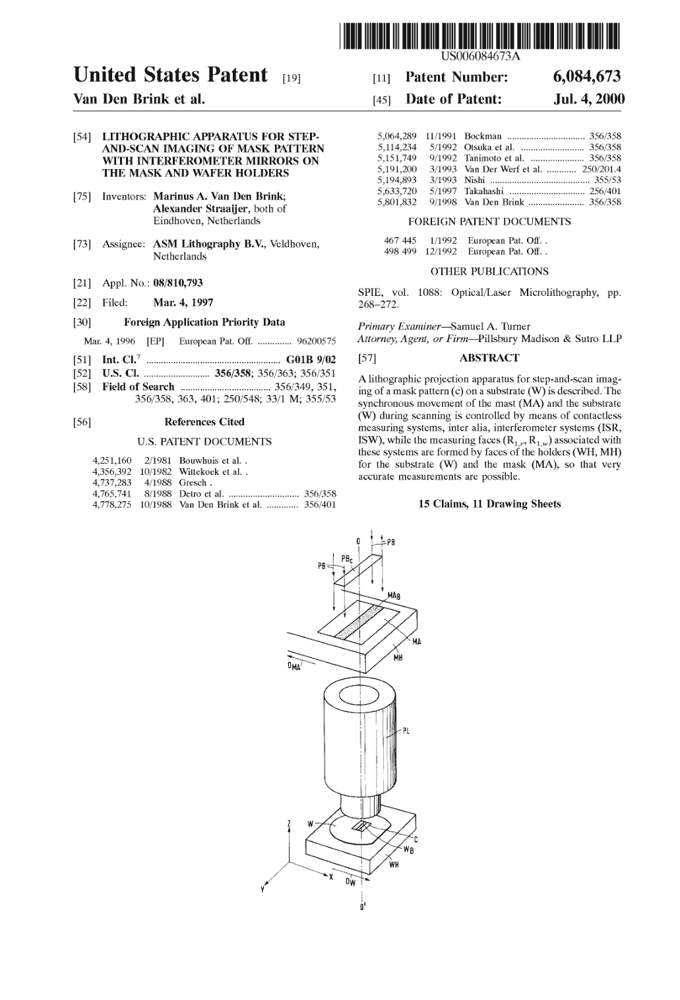

## PDF 第 2 页

[查看原页](https://patentimages.storage.googleapis.com/8e/53/50/5ca8d0ec153924/US6084673.pdf#page=2)

附图第 1 张，图 1。

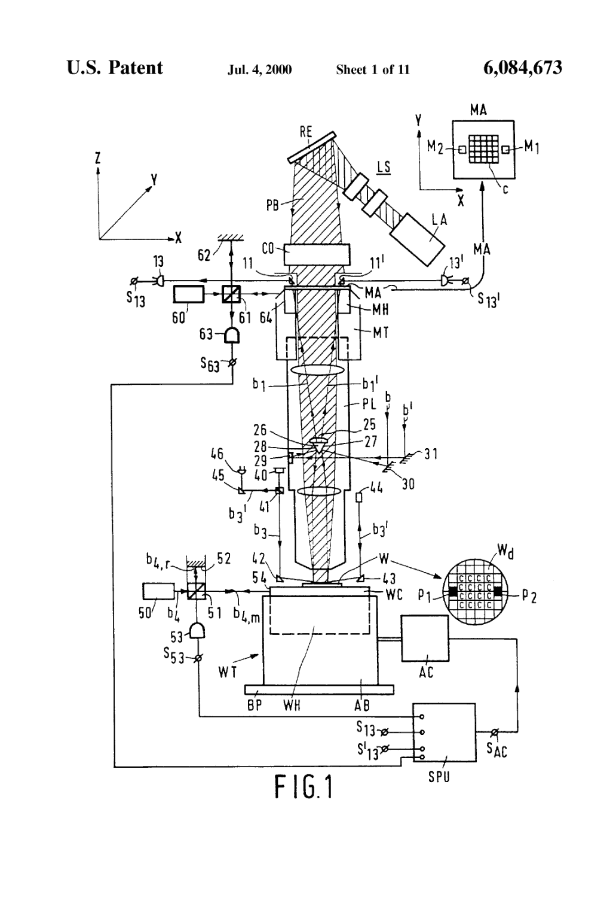

## PDF 第 3 页

[查看原页](https://patentimages.storage.googleapis.com/8e/53/50/5ca8d0ec153924/US6084673.pdf#page=3)

附图第 2 张，图 2、3。

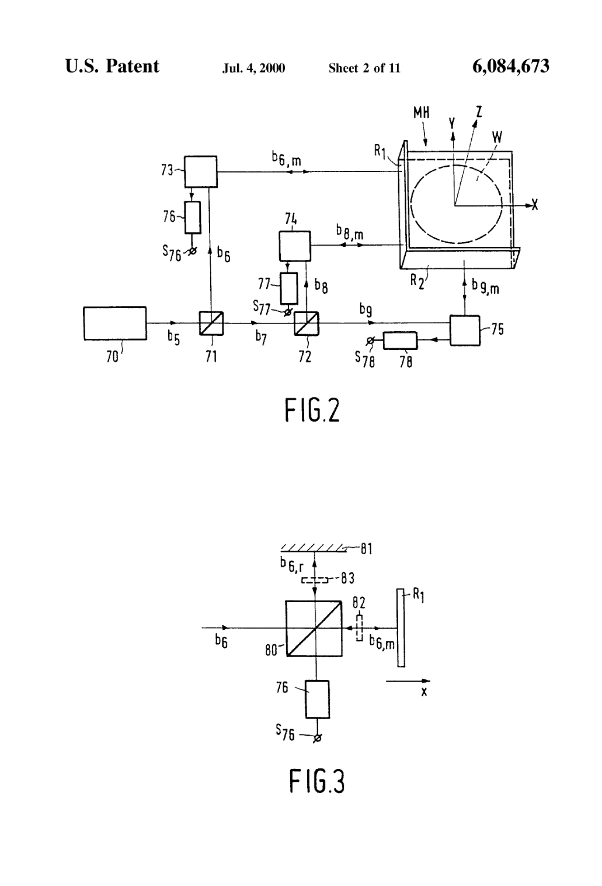

## PDF 第 4 页

[查看原页](https://patentimages.storage.googleapis.com/8e/53/50/5ca8d0ec153924/US6084673.pdf#page=4)

附图第 3 张，图 4。

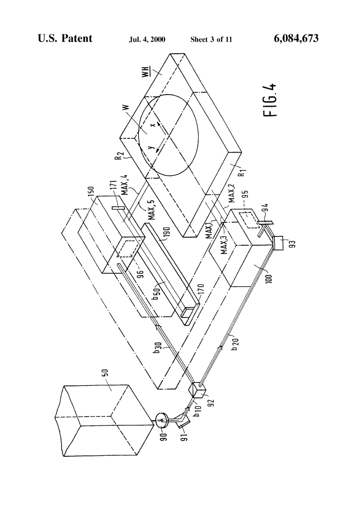

## PDF 第 5 页

[查看原页](https://patentimages.storage.googleapis.com/8e/53/50/5ca8d0ec153924/US6084673.pdf#page=5)

附图第 4 张，图 5、7。

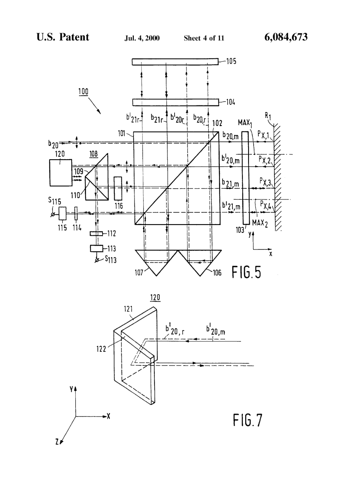

## PDF 第 6 页

[查看原页](https://patentimages.storage.googleapis.com/8e/53/50/5ca8d0ec153924/US6084673.pdf#page=6)

附图第 5 张，图 6、8。

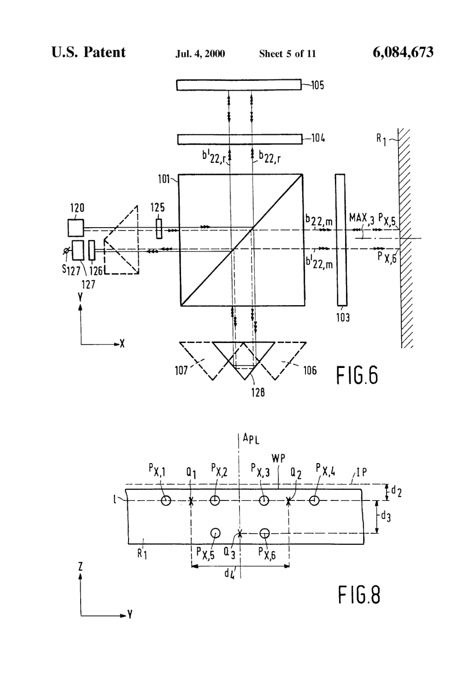

## PDF 第 7 页

[查看原页](https://patentimages.storage.googleapis.com/8e/53/50/5ca8d0ec153924/US6084673.pdf#page=7)

附图第 6 张，图 9、12。

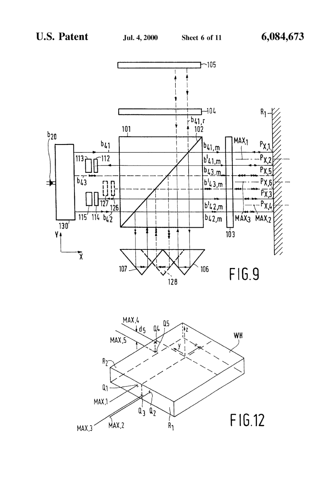

## PDF 第 8 页

[查看原页](https://patentimages.storage.googleapis.com/8e/53/50/5ca8d0ec153924/US6084673.pdf#page=8)

附图第 7 张，图 10、11。

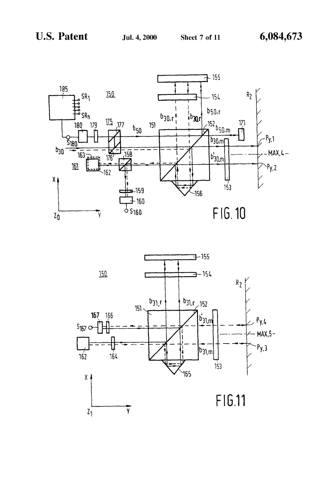

## PDF 第 9 页

[查看原页](https://patentimages.storage.googleapis.com/8e/53/50/5ca8d0ec153924/US6084673.pdf#page=9)

附图第 8 张，图 13。

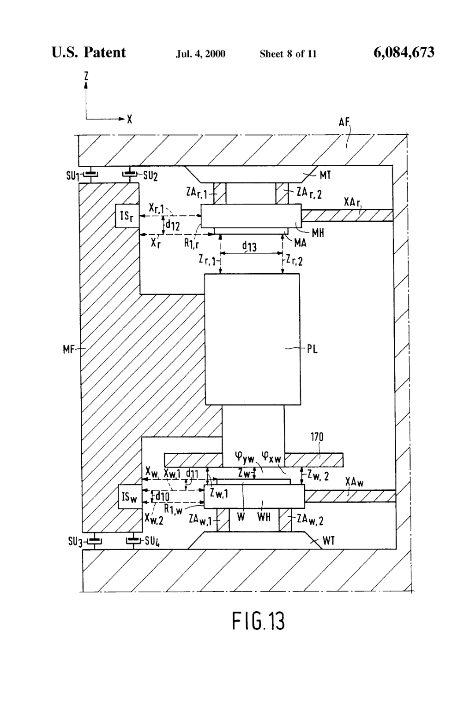

## PDF 第 10 页

[查看原页](https://patentimages.storage.googleapis.com/8e/53/50/5ca8d0ec153924/US6084673.pdf#page=10)

附图第 9 张，图 14、17。

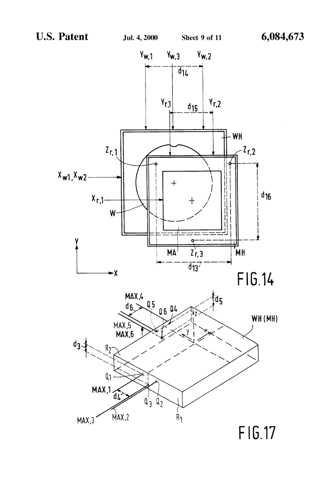

## PDF 第 11 页

[查看原页](https://patentimages.storage.googleapis.com/8e/53/50/5ca8d0ec153924/US6084673.pdf#page=11)

附图第 10 张，图 15。

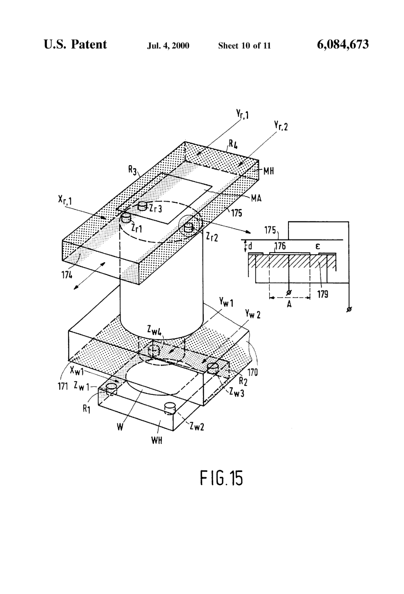

## PDF 第 12 页

[查看原页](https://patentimages.storage.googleapis.com/8e/53/50/5ca8d0ec153924/US6084673.pdf#page=12)

附图第 11 张，图 16。

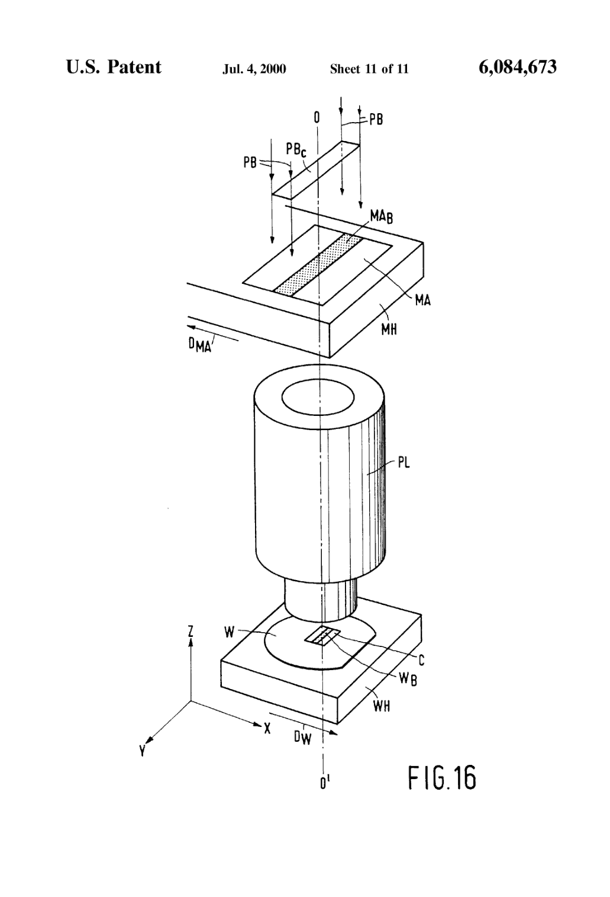

## PDF 第 13 页

[查看原页](https://patentimages.storage.googleapis.com/8e/53/50/5ca8d0ec153924/US6084673.pdf#page=13)

### 原文第 1 栏

1
   LITHOGRAPHIC APPARATUS FOR STEP
   AND-SCAN MAGING OF MASK PATTERN
   WITH INTERFEROMETER MIRRORS ON
     THE MASK AND WAFER HOLDERS
   The invention relates to a lithographic projection appa
ratus for Step-and-Scan imaging of a mask pattern, present in
a mask, each time on a different area of a Substrate provided
with a radiation-Sensitive layer, Said apparatus, Viewed in the
direction of a projection beam, Successively comprising:
   a radiation System for Supplying a projection beam whose
     croSS-Section in the plane of the mask is Smaller than
     the mask pattern,
   a mask table being movable in at least a first direction, the
     Scan direction, and provided with a mask holder in
    which the mask can be fixed,
   a projection System for imaging the irradiated part of the
    mask pattern on the Substrate with a magnification M,
    and
   a Substrate table which is movable in the first direction
    and in a Second direction perpendicular thereto and is
     provided with a substrate holder in which the substrate
    can be fixed,
     further comprising:
    mask table drive means for moving the mask table
       during each imaging operation in at least the Scan
        direction with respect to the projection beam and the
       projection System,
     Substrate table drive means for moving the Substrate
        table during each imaging operation in at least the
       Scan direction at a rate equal to M times the rate at
      which the mask is moved, and
     a first and a Second interferometer System for continu
       ously measuring, during each imaging operation, the
      mutual position of the mask and the Substrate.
  The apparatus may be a photolithographic apparatus in
which the projection beam is a beam of electromagnetic
radiation, Such as deep UV radiation, and in which the
projection System is an optical projection lens System. It may
alternatively be an apparatus in which the projection radia
tion  is  a charged-particle  radiation, Such  as  electron
radiation, ion radiation, or X-ray radiation, and in which an
asSociated projection System, for example, an electron lens
System is used. A photolithographic apparatus of the con
Struction described above and being uSable, inter alia, in the
manufacture of integrated circuits, or ICs, is known from,
inter alia, U.S. Pat. No. 5,194,893.
  Due to the demand for an increasingly large number of
electronic components  in one  IC, increasingly  Smaller
details, also referred to as line widths, must be imaged by
means of the projection apparatus in each  area of the
Substrate on which an IC must be formed, which area is also
referred to as IC area or “die”. One also wants to enlarge
these IC areas So as to increase the number of components
per IC in that way as well. For the projection lens System this
means, on the one hand, that the resolving power, hence its
numerical aperture, must be raised and, on the other hand,
the image field must be enlarged.
   Hitherto, one has been able, be it with great effort and at
high costs, to find an optimum between the two technologi
cally contradictory requirements for a projection lens SyS
tem. For a  step-projection apparatus, known  as wafer
Stepper, a projection lens System having a numerical aper
ture of approximately 0.6 and an image field of 22 mm has
been made for the manufacture of ICs of the 64 Mbit type.
With this projection lens system, line widths of 0.35 um can

### 原文第 2 栏

2
be imaged on the Substrate. This approaches approximately
the limits of a projection lens System which is still easy to
handle and manufacturable. If even Smaller details are to be
imaged, hence even Smaller line widths are to be formed on
the Substrate, in other words, if an even larger numerical
aperture is to be given to the projection lens System, then this
will only be at the expense of the image field size.
  This dilemma can be circumvented by changing from a
Step-projection apparatus to a step-and-Scan apparatus as
described in U.S. Pat. No. 5,194,893. In a step-projection
apparatus, the complete mask pattern  is illuminated and
imaged as  a whole on an IC area on  the  Substrate.
Subsequently, a step is made, i.e. the Substrate is moved with
respect to the projection lens System and the mask pattern,
until a Second IC area is present opposite the mask pattern
and within the image field of the projection lens System, and
a Second image of the mask pattern is formed in that area.
Subsequently, the apparatus Steps to a third IC area and the
mask pattern is imaged again, and So forth, until images of
the mask pattern have been formed in all IC areas. In a
Step-and-Scan apparatus, the same Stepping movements are
performed, but each time only a Small part of the mask
pattern is imaged on a corresponding Sub-area of the IC area.
By imaging Successive parts of the mask pattern on Succes
Sive Sub-areas of the IC area, an image of the complete mask
pattern is obtained on an IC area. To this end, the mask
pattern is illuminated with a projection beam which forms a
Small, for example, rectangular or arcuate illumination Spot
at the location of the mask pattern, and the mask table and
the Substrate table are moved in the same direction or in the
opposite direction, the Scan direction, with respect to the
projection lens System and the projection beam, while the
rate of the Substrate table is M times that of the mask table.
M  is the magnification with which  the mask pattern  is
imaged. A commonly used value for M is +/4 or -/4 for
tables moving  in  the same  direction  or  the  opposite
direction, respectively. Other values of M, for example 1, are
alternatively possible. Said movement of the mask table and
the Substrate table with respect to the illumination spot is
referred to as the Scan movement. The illumination Spot has
its largest dimension in the direction transverse to the Scan
direction. This dimension may be equal to the width of the
mask pattern, So that this pattern  is imaged in one Scan
movement. However,  it is alternatively possible that said
dimension is half the mask pattern width or even Smaller. In
that case, the complete mask pattern is imaged by perform
ing two, or a larger number of, opposed Scan movements. It
should then be ensured that the mask and the Substrate have
the correct mutual position at any moment, which can be
realized by means of a very accurate Synchronization of the
movements of the mask and the Substrate, i.e. the rate V.
of the substrate should always be equal to M times the rate
V   of the mask.
  AS compared with a step-projection apparatus, in which
an accurate alignment of the mask pattern with respect to the
IC areas on  the  Substrate, an  accurate focusing of the
projection lens System on the Substrate and an accurate
check of the Stepping Substrate table must take place,  it
should  also be measured  in a step-and-Scan  projection
apparatus whether condition V=MV    is fulfilled, hence
whether the Substrate and the mask pattern image are, as it
were, stationary with respect to each other. With reference to
this measurement, the Speed of one of the tables can then be
adapted to that of the other.
   In the projection apparatus described in U.S.  Pat. No.
5,194,893, two interferometer systems are used for checking
the condition V=MV. The measuring mirror of the first

## PDF 第 14 页

[查看原页](https://patentimages.storage.googleapis.com/8e/53/50/5ca8d0ec153924/US6084673.pdf#page=14)

### 原文第 3 栏

3
interferometer System is Secured to the Substrate table, So
that the displacement of the Substrate  table  in the Scan
direction, hereinafter also referred to as X direction, can be
measured with this System, as well as what is referred to as
the yaw, i.e. the rotation of the substrate about the axis of the
projection lens System, hereinafter also referred to as Z axis.
The measuring mirror of the Second interferometer System is
Secured to the mask table, So that the displacement of this
table in the scan direction and the yaw of this table can be
measured by means of this System. The output signals of the
two interferometer Systems are applied to an electronic
processing unit, for example, a microcomputer in which the
Signals are Subtracted from each other and processed to
control Signals for, inter alia, actuators for the tables. In the
known apparatus, the reference mirrors, i.e. the Stationary
mirrors, of the two interferometer Systems are Secured to the
projection lens holder. In this way, the movements in the
Scan direction of the two tables with respect to the projection
lens holder and hence with respect to each other can be
measured.
   If the interferometer measurements are to be reliable, a
number of conditions should be fulfilled, which cannot, or
cannot easily be  fulfilled  in  practice. One of the most
important conditions  is that the movements, in the Scan
direction, of the measuring mirrors should be very accu
rately equal to those of the Substrate and the mask, respec
tively. For example, actuators for adjusting the Substrate in
the Z direction are provided in the Substrate table, and by
energizing these actuators, the position of the Substrate can
also be changed in the X direction without the position of the
measuring mirror changing in the same way. Since only the
positions in the X direction and the rotation about the Z axis
of the mask and the Substrate are measured in the apparatus
described in U.S. Pat. No. 5,194,893, very strict require
ments must be imposed on the guidance of the mask and the
Substrate So that a displacement in the Y direction or a tilt
about the Y axis, which may affect the measurement of the
X position, cannot occur. In a step-and-Scan apparatus with
which detail sizes, or line widths of 0.35 um must be imaged
on the Substrate, it is Substantially impossible to comply with
the  requirements of journaling. Moreover,  it should be
possible to illuminate the mask with an illumination spot
whose dimension in the Y direction is Smaller than the width
of the mask pattern, in order that an even Smaller image field
is Sufficient and the resolving power can thus be further
increased. Then, also the positions/movements of the mask
and the Substrate in the Y direction should be measured
when the mask pattern  is imaged on an IC area of the
Substrate.
  The present invention provides a novel measuring concept
for a step-and-Scan projection apparatus with which the
above-mentioned requirement can be met and in which the
above-mentioned problems can be prevented. This novel
concept comprises a number of aspects which can be used
Separately or in combination.
   In accordance with a first aspect of the invention, the
projection apparatus is characterized in that the measuring
mirrors of the interferometer Systems are constituted by
reflecting Side faces of the mask holder and the Substrate
holder, respectively.
   Reflecting Side faces are understood to mean that these
Side faces themselves are reflecting or that reflectors are
rigidly Secured to these Side faces.
  Since the measuring mirrors are rigidly Secured to the
Substrate and the mask, the movements of these elements
themselves are measured directly and hence reliably, includ
ing the movements, left outside consideration in the known

### 原文第 4 栏

4
apparatus, resulting from mutual displacements of elements
of the substrate table and from mutual displacements of
elements of the mask table. A reference mirror does not have
to be arranged on the projection lens in this apparatus.
   In accordance with  a  further aspect of  the  present
invention, the projection apparatus is further characterized
in that the Substrate interferometer System  is a five-axis
System, and in that the mask interferometer System com
prises at least three measuring axes.
  The five-axis interferometer System cooperates with a first
mirror, which  is perpendicular to the X direction, and a
Second mirror, which is perpendicular to the Y direction, and
comprises, for example five measuring axes terminating at
five different points of these mirrors, and five detectors. The
output signals of these detectors can be combined to:
  an X position Signal
  an Y position signal
   a signal (p. indicating the tilt about the X axis
  a signal p, indicating the tilt about the Y axis, and
   a signal  (p. indicating the rotation about the Z axis.
By using a five-axis interferometer System and Servosystems
driven thereby, it is not necessary to impose Strict require
ments on the guidance of the element, in this case  the
substrate, which is controlled by the interferometer system.
The accuracy with which this element can be displaced and
positioned is now determined by the measuring accuracy of
the interferometer System, which accuracy is known to be
Very great.
  The three-axis mask interferometer System cooperates
with a first mirror perpendicular to the X direction and a
Second mirror perpendicular to the Y direction and com
prises three measuring axes and three detectors. The X and
Y positions of the mask and the rotation (p of the mask about
the Z axis can be measured with this System.
   It is further noted that it is known perse from European
Patent Application No. 0 498 499  in  the name of the
Applicant to use a five-axis Substrate interferometer System
in a projection apparatus, which System cooperates with two
mirrors extending perpendicularly to the X direction and the
Y direction, respectively. However, this apparatus is a step
projection apparatus in which the mask is stationary when a
complete Substrate is being illuminated. In this apparatus, no
mask interferometer System is used and the Substrate inter
ferometer is only used for positioning and controlled move
ment of the Substrate table.
   Alternatively, the projection apparatus may be character
ized in that the Substrate interferometer System is a three
axis System, in that contactleSS Sensors are provided for
measuring Substrate movements not measured by the three
axis interferometer System, in that the Substrate holder is
provided with measuring faces for the contactleSS Sensors,
and in that the mask interferometer System comprises at least
three measuring axes.
  Again, all measuring faces of the measuring Systems, with
which the movements of the mask and the Substrate are
controlled, are rigid components of the holders in which the
Substrate and the mask are  rigidly Secured, So that the
measurements of these movements are very reliable.
 A first embodiment of the projection apparatus is further
characterized in that contactleSS Sensors are provided for
measuring mask movements not measured by the three-axis
interferometer System, and in that the mask holder is pro
Vided with measuring faces associated with Said Sensors.
  This embodiment is particularly used if the mask pattern
is Scanned in one direction only and this mask pattern is thus
moved only in this direction along a relatively large distance

## PDF 第 15 页

[查看原页](https://patentimages.storage.googleapis.com/8e/53/50/5ca8d0ec153924/US6084673.pdf#page=15)

### 原文第 5 栏

S
when said mask pattern is being projected. Since the mask
movements possibly occurring in other directions are then
Small, other contactleSS Sensors capable of measuring only
Small movements with a Sufficiently great accuracy, but
being less costly than interferometer Systems, can be used
for measuring these movements.
 A contactleSS Sensor may be constituted by a capacitive
Sensor which cooperates with a guiding, for example metal,
Surface part, or measuring face, of the mask holder. Such a
Sensor may alternatively be constituted by an optical mea
Suring head, for example in the form of an optical Scanning
head as used in the known CD players.
  However, an alternative embodiment of the projection
apparatus is further characterized in that the mask interfer
ometer System is a five-axis System.
   In  this embodiment, the movements of the mask are
measured in the same manner and with the Same accuracy as
that of the Substrate coupled to a five-axis interferometer
System. This embodiment is particularly used when the mask
pattern is also moved in a Second direction perpendicular to
the Scan direction So as to be able to Scan the mask pattern
in two or more movements, each time in opposite directions.
   In principle, the projection apparatus according to the
invention is Suitable for forming mask pattern images on the
Substrate with detail dimensions, or line widths, of the order
of 0.18 um, So that this apparatus is Suitable for the produc
tion of 1 Gbit ICs. However, to  this end, a measuring
accuracy of the order of 5 nm should be achievable. In the
chosen measuring concept of two Separate multi-axis inter
ferometer Systems for the mask and the  Substrate, and
electronically processing the electric output signals of these
interferometer Systems to the desired measuring Signals, the
delay time elapsing between the instant when a measure
ment is performed and the instant when the desired mea
Suring result is available is going to play an important role.
This delay time is dependent on the processing rate of the
interferometer System electronics and the measuring and
control computer.  If the  rate  at which  the  substrate  is
Scanned  is, for example 250 mm/sec and  the  required
measuring accuracy is, for example 2 nm, then the maxi
mally admissible, variable delay time is, for example 12.5
nSec. Thanks to the high processing rate and the Stability of
modern interferometer Systems,  this requirement can be
Satisfied.
  The projection apparatus is preferably further character
ized in that, with the exception of the measuring mirrors, the
components of the interferometer Systems and the possible
further Sensors are arranged in one rigid frame in which also
the projection lens System  is rigidly Secured, this frame
being Suspended in a dynamically isolated way from the
other components of the apparatus.
  This measure considerably contributes to the realization
of the desired measuring accuracy.
  The interferometers are now free from disturbance and are
rigidly coupled to the projection lens. Since Said frame, also
referred to as metrology frame, is Suspended in a dynami
cally isolated way, or free from Vibrations, in the apparatus,
the positions of the interferometers present in this apparatus
are no longer affected by external forces, Such as the drive
forces for the Substrate table and the mask table.
  As described in European Patent Application No. 0 498
499, it is possible, after a global alignment of the substrate
with respect to the mask, and if the Substrate interferometer
System is a five-axis System, to position the Separate IC areas
on the Substrate Sufficiently accurately with respect to the
mask pattern without having to align each IC area again,
which yields a considerable gain of time and greater accu

### 原文第 6 栏

6
racy. The  extra measuring Signals  in  the form of  tilt
measuring Signals Supplied by a five-axis interferometer
System are used in different embodiments of the projection
apparatus and in different manners.
 A first embodiment of the projection apparatus, having a
local leveling facility, is characterized in that the chief rays
of the measuring beams of the  Substrate interferometer
System are not located in the plane of the Substrate, and in
that a Substrate measuring Signal processing unit is provided
for converting all Substrate measuring Signals into control
signals for the X-Y and (p  drives for the substrate.
   In this embodiment, the tilt measuring Signals are used to
correct the X and Y axis displacement measuring Signals and
the rotation measuring Signal for the tilts of the Substrate due
to the local leveling of the substrate. The local leveling is
understood to mean the Separate leveling of each IC area.
  An embodiment of the  apparatus,  in which no  local
leveling takes place, is further characterized in that a Sub
Strate measuring Signal processing unit  is provided  for
converting the Substrate measuring Signals into control Sig
nals for the X, Y and  (p. Substrate drives, and into control
Signals for actuators eliminating tilts of the Substrate.
  The Substrate can then be very accurately manoeuvred at
the desired X and Y positions without the displacement from
a first position to a Subsequent position resulting in a  tilt
about the X or Y axis.
   In principle, the mask does not have to be tilted or locally
leveled. However,  it  is possible  to do  this.  If the mask
interferometer System is implemented as a five-axis System,
the above-mentioned possibilities for the Substrate interfer
ometer System could also be realized for the mask interfer
ometer System.
  To prevent measuring errors from  occurring due  to
changes  in ambient parameters, Such  as  pressure,
temperature, humidity and air composition, resulting in a
change of the refractive index of the interferometer medium
and the apparent wavelength of the interferometer beams,
Said interferometer System may be further characterized in
that the System further has a reference axis whose measuring
beam cooperates with a Stationary reflector.
  As described in European Patent Application No. 0 498
499, the variation of the refractive index of the medium can
be measured by means of this extra measuring beam which,
Similarly as the other interferometer beams is traveling in the
Same medium.
  The measuring Signal generated by means of the extra
measuring beam is applied to the Signal processing unit, So
that the results of the X, Y, and  X,  y and  Z measurements
can be corrected for changes of the refractive indeX.
  To enhance the measuring accuracy, the projection appa
ratus according to the invention may be further characterized
in that means are provided for Supplying a Stream of air
having a constant refractive indeX at the area of Spaces in
which the interferometer beams propagate.
  These means may consist  of, for example  a  first  air
shower at the area of the Substrate and a Second air shower
at the area of the mask. AS described in European Patent
Application No. 0498499, not only the optical quality of the
interferometer medium is enhanced by Said stream of air, but
it is also achieved that the medium has the same quality at
the location of all measuring beams, including the possible
reference-axis beam. The air which is blown in is preferably
air having a very high degree of purity and a very constant
temperature.
  The projection apparatus may further have the construc
tive characteristic features as claimed in any one of claims
11 to 17.

## PDF 第 16 页

[查看原页](https://patentimages.storage.googleapis.com/8e/53/50/5ca8d0ec153924/US6084673.pdf#page=16)

### 原文第 7 栏

7
  These and other aspects of the invention will be apparent
from and elucidated with reference  to the embodiments
described hereinafter.

               IN THE DRAWINGS
  FIG. 1 shows diagrammatically an embodiment of an
apparatus for Step-and-Scan imaging of a mask pattern on a
Substrate,
  FIG. 2 shows a known two-axis interferometer system,
  FIG. 3 shows the principle of a known one-axis interfer
ometer System,
  FIG. 4 is a perspective view of a six-axis interferometer
System,
  FIGS. 5 and 6 show a first embodiment of a three-axis
interferometer System in accordance with two croSS-Sections
in different X-Y planes,
  FIG. 7 shows a reflector for this embodiment,
  FIG. 8 shows the positions where the measuring beams
impinge on a measuring mirror and where the measuring
axes interSect these mirrors,
  FIG. 9 shows a second embodiment of a  three-axis
interferometer unit,
  FIGS. 10 and 11 show an embodiment of a two-axis
interferometer unit in accordance with two cross-sections in
different X-Y planes,
  FIG. 12 shows the positions where the five measuring
axes of the interferometer System interSect the two measur
ing mirrors of the Substrate holder,
  FIGS. 13 and 14 are overviews of the positions to be
determined and the measuring axes to be used for this
purpose,
  FIG. 15 shows an apparatus according to the invention,
using capacitive Sensors for the mask and the Substrate,
  FIG. 16 shows the illumination principle of an imaging
projection apparatus, and
  FIG. 17 shows the principle of planeness measurements
of mirrors by means of a six-axis interferometer System.
  FIG. 1 shows diagrammatically the optical elements of an
embodiment of an apparatus for Step-and-repetitively imag
ing a mask pattern on a Substrate. The main component of
this apparatus is a projection column accommodating a
projection lens system PL. A mask holder MH for a mask
MA, in which the mask pattern C to be imaged is provided,
is arranged above this System. The mask holder is present in
a mask table MT. A substrate table WT is arranged below the
projection lens System  PL. This  table accommodates a
Substrate holder WH for a Substrate W on which the mask
pattern must be imaged a number of times, each time in a
different Substrate area, an IC area, Wol. The Substrate table
is movable in the X and Y directions So that, after imaging
of the mask pattern on an IC area, a Subsequent IC area can
be positioned underneath the mask pattern.
  The apparatus further has an illumination System which
comprises a radiation Source LA, for example, a Krypton
Fluoride Excimer Laser or a mercury lamp, a lens System
LS, a mirror RE and a condenser lens Co. The projection
beam PBSupplied by the illumination system illuminates the
mask pattern C. This pattern is imaged by the projection lens
system PL on an area in the substrate W. The projection lens
System has a magnification of, for example, M=/4, a numeri
cal aperture NA=0.6 and a diffraction-limited image field
having a diameter of 22 mm.
  The apparatus further comprises a plurality of measuring
devices, namely a device for aligning the mask MA with

### 原文第 8 栏

8
respect to the substrate W in the XY plane, an interferometer
System for determining the position and orientation of the
Substrate holder and hence of the Substrate, and a focus error
detection device for determining a deviation between the
focal or image plane of the projection lens System PL and the
surface of the substrate W. These measuring devices are
parts of Servosystems which comprise electronic signal
processing and control circuits and drivers, or actuators,
with which the position and orientation of the substrate and
the focusing can be corrected with reference to the Signals
Supplied by the measuring devices.
  The alignment device uses two alignment marks M  and
M. in the mask MA, indicated in the top right corner of FIG.
1. These marks preferably consist of diffraction gratings, but
they may be alternatively formed by other marks, Such as
Squares or Strips which are optically different from their
Surroundings. The alignment marks are  preferably two
dimensional, i.e. they extend in two mutually perpendicular
directions, the X and Y directions in FIG.1. The Substrate W.
for example, a Semiconductor Substrate on which the pattern
C must be imaged at juxtaposed positions Several times, has
at  least two  alignment marks,  preferably  also two
dimensional diffraction gratings, two of which, P  and P2,
are shown in FIG.1. The marks P, and P are located outside
the areas on the Substrate W where the images of the pattern
C must be formed. The  grating marks P  and P  are
preferably phase gratings and the grating markS M and M2
are preferably amplitude gratings.
  FIG. 1 shows a Special embodiment of an alignment
device, namely a double alignment device in which two
alignment beams b and b' are used for aligning the Substrate
alignment mark P. on the mask alignment mark M, and the
Substrate alignment mark P on the mask alignment mark
M, respectively. The beam b is reflected by a reflecting
element 30, for example, a mirror to the reflecting surface 27
of a prism 26. The surface 27 reflects the beam b to the
Substrate alignment mark P  which passes a part of the
radiation as beam b, to the associated mask alignment mark
M2 where an image of the mark P  is formed. A reflecting
element 11, for example, a prism is arranged above the mark
M, which prism directs the radiation passed by the mark M.
towards a radiation-Sensitive detector 13.
  The second alignment beam b' is reflected by a mirror 31
to a reflector 29  in the projection lens system PL. This
reflector 29 passes the beam b' to a Second reflecting Surface
28 of the prism 26, which surface directs the beam b' onto
the Substrate alignment mark P. This mark reflects a part of
the  radiation of the beam  b' as beam b'  to  the mask
alignment mark M  where an image of the mark P   is
formed. The radiation of the beam b' passing through the
mark M  is directed towards a radiation-Sensitive detector
13' by a reflector 11'.
  The operation of the double alignment device is described
in U.S. Pat. No. 4,778,275.
  The embodiment of the alignment device according to
FIG. 1 is particularly Suitable for an apparatus in which an
illumination beam having a short wavelength, for example,
248 nm, and an alignment beam having a considerably
longer wavelength, for example, 633 nm are used.
  Since  the projection lens System  is designed for the
wavelength of the projection beam PB, deviations occur
when using this System PL for imaging the alignment marks
P, P and M1, M2 on each other by means of the alignment
beam. The Substrate alignment marks will not be imaged in
the plane of the mask pattern in which the mask alignment
marks are located but at a certain distance therefrom, this

## PDF 第 17 页

[查看原页](https://patentimages.storage.googleapis.com/8e/53/50/5ca8d0ec153924/US6084673.pdf#page=17)

### 原文第 9 栏

distance depending on the difference between the wave
lengths of the projection beam and the alignment beam and
the difference between the refractive indices of the material
of the projection lens elements for the two wavelengths. If
the projection beam has a wavelength of, for example 248
nm, and the alignment beam has a wavelength of 633 nm,
this distance may be up to 2 m. Moreover, due to Said
wavelength difference, a Substrate alignment mark is imaged
on a mask alignment mark with  a magnification which
deviates from the desired magnification, with the deviation
increasing with an increasing wavelength difference.
  To correct for Said deviations, an extra lens, or correction
lens, 25 is incorporated in the projection column PL. The
correction lens is arranged at Such a height in the projection
column that, on the one hand, the Sub-beams of the different
diffraction orders of the alignment beam, which Sub-beams
are formed by a Substrate alignment mark, are Sufficiently
Separated in the plane of the correction lens So as to be able
to influence these Sub-beams Separately, and, on the other
hand, this correction lens has a negligible influence on the
projection beam and the mask image formed there with. The
projection lens is preferably arranged in the Fourier plane of
the projection lens System.  If the correction lens 25  is
arranged in a plane in which the chief rays of the alignment
beams band b  interSect each other, as is shown in FIG. 1,
this lens can be used for correcting the two alignment beams.
   If desired, a wedge or another deflection element, Such as
a diffractor element, may be arranged in the proximity of an
alignment mark in the path of the alignment beam(s). With
Such a deflection element (not shown in FIG. 1), alignment
errors may be prevented, which result from unintentional
phase differences within the Selected alignment beam por
tions captured by the detector 13  or  13', which phase
differences may occur if the Symmetry axis of the alignment
beam portions coming from a Substrate alignment mark is
not perpendicular to the mask plate, So that false reflections
may occur within this plate. An alignment device provided
with Such a deflection element is described in European
Patent Application no. 0 467 445.
   In addition to the global alignment markSP and P. shown
in FIG. 1, which marks are used for aligning the Substrate
with respect to the mask, referred to as global alignment, the
Substrate may be provided with further alignment marks per
IC area So as to align the relevant area with respect to the
mask pattern for each IC area. The mask may comprise more
than two alignment marks, while  the  further alignment
marks may be used, for example, to measure the rotation of
the mask about the Z axis So as to correct therefor.
  The projection apparatus further comprises a focus error
detection System for determining a deviation between the
focal plane of the projection lens System PL and the Surface
of the Substrate W So that this deviation can be corrected, for
example, by moving the projection lens System along its
axis. This system may be constituted by the elements 40, 41,
42, 43, 44, 45 and 46 which are arranged in a holder (not
shown) which is fixedly connected to the projection lens
system. The  reference numeral 40 denotes  a  radiation
Source, for example a diode laser emitting a focusing beam
b. This beam is directed at a very Small angle onto the
substrate by a reflecting prism 42. The beam reflected by the
substrate is directed towards a retroreflector 44 by the prism
43. The element 44 reflects the beam in itself so that this
beam (b) once more traverses the same path via reflections
on the prism 43, the substrate W and the prism 42. The beam
b' reaches a radiation-Sensitive detection System 46 via a
partially reflecting element 41 and a reflecting element 45.
This detection System comprises, for example, a position

### 原文第 10 栏

10
dependent detector or two separate detectors. The position of
the radiation spot formed by the beam b' on this System is
dependent on the extent by which the focal plane of the
projection lens System coincides with the plane of the
Substrate W. Reference is made to U.S. Pat. No. 4,356,392
for an extensive description of the focus error detection
System.
  For accurately determining the X and Y positions of the
Substrate table WT, known Step-projection apparatuses com
prise a  multi-axis interferometer system.  U.S.  Pat. No.
4,251,160 describes a two-axis system and U.S. Pat. No.
4,737,283 describes a three-axis system. In FIG. 1, such an
interferometer System is diagrammatically represented by
the elements 50, 51, 52 and 53, the Figure showing only one
measuring axis, the X axis. A beam b. emitted by a radiation
Source 50 in the form of a laser is split into a measuring
beam b.   and a reference beam b.  by a beam splitter 51.
The measuring beam reaches a reflecting Side face 54 of the
substrate holder WH and the reflected measuring beam is
combined by the beam  splitter with  the reference beam
reflected by a Stationary retroreflector 52, for example, a
“corner cube'. The  intensity of the combined beam  is
measured with the aid of a detector 53 and the displacement,
in this case in the X direction, of the Substrate holder WH
can be derived from the output signal of this detector, and
also an instantaneous position of this holder can be estab
lished.
  AS is diagrammatically shown in FIG. 1, the interferom
eter Signals, represented by one signal Ss  for the Sake of
Simplicity, and the Signals S   and S   of the alignment
detection device are applied to a signal-processing unit SPU,
for example a microcomputer, which processes Said Signals
to control signals SA  for an actuator AC with which the
substrate holder WH is moved in the X-Y plane via the
Substrate table WT.
  With an interferometer system, which does  not only
comprise the X measuring axis shown in FIG. 1 but also a
Y measuring axis and possibly a third measuring axis, the
positions of, and the mutual distance between, the alignment
markSP, P and M, M  in a System of coordinates defined
by the Stationary interferometer System can be laid down
during the  initial, or global, alignment of the mask with
respect to the Substrate. This interferometer System is also
used so as to be able to move the substrate  table very
accurately, which is necessary for a step-projection appara
tus So as to be able to Step very accurately from a first IC area
to a Second IC area.
   In the described Step-and-Scan apparatus in which the
mask and the Substrate must also be moved Synchronously
during the projection of a mask pattern in one IC area, the
mask must also be moved accurately in one direction, the
Scan direction. To this end, the apparatus should be provided
with a second interferometer system with which the move
ment of the mask can be measured accurately. This inter
ferometer system comprises the elements 60, 61, 62, 63 and
64 which have the same function as the elements 50, 51, 52,
53 and 54. The mask interferometer system signals, repre
Sented by one signal Sea for the Sake of Simplicity in FIG.
1, are applied to the Signal processing unit SPU in which
these signals are compared with the corresponding Signals of
the Substrate interferometer System.  It can then be ascer
tained whether the mask and the substrate have the mutually
correct position and/or move Synchronously.
   If the positions in the X and Y directions of the mask are
represented by X, Y and those of the substrate by X, Y,
and the rotation of the Z axis is represented by p,  and (p.,

## PDF 第 18 页

[查看原页](https://patentimages.storage.googleapis.com/8e/53/50/5ca8d0ec153924/US6084673.pdf#page=18)

### 原文第 11 栏

11
the following conditions will be satisfied if the mask and the
Substrate are correctly positioned with respect to each other:
    X-MX=0                                                           (1)
    Y-MY=0                                                           (2)
     (p-(p=0                                                            (3)
in which M  is the magnification of the projection lens
System. It has been assumed that the mask and the Substrate
move in opposite directions. If these elements move in the
Same direction, the minus Sign for M should be replaced by
a plus sign in the afore-mentioned conditions.
  To ascertain whether these conditions are fulfilled, it is
sufficient that both the interferometer system for the sub
Strate and that for the mask have three measuring axes.
  However, the substrate interferometer system preferably
has five measuring axes. Then, in addition to X, Y  and
(p., also p,   and (p,  i.e. the tilts about the X axis and Y
axis, can be measured.
  To be able to measure Such tilts of the mask, a five-axis
mask interferometer System may be used, or a combination
of a three-axis interferometer System for determining X, Y,
and (p., and other sensors, Such as capacitive sensors, for the
(p,  and p,  measurements.
   If X, Y, (P., (py   are X, Y, P., P., (P.  are measured,
and, with the aid of the focus detection System, Z  and Z,
i.e. the positions along the Z axis of the Substrate and the
mask, then  it can be  ascertained whether not only  the
conditions (1), (2), (3) but also the conditions:
     M.Z-Z=0                                                          (4)
      M.cp-(p=0                                                        (5)
      M.(p-(p-0                                                        (6)
are Satisfied. AS already noted, a three-axis interferometer
System can be used for measuring the movements along the
X and Y axes and for determining the final positions of, for
example, the mask holder, and for determining the rotation
of the mask about the Z axis. Such a System, an embodiment
of which is described in “SPIE, vol. 1088: Optical/Laser
Microlithography, pp. 268-272, Linear/angular displace
ment interferometer for waferStage metrology', is diagram
matically shown in FIG. 2, together with the mask holder
MH.
  The composite  interferometer System comprises  a
Helium-Neon laser 70, two beam splitters 71 and 72 and
three interferometer units 73, 74 and 75. A part of the beam
bs from the laser is reflected by the beam splitter 71 as beam
be to the interferometer unit 73 which cooperates with the
mirror R  of the mask holder MH. The beam b, passed by
the beam splitter 71 is split by the beam splitter 72 into a
beam bs which is reflected to the interferometer unit 74 and
into a beambo which is passed to the interferometer unit 75.
The interferometer unit 74 cooperates with the mirror R,
while the interferometer unit 75 cooperates with the mirror
R2.
  FIG. 3 shows the principle of the interferometer unit 73.
This unit comprises a beam  splitter 80, for example, a
partially transparent mirror which Splits the incoming beam
be into a measuring beambo, and a reference beambo. The
measuring beam  is passed to the mask holder mirror R
which reflects this beam to the beam splitter 80 which in its
turn reflects a part of the beam be, to the detector 76. The
beam be  reflected by the beam splitter 80 is reflected to the
beam splitter 80 by a fixedly arranged reference mirror 81

### 原文第 12 栏

12
which passes a part of this beam to the detector 76. When the
mask holder mirror is moved in the X direction, constructive
and destructive interferences alternately occur between the
beams be  and be  incident on the detector 76, so that theoutput signal of this detector passes from a maximum value
to a minimum value, and conversely, whenever the Substrate
table is displaced over a distance of 2/4, in which  )  is the
wavelength of the beam b. The number of maxima and
minima of the detector Signal S7   is a measure of the
displacement of the holder in the X direction. Movements of
the mirrors R and R which are much smaller than 2/4, for
example, up to 2/128 or even 2/512 can be measured with
the aid of electronic interpolation methods known in the
interferometer technique.
  The interferometer units 74 and 75 have the same con
Struction and operate in the same way as the interferometer
unit 73. The movement of the mask holder in the Y direction
is measured by means of the interferometer unit 75 and the
asSociated detector 78. A Second X displacement measure
ment is performed with the interferometer unit 74 and the
associated detector 77. The rotation of the holder about the
Z axis is computed from the Signals S7  and S77. This
rotation is given by

             S76 - Sri
         P      d

in which d is the distance between the points where the chief
rays of the measuring beams be  and bs, impinge upon the
mirror R.
   It is to be noted that FIG.3 only shows the principle of an
interferometer  unit.  In  practice, a  polarization-Sensitive
beam splitter 80 and a number of 7/4 plates, represented by
the elements 82 and 83 in FIG. 3, will be used for beam
Splitting and combination. Then  the  radiation  loSS  is
minimal, which is particularly important if only one laser 70
is  to be  used  for  the  different  interferometer  units.
Furthermore, retroreflectors as described in Said article in
SPIE, Vol. 1088, Optical/Laser Microlithography  II, pp.
268-272 may be incorporated in the interferometer units.
   In principle, a three-axis interferometer System could be
used for measuring the X and Y displacements of the
Substrate. To achieve the desired accuracy with this System,
the following two conditions should be fulfilled:
   1. The chief rays of the interferometer beams must be
located in the plane of the Substrate.
   2. During the displacements along the X and Y axes and
the possible rotation about the Z axis, the substrate holder
must be fixed in the other degrees of freedom (p., p. As
described in European Patent Application no. 0 498 499, the
conditions, which can hardly or not easily be fulfilled in
practice, can be circumvented by making use of a five-axis
interferometer system with which more movements of the
Substrate can be measured, So that this provides the possi
bility of measuring the X and Y movements more accurately.
  FIG. 4 shows the principle of the five-axis interferometer
system for measuring the five degrees of freedom X, Y, (p.
(p,  and (p.  of the Substrate holder WH with an integratedmirror block. The System comprises,  for example, two
interferometer units 100 and 150 to which the beams band
bo are Supplied. These beams are emitted by a laser, for
example a Helium-Neon laser, 50. The beam be coming
from this laser first passes a beam-widening optical System
diagrammatically shown by means of the lens 90 and is
Subsequently split into the two beams bo and bo by a beam
splitter 92. The elements 91, 93 and 94 are mirrors which
ensure that the beams are deflected in Such a way that they

## PDF 第 19 页

[查看原页](https://patentimages.storage.googleapis.com/8e/53/50/5ca8d0ec153924/US6084673.pdf#page=19)

### 原文第 13 栏

13
are incident on the interferometer units 100 and 150 at the
correct angles. The interferometer unit 100 may be imple
mented in Such a way that it emits three measuring beams
towards the mirror R  and receives these beams from this
mirror. With  these beams,  the displacement  in  the X
direction, the  tilt about the Y axis, (pw, and the rotation
about the Z axis, (pzw, of the mirror block and Substrateholder WH can be measured. The second interferometer unit
120 sends two measuring beams to, and receives two mea
suring beams from, the mirror R. With these beams, the
displacement in the Y direction and the tilt about the X axis
can be measured.
  The interferometer units may be implemented in various
ways. FIG. 5 shows an embodiment of the interferometer
unit 100. It comprises a polarization-sensitive beam splitter
101, two 2/4 plates 103, 104, a reference mirror 105, two
retroreflectors 106, 107, a composite prism 108 and two
detectors 113, 115. The detectors may be arranged on the
plane 95 of the interferometer unit 100 shown in FIG. 4. The
interferometer unit is of the heterodyne type. The beam bo
then comes from a Helium-Neon laser which is implemented
as a Zeeman laser. Such a laser Supplies a beam with two
mutually perpendicularly polarized components which have
an optical phase difference of, for example 20 MHz. These
two components are shown in FIG. 5 by means of solid lines
and broken lines.
  The beam bo entering the prism 101  is  split into a
measuring beam boo, and a reference beam bao, by the
polarization-sensitive  interface  102. The beam bao,  is
passed to  the  mirror R  of the  substrate holder and  is
reflected by this mirror. A 2/4 plate 103 ensuring that the
direction of polarization of the reflected beam, which has
traversed the 2/4 plate twice, is rotated through 90  with
respect to the direction of polarization of the ongoing beam
bo   is arranged between the prism 101 and the mirror R.
The reflected beam is then reflected by the interface 102 to
a retroreflector 106, for example, in the form of a three
dimensional corner cube prism. The beam reflected by the
prism is subsequently reflected by the interface 102 and sent
as measuring beam b'o,  to the  mirror  R1  again and
reflected by this mirror to the prism again. This beam has
then again traversed the 2/4 plate twice So that  it is now
passed by the interface 102. The beam b'o, Subsequently
reaches a prism system 108 and is reflected by its surface
109 to a radiation-sensitive detector 113 via an analyzer 112.
  The reference beam blo  reflected by the interface 102
traverses the 2/4 plate 104, is reflected by the reference
mirror 105 and traverses the 2/4 plate a second time. The
direction of polarization of the beam incident on the inter
face 102 is rotated through 90 so that it is passed on to the
retroreflector 106. The beam b'o  reflected by this element
is again Sent as a reference beam to the reference mirror 105
and reflected by this mirror to the interface 102, the direction
of polarization being rotated through 90  again. The inter
face 102 subsequently reflects the beam to the prism system
108 whose face 109 sends the beam b'o  to the detector 113.
The direction of polarization of the analyzer 112 extends at
an angle of 45  to the two mutually perpendicular directions
of polarization of the beams b'o, and b'o. The compo
nents of the beams b'o, and b'o  passed by the analyzer
have the same direction of polarization and interfere with
each other. The output signal S   of the detector 113 has an
intensity modulation at a frequency which is equal to the
Zeeman frequency difference plus or minus a frequency shift
which  is dependent on the displacement of the Substrate
holder mirror R  in the X direction.
   In principle, the retroreflector 106 could also be omitted
So that the measuring beam and the reference beam incident

### 原文第 14 栏

14
on the detector 113 would only be reflected once by the
substrate table mirror R  and the  reference mirror 105,
respectively.
  The Special embodiment of the interferometer according
to FIG. 5, in which use is made of the retroreflector 106 to
reflect the measuring beam twice as beams bao, and b'o,
on the Substrate mirror, has the great advantage that the
direction of the measuring beam b'o, ultimately incident
on the detector 113 is independent of a tilt of the mirror R
about an axis perpendicular to the X axis. As a result, the
Signal S   contains only true X displacement information.
For the same reason, a possible tilt of the reference mirror
105 does not have any influence on the Signal S.
  The rotation of the Substrate table about the Z axis, which
is perpendicular to the plane of the drawing in FIG. 5, can
also be measured by means of the interferometer unit of FIG.
5. This is effected via a Second X measurement at a position
Ps (P) at a maximum possible distance from the position
P, (P) where the first X measurement is performed. To
this end, the face 110 of the prism system 108 is in the form
of a partially transparent mirror which reflects a portion of
the measuring beam b'o, and the reference beam b'o  as
a new reference beam band a new measuring beam be,
respectively, to the beam  splitter 101. The  direction of
polarization of the two beams is first rotated through 90 by
means of the 2/20 plate 116 so that the functions of these
beams are  interchanged. The measuring beam b2     is
passed to the Substrate holder mirror by the polarization
sensitive interface 102, while the reference beam be    is
reflected to the reference mirror. The paths traversed by the
beams bei, and be   are analogous to those traversed by the
beams bao, and bo. Preferably, a second retroreflector 107
is provided which ensures that the measuring beam and the
reference beam are Sent a Second time to the Substrate holder
mirror R and the reference mirror as beams b', and b'.Via the beam splitter 101, the prism system 108 and a second
analyzer 114, the reflected beams b', and b'2   reach a
second detector 115 where they interfere with each other.
  The output Signal Ss of this detector has an intensity
modulation at a frequency which is equal to the Zeeman
difference frequency plus or minus a frequency shift which,
however, is now dependent on the possible rotation of the
mirror R  about the Z axis. In fact, if Such a rotation occurs,
the frequency shift between the measuring and reference
beams at their first passage through the System, at which
reflections occur at the positions P,  and P2, is different
from the frequency shift at the Second passage through the
system, at which reflections occur at the positions Pa and
P. The frequency difference measured by means of the
detector 115 is the difference between said frequency shifts.
If the Substrate table mirror does not have a rotation about
the Z axis, the resultant frequency difference is equal to Zero.
  For the way in which the Signals S   and Ss can be
electronically processed So as to derive the X displacement
and the rotation  cp  about the Z axis of the substrate table
from the frequency shifts, reference may be made by way of
example to the article in SPIE, Vol. 1088 “Optical/Laser
Microlithography” II, 1989, pp. 268-272.
   Instead of a beambo with two frequency components, a
beam having only one frequency may be used. The displace
ment or rotation of the mirror R   is then measured by
determining the phase difference between the measuring and
reference beams.
 A third measurement, for example, of the tilt about the Y
axis can be performed with the interferometer unit. To this
end, for example, the face 109 of the prism system 108 may
be implemented as a partially  transparent mirror which

## PDF 第 20 页

[查看原页](https://patentimages.storage.googleapis.com/8e/53/50/5ca8d0ec153924/US6084673.pdf#page=20)

### 原文第 15 栏

15
passes a portion of the beams b'o, and b'o, as is shown
in FIG. 5. A reflector system 120 is arranged in the path of
the beam portions which have been passed. This System
must reflect the beams to the beam splitter 101 and displace
these beams parallel to themselves in the Z direction So that
the beams will extend in a second XY plane which is located
in front of or behind the plane of the drawing in FIG. 5. This
plane is shown in FIG. 6, together with the third measuring
beam b2  and reference beam b.
  The path of the beams be  and be   in front of the beam
splitter 101 incorporates a 2/20 plate 125 which rotates the
direction of polarization of these beams through 9, so that
the functions of the  reference beam and the measuring
beams are interchanged. Preferably, there is a third retrore
flector 128, So that the measuring beam is reflected twice, as
beams be    and b'22, at the  positions Prs and P6,
respectively, by  the Substrate  table  mirror R, and  the
reference beam is reflected twice, as beams be  and b',
by the reference mirror. The paths traversed by the measur
ing beams and reference beams are analogous  to those
traversed by the measuring beams bao, and b'o, and the
reference beams bor and b'o  in FIG. 5.
  The beams b', and b'i  ultimately reach a polarization
analyzer 126 which passes the components having the same
direction of polarization of these beams, which components
interfere with each other, to a detector 127. The output signal
S27 of  this detector has an  intensity modulation  at a
frequency which is equal to the Zeeman difference fre
quency plus or minus a frequency shift which is dependent
on the possible tilt of the mirror R about the Y axis. In fact,
if Such a  tilt occurs, the frequency shift between the mea
Suring beam b'o, and the reference beam b'o  differs from
the frequency shift between the measuring beam b', and
the reference beam b'. The frequency difference mea
sured by means of the detector 127 is the difference between
these frequency shifts. If the substrate holder does not have
a tilt about the Y axis, the resultant frequency difference is
equal to Zero. This tilt can also be measured by means of a
Single frequency beam and by determining phase differ
CCCS.
  FIG. 7 shows an embodiment of the reflector system 120
in detail. This system comprises a first reflector 121, which
reflects the beams b'o, and b'o  extending parallel to the
X axis towards the Z axis, and a Second reflector 122, which
reflects these beams again in a direction parallel to the X
axis. The reflector pair 121, 122 thus displaces the beams
parallel to themselves along the Z axis.
   In the embodiment of FIGS. 6 and 7, in which the beams
ba, and b', are displaced in the Z direction only, the
points Prs and P  where the chief rays of these measuring
beams impinge upon the Substrate holder mirror R have the
same X positions as the points P2 and Pa where the chief
rays of the measuring beams b'o, and b'21  impinge upon
this mirror. This is shown in FIG. 8 for the sake of clarity.
In  this  Figure, the points where  the chief rays of the
measuring beams baobao, b21  b21, b22, and b22,
are incident on the mirror R  are denoted by the circles P1,
P2, Ps, P., P.s and Ps, respectively. A so-called mea
Suring axis is associated with each pair of measuring beams.
These measuring axes are denoted by MAX, MAX  and
MAX  in FIGS. 5 and 6. The points where these measuring
axes interSect the mirror R  are denoted by Q, Q and Q,
respectively, in FIG. 8.
  The point Q  is preferably located in a plane through the
optical axis A   of the projection lens System and perpen
dicular to the plane of the drawing in FIG. 8, hence perpen
dicular to the mirror R. The points Q and Q  are preferably

### 原文第 16 栏

16
located Symmetrically with respect to this plane, So that the
line of connection 1 between the points Q and Q  is parallel
to the image plane IP of the projection lens System, which
image plane coincides with the substrate surface WP if this
Surface is an ideal Surface.
  The measuring beams and the measuring axes are further
preferably parallel So as to prevent interference patterns
instead of a Single  radiation Spot from occurring at the
location of the detectors 113, 115 and 127. This parallelism,
which is determined by the planeness of the surfaces of the
beam  splitter 101, of the prism system 108 and of the
reflector system 120, and by the angle between the surfaces
109 and 110 of the prism system 108 and the angle between
the surfaces 121 and 122 of the reflector system, can be
Satisfactorily realized in practice because Said Surfaces can
be accurately flattened within 3 angle Seconds and because
said angles can be made  accurately equal to 90. The
reflector system 120 is preferably integrated with the prism
System 108 So  as  to avoid alignment problems during
assembly and to ensure Stability with time.
  The distance d between the image plane IP and the line
of connection 1 must be as short as possible. The distance d
between the line  1 and the point Q  and the distance  d.
between the points Q and Q should be as long as possible
So as to be able to measure the tilt (p, and the rotation (p asaccurately as possible. On the other hand, these distances
should remain limited So as to limit the dimensions and
hence the weight of the mirror R. In a realized embodiment
of the device, the distances d and d  are of the order of 20
mm, while the distance d  is of the order of 7 mm.
  The interferometer unit shown in FIGS. 5 and 6 has the
advantage  that the measuring beam and reference beam
asSociated with  a measuring axis  are Symmetrical with
respect to the beam splitter 101 and have the same path
lengths through this beam splitter. This Substantially elimi
nates the risk of instabilities.
   In the device according to FIGS. 5 and 6, the differences
between the Signals associated with the measuring axes
MAX, MAX  and MAX, which differences are required
for measuring the rotation (p and the tilt p, are determined
optically. If the information obtained via the measuring axes
is represented by Itax.1, IAx2 and Itax3, the detector
Signals S1, S1s and S27 in the embodiment of FIGS. 5 and
6 are given by
  S113-IMAxi
  S115-MAxi-IMAx2
  S27-Maximax.3.  The measuring axis information as a function of the
detector Signals is:
  IMAx1=S113
  IMAx2=S 113-S115
  IMAx3-S113S127
  The signals S(X), S(p) and S(p) which comprise infor
mation about the magnitude and direction of the displace
ment along the X axis, the rotation about the Z axis and the
tilt about the Y axis then are:

                                       -              -       S(X) =  MAX1    it MAX2  t IMAX.3
                        3
             iMAX + MAX2
      S(p) = — —
              MAXI + MAX3      S(p) = -r, or

## PDF 第 21 页

[查看原页](https://patentimages.storage.googleapis.com/8e/53/50/5ca8d0ec153924/US6084673.pdf#page=21)

### 原文第 17 栏

17
                       -continued

       O:
                 S113 + (S113 - S115) + (S113 - S127)               S127
       S(X) =               3            = Sussils + --

  The X position, the rotation about the Z axis and
                 S113 - (S113 - S115)    S115        S(e.) = -r   c =         .
                 S113 - (S113 - S127)    S127
        S(e.) = -r      is c =            .

the tilt about the Y axis of the Substrate can be determined
by means of these signals.
   Alternatively, the difference between the Signals associ
ated with the different measuring axes may be determined
electronically  instead of  optically. Then,  three  Separate
beams should be supplied to the beam splitter 101, as is
shown in FIG. 9.
  The path of the beam blo incorporates, in front of the
polarization-Sensitive beam  splitter 101,  a  polarization
insensitive beam splitter 130 which splits the beambo into
a first and a Second beam b  and b,  whose principal axes
are located in a first X-Y plane, the plane of the drawing in
FIG. 9, and a third beam b.  whose principal axis is located
in a second X-Y plane in front of or behind the plane of the
drawing in FIG.  9. The beam  splitter 130 comprises a
combination of partially or not partially transparent reflec
tors and may be implemented in various ways. For example,
the reflectors may be faces of plane-parallel plates, So that
the beams b, b, and b   are satisfactorily parallel. Each
of these beams is split by the interface 102 into a measuring
beam and a reference beam bas, and bas, b2, and b2.
and b, and b, respectively. For the sake of clarity, only
a part of the radiation path is shown for the reference beam
b41.
   Preferably, retroreflectors 106, 107 and 128 are arranged
in the paths of the beams b, b   and b, So that the
measuring beams b', b', and b's   leaving the beam
splitter are reflected twice by the Substrate holder mirror R.
Each measuring beam, together with the associated refer
ence beam, is incident on a separate detector 113, 115 or 127
via an analyzer 112, 114 and 126. For the sake of clarity in
FIG. 9, the Ypositions of the points Prs and P., where the
chief rays of the measuring beams bas, and b's  impinge
upon the mirror R, are different from those of the points P.
and Pa where the beams b', and b2, impinge upon the
mirror. However, the Y position of P.s and P.   preferably
coincides with that of P  and Ps, respectively, so that the
situation of FIG. 8 is obtained again.
  For the embodiment of FIG. 9, the relationship between
the detector Signals S13, S1s and S27 and the information
obtained via the measuring axes is as follows:
  S113-MAx1
  S115-MAx2
  S127=IMAx3.
The measuring signals S(X), S(p) and S(p,) may now be:

             iMAX + MAX2 +  MAX.3

             iMAX                   + MAX2      S (p.)                   d4

### 原文第 18 栏

-continued
                  iMAX.1 +  MAX.2
   —     -- iMAX3
       S(py) =          d3

and, in terms of detector Signals:

                 S113 + S115 - S127
       S(X) =        3
                 S113 + S115
      S(p) = -  -
                 S113 + S115
       S(py) =     2     -S127

  The choice between a device with three independent
measuring axes and a device with three coupled measuring
axes is determined by the extent to which an interferometer
error A may affect the measuring signals S(X), S(dB) and
S(d.). The interferometer error A is the error caused by theinterferometer itself in the detector Signals S, Ss and
S27. When Such an error A occurs in each detector Signal,
the error in the measuring Signals, in  the case of three
independent measuring axes, is:

            A + A + A
      AS(X) =                   3
       AS(    A + A  2A
           ez) =       ,  =     ,
            A + A
                  2   * A   3A
       AS(py) =    d3      34,

and in the case of three coupled measuring axes:

              A +
      AS(X) = A +

            A
      AS(p) = -

       AS(py)  d

   In order to determine the displacement of the substrate
holder in the Y direction and the  tilt about the X axis, the
composite interferometer System according to the invention
includes a Second interferometer unit which is denoted by
150 in FIG.  4. In principle, this interferometer has two
measuring axes MAX,  and MAX,  and  its Structure  is
analogous to that of the interferometer unit 100. FIGS. 10
and 11 show the interferometer unit 150 in detail.
  The incoming beam bo, with two mutually perpendicu
larly  polarized components having  a given frequency
difference, is split by the interface 152 of a beam splitter 151
into a measuring beam bao, and a reference beam bao. The
measuring beam is reflected by the Second Substrate holder
mirror R2 and is reflected twice at the positions P,  and Pa
in the presence of a retroreflector 156. The measuring beam
b'so   exiting from the beam splitter 151 is combined with
the reference beam b'so, which is reflected twice by the
reference mirror 155. The two 2/4 plates 153 and 154 ensure
that the measuring and reference beams acquire the direction
of polarization which is desired for the Second passage
through the System. The beams b'so, and b'so  are sent to a
detector 160 by  a  reflector 158, passing a polarization
analyzer 159. The direction of polarization of this analyzer

## PDF 第 22 页

[查看原页](https://patentimages.storage.googleapis.com/8e/53/50/5ca8d0ec153924/US6084673.pdf#page=22)

### 原文第 19 栏

19
extends at an angle of 45  to the two mutually perpendicular
directions of polarization of the beams b'o, and b'so, so
that this analyzer passes components of the same directions
of polarization of the beams, which components interfere
with each other. The output signal So of the detector 160
then has an intensity modulation at a frequency which is
equal to the difference frequency of the beams bao, and
bo  plus or minus a frequency shift which is determined by
the displacement of the substrate holder in the Y direction.
  To enable measurement of the tilt of the Substrate holder
about the X axis, the reflector 158 may be implemented as
a partially transparent mirror. The portions of the beams
b'o, and b'so  passed by this element are reflected to the
beam splitter 151 by a reflector system 161. This system may
comprise two mirrors 162 and 163 at an angle of 45  to the
X-Y plane in FIG. 10. The mirror 162 reflects the beam
portions in the Z direction and the mirror 163 subsequently
ensures that the beam portions will extend in the Y direction
again, but then in a Second X-Y plane which is located in
front of or behind the plane of the drawing in FIG. 10. This
second plane is the plane of the drawing in FIG. 11, which
Figure shows how the beam portions reflected by the system
161 traverse the interferometer unit as a new measuring
beam bai, and a new reference beam band how they are
reflected by the substrate holder mirror R and the reference
mirror 155. A 2/2 plate 164 is arranged in front of the beam
splitter 151, which plate rotates the directions of polarization
of the beams through 90, so  that  the functions of the
measuring beam and the reference beam are interchanged. In
the presence of a retroreflector 165, the measuring beam is
reflected twice, as measuring beam bai, and b's, at the
positions P,  and P.  by the mirror R2, and the reference
beam is reflected twice, as reference beams ba  and b's
by the reference mirror.
  The beams b's   and b's   ultimately reach a polarization
analyzer 166 which passes the components having the same
direction of polarization of these beams to a detector 167.
The output signal S7 of this detector has an intensity
modulation at a frequency which is equal to the difference
frequency of the beams bao, and bao,  plus or minus a
frequency shift which is dependent on a tilt (p  of the mirror
R  about the X axis. In  fact,  if Such a  tilt occurs, the
frequency shift between the measuring beam b'so, and the
reference beam  b'so   differs from  the frequency  shift
between the measuring beam b's   and the reference beam
b's. The frequency difference measured by means of the
detector 167 is the difference between these frequency shifts.
If the Substrate table does not have a tilt about the X axis, the
resultant frequency difference is equal to Zero.
  The points P,   and P,  where the chief rays of the
measuring beams bai, and b's   impinge upon the mirror
R2 preferably have the same X positions as the points P2
and P,  where the chief rays of the measuring beams b'so
and bao, impinge upon this mirror, and the measuring axes
MAX and MAXs are directed perpendicularly to the Z axis.
This is illustrated in FIG. 12. This Figure not only shows
these measuring axes and the points of interSection Q and
Qs of these axes with the mirror R  of the substrate holder
WT, but also the measuring axes MAX, MAX and MAX
of the first interferometer unit and the points of intersection
Q, Q  and Q  of these axes with the mirror R  of the
Substrate holder.
   In the interferometer unit according to FIGS. 10 and 11,
the difference between the Signals associated with the mea
Suring axes MAX and MAXs, which difference is required
for determining the  tilt (p., is determined optically. If the
information obtained via these measuring axes is repre

### 原文第 20 栏

20
Sented by Itax  and Itaxis, the detector signals S160 and
S, in the embodiment of FIGS. 10 and 11 are given by:
  S 16O IMAx4
  S167-MAx4-MAxisThe measuring axis information as a function of the detector
Signals is:
  IMAx4S160
  IMAxis-S1so-S167
The Signals S(Y) and S(p) representing information about
the magnitude and direction of the displacement along the Y
axis and of the tilt about the X axis then are:

             iMAX4 + IMAX5         1
       S(Y) =                 S160 - 5Si67
              iMAX4 + IMAX5    S167
      S(p) = —       =

in which ds is the distance between the points Q and Qs in
FIG. 12.
   Instead of using coupled measuring axes, as is shown in
FIGS. 10 and 11, it is possible to use independent measuring
axes for operating the interferometer unit 150 analogously as
described with reference to the interferometer unit 100. In
this case, the following relationships apply between the
measuring axis information and the detector Signals:
  S160-IMAx4
  S167-IMAxisand for the measuring Signals S(Y) and Sp):

             lMAX4 + MAX5     1       S(Y) =       2          5 (Si60 + S167)
              iMAX4 + IMAX5    S160 - S167
      S(p) = —       = -

  The interferometer unit according to FIGS. 10 and 11 also
provides the advantage that the associated measuring and
reference beams traverse this unit Symmetrically and cover
the same distances through the beam splitter 151, which is
very favorable from the point of view of stability, i.e.  it is
independent of temperature, humidity, etc.
   In both interferometer units 100 and 150, it is not neces
sary for the detectors 113, 115, 127, 160 and 167 to be
arranged directly behind the analyzers 112, 114, 126, 159
and 166 but, if desired, these detectors may be arranged at
larger distances and possibly close together. Optical fibers
can then be used to guide the beams to the detectors. Lenses
for focusing the beams on the entrance planes of the fibers
may be arranged between the analyzers and the fibers.
  The prism retroreflectors, or three-dimensional “corner
cubes", shown in FIGS. 5, 6, 9, 10 and 11 may also be
replaced by what are called cat's eye retroreflectors. Such a
cat's eye is constituted by a lens with a mirror arranged in
its focal plane, and it ensures that not only the principal axis
of the reflected beam  is parallel to that of the incoming
beam, but it also ensures that these principal axes coincide.
   In View of the required accuracy of the composite inter
ferometer System, changes of ambient parameters, Such as
temperature, pressure, humidity may be going to play a role.
These changes cause a variation of the refractive index of the
medium in which the interferometer beams propagate. To be
able to determine this variation, So that it can be corrected,
the interferometer System preferably has a sixth axis which
is used as a reference axis along which a beam extends
which cooperates with a fixedly arranged mirror. In FIG. 4,
this mirror is denoted by the reference numeral 170 and the

## PDF 第 23 页

[查看原页](https://patentimages.storage.googleapis.com/8e/53/50/5ca8d0ec153924/US6084673.pdf#page=23)

### 原文第 21 栏

21
reference axis beam is denoted by bo. The beam bso  is
preferably supplied by the second interferometer unit 150
and the beam coming from this unit is sent to the mirror 170
by a mirror 171.
  FIG. 10 shows how the beam bso can be derived from the
beam bo, for example, by means of a prism System 175
comprising two reflectors 176 and 177. The first, partially
transparent reflector 176 reflects a part of the beambo to the
second reflector 177 which sends this part as beambo to the
beam splitter 151. The interface 152 splits the beam bso into
a measuring beam bso, and a reference beam bso. The
last-mentioned beam is reflected to the reference mirror 155,
while the measuring beam bso, is passed on to the mirror
171 which is arranged, for example, at an angle of 45  to the
plane of the drawing in FIG. 10. The measuring beam bso,
reflected by the fixedly arranged mirror 170 enters the beam
splitter 151 via the mirror 171, in which beam splitter it is
combined with the reference beam bso  reflected by the
reference mirror 155. Via a polarization analyzer 179, the
combined beam  reaches a detector 180 which may be
arranged behind the prism system if the reflector 177 is a
partially transparent reflector.
  The measuring beam bso, traverses a constant geometrical path length.
  The  optical path  length, which  is the product of the
geometrical path length and the  refractive index of the
medium,  is, however, influenced by  a  variation of the
refractive index, hence also by the path length difference
between the measuring beam bso, and the reference beam
bso. The variation of the path length difference is measured
by means of the detector 180 and the output signal Sso can
be used to correct the information obtained via the other
measuring axes for the refractive index variations due to
variations of the ambient parameters.
  AS is shown in FIG. 4, the reference mirror 170 for the
reference axis is connected to the interferometer unit 150,
preferably via a plate 190 of very stable material such as
“Zerodure” or “Invar'. A very stable construction for the
reference axis is then obtained.
  The information of the reference axis of the six-axis
interferometer System may also be used for correcting the
measuring information from  other  optical measuring
Systems, Such as a focus error detection System and/or a
System for detecting local levelling of the Substrate Surface
if the beams of these measuring Systems traverse the same
Space as the interferometer beams.
  Due to changes of the ambient parameterS Such as air
preSSure, temperature, humidity, etc., the refractive index of
the medium within  the  projection  lens System may be
affected, which may  result in variations of the imaging
quality of the projection lens System. The Signal generated
by means of the reference axis of the composite interfer
ometer System may be used for correcting the imaging
quality. This may be effected, for example, by adjusting one
or more of the following parameters:
   the wavelength of the projection beam
   the gas pressure within the projection lens System
   the temperature within the projection lens System
   the composition of the medium in one or more of the
    compartments within the projection lens System
   the mutual distance between the lens elements in the
     projection lens System.
  Furthermore, also
   the Zero Setting of the alignment device, and
   the Zero Setting of the focusing device could be adjusted
    by means of Said Signal.

### 原文第 22 栏

22
  To obtain the control Signals required for this purpose, the
output signal So of the detector 180  is applied to an
electronic Signal-processing unit 185. AS is diagrammati
cally shown in FIG. 10 by means of the signals SR  ... SR,
various Servosystems of the projection apparatus can be
controlled from the unit 185. It is to be noted that the Zero
Settings and the correction of the imaging quality by means
of the reference axis Signal may alternatively be realized in
an apparatus without local levelling of the object or Sub
Strate.
  For measuring variations of the  refractive index,  it is
Sufficient to use one measuring beam. However, if desired,
a double measuring beam and a double reference beam may
also be realized for the reference axis, as has been described
in the foregoing for the other measuring axes. In that case,
the measuring beam bso, and the reference beam bso  must
traverse the 2/4 plate 153 and the 2/4 plate 154, respectively,
and a retroreflector, at the location of the retroreflector 156,
must also be arranged for the reference axis. The measuring
and reference beams of the reference axis then traverse the
System according to FIG. 10 in an analogous way as the
measuring beams bao, b'so, and the reference beams bao,
b'so  of the fourth measuring axis.
  An even greater accuracy of the composite interferometer
System can be obtained  if  it  is ensured  that the same
circumstances prevail in  the  entire Space  in which  the
interferometer beams propagate. This can be realized by
passing a constant, preferably laminar Stream of air through
this space, as has been described in European Patent Appli
cation no. 0 498 499. In this Application, embodiments of
the interferometer unit other than those shown in FIGS. 5, 6,
9, 10 and 11 are described.
  AS is diagrammatically shown in FIG. 1 by means of the
elements 60–64, the projection apparatus comprises a Sec
ond interferometer System for measuring the movements and
the positions of the mask. If the movements along the X and
Y axis and the rotation  (b.  about the Z axis are to be
measured with this Second System, it will be Sufficient to use
a  three-axis  interferometer System, Such as  the System
shown in FIG. 2, having two X measuring axes and one Y
measuring axis.
   If also tilts about the X and Y axes must be measured,
Separate Sensors may be used for this purpose, Such as
capacitive Sensors which are relatively inexpensive, particu
larly when the mask must not be moved in one direction
only, the Scan direction, along a relatively large distance.
   If during projection of the mask pattern on one IC area,
the mask pattern and the Substrate must perform a number of
Scanning movements in opposite directions, in which case
the mask pattern and the Substrate must be displaced in the
direction perpendicular to the Scan direction between two
Successive Scan movements, a five-axis interferometer Sys
tem which is similar to the system described with reference
to the circuit diagram shown in FIG. 4 and the embodiments
shown in FIGS. 5, 6, 9, 10 and 11, or other embodiments
described in European Patent Application No. 0 498 499
may be used for measuring the mask movements.
  FIG. 13 shows diagrammatically and in the form of a
croSS-Section in the XZ plane an overview of the positions
which have to be determined and of the measuring axes to
be used for this purpose. This Figure also shows an impor
tant further aspect, namely the projection lens System PL,
the interferometer system IS, for the mask and the interfer
ometer System IS   for the Substrate are arranged in one
frame referred to as the metrology frame MF, so that IS, IS,
and PL are rigidly fixed with respect to each other. The mask
pattern image formed by the projection lens System PL is

## PDF 第 24 页

[查看原页](https://patentimages.storage.googleapis.com/8e/53/50/5ca8d0ec153924/US6084673.pdf#page=24)

### 原文第 23 栏

23
thereby coupled to the interferometer systems. The metrol
ogy frame also accommodates the capacitive Sensors, to be
described hereinafter,  for the mask and the focus error
detection System. Since the measuring mirrors R1  and R.
of the mask interferometer System and the Substrate inter
ferometer System, respectively, are parts of the mask holder
MH and the Substrate holder WH on which the mask MA
and the substrate W are rigidly fixed, the movements of the
mask and the Substrate are directly measured with these
Systems. Consequently, these measurements and the mask
pattern image formed are not affected by movements of
other components of the apparatus, Such as actuators for
adjustment along the Z axis of the Substrate and the mask.
  The actuators for displacing the mask and the Substrate in
the X and Y directions, of which only the X actuators XA,
and Xa  are illustrated by way of rods in FIG. 13, form part
of the actuator frame AF.
  The metrology frame is Suspended in the actuator frame
by means of diagrammatically shown dynamic isolators
SU, SU, SU  and SU  so that this frame is dynamically
decoupled from the rest of the apparatus. The mask table MT
and the substrate table WT are also arranged on the actuator
frame. The mask table has three Z actuators, two of which,
ZA,  and ZA,   are shown, with which the Z position of the
mask can be adjusted by equal energization of the actuators,
or with which a tilt of the mask can be realized by unequal
energization of the  actuators. These movements can be
realized also  for the Substrate  in an analogous manner,
because the Substrate table is also provided with three Z
actuators, two of which, ZA,   and ZA, are shown.
  The vertical position of the Substrate with respect to the
projection  lens System P, diagrammatically shown by
means of Z, can be measured With a focus error detection
system as shown by way of the elements 40-46 in FIG. 1.
A preferred embodiment of Such a System is described in
U.S. Pat. No. 5,191,200. The Zactuators ZA, ZA,   can
be controlled by means of the focus error Signal Supplied by
a focus error detection System, Such that Z  is adjusted at a
constant value and does not have to be taken into account
when processing the measuring Signals of the Substrate
interferometer System.
  The elements of the focus error detection system, with
which measurements with respect to the Substrate Surface
take place, may be arranged on a plate 170 Secured to the
projection lens PL. This plate may also serve as a reference
plate for the Substrate holder, for example, if the distance
between the projection lens and the Substrate holder is
measured with capacitive Sensors at different positions. The
measuring parameters  p,   and (p,  between the projection
lens reference plate 170 and the substrate indicate that the
tilts of the Substrate about the Z and Y axes are measured.
  FIG. 14 shows the determinations of the positions and the
asSociated measuring axes which cannot be shown in FIG.
13. This Figure is a very diagrammatic plan view of the
mask holder MH and the Subjacent substrate holder WH,
which holders are mutually offset for the sake of clarity in
the X and Y directions. AS is shown in FIGS. 13 and 14, the
X position of the Substrate X, and that of the mask X, the
Y position of the mask Y, and that of the substrate Y, (not
shown in the Figures) and the rotation about the Z axis of the
Substrate  (p   and that of the mask  (p.   are determined. Itshould further be ensured that the mask and the Substrate are
both either correctly horizontal or have the same tilts about
the X and Y axes, So that p, p,  and (p.,  p,  must also
be measured. To be able to perform these measurements, the
Substrate  interferometer System comprises the following
measuring axes: X,  X2, y1, Y2, Y3.

### 原文第 24 栏

24
   It is to be noted that the interferometer system in this
embodiment comprising two X measuring axes and three Y
measuring axes is different than that described with refer
ence to FIGS. 4, 5, 6, 9 and 10; this system comprises two
Y measuring axes Yi, Y,   and three X measuring axes
X1, X2 and X,   which are denoted by MAX, MAXs.
MAX, MAX, MAX, respectively, in the Figures.
   Instead of the measurements X and Y indicated in FIG.
14, the measurements Z and Zindicated in FIG. 13 may also
be performed.
  AS is indicated in FIGS. 13 and 14, the mask interferom
eter System may comprise three measuring axes X, Y,
and Ye. Moreover, as is shown by means of Z, Z,  and
Z,   in FIG. 14, the local height (Z position) of the mask
must be determined at three positions of the mask.
  The distance between the measuring axis X,   and the
plane of the  Substrate  is indicated by d, the distance
between the measuring axis X,  and the plane of the mask
is indicated by dia, the distance between the height mea
Suring points Z,  Z2, on the one hand, and Z2, Za, on the
other hand, is indicated by d  and die, and the distance
between the pairs of measuring axes X1, X2 and Y,
Y,   and Y1, Y,   is indicated by do, d  and dis, respec
tively. For this embodiment, the desired measuring Signals
are given by:

                 1                       1                                           (7)
           -saiodin -d- all       -saiodin +dtail        W. F           wel +          W.2           do           do
                 1                                1                                  (8)
             sdio - d.             do + di
      y =  - - (y1 + y, 2) +                 yw.3              2d 10               do
                yw.    yw.2                                                      (9)
         pz   F -  -
      X = x  + d2  3rll    3r 2                                         (10)
                           d13
           y = 2   2tre+ deald6           -2 22    2. r3 )                           (11)
                    yr.     yr.2                                                  (12)
           pzir F    d15

The Substrate and the mask are and remain correctly posi
tioned with respect to each other, if the following conditions
are Satisfied:

     X-M.X=0                                                          (1)
     Y-M.Y=0                                                          (2)
     (p-(p-0                                                            (3)
and also:

       McP     =0                                                          (5)
   Mcp=0                                                          (6)
For measuring the height position of the mask, for example,
capacitive sensors Z, Z,  and Zs, as shown in FIG. 15,
may be used. In this Figure, also all measuring planes used
in the apparatus are illustrated by means of a pattern of dots.
The mask holder comprises, as optical measuring planes, the
two measuring mirrors R  and R  which cooperate with a

## PDF 第 25 页

[查看原页](https://patentimages.storage.googleapis.com/8e/53/50/5ca8d0ec153924/US6084673.pdf#page=25)

### 原文第 25 栏

25
three-axis interferometer System with which, for example,
X, Y,  and Y   are measured. Moreover, this holder isprovided at its lower side with two electrically conducting
faces 174 and 175 which form part of the capacitive sensors
Z,  Z,   and Z. The  effect of a capacitive Sensor is
illustrated in the right central part of FIG. 15. A second
conductor 176 having a Surface  Size A arranged on an
isolator 179 is present at a distance d from the face 175. If
the medium between the conductors 175 and 176 has a
dielectric constant  E,  the capacitance C  is given by:
C=E.A/w. By measuring this capacitance, which is depen
dent on the distance d between the conductors 175 and 176,
the local distance between the projection lens and the mask
holder, hence the local height of the mask, can be directly
measured. When using three Sensors and comparing their
measuring results, the tilts about the X and Y axes may also
be determined.
   Instead of capacitive Sensors, also other Sensors Such as
pneumatic Sensors or optical Sensors may be used. In the
latter case, the faces 174 and 175 must be reflective, hence
they should be optical measuring faces again. The optical
Sensors may be constituted by the optical read heads devel
oped for reading optical audio discs known as CDS. These
heads have the advantage of a Small size and low cost.
  FIG. 15 shows an alternative for the substrate position
measurement. Instead of a five-axis interferometer System, a
three-axis interferometer system  is now used. With this
System, which cooperates with the measuring mirrors R and
R  on the substrate holder WH, the position in  the X
direction (X), the position in the Y direction (Y) and
the rotation about the Z axis (Y-Y) of the Substrate aredetermined. The tilts about the X axis and the Y axis and the
distance between the projection lens and the Substrate may
be determined in the same manner as for the mask, namely
with the aid of the capacitive sensors Z, Z,  and Zs. To
this end, the lower side of the reference plate 170 secured to
the projection lens is adapted to conduct electrically So that
this plate functions as one of the plates of the Sensors. The
capacitive Sensors for the Substrate may also be replaced by
other Sensors Such as optical or pneumatic Sensors.
    It  is to be noted that the apparatus may comprise an
optical height meter in the form of a focus error detection
system as described, for example, in U.S. Pat. No. 4,356,
392, as well as a capacitive height measuring System as
shown in FIG. 15. Moreover, the apparatus may include
more than three capacitive Sensors for the Substrate and/or
the mask. Moreover, the mask may not only have the marks
used for the actual alignment, but also extra marks with
which, for example, lens errors can be detected.
  FIG. 16 has been incorporated to illustrate that a demag
nified image of the mask MA is formed on the substrate WH
in the present Step-and-Scan apparatus, the magnification M
of the projection lens System is, for example, 4. At the area
of the  mask,  the  projection beam has,  for example,  a
rectangular cross-section PB, So that a rectangular part
MA  of this mask is illuminated. This part is imaged by the
projection lens System PL on a similarly rectangular part W.
of the substrate W. By moving the mask with respect to the
Substrate Synchronously  in opposite X directions, as  is
shown by way of the arrows DA and D   in FIG. 15, and
by taking the magnification M into account, the entire mask
is Successively illuminated and the entire mask pattern is
imaged on an IC area W of the Substrate. The mask and the
Substrate may also be moved in the same X direction. Then,
the - Sign should be replaced by a + Sign in the conditions
(1) and (2).
  After the mask pattern has been imaged on a first IC area,
the Substrate holder is moved with respect to the mask along

### 原文第 26 栏

26
a distance which is equal to the period of the IC areas in the
X direction or the Y direction, and the mask is imaged on a
Second IC area by the Scanning radiation pattern BP.
  The radiation pattern may alternatively have a different
shape than a rectangular shape, for example, an arcuate
shape. In practice, the width, measured in the X direction, of
the radiation pattern is Smaller than its length, measured in
the Y direction.
   In the projection apparatus described, two independent
interferometer Systems are used whose Signals are jointly
processed. The  result of the Signal processing operation
should be available sufficiently rapidly so that the X, Y, (p.
So Servosystems, or control loops, can be made Sufficiently
rapidly. In other words, the delay time elapsing between the
instant when a measurement is performed and the instant
when the desired measuring result is available should be
Sufficiently short. To this end, the Signal-processing elec
tronics in the positioning Servosystems, inter alia, those of
the interferometer systems should be sufficiently fast. For
example, these electronics should be able to process signals
at a frequency of the order of 30 MHz, if the required
measuring accuracy  is approximately 2 nm, the distance
covered is of the order of 30 mm and the illumination time
is of the order of 0.5 sec. Moreover, the electronics of the
entire Servosystem comprising all measuring axes of the
interferometer System and the actuators controlled thereby
should be synchronized.
  When a five-axis interferometer system is used for the
mask, or when a three-axis interferometer System is used in
combination with capacitive or other contactleSS Sensors, as
well as all actuators for realizing the X,Y, (p., (),  and (p,
adjustments, no Strict requirements need to be imposed on
the journaling of the Substrate holder and, for example,
deviations of the order of 0.4 um are permissible. Two loops
are used which do not need to be equally fast. Preferably, the
servoloop for the mask holder is faster than that for the
substrate holder. The latter only uses the information of its
own, five-axis interferometer System for adjusting the Sub
Strate holder position and orientation. Since the drive System
for the mask holder is simpler than that for the substrate
holder, the servoloop of the mask holder may be faster than
that of the substrate holder. The servoloop of the mask
holder ensures that conditions (1)–(6) are satisfied. Thus, the
residual errors of the slower servoloop are corrected with the
faster Servoloop.
   If more Stringent requirements could be imposed on the
journaling of the mask holder, for example, the deviation
should be smaller than 0.4 um, then the servoloop for the
mask holder could be  simpler. Then, no  Separate  tilt
actuator-sensor (p, q},...) would be necessary for the mask
holder. Also the Y measurement and the Yactuator are then
coupled to those of the substrate holder. The mask interfer
ometer System then only needs to perform an X measure
ment and a ?p. measurement, and the Servoloop only needs to
comprise a X actuator and a (p actuator in the form of two
X or two Y actuators.
  The tilt measuring signals (p,  and  p,   Supplied by the
five-axis Substrate holder interferometer System may be used
in two manners. In an embodiment of the apparatus, in
which the Substrate is leveled per IC area, the tilt measuring
Signals may be used to correct the X, Y and (p  measuring
Signals for the tilts of the Substrate, which may occur due to
this local leveling.
   In an embodiment of the projection apparatus, in which no
local leveling takes place, the tilt measuring Signals may be
used together with the other measuring Signals for correcting
the tilts of the substrate, which may occur when the substrate

## PDF 第 26 页

[查看原页](https://patentimages.storage.googleapis.com/8e/53/50/5ca8d0ec153924/US6084673.pdf#page=26)

### 原文第 27 栏

27
is displaced along a distance which is equal to the period of
the IC areas, thus during Stepping.
  To be able to achieve the desired measuring accuracy with
the interferometers, Stringent requirements must be imposed
on the planeness of the, relatively long, measuring mirrors.
If for reasons of costs, these requirements are alleviated or
if, also at higher costs, these requirements can no longer be
Satisfied in practice, possible unevennesses of the mirror
may be  detected before  the  actual measurements  are
performed, and the information thus obtained may be used
to correct the actual measurements. To this end, use may be
made of a six-axis interferometer System, whose Sixth axis
is not a reference axis but an extra measuring axis. Analo
gously as in FIG. 12 showing a five-axis interferometer
system, FIG. 17 shows such a six-axis interferometer sys
tem. The  interferometer units which measure  in  the X
direction and the Y direction may be implemented again as
described with reference to FIGS. 5, 6 and 9.
  The X interferometer unit comprises the measuring axes
MAX.1, MAX.2 and MAX.3 with which the X position, the
tilt about the Y axis, p, and the rotation about the Z axis, (p.
are measured. If the above-mentioned notation is used, in
which I      represents the information Supplied by the
measuring axis MAX,1, and if S  is the Signal representing
the X position of the object to be measured (a substrate
holder in the relevant case), if S(qb) is the Signal representing
the rotation about the Z axis and if S(p,) is the signal
representing the  tilt about the Y axis, then the Signals
supplied by the X interferometer unit are:

                  iMAX.1 + MAX2 + MAX3
     S(X) = —              -
               MAXI - IMAX.2
      S(p.) = —     4. —
                  0.5 MAX + 0.5 MAX2 - IMAX3        S, (py) = -                    -                     d

   in which d  and d  are the distances between the mea
     Suring axes MAX.2 and MAX.3 and MAX,1 and
    MAX.2, respectively, and in which  the  addition X
     denotes that the X interferometer unit is concerned.
  Also the Y interferometer unit comprises three measuring
axes MAX.4, MAX.5 and MAX,6. With these axes, the Y
position, the tilt about the X axis, p, and the rotation about
the Z axis, (p  are measured. The associated signals are:

              iMAX4 + IMAX.5 + MAX3        Sy(Y) =           3
               iMAX4 - IMAX.5
        Sy(p.) = —  6
               iMAX4 +  MAX.5 - IMAX6      Sy(p) = -r,       or                           ds

   If the Servoloops, consisting of the measuring Systems and
the actuators, are closed, the accuracies of the movements in
the X and Y directions depend on the extent of planeness of
the mirrors R and R. The unevennesses in the mirrors can
now be detected by means of the S(qb) values of the X and
Y interferometer units. To this end, the Substrate holder is
moved in the X direction, at which S(qb) is maintained
constant. If the Y measuring mirror R2 has unevennesses,
S,(cp) varies as a function of X. A correction table may be
computed from the measured values of S,(p) as a function
of X, which table can be used during the actual measurement

### 原文第 28 栏

28
with the Y interferometer unit So as to correct for uneven
nesses of the mirror R. For determining unevennesses of the
X measuring mirror R, the Substrate holder may similarly be
moved in the Y direction, at which S,(p) is maintained
constant. If the X measuring mirror has unevennesses, then
S(cp) varies as a function of Y. A correction table can also
be computed from these variations, which table is used again
to correct for unevennesses in the mirror R  at the actual
measurement with the X interferometer unit.
  AS already noted, when using the interferometer units in
a photolithographic apparatus through which the Substrates
must be fed  at a  fast  rate,  Strict requirements must be
imposed on the delay time elapsing between the instant
when a measurement is performed and the instant when the
measuring result becomes available. This delay time should
be minimal for each measuring axis and, moreover, the
differences between the delay times for the different mea
Suring axes should be minimal. If the Servoloops, consisting
of the measuring Systems and the actuators, are closed, the
accuracies of the movements in the X and Y directions
depend on the Speed of the Substrate holder and on Said time
delay differences. If the requirements imposed on the time
delay differences are to be alleviated, or if it appears that the
desired, even Stricter requirements cannot be Satisfied in
practice, the Six-axis interferometer System shown in FIG.
17 may alternatively be used for detecting errorS resulting
from differences between the time delays in the different
measuring axes, and for correcting these differences.
   In order to detect the errors, the Substrate holder is moved
in the X direction, at which S(qb) is maintained constant,
and possible variations of S,(p) are measured as a function
of the speed in the X direction, V. A correction table can be
computed from the measured variations, this table being
used for the actual measurement. Analogously, the Substrate
holder may be moved in the Y direction, at which S,(p) is
maintained constant, and possible variations of S(qb) are
measured as a function of the speed in the Y direction, V,
and used for composing a correction table for the actual
measurement. For a lithographic apparatus, in which Scan
ning takes place in the X direction, particularly the variation
S,(p) as a function of V   is important. The measured
variations may be used to correct the rotation  p  for the
speed V used.
  When an interferometer System with a sixth measuring
axis MAX,6 is used, the information supplied thereby may
be used for correcting the position of a holder associated
with this interferometer System at every instantaneous posi
tion and at every speed of this holder. The holder may not
only be a Substrate holder but also a mask holder if a six-axis
interferometer System is used for controlling the position of
the mask holder.
  The invention has been described with reference to its use
in an apparatus for Step-and-Scan imaging of a mask pattern
on  a  Substrate  for manufacturing integrated  circuits.
However,  it may also be used in Such an apparatus for
manufacturing integrated optical Systems, or plenary optical
Systems, guidance and detection  patterns  for magnetic
domain memories, or liquid crystalline display panels. The
apparatus may not only be a photolithographic apparatus, in
which the projection beam is a beam of electromagnetic
radiation, Such as deep UV radiation, and the projection
System  is an optical projection lens System, but also an
apparatus in which the projection radiation is a charged
particle radiation Such as electron radiation, ion radiation or
X-ray  radiation and  in which an  associated  projection
System, for example, an electron lens System is used.

## PDF 第 27 页

[查看原页](https://patentimages.storage.googleapis.com/8e/53/50/5ca8d0ec153924/US6084673.pdf#page=27)

### 原文第 29 栏

29
  We claim:
   1. A lithographic projection apparatus for Step-and-Scan
imaging of a mask pattern present in a mask, each time on
a different area of a Substrate provided with a radiation
Sensitive layer, Said apparatus, Viewed in the direction of a
projection beam, Successively comprising:
   a radiation System Supplying a projection beam whose
     croSS-Section in the plane of the mask is Smaller than
     the mask pattern;
   a mask table being movable in at least a first direction, the
     Scan direction, and provided with a mask holder in
    which the mask can be fixed;
   a projection System constructed and arranged to image the
     irradiated part of the mask pattern on the Substrate with
     a magnification M,
   a Substrate table which is movable in the first direction
    and in a Second direction perpendicular thereto and is
     provided with a substrate holder in which the substrate
    can be fixed;
   a mask table drive unit constructed and arranged to move
     the mask table during each imaging operation in at least
     the Scan direction with respect to the projection beam
    and the projection System;
   a Substrate table drive unit constructed and arranged to
    move the Substrate table during each imaging operation
     in at least the Scan direction at a rate which is equal to
  M times a rate at which the mask is moved, and
   a first and a Second interferometer System constructed and
     arranged to measure during each imaging operation, the
    mutual position of the mask and the Substrate, wherein
     the measuring mirrors of the interferometer Systems are
     constituted by reflecting side faces of the mask holder
    and the Substrate holder, respectively.
   2. Alithographic projection apparatus as claimed in claim
1, wherein the Second interferometer System is a Substrate
interferometer System comprising a five-axis System and the
first interferometer System is a mask interferometer System
comprising at least three measuring axes.
   3. Alithographic apparatus as claimed in claim 1, wherein
the Second interferometer System is a Substrate interferom
eter System comprising a three-axis System, contactleSS
Sensors are provided for measuring Substrate movements not
measured by the three-axis interferometer Systems, the Sub
Strate holder  is provided with measuring faces  for  the
contactleSS Sensors, and the first interferometer System is a
mask interferometer System comprising at least three mea
Suring axes.
   4. Alithographic projection apparatus as claimed in claim
2, wherein contactleSS Sensors are provided for measuring
mask movements not measured by the mask interferometer
System, and the mask holder is provided with measuring
faces associated with Said contactleSS Sensors.
   5. Alithographic projection apparatus as claimed in claim
1, wherein the first interferometer System is a mask inter
ferometer System comprising a five-axis System.
   6. Alithographic projection apparatus as claimed in claim
1, wherein, with the exception of the measuring mirrors, the
components of the interferometer Systems are arranged in

### 原文第 30 栏

30
one rigid frame in which also the projection lens System is
rigidly Secured, Said frame being Suspended in a dynami
cally isolated way from the other components of the appa
ratuS.
   7. A lithographic projection apparatus as claimed in claim
1, wherein the Second interferometer System is a Substrate
interferometer System and the chief rays of the measuring
beams of the Substrate interferometer System are not located
in the plane of the Substrate, and a Substrate measuring
Signal processing unit is provided for converting all Sub
Strate measuring Signals into control Signals for the X-Y and
(p  drives for the Substrate.
   8. A lithographic projection apparatus as claimed in claim
1, wherein a Substrate measuring Signal processing unit is
provided for converting Signals  reflecting  the measured
position of the Substrate into control signals for the X-Y and
(p. Substrate drives, and into control Signals for actuators
eliminating tilts of the Substrate.
   9. A lithographic projection apparatus as claimed in claim
1, wherein at least one of Said first and Second interferometer
Systems further comprises a reference axis whose measuring
beam cooperates with a Stationary reflector.
   10. A lithographic projection apparatus as claimed in
claim 1, wherein means are provided for Supplying a stream
of air having a constant refractive indeX at the area of Spaces
in which the beams of at least one of the first and second
interferometer Systems propagate.
   11. A lithographic projection apparatus as claimed in
claim 1, wherein a retroreflector is arranged in the path of a
measuring beam of each measuring axis of at least one of the
first and Second interferometer Systems, which retroreflector
passes Said measuring beam, after reflection on the associ
ated measuring mirror, back to said mirror for a second
reflection on Said mirror.
   12. A lithographic  apparatus as claimed  in claim  1,
wherein at least one of the interferometer Systems comprises
a six-axis interferometer System which can be driven in a
first, measuring mode and in a Second, control mode for
controlling the planeness of the measuring mirrors associ
ated with Said at least one interferometer System.
   13. A lithographic projection apparatus as claimed in
claim 1, wherein each of the first and Second interferometer
Systems comprises four or more measuring axes and further
comprising a first and a Second interferometer unit, the first
unit Supplying the measuring beams for measuring along
three measuring axes, and the Second unit Supplying the
measuring beams for measuring along the other measuring
 XCS.
   14. A lithographic apparatus as claimed  in claim  12,
wherein at least one of the first and Second interferometer
Systems has four or more measuring axes and the two
interferometer units have a common radiation Source.
   15. A lithographic device as claimed in claim 1, wherein
a radiation Source in each interferometer System is a laser
Source Supplying two beam components having different
frequencies and mutually perpendicular directions of polar
ization.
