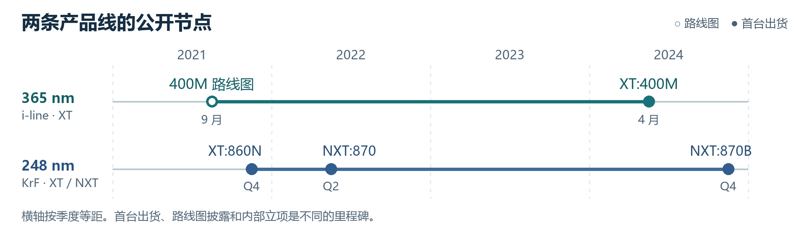
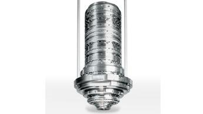
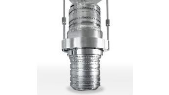
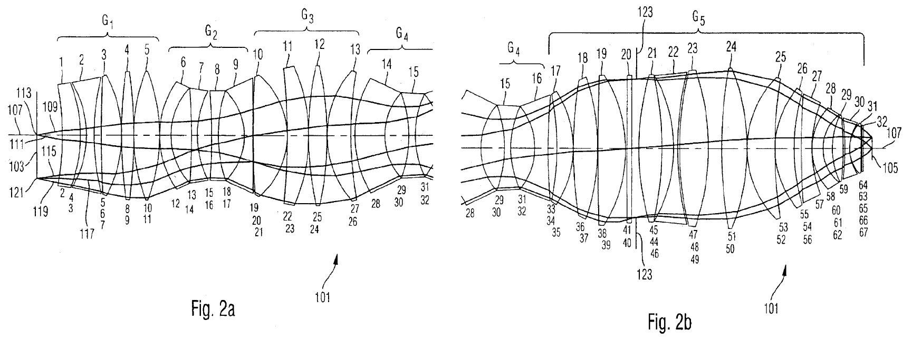
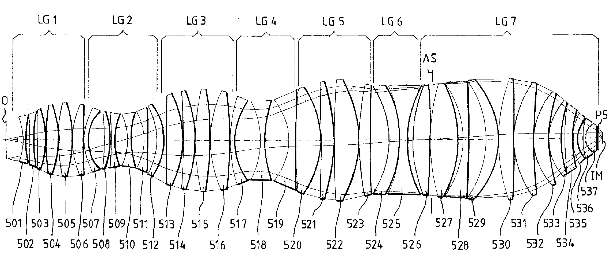
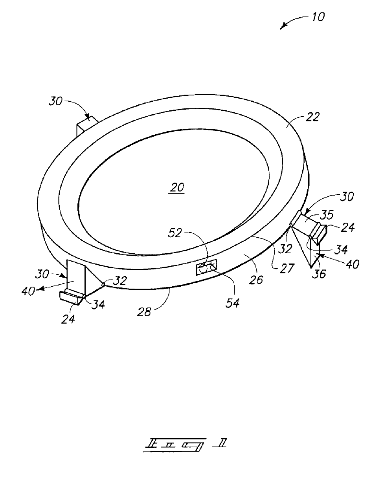
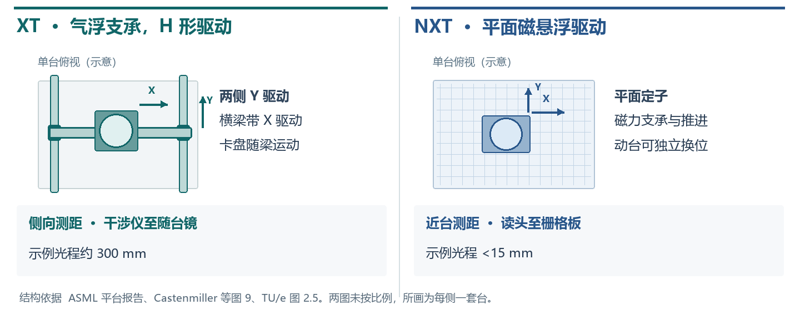
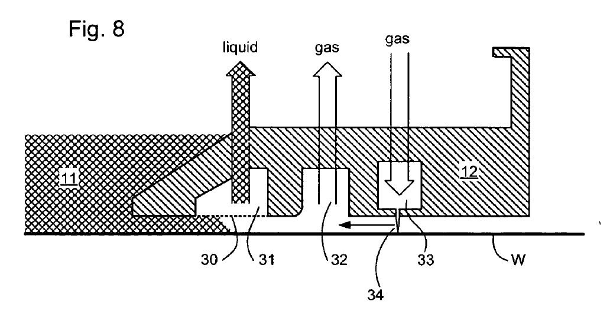

# ASML XT:400M 与 NXT:870 的研发难度与产品迭代

**从 XT:400M 的 i-line 能力做到 NXT:870 的干式 KrF 能力，最难的是在更小的焦深余量里，同时做到 110 nm 成像、纳米级套刻和更快的连续出片。** 标称线宽上限从 350 nm 降到 110 nm，收紧 **68.6%**。即使以 400M 的 220 nm 选件比较，仍收紧 **50.0%**。两机各按最大 NA、相同工艺系数计算，870 的理论焦深尺度为 400M 的 **44.9%**。在 ASML 各自的 ATP 验收工况下，产能则从 250 升至 330 片/小时。公开资料未披露可比的研发人年、成本和整机物料清单，无法把这些指标折成一个整机难度倍数。[S15][S38–S40]

两者均有 **2 套完整晶圆台、0 套浸没头**。从实机指标可量化约束收紧了多少，从物料证据只能对一部分部件计数。产品时间线上，**NXT:870 于 2022 Q2 首发，比 XT:400M 的 2024 年 4 月更早**。400M 的前款是 i-line XT:400L。870 的平台换代与后续改进，则可沿 KrF 的 XT:860N → NXT:870 → NXT:870B 追踪。[S38][S42][S44–S48]

核查日期 2026-11-03　·　[ASML 产品迭代](#asml-cadence)　·　[模块数量](#module-counts)　·　[ZEISS 物镜与镜框](#optics-and-mounts)　·　[气浮与磁悬浮晶圆台](#wafer-stages)　·　[来源与原件](sources.md)

## 两台实机放在一起，指标差多少？

| XT:400M · i-line | NXT:870 · KrF |
| --- | --- |
|  |  |

两图分别来自对应的 ASML 产品页，可看到光学柱和机台的相对位置。厂家提供的是整机示意图，内部处方、镜框和控制柜的数量须另外取证。[XT:400M 原图与规格](https://www.asml.com/en/products/duv-lithography-systems/twinscan-xt-400m) · [NXT:870 原图与规格](https://www.asml.com/en/products/duv-lithography-systems/twinscan-nxt870)

| 比较项 | XT:400M · i-line | NXT:870 · KrF | 读数说明 |
| --- | --- | --- | --- |
| 平台、晶圆 | XT，双台干式扫描；200、300 mm | NXT，双台干式扫描；300 mm | 两台都要一边测量、一边曝光；400M 还覆盖 200 mm 生产。[S38][S39] |
| 曝光源 | 365 nm 汞灯 | 248 nm 窄线宽准分子激光器；40 或 60 W，频率可调 | 40/60 W 是激光器光输出选项；未取得同测点的 400M 光输出。[S38][S39] |
| 投影物镜 | 标示 NA 0.65；光学柱改进提高透过率 | ZEISS Starlith 865，4× 缩小，可调 NA 0.55–0.80；AERIAL II 照明，QUASAR XL 选配 | 比较最大 NA 时为 0.65 对 0.80。两机的公开产品页均未给逐面处方。[S38][S39] |
| 标称分辨率 | ≤350 nm；高分辨率硬件选件可达 220 nm | ≤110 nm | 按规格端点比较；选件、掩模、胶和图形会影响实测窗口。三个数都不是设备可做的芯片节点名。[S38][S39] |
| 全片套刻 | ≤20 nm，需 TOP-2F；旧 TOP-2 的 20 nm 仅适用于内场 | 产品页：≤7.5 nm，全片、匹配参考晶圆；2025-01 厂商对照表另列 MMO ≤6.0 nm | 400M 产品页未给与 870 相同的参考晶圆和统计定义；870 两份资料也未交代差别原因。保留各自口径，不算台精度倍数。[S38][S39][S42] |
| 产品页产能 | ≥245 片/小时，指标卡未分列片径或高分辨率选件 | 330 片/小时，明确为 300 mm | 两侧未给同一剂量和场数。不能断言 400M 在 220 nm 选件下仍同时达到 245。[S38][S39] |
| 年报验收测试（ATP）产能 | 250 片/小时，2023 年能耗测试 | 330 片/小时，2022 年能耗测试 | 同一张年报表，870 高 32%；产品页的 245 与能耗测试的 250 用途不同。[S40] |
| 验收工况功耗／单片一次曝光能耗 | 0.07 MW；0.30 kWh/片次 | 0.13 MW；0.38 kWh/片次 | 每片次能耗高约 27%；采用厂商公布的每片数值。不能把整机电功耗当作激光发热量或冷机负荷。[S40] |
| 场内畸变／在线成像测量 | 未公开与右列同口径的数值 | 环形照明畸变 ≤10 nm，PARIS 监测成像 | 畸变衡量场内图形位置偏差。应与跨机或跨层套刻分读。[S38][S39] |
| 在役机群日产／可用率 | 未找到该型号同口径 13 周数据 | **>5,200 片/日，可用率高于 95%**，均为 13 周平均 | ASML 2024 年 11 月公布的机群表现。日产还受任务、换批和调度影响，不能由日产和额定片速反算可用率。[S45，第 20 页] |

[XT:400M 原厂规格](https://www.asml.com/en/products/duv-lithography-systems/twinscan-xt-400m) · [NXT:870 原厂规格](https://www.asml.com/en/products/duv-lithography-systems/twinscan-nxt870) · [同表原始数据与计算](official-data.md#twinscan-calculations)

## ASML 自己的产品迭代用了多久？

**在 248 nm、最大 NA 0.80、110 nm 这一档，ASML 连续两步都多做了 70 片/小时。** 第一步是从 XT 切到 NXT，第二步是在 NXT 上升级。三款机的首台出货可定位到季度。两段间隔分别为 2 和 10 个季度，反映客户看到新品的节奏。ASML 在 2021 年 9 月的一张路线图上已经同时列出 860N 和 870。[S39][S41][S42][S45][S47][S48][S50]

| 干式 KrF 的同一档产品 | XT:860N | NXT:870 | NXT:870B |
| --- | ---: | ---: | ---: |
| 首台出货所在季度 | 2021 Q4（年底） | 2022 Q2 | 2024 Q4 |
| 距左侧上一款首发 | — | **2 个季度** | **10 个季度** |
| 产能规格，片/小时 | ≥260 | ≥330（增 26.9%） | ≥400（增 21.2%） |
| 匹配机套刻 MMO，nm | ≤7.5 | ≤6.0 | ≤6.0 |
| 特定用例产品上套刻，nm | ≤6.0 | ≤5.0 | ≤4.0 |

后三行均取自同一份 ASML 三机对照表。870 到 870B，匹配机套刻仍为 6.0 nm，特定用例的产品上套刻上限收紧了 1.0 nm（20%）。这说明只盯某一种套刻，会漏掉升级的收益。两款目标机的规格表另列 870 产品页的参考晶圆口径。[三机同表，第 21 页](https://www.sec.gov/Archives/edgar/data/937966/000093796624000026/exhibit995.htm) · [首台 860N](https://www.sec.gov/Archives/edgar/data/937966/000093796622000004/pressreleasequarterlyresul.htm) · [首台 870](https://www.sec.gov/Archives/edgar/data/937966/000093796622000019/pressreleasequarterlyresul.htm) · [首台 870B，第 9 页](https://www.sec.gov/Archives/edgar/data/937966/000093796625000003/a2025_01x29presentationi.htm)

| 另一条产品线 | 可定位的研发、发布和交付节点 | 能读出的时间 |
| --- | --- | --- |
| i-line · XT:400 系列 | 2007 年 10 月，XT:400E 在客户现场达到一年处理百万片的纪录。2018 年 11 月路线图已列 XT:400L。2021 年 9 月路线图并列 400L 和 400M。2022 年报预计 400M 于 2023 年出货。公司在 **2023 年**测得该机 ATP 能耗与产能，首台实际在 **2024 年 4 月**出货。[S40][S43][S44][S49–S51][S64] | 从 400M 具名路线图到首发约 **31 个月**。400L 的首台出货日和 400M 内部立项日均未查到。2025 Q3 首发的 XT:260 面向先进封装，单列为 i-line 分支。[S62] |
| 双台平台 · AT → XT → NXT | **2001** 年首台 TWINSCAN（KrF AT:750T）出货，i-line AT:400T 随后加入。**2004** 年由 AT 转入 XT，平台占地缩小。**2008** 年推出首款 NXT:1950i，采用更轻的晶圆台，**2009** 年首台出货。**2022 Q2** 首次把 NXT 用在 KrF。[S46–S48][S52][S65] | 早期平台节点约相隔 **3 年、4 年**。NXT 的浸没式和干式 ArF 经验先于 KrF，2022 年的换平台可复用已有的技术。[S45][S47] |
| 浸没式 · 概念 → 样机 → 量产 | **2001 年 12 月**讨论以水延伸 193 nm，回程后组队验证，随后约 20 人做全尺寸样机。**2003 年秋** AT:1150i 首次展示成像，**2003 年 12 月**公布预生产 XT:1250i。**2006 年** XT:1700i 系列进入量产阶段。[S52][S53] | 概念到样机成像约 **两年**，样机到量产机约 **三年**。已验证的干式测量台、ZEISS 物镜设计和新的局部供液技术并行开发。[S52] |
| 浸没式 · 同一 NXT 产品线 | 2024 年原厂路线回顾列出 **2020 年 2050i → 2022 年 2100i → 2024 年 2150i**。三代 MMO 分别为 1.5、1.3、1.0 nm，产能为 295、295、310 片/小时。[S45，第 12 页][S66] | 按该图的发布年份，两次相隔均约 **2 年**。第一步主要收紧套刻，下一步同时提高产能。这些年份与上表干式 KrF 的首台出货季度分别统计。 |
| 早期 KrF · 248 nm 样机 | ASML 前身牵头的欧共体 2048 项目有合同起止日，**1988-11-01 至 1991-10-31**，覆盖曝光样机、材料与环境集成。[S08] | **36 个月**是限定任务的联合研发期。现代 400M、870 均未披露同样口径的全项目工期。 |

**复用具体发生在哪里？** ASML 在 870、1470、2050i 三款 NXT 机型中点名了晶圆台、掩模台和掩模搬运技术的共用。在同波长的 870 与 870B 之间，还共用光源、传感器和光学模块技术。已有双台、搬运和量测技术可以缩短开发前置工作，后续仍须重新验证更快的扫描、交接和热稳定。厂商没有公布逐件复用率或因此节省的月份。[S45，第 26 页]

## 研发时，哪几项需要重新验证？

| 研发问题 | XT:400M 的起点 | NXT:870 增加的约束 | 最能分清原因的验证 |
| --- | --- | --- | --- |
| 光源和照明怎样稳定剂量？ | 汞灯配 365 nm 光学柱；提高透过率可增加有效光量 | 窄线宽脉冲源同时控制谱宽、脉冲能量和触发；扫描狭缝上累加的脉冲决定局部剂量 | 固定胶与图形，分别测光源出口光谱、晶圆面剂量均匀性，以及停顿后首场和连续场的差异。没有两机同口径线宽或剂量稳定度实测值。[S34][S38][S39] |
| 对焦为何更难？ | 波长 365 nm、NA 0.65 | 248 nm、最大 NA 0.80。相同工艺系数且均取最大 NA 时，理论线宽尺度只剩 **55.2%**，焦深尺度只剩 **44.9%** | 对同类图形做焦距–剂量矩阵；分别记录中心、边缘及台阶区的可用焦深。44.9% 不是实测工艺窗口。[S15][S38][S39] |
| 台、对准与物镜各吃掉多少套刻余量？ | 双台均已存在；TOP-2F 把 20 nm 覆盖到晶圆边缘 | NXT 平台须在更快节拍维持配机套刻；PARIS 用于设置和监测成像，环形畸变规格 ≤10 nm | 用同一参考晶圆分别做同卡盘重复、换卡盘、跨机匹配；保留内外场残差图，再核查扫描同步与场内畸变。畸变、套刻、台跟随误差不能互相替代。[S38][S39] |
| 快在哪里？增加哪些热负担？ | ATP 下平均每 14.40 s 输出一片 | ATP 下约 10.91 s 输出一片；功耗和每片次能耗同时上升 | 用相同曝光场数、剂量、测量点数及批长记录曝光侧、测量侧、交接与搬片节拍，再看冷启动到热稳态的套刻漂移。上述秒数是产线平均出片间隔，不是单台扫描时间。[S39][S40] |

## 从 XT:400M 到 NXT:870，能确认多了多少模块？

| 先固定计数单位 | XT:400M | NXT:870 | 差额与依据 |
| --- | ---: | ---: | --- |
| 顶层功能种类（按下表拆分） | 8 类 | 8 类 | **0 类**。两者都要完成同一套双台干式扫描流程。分类用于保证比较范围一致。[S38][S39][S46] |
| 完整晶圆台模块（台） | 2 | 2 | **0 台**。测量位和曝光位交换的是两套完整晶圆台。掩模台另计。[S46] |
| 曝光位局部浸没头（套） | 0 | 0 | **0 套**。两机均为干式。浸没头单列在后面的 2050i 参照中。[S38][S39][S54] |
| 投影物镜内的镜框／主动功能框（件） | 未公开／未公开 | 未公开／未公开 | 870 有具名物镜和 PARIS 成像计量。可动镜片、驱动器、镜框分别计数。[S38][S39][S57] |
| 实装 PCB（块）／独立环控柜（柜） | 未公开／未公开 | 未公开／未公开 | 两机均缺按同配置、含外置光源电子学和厂务边界的装机清单。[S38–S40][S59][S60] |

| 同一层级的功能 | XT:400M · i-line | NXT:870 · KrF | 工程上要多解决什么 |
| --- | --- | --- | --- |
| 1 光源与供能 | 365 nm 汞蒸气灯 | 248 nm 窄线宽脉冲激光器，40 或 60 W 选项 | 气体循环放电、激光线宽控制、逐脉冲能量控制是三项可辨认的光源任务。下钻到此层才看得出差异。[S34][S38][S39][S63] |
| 2 照明与剂量 | 光学柱透过率改进，高分辨率硬件选配 | AERIAL II 连续可变常规及离轴照明，QUASAR XL 选配 | 把各脉冲在移动狭缝内累加到目标剂量，同时控制照明瞳形。[S34][S38][S39] |
| 3 投影物镜 | 0.65 NA | 0.55–0.80 NA，ZEISS Starlith 865 | 在较高最大 NA、较短波长下维持热稳态像质。镜框分析见下节。[S38][S39] |
| 4 掩模搬运与掩模台 | XT 同步扫描 | NXT 同步扫描 | 更快扫描及较短准备时间与掩模夹持、振动收敛相互制约。两台的夹具和驱动器数量未公开。[S42][S43][S45] |
| 5 晶圆搬运与预处理 | 支持 200 和 300 mm | 目标规格为 300 mm | 前者须覆盖两种片径，后者的高速生产压缩搬片、预调温和交接时间。[S38][S39][S60] |
| 6 晶圆台与对焦调平 | 双台，测量与曝光并行 | 双台，测量与曝光并行 | 焦深尺度缩小，台高、倾斜和边缘调平残差要占用更少余量。[S15][S38][S39][S46] |
| 7 对准与成像计量 | TOP-2F 选配，把 20 nm 套刻扩至全片 | PARIS 监测成像，公开全片参考晶圆匹配规格 | 边缘场套刻、场内畸变、不同机台间匹配要各自验收。[S38][S39] |
| 8 温控、洁净与厂务接口 | ATP 整机 0.07 MW | ATP 整机 0.13 MW | 区分整机电功耗、晶圆进台温度和镜筒热漂移。实装柜数和回路冷量另需证据。[S16][S40][S60] |

这八类是统计边界。以光源为例，i-line 同样有供电、谱线选择和剂量控制，KrF 则需要循环激光工作气体、在谐振腔内压窄谱线、随每个脉冲调整放电能量。Cymer 公报的商用光源结构和控制电路把这些任务落实到了装置。公开资料未把 NXT:870 的任务逐一映射到可更换总成，**两台整机净增多少件目前无法计算**。[S34，图 1–2][S38][S39][S63]

### 同一款 KrF 继续升级，ASML 实际改了哪些地方？

| 870 → 870B，按原厂图上 7 处标注计 | 具体变化 |
| --- | --- |
| ① 晶圆台　② 整机动力学 | 缩短晶圆台稳定时间，同时改进晶圆台与基座的阻尼。 |
| ③ 晶圆搬运　④ 紫外调平传感器 | 改进晶圆预调节。调平传感器使用 **35 束**光提高效率，计量单位为光束。 |
| ⑤ 掩模台　⑥ 掩模与台对准 | 更快扫描、缩短准备时间、改进夹持，并改进对准。 |
| ⑦ 投影物镜 | 减小物镜受热影响，增加物镜调节器。厂商确认数量增加，未给原有数和新增数。 |

这 7 处共同支撑 ≥330 到 ≥400 片/小时的升级，覆盖改设计、改控制以及增加部件三种工作。每项对产能的独立贡献未公布。[ASML 原始标注及三机对照，第 21 页](https://www.sec.gov/Archives/edgar/data/937966/000093796624000026/exhibit995.htm)

### ZEISS 物镜实物与专利剖面

| 365 nm i-line · Starlith 400 | 248 nm KrF · Starlith 860（86X 系列） |
| --- | --- |
|  |  |

两张镜筒图取自 ZEISS 官网，原厂图题分别标明 **Starlith 400** 和 **Starlith 860**。它们展示两个产品系列的外观，图片各自取景。ASML 对 NXT:870 明确给出的装机型号是 **Starlith 865**，属于右侧 86X 系列。XT:400M 产品页公开了 0.65 NA，未列物镜商品名。[ZEISS 原厂配图与型号（S77）](https://www.zeiss.de/semiconductor-manufacturing-technology/inspiring-technology/duv-lithographie.html) · [ASML NXT:870](https://www.asml.com/en/products/duv-lithography-systems/twinscan-nxt870) · [ASML XT:400M](https://www.asml.com/en/products/duv-lithography-systems/twinscan-xt-400m)

| 365.5 nm · US6806942B2 图 2 | 248 nm · US6522484B1 第五实施例，图 5 |
| --- | --- |
|  |  |

剖面均为专利原图，物方在左，像方在右。左图两幅在 15 号镜片附近重叠。右图可以沿光轴数到 37 片透镜和末端平板 P5，表 5 给出对应处方。两图各自缩放，物像距和镜片直径按下表比较。两套专利与两台整机的装机处方对应关系未公开。[i-line 图 2 与表 1](../../../materials/patents/US6806942B2/README.md) · [KrF 图 5 与表 5](../../../materials/patents/US6522484B1/README.md#prescription)

**在这两套设计里，KrF 多 7 片有光焦度的透镜，少 1 块平板，合计多 6 件玻璃、12 个玻璃表面。** 加工难度集中在约 340 mm 的大口径，装调难度还体现在 526 与 527 号之间仅 34 µm 的轴上间隔。i-line 的第 22 件直径接近 196 mm、中心只有 5 mm 厚，薄片装夹仍是它突出的制造约束。

| 技术参数 | 365.5 nm · i-line 图 2 | 248 nm · KrF 图 5 | 差异及工程含义 |
| --- | --- | --- | --- |
| 像方 NA／物像距 | 约 0.6501（轴上处方追迹）／1,000.0 mm | 0.80／1,695 mm（说明书） | 右侧物像距长 695 mm，接收的像方光束角更大。[S68][S69] |
| 像场与波前 | 末行像面半口径 14.752 mm。图 2 未给全场最差 RMS 波前值 | 像场直径 27.2 mm，全场最差 RMS 波前误差 18.7 mλ，折 4.64 nm | 左侧是表列半口径，右侧是设计像场。相同 λ/50 波前预算对应 7.31 和 4.96 nm。[S68][S69] |
| 镜组／有光焦度透镜／平板 | 5 组／30 片／2 块 | 7 组／37 片／1 块 | 独立玻璃件 **32 → 38**。左侧原文的 31 片含第 20 件内部平板，另有第 32 件末端平板。[S68][S69] |
| 曲面／平面／非球面 | 60 个球面、4 个平面，非球面 0 | 表 5 有 74 个有限半径面、2 个平面，列出的非球面系数组数为 0 | 第五例按表列球面复算，每面检查半径和中心位置。两套公开处方均未给实机面形公差。[S68][S69][S78] |
| 材料与设计波长处折射率 | 22 片 FK5（1.503934）、3 片 LF5（1.619068）、5 片 LLF1（1.579164），2 块 SUPRA1 石英平板（1.474478） | 37 片透镜和 P5 均为 SiO₂。表 5 未列 n，20 °C 熔融石英色散式在 248 nm 给出约 1.50855 | 左列为处方值，右列 n 为材料参考值。第五例里不用 CaF₂。[S68–S70] |
| 最大镜片直径，按说明书 | 212.87 mm，第 24 件。两面共同通光直径 212.508 mm | 341 mm，第 529 号。表 5 另列第 522 号后面 Hmax＝172 mm，折直径 344 mm | 按两份说明书比，直径增约 **60%**，圆面积约为 **2.57 倍**。右侧 341 与 344 mm 在原件中并存，机加工外径、公差均未列。[S68][S69][S78] |
| 顶点曲率半径绝对值，有限面 | 43.342–6,356.791 mm | 47.759–593,481.158 mm | KrF 第 537 号前面半径 47.759 mm，第 530 号后面接近平面。逐片表保留正负号。 |
| 有光焦度透镜中心厚，最小／中位／最大 | 5.000／22.481／44.977 mm | 6.015／30.190／78.378 mm | KrF 最薄的 528 号紧随最厚的 527 号。装配时厚片支撑与薄片变形需要分别验证。 |
| 直径／中心厚 D/CT | 第 22 件 195.688／5.000＝**39.14**，为 30 片中最大 | 第 529 号 341／33.801＝**10.09**。另有 8 片提供单面 Hmax，其中第 518 号 220／12.074＝**18.22** | 左侧按两面共同口径。右侧保留说明书直径或单面直径的来源，全套最大 D/CT 未知。 |
| 直径／边缘厚 | 第 12 件共同通光直径 187.982 mm、该边缘厚 5.329 mm，**D/ET＝35.28** | 第 530 号前面 Hmax＝170 mm，按两面球形延至此高度计算厚 13.739 mm，**340／13.739＝24.75** | 右侧仅公开前面口径，24.75 是指定半径的几何比值。实物共同口径、倒角和装夹边余量仍需加工图。 |
| 相邻玻璃件之间的最小轴上间隔 | **0.500 mm**，第 5、6 件之间 | **0.034 mm**，第 526、527 号之间 | 后者名义间隔约为前者的 1/15。偏心、倾斜或热漂下的局部防碰余量还要结合两面矢高与公差计算。 |
| 可动框种类、数量 | 图 2 未列固定框、可动框或驱动自由度 | 图 5 标出孔径光阑 AS 和末端平板 P5，未列可动镜框种类、件数 | 专利可点数到玻璃件。两台实机公开的调节功能与其他具名装机样本列在下节。 |

KrF 表 5 对 37 片透镜都列出曲率、中心厚和到下一面的轴上间隔，只有 8 片给出一侧的最大通光高度。附表逐片列数并标记口径取自前面还是后面。另一件 ZEISS 专利 N801 的 16 片透镜和 7 个非球面保留在附录，供研究另一种校正方案。[70 件玻璃的逐片表与计算](optical-manufacturing.md) · [表 5 美国原页](../../../materials/patents/US6522484B1/figures/table-5.png) · [欧洲同族表 5](../../../materials/patents/EP1006387A2/README.md)

#### 目标机的商品物镜和可动框

ASML 还把 XT:860N 的镜头标为 Starlith 860+。这款镜头和 NXT:870 的 865 都是 4× 缩小、NA 0.55–0.80，可以用原厂机型页逐项核对。[XT:860N 原厂光学规格](https://www.asml.com/en/products/duv-lithography-systems/twinscan-xt860n) · [NXT:870 原厂光学规格](https://www.asml.com/en/products/duv-lithography-systems/twinscan-nxt870)

| 能核对的实机信息 | XT:400M · 365 nm | NXT:870 · 248 nm |
| --- | --- | --- |
| 投影光学与倍率 | ASML 系统采用 ZEISS 光学，400M 产品页未列镜头商品名及倍率 | ZEISS Starlith 865，4× 缩小。[S38][S39][S55] |
| 数值孔径与成像 | NA 0.65，350 nm，选配可达 220 nm | NA 0.55–0.80，110 nm，环形照明畸变 ≤10 nm。[S38][S39] |
| 已公开的调节／测量 | 400M 提高光学柱透过率。前款 400L 明载主动镜头调节器 | PARIS 监测成像。后款 870B 明载增加调节器。[S38][S39][S45][S51] |
| 镜片数、固定镜框数、主动调节框种类及各自件数 | 均未公开 | 均未公开。[S38][S39] |

**一片镜片如何安装和调节？** 左图是在 ZEISS 专利里能实际点数的结构，右列说明每个号代表什么。以此口径，一处可调镜片安装位就可能同时有内外两框、多个连接点和位置测量。把三种数量混用会放大估算误差。[S57]

| ZEISS 可调镜框，授权专利图 1 | 原图元件与作用 |
| --- | --- |
|  | **20** 为 1 个光学元件。**22、24** 为内外两级支承件。**30** 在该实施例沿周向分布 **3 处**。**40** 表示径向施力的方向，经杠杆转换为镜片轴向运动。**52** 为可选电容位置测量。图 2、3 给出两种杠杆安装方向。[原图与逐页说明](../../../materials/patents/US6816325B1/README.md) |

实装数可在更早的 ASML 设备上找到校验点。EPFL 的 PAS 5500/350C 使用 ZEISS 物镜，内含超过 15 片石英透镜，其中 **2 个可动元件**用于校正焦点偏移和倍率。前款 400L、这台 /350C 和后款 870B 合起来说明主动调节横跨 i-line 和 KrF，两款目标机各有多少主动框仍需装配图或物料表。[S16][S45][S51]

**功能框按它校正什么来分，比按镜筒外观来数更有意义。** ASML 产品资料中至少能辨认下列三种光学调节功能。这里的“类”按控制目标划分，一种功能可能需要多个驱动器，也可能与另一种共用一套安装件。

| 可辨认的调节功能 | 有实机证据的 ASML 产品 | 公开到哪一级 |
| --- | --- | --- |
| 轴向位置／倍率补偿 | PAS 5500/350C | 装机资料明确给出 2 个可动元件。上方 ZEISS 专利给出一种径向施力、轴向移动的实现，未证实为 /350C 的装配图。[S16][S57] |
| 可编程波前补偿 | NXT:1950i 的 FlexWave 选件 | 2011 年原厂公告列为可用选件。用于校正投影物镜的固有像差及镜头受热造成的波前变化，硬件件数未给。[S65] |
| 像场畸变补偿 | NXT:2100i 的新型调节器 | 原厂确认用于改善 DUV 与 EUV 的匹配。样机两层图形试验中，校正前后失配约 **0.65 → 0.30 nm**，是一次实验的残差。产品的调节器数量未公开。[S66][S67] |

[补充阅读：Nikon 的 365 nm 与 248 nm 物镜设计及原始剖面](nikon-lens-supplement.md)

### 晶圆台从气浮 H 形驱动改成平面磁悬浮，究竟改了什么？

**XT 用气膜承重、H 形驱动推进。NXT 用平面磁驱动悬浮和移动晶圆台。** 左图的卡盘由横梁带动，右图的动台能在定子平面上独立运动。两边都需要精定位、双台交接和晶圆对准。上图依公开设备结构重绘，省略短行程执行器和厂务管束；原始平台图可在 ASML 作者的论文图 9 和 TU/e 图 2.5 对读。[ASML 晶圆台技术报告](https://www.sec.gov/Archives/edgar/data/937966/000115697308000936/u56855exv99w3.htm) · [两种平台原结构示意，图 2.5](https://pure.tue.nl/ws/portalfiles/portal/318592528/Master_Thesis_Max_Adaloudis.pdf#page=21)

**哪些有实测对照？** XT:400M 与 NXT:870 的公开资料给出了整机指标，未给足两台 WS 本体的质量、扫描加速度、共振频率和跟随误差。下表采用 ASML 对 **XT:1900Gi 与 NXT:1950i** 两台浸没式扫描机的对照实验，保留样机身份和工况。另一个与目标机直接相关的证据是，ASML 将 NXT:870 的晶圆台技术与 NXT:1470、2050i 列为共用项。[S38][S39][S45，第 26 页][S71]

| 同口径性能 | 气浮 H 形台 · XT 平台 | 平面磁悬浮台 · NXT 平台 | 样本、工况与含义 |
| --- | --- | --- | --- |
| 总运动质量（归一化） | 100% 基准 | **约为 XT 的 1/3** | ASML 论文图 9。省去粗定位重横梁和随台大反射镜，绝对 kg 数未给。[S71] |
| 机械共振（实台开环） | 首阶频率取 1.00；图示寄生模态 **667 Hz** | 首阶约 **1.40 倍**；图示寄生模态 **921 Hz** | 图 10 分别给首阶相对值和寄生模态频率。后者升 **38.1%**。这给提高伺服带宽留下余量，实际闭环带宽没有随这两个频率一起公布。[S71] |
| 晶圆台扫描加速度 | 图 8 未给绝对值 | **35 m/s²**（约 3.57 g） | 图 8 的 WS 数字。同图的最高 150 m/s² 属于掩模台 RS。[S71] |
| 位置计量光路长度 | 干涉仪到随台反射镜，图示约 **300 mm** | 台上读头到栅格板，图示 **<15 mm** | ASML 2008 年平台示意，右列不到左列的 1/20。短光路减少空气折射率波动造成的测长误差；这两个长度均非台行程。[S73] |
| 扫描同步，移动平均误差（MA） | 图 10 未给同条件 X、Y 读数 | **X 0.47 nm，Y 0.49 nm** | 图 10，175 片/小时设置下，比较按 4× 缩小换算的掩模台位置与晶圆台位置。图示为一次扫描的 MA 指标，未给两机的静态重复定位精度。[S71] |
| 同图整机生产节拍 | XT:1900Gi **131 片/小时** | NXT:1950i **175 片/小时** | 图 8，16 × 32 mm 曝光场、每片 125 次曝光，增 **33.6%**。其中还有交接、对准和浸没液交接的收益，不能全计入 WS。[S71] |

作为量级参照，ASML 对 2008 年 NXT 平台另列晶圆台加速度最高 **5 g**、位置传感器每秒约 **20,000 次**测量、传感器精度约 **60 pm**。35 m/s² 是上表 1950i 图 8 的数值，5 g 是平台上限。传感器精度也不能换作卡盘动态定位精度。[S71][S72]

**从卡盘到控制器，两侧要完成哪些工作？** 以下十项按功能对齐。计量基准、调平传感器等跨越晶圆台与整机的边界，表内写明接口。它们是十项功能的比较，不能据此认定两台各有十个可更换硬件总成。[S71][S73–S75]

| WS 功能／接口 | XT 气浮 H 形架构 | NXT 平面磁悬浮架构 | 对研发难度的影响 |
| --- | --- | --- | --- |
| 1　承重与导向 | 气浮轴承与精密基面提供机械承载基准，电机提供推力 | 平面磁驱动支承运动体，主动控制悬浮姿态 | 由气膜、导轨精度和供气稳定性，转向磁力模型、多轴耦合和悬浮稳定性。[S71][S74] |
| 2　长行程 X、Y 粗动 | H 形架构的两侧 Y 驱动带横梁，X 驱动沿横梁走 | 动台相对平面定子运动，省去用于粗定位的 H 形重梁 | 左侧要管住横梁偏摆和挠曲，右侧要在整片行程内保持推力与力矩的可预测性。[S71][S74][S75] |
| 3　短行程、六自由度精调 | 粗动到位后，精动校正 X/Y/Z 与三个转角 | 仍须精调六自由度；1950i 可在装片阶段完成六自由度绝对置零 | 磁悬浮保留末端定位任务。目标两机短行程线圈数、逐轴行程与公差均未披露。[S71][S74] |
| 4　卡盘、晶圆夹持、台上基准 | 卡盘随驱动机构运动；台上标记用于定位卡盘与晶圆 | 卡盘随独立动台运动，仍需台标记、夹持及晶圆形貌控制 | 台定位误差、夹持残差和晶圆热变形在套刻中有独立贡献。两目标机夹持面平面度和夹持力未公开。[S71][S75] |
| 5　位置与姿态读出 | 长光路激光干涉仪读取随台镜面位置 | 栅格板配台上编码器读头，测量位到曝光位保持闭环 | 精度约束从空气光路与镜形误差扩展到栅格标定、读头几何和切换一致性。[S71][S73] |
| 6　计量基准与校准 | 换台后须在曝光侧重新建立该代系统的台坐标零点 | 1950i 装片时绝对置零，换台中连续读数；用读头重叠区的冗余读数校漂移 | 论文图 7 用四读头的一致性校验。读头数是这个校准实例的配置，不能外推目标机总传感器数。[S71] |
| 7　运动控制与扫描同步 | H 驱动粗、精动协同，曝光时同步掩模台 | 降动质量、提刚度，1950i 论文列出 **10 kHz** 运动控制，图 10 给出 MA 同步误差 | 要区分机械共振、采样频率、闭环带宽和曝光中位置误差，四者单位与含义各异。[S71][S74] |
| 8　双台交接与路径 | 测量位与曝光位并行，交换时需交接卡盘 | 两个独立动台直接交换，1950i 可在物镜下方开始交换 | 收益来自直接换台及省下重复置零。论文里的液桥、封液盘与浸没头只属于湿式参照，两款干式目标机均无这一环。[S38][S39][S71] |
| 9　找平、对准与焦面指令 | 在测量位获取台及晶圆标记、晶圆高度图，再交给曝光侧 | 同样测量后曝光；坐标跨台位保持一致，使部分重复对准步骤可省 | 应分别验证高度图误差、Z／倾斜跟随残差与扫描同步。对准／调平光学头是整机计量接口。[S71][S75] |
| 10　热、振动和公用工程接口 | 气源、基面和干涉光路环境影响承载或读数；电机加速向基座传递反力 | 磁驱动的线圈耗散、结构模态和计量基准漂移仍须控制；较短光路降低空气扰动贡献 | 评估连续运行后的漂移和扰动传递。两目标机逐轴热耗、供气量、冷却回路数和隔振器数均未公开。[S71–S74] |

#### 晶圆台升级后，用哪些数字验证？

**换平台后，量测链要在更宽频带内读出更小的位置波动，高速运动又要在曝光时与掩模台同步。** 对 XT:400M → NXT:870 本身，ATP 平均出片间隔由 **14.40 降至 10.91 秒**，每片少 **3.49 秒**；同波长、同最大 NA 的 XT:860N → NXT:870 则从 260 升至 330 片/小时，按规格折算每片少 **2.94 秒**。ASML 把后一项提升归因于更高扫描速度和更低系统开销，未拆出晶圆台单次稳定时间。下面依 ASML 作者的 XT:1900Gi／NXT:1950i 论文，查看哪些部件和验证条件发生了可量化的变化。[S38–S43][S71]

| 验证项目 | 气浮 H 形 XT | 平面磁悬浮 NXT | 可量化的研发约束与验法 |
| --- | --- | --- | --- |
| X 向位置计量噪声 | 干涉仪 **0.90 nm（3σ）**，图 4 滤波 **40 Hz** | 栅格编码器 **0.22 nm（3σ）**，滤波 **1,000 Hz** | 新平台图示滤波频率高 **25 倍**，仍读到较小幅度。若要确定同带宽噪声改善倍数，应以相同轨迹、采样与滤波重测两台，分别报 3σ 和噪声谱。[S71，图 4] |
| 空气折射率波动带来的测长误差 | 空气光路示意 **300 mm** | 近台光路 **<15 mm** | 给一个相同、均匀的折射率扰动 Δn＝10⁻⁸，按单程等效光程偏差 LΔn，约 **3.0 nm → <0.15 nm**。这是灵敏度算例；实际闭环误差还取决于双光束共模抑制及气流分布。[S71，图 4][S73] |
| 残振与稳定时间 | 图 10 寄生模态 **667 Hz**，一个周期 **1.50 ms** | **921 Hz**，一个周期 **1.09 ms** | 若两侧模态阻尼比均取 0.05，按单模态自由衰减到初幅的 1%，包络时间 **22.0 → 15.9 ms**。实台须在同一加速度和加加速度指令下记录残振、阻尼与入窗时间；本例不提供 400M 或 870 的实测稳定时间。[S71，图 10] |
| 热稳定及校准负担 | 旧台侧向干涉光路受片台运动引起的温度、气压和气体组成变化影响；论文指出 **0.5–50 Hz** 扰动值得关注 | 图 5 的栅格支架约 **0.8 × 0.8 m**，每个支架装 **4 块栅板**；栅板周围空气控制至 **10 mK** 量级 | 若支架 α≈10⁻⁸/K，0.8 m 跨度均匀升温 10 mK，自由膨胀约 **0.08 nm**。新台要标定栅板拼接、运动学安装和读头漂移。应分别检验单片约 20 s 内漂移与数小时热稳态。[S71，图 5–7] |
| 扫描同步和成品套刻 | 同篇的跨机匹配参照为 XT:1900Gi；XT 同工况独立同步 MA 未给出 | 175 片/小时设置下同步 MA 为 **X 0.47／Y 0.49 nm**；另一组 **0.6 m/s** ATP 扫描，单卡盘套刻 **X 1.5／Y 1.6 nm**，跨机匹配 **X 3.7／Y 4.5 nm** | 图 10、11 对应三个层级。先验掩模台折算位置与 WS 之差，再验同卡盘和跨机印刷；图 11 给 44 场、每场 25 点、场 26 × 33 mm，按原图 99.7% 口径。不能把编码器噪声或 MA 直接当作整机套刻。[S71] |

台架上最有区分力的结果，是在同一负载和扫描轨迹下，把**位置读出噪声、加速结束后的入窗时间、曝光期间的双台同步误差**并排列出；只给最终片速，无法定位究竟是驱动、计量、调平还是换台改善。两款目标机的逐轴加速度、同带宽噪声和稳定时间仍缺同工况原厂数据。[原论文图 4–11](https://doi.org/10.1117/12.847025)

### 板卡可以数到一个机架，环控可以数到一个工位

| 工程证据 | 能直接数出的配置 | 与 XT:400M／NXT:870 的关系 |
| --- | --- | --- |
| NXT 已部署的成像控制机架 IMCR（2020 年项目，图 14） | **1 块 HCB 主控板＋5 块 MCB 运动控制板（3＋2）＋2 块 BB 桥接板＝8 块**明确画出的控制与桥接板。图中另有两组 S&A 传感／执行接口板，组内块数未标 | 只覆盖照明、掩模遮光和投影 3 个子系统。图的机型范围标为 NXT，无 XT:400M 或 NXT:870 的配置号。两台的整机板卡差额未公开。[S59，PDF 第 44 页图 14] |
| 同一研究的多核运动控制方案 | 把照明＋掩模遮光所需的 3 块单核 AMB 合并为 1 块，投影的 2 块合并为 1 块。该方案的 **5 → 2 块**取决于各控制回路满足时限 | 这是设计方案的运动板分项。功能更多或控制更快，并不必然多用板卡。需要同配置的机架槽位表和外置电源／光源板清单，才能求两台差额。[S59，PDF 第 67、69 页] |
| 晶圆搬运单元的热调节（2023 年 MK7 工程研究） | 现有结构由储片单元 SU 和热稳定单元 TSU **两站串联**。研究提出用气流调温 TCU 替代或升级。按 330 片/小时，搬运侧约有 **10.9 秒**完成一片的调温 | 在台架最大实测流量下，样机达到温度目标所需时间约为目标的 **2 倍**。以更高流量达到目标是外推。这个实验说明高速生产首先压缩热交换时间，两站不能换算为两个环控柜。[S60，PDF 第 10、37–38 页] |
| 整机环控柜、局部热回路与厂务 | 400M／870 的柜数、各回路流量与热负荷均未公开。/350C 现场记录另可识别镜筒与机械水循环、受控气流及镜筒吹扫 | 年报 ATP 整机功耗从 **70 kW 到 130 kW**，差 60 kW。冷却机容量还取决于热量在光源、机内和厂务间的分配。公开资料不足以把 60 kW 分摊到柜。[S16][S40][S60] |

### 只有浸没式才增加的浸没头

| 曝光端的部件或参数 | XT:400M／NXT:870 · 干式 | NXT:2050i · ArF 浸没式参照 |
| --- | --- | --- |
| 末级物镜到晶圆之间 | 无局部曝光水层，浸没头 **各 0 套** | 局部超纯水，曝光位有 **1 套浸没头功能总成**。原厂记载该型更换了减少失水的新头。[S38][S39][S52][S54] |
| 波长／最大 NA | 365 nm／0.65，248 nm／0.80 | 193 nm／1.35。4×，26 × 33 mm 场。双极照明 38 nm，C-quad 40 nm。[S38][S39][S54] |
| 新增接口与验收 | 依靠干式光路和原有热控 | 供水、边缘密封、抽液与抑制残滴须和扫描速度配合。液层气泡妨碍成像，残滴会与光刻胶作用，蒸发会使晶圆局部冷却。[S52][S54][S58] |

| ASML 浸没专利图 8，密封件的一侧 | 图上可以分开的三条流路 |
| --- | --- |
|  | ① 液体经多孔板 **30** 进入集液腔 **31**。② 抽气环 **32** 带走气体。③ 供气环 **33** 在窄缝形成气刀 **34**。这是同一侧密封结构上的三条路径，2050i 的内部件数与泵数未公开。[图 5、图 8 与段 0059–0064](../../../materials/patents/US20060038968A1/README.md) |

### 哪些供应商能对应到目标机型？

| 子系统 | XT:400M · i-line | NXT:870 · KrF | 证据能落实到哪一层 |
| --- | --- | --- | --- |
| 投影光学 | **ZEISS**。具体物镜商品名未公开 | **ZEISS Starlith 865** | ASML 明确自 1980 年代末起整机均采用 ZEISS 光学。870 的原厂型号页又给出物镜名。[S38][S39][S55] |
| 曝光光源 | 汞灯。Ushio INE 列有 ASML i-line 适配灯，400M 出厂灯号未公开 | 40／60 W 窄线宽 KrF。Cymer、Gigaphoton 均有公开 KrF 光源，870 规格未点名供方 | 旧款 /350C 明列 Cymer 5610，/750F 明列两家选项。系列适配、旧机选项与目标机实际装机分开登记。[S04][S06][S17][S27][S38][S39][S63] |
| 搬运控制与供电 | 逐柜供应商未公开 | 逐柜供应商未公开 | **Neways** 自述为 ASML 开发和生产电源控制设备，明确列出晶圆搬运器控制单元。案例未注明 XT／NXT 具体型号。[S56] |
| 环控柜、晶圆台与浸没头 | 环控柜、台的量产供应商未公开。无浸没头 | 同左 | ASML、ZEISS、Philips Research 与特温特大学在早期浸没研发中各有分工。公开的研究合作不能确定 2050i 浸没头的量产供货主体。[S45][S52][S54] |

---

复核入口：[来源表](sources.md) · [官方数据底稿](official-data.md) · [专利资料索引](../../../materials/patents/README.md)。

## 本篇图表与行文约定

每张图表回答一个具体问题。正文就近解释读者应关注的差异，以及该差异能说明哪一项工程难度。

| 要回答的问题 | 呈现方式 | 本篇用法 |
| --- | --- | --- |
| 同一项性能相差多少？ | 同条件的两个数并列，紧跟差额 | 例如晶圆台的寄生模态从 667 升至 921 Hz，保留原图频率与复算变化 38.1%。 |
| 技术如何随时间演进？ | 带箭头的时间轴 | 按厂商梳理研发历程，每个节点标上时间和里程碑，写清是项目启动、样机完成还是首次交付。 |
| 多项指标和条件如何逐项核对？ | 对照表 | 例如对比晶圆台时，逐行列出重复性、套刻和曝光场，按机型分列，保留各自的单位、测试条件和资料缺口。 |
| 子系统的结构或工作原理是什么？ | 两个有出处的真实结构并排，紧跟同口径参数表 | 例如讲解投影物镜时，截取对应实施例的光路图，保留元件编号，用图注解释关键镜组，并注明专利公开号、图号和来源链接。 |

## 修订记录

| 修订日期 | 修改及对结论的影响 |
| --- | --- |
| 2026-11-03 | 实物图恢复为 ZEISS 官网具名的 Starlith 400 和 860。KrF 主样本从 N801（16 片透镜＋1 块平板）换回 US6522484B1 图 5（37＋1），据表 5 和欧洲同族原页重算。对应 i-line 图 2 的玻璃件差额由 −15 改为 +6。 |
| 2026-11-03 | 撤下 Starlith 1000 系列配图，按 ASML 原厂页确认 86X 系列中的 865。改用有逐面数据的 ZEISS 图 2／N801 图 9 并列核算：32 和 17 件玻璃、0 和 7 个非球面；原 31 与 38 件是另两套专利图。晶圆台补入噪声及带宽、热敏度、残振和扫描套刻。 |
| 2026-11-03 | 正文改用与目标波长、NA 匹配的两幅 ZEISS 专利剖面，并列计数、成像、材料和制造尺寸。新增 XT／NXT 晶圆台实测与十项功能对比。移除历史整机样本，Nikon 物镜移至独立补充。 |
| 2026-11-03 | 按 ASML 干式产品线重新核对首发季度、路线图与 ATP 节点。新增在役机群表现、模块计数、镜框、成像机架、晶圆调温及独立浸没参照。两款目标机的物理模块净增数仍未公开。 |
| 2026-11-03 | 主对象改为 XT:400M 与 NXT:870。分别比较标称与选配线宽、产品与 ATP 产能，以及不同套刻口径；增加同波长 XT:860N 对照、两件公报的逐页稿与并排结构图。该版同时附有历史样本。 |
| 2026-11-02 | 补录 SF 样本、项目档案及光源与双台测量专利。KrF 物镜实施例最大 NA 由 0.55 修订为 0.60，依据为 [S20] 段 [0015]；[S18] 图注的 0.55 单列说明。镜片计数及三组主样本的线宽结论不变。 |
| 2026-11-02 | 首次发布。对照两种架构，逐项标明物镜计数依据、研发经费口径和板卡资料缺口。 |
