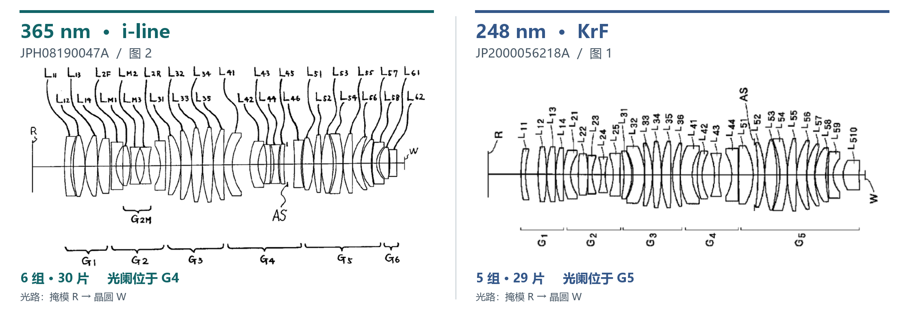
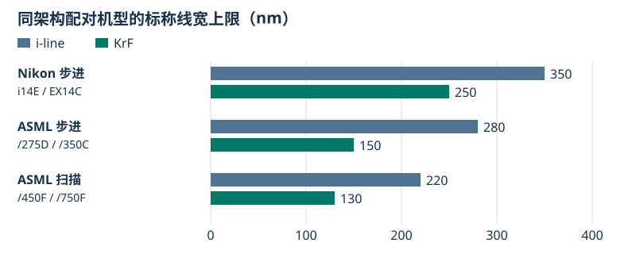

# XT:400M 与 NXT:870：从 365 nm i-line 到 248 nm KrF，研发难在哪里？

**NXT:870 的难点，是在更小的焦深余量下，把 110 nm 图形以 330 片/小时的节拍印出来，并维持纳米级套刻。** 对照 XT:400M，标称线宽由 350 nm 降到 110 nm，缩小 **68.6%**；即便以 XT:400M 的 220 nm 高分辨率选件为起点，也缩小 **50.0%**。两台都是双台干式扫描机，XT:400M 已经要解决同步扫描、全片调平和边缘套刻问题。要评估研发投入，须分开看光源和物镜、台与计量、连续运行三个环节；公开资料没有两机同范围的人年或决算，不能给出可信的整机难度倍数。[S38–S42]

核查日期：2026-11-03。主比较仅含 ASML TWINSCAN **XT:400M** 与 **NXT:870（无 B）**。先看实机规格，再看公开的物镜结构。**这不是 ASML 的前后代升级路线**：首台 NXT:870 于 2022 年交付，首台 XT:400M 于 2024 年 4 月交付；后者是 XT:400L 的后继机。本文比较两种目标能力，不能以两个日期相减推算研发工期。[S43][S44]

## 两台实机放在一起，指标差多少？

| 比较项 | XT:400M · i-line | NXT:870 · KrF | 读数说明 |
| --- | --- | --- | --- |
| 平台、晶圆 | XT，双台干式扫描；200、300 mm | NXT，双台干式扫描；300 mm | 两台都要一边测量、一边曝光；400M 还覆盖 200 mm 生产。[S38][S39] |
| 曝光源 | 365 nm 汞灯 | 248 nm 窄线宽准分子激光器；40 或 60 W，频率可调 | 40/60 W 是激光器光输出选项；未取得同测点的 400M 光输出。[S38][S39] |
| 投影物镜 | 标示 NA 0.65；光学柱改进提高透过率 | ZEISS Starlith 865，4× 缩小，可调 NA 0.55–0.80；AERIAL II 照明，QUASAR XL 选配 | 比较最大 NA 时为 0.65 对 0.80。两机的公开产品页均未给逐面处方。[S38][S39] |
| 标称分辨率 | ≤350 nm；高分辨率硬件选件可达 220 nm | ≤110 nm | 按规格端点比较；选件、掩模、胶和图形会影响实测窗口。三个数都不是设备可做的芯片节点名。[S38][S39] |
| 全片套刻 | ≤20 nm，需 TOP-2F；旧 TOP-2 的 20 nm 仅适用于内场 | 产品页：≤7.5 nm，全片、匹配参考晶圆；2025-01 厂商对照表另列 MMO ≤6.0 nm | 400M 产品页未给与 870 相同的参考晶圆和统计定义；870 两份资料也未交代差别原因。保留各自口径，不算台精度倍数。[S38][S39][S42] |
| 产品页产能 | ≥245 片/小时，指标卡未分列片径或高分辨率选件 | 330 片/小时，明确为 300 mm | 两侧未给同一剂量和场数。不能断言 400M 在 220 nm 选件下仍同时达到 245。[S38][S39] |
| 年报验收测试（ATP）产能 | 250 片/小时，2023 年能耗测试 | 330 片/小时，2022 年能耗测试 | 同一张年报表，870 高 32%；产品页的 245 与能耗测试的 250 用途不同。[S40] |
| 验收工况功耗／单片一次曝光能耗 | 0.07 MW；0.30 kWh/片次 | 0.13 MW；0.38 kWh/片次 | 每片次能耗高约 27%；采用厂商公布的每片数值。不能把整机电功耗当作激光发热量或冷机负荷。[S40] |

[XT:400M 原厂规格](https://www.asml.com/en/products/duv-lithography-systems/twinscan-xt-400m) · [NXT:870 原厂规格](https://www.asml.com/en/products/duv-lithography-systems/twinscan-nxt870) · [同表原始数据与计算](official-data.md#twinscan-calculations)

## 把两支物镜并排看：镜片多了，还是要求变了？

查到的 ASML 原厂资料能把 NXT:870 对应到 Starlith 865，但没有公开到能逐面核验这两台装机物镜的程度。因此，下图采用**两件 Nikon 专利中确切可查的设计**：能看到哪一组放了光阑、实际画了几片，也能回到同一实施例核对参数。图中的 30 片和 29 片均不代表 ASML 两机的实装清单。[S18–S20][S38][S39]

**图 A　同为 15.6 mm 最大像高，KrF 设计少一片镜片，光阑从第四组移至第五组。** 左为 [JPH08190047A 图 2](../../../materials/patents/JPH08190047A/figures/fig-2.png)，右为 [JP2000056218A 图 1](../../../materials/patents/JP2000056218A/figures/fig-1.png)。两图保留原编号，统一掩模 R 在左、晶圆 W 在右；右图旋转，各自缩放，不可用图上长度比较口径。[S18–S20]

| 同图可核的设计参数 | 365 nm · Nikon 第一实施例，图 2 | 248 nm · Nikon 实施例，图 1 |
| --- | --- | --- |
| 最大像高／像方 NA | 15.6 mm（综述）；0.57（表 1） | 15.6 mm／0.60（公报段 [0015]；综述图 5(e) 标 0.55） |
| 镜组／独立镜片 | 6 组，4＋5＋5＋6＋8＋2＝**30 片** | 5 组，4＋5＋6＋4＋10＝**29 片** |
| 开口光阑 AS | G4 内，L45 与 L46 之间 | G5 内，L51 与 L52 之间；处方第 41 面 |
| 处方给出的材料信息 | 表 1 有不同折射率，例如 1.53627、1.66638；不据此指定商业玻璃牌号 | 全镜合成石英；248 nm 下折射率 1.50839 |
| 掩模面至第一面／末面至晶圆面间距 | 94.97557／22.68864 mm（表 1 的 d₀、Bf） | 94.501／19.200 mm（表 1 面 0、59 对应的间隔） |
| 核对入口 | [实施例、原件与逐页稿](../../../materials/patents/JPH08190047A/README.md) | [实施例、原件与逐面处方](../../../materials/patents/JP2000056218A/README.md) |

**难度来自允许的误差，而不只是片数。** 在相同波前误差波数要求下，若举例取 RMS 光程差 λ/50，365 nm 对应 7.30 nm，248 nm 只剩 4.96 nm。全石英处方减轻多种材料搭配的问题，也让激光线宽和石英均匀性直接影响成像。这是公开设计解释的机制；λ/50 是算例，并非两机验收公差。[S18–S21]

## 研发时，哪几项需要重新验证？

| 研发问题 | XT:400M 的起点 | NXT:870 增加的约束 | 最能分清原因的验证 |
| --- | --- | --- | --- |
| 光源和照明怎样稳定剂量？ | 汞灯配 365 nm 光学柱；提高透过率可增加有效光量 | 窄线宽脉冲源同时控制谱宽、脉冲能量和触发；扫描狭缝上累加的脉冲决定局部剂量 | 固定胶与图形，分别测光源出口光谱、晶圆面剂量均匀性，以及停顿后首场和连续场的差异。没有两机同口径线宽或剂量稳定度实测值。[S34][S38][S39] |
| 对焦为何更难？ | 波长 365 nm、NA 0.65 | 248 nm、最大 NA 0.80。相同工艺系数且均取最大 NA 时，理论线宽尺度只剩 **55.2%**，焦深尺度只剩 **44.9%** | 对同类图形做焦距–剂量矩阵；分别记录中心、边缘及台阶区的可用焦深。44.9% 不是实测工艺窗口。[S15][S38][S39] |
| 台、对准与物镜各吃掉多少套刻余量？ | 双台均已存在；TOP-2F 把 20 nm 覆盖到晶圆边缘 | NXT 平台须在更快节拍维持配机套刻；PARIS 用于设置和监测成像，环形畸变规格 ≤10 nm | 用同一参考晶圆分别做同卡盘重复、换卡盘、跨机匹配；保留内外场残差图，再核查扫描同步与场内畸变。畸变、套刻、台跟随误差不能互相替代。[S38][S39] |
| 快在哪里？增加哪些热负担？ | ATP 下平均每 14.40 s 输出一片 | ATP 下约 10.91 s 输出一片；功耗和每片次能耗同时上升 | 用相同曝光场数、剂量、测量点数及批长记录曝光侧、测量侧、交接与搬片节拍，再看冷启动到热稳态的套刻漂移。上述秒数是产线平均出片间隔，不是单台扫描时间。[S39][S40] |

**同波长再比一次，可以排除一个误解。** ASML 的 **XT:860N 和 NXT:870 都是 248 nm、最大 NA 0.80、110 nm**，300 mm 产品页产能却是 **260 对 330 片/小时（+26.9%）**。两者分别采用 Starlith 860+ 和 865。ASML 的 2022 年报把增产归于 NXT 平台、更高的扫描速度及更短的非扫描开销。不换波长也有显著收益，但厂商没有把这 70 片/小时分摊到台、交接或计量各环节。[S43]两机的产品页均列 ≤7.5 nm 全片配机套刻，而 ASML 2025 年并列表列 ≤7.5 与 ≤6.0 nm；另一行 ≤6.0 与 ≤5.0 nm 是特定用例的产品上套刻。[S39][S41][S42]

**板卡、厂务和供应商能比较到哪一级？** 400M 产品页确认汞灯及光学柱，但未列灯源料号和物镜逐片清单；870 产品页把物镜明确到 ZEISS 865，列出光源功率选项，未指定该台的激光器供应商。两份资料均不含机柜实装表、冷却水流量或同测点温漂限值。可比较的是灯源供电与激光高压放电、频率触发、能量采样这些功能，以及年报实测的整机功耗。要数新增板件须先固定机器配置，把外置光源柜列入同一统计边界；要定冷却能力则须分开核对热源位置和各回路负荷。[S34][S38–S40]

**对研发决策的含义。** 若目标是从现有 i-line 能力做到 870 级，优先验证三件事：248 nm 物镜与窄带源联合能否得到 110 nm 的焦距–剂量窗口；双台在目标节拍下能否维持全片匹配；连续批次中剂量、像质与套刻能否同时稳定。成本判断至少还缺同范围的研发人年、关键件良率及返工工时。下面的历史对照提供已有证据，不作为这两台机器的配置或成本。

---

## 历史参照：换用 PAS 5500 和 Nikon 样本，哪些判断还成立？

展开历史机型、研发投入、晶圆台、板卡、环控与供应商的原有调查

### 一、保持曝光架构相近，线宽会缩小多少？

| 保持相近的条件 | i-line → KrF | 可打印线宽的标称上限 | 同时观察到什么 |
| --- | --- | --- | --- |
| Nikon，1997 年、同为 2205 步进机、同倍率同幅面 | NSR-2205i14E → NSR-2205EX14C | 350 → 250 nm，缩小 **28.6%** | 两机 EGA 对准精度均 ≤50 nm；两种标配对准方式和一种选配也相同。[S01][S02] |
| ASML，PAS 5500 步进机、同为 22 mm 方场 | /275D → /350C | 280 → 150 nm，缩小 **46.4%** | 单机套刻上限 40 → 28 nm，收紧 **30%**；最大 NA 仅从 0.60 增至 0.63。[S03][S04][S07] |
| ASML，PAS 5500 扫描机、同为 26 × 33 mm 场 | /450F → /750F | 220 → 130 nm，缩小 **40.9%** | 两者动态畸变均 ≤20 nm；积分狭缝均匀性上限从 1.2% 到 0.8%（环形照明）。[S05][S06] |

**图 1　三组配对样本中，KrF 都能分辨更细的线条。** 每组内比较相同曝光架构。柱长表示原厂标称线宽上限，数值越小，可分辨的线条越细。[S01][S03–S06]

这是三对指定产品的规格差异。Nikon 对照最接近同代实验；ASML 对照还包含配置、工艺和产品定位变化。比如 Nikon 两机的 NA 分别为 0.63 和 0.60，KrF 在更低 NA 下仍能分辨更细线条。这也说明，只看 NA 或只看波长都会漏掉一部分事实。[S01]

**换一组步进机，差距能有多大？** Nikon SF100 与 SF200 同为 4× 缩小步进机，标称最小线宽从 400 nm 降至 150 nm，缩小 **62.5%**。这组的 NA 从 0.52 增至 0.63，曝光场从 25 × 33 mm 变为 26 × 33 mm，因此单列为产品跨度示例。200 mm 晶圆的产能下限均为 120 片/小时，缩小线宽与提高产能是两项独立的验收目标。[S30][S31] [完整参数与比较条件](official-data.md)

### 二、ASML 和 Nikon 花了多久、投入多少？

| 厂商 | 可核查的研发阶段 | 可以确认的投入 | 解释边界 |
| --- | --- | --- | --- |
| ASML | 已有商用 i-line 基础。其牵头的欧共体 ESPRIT 2048 项目自 1988-11-01 至 1991-10-31，历时 **36 个月**。交付物包括 248 nm 步进样机，以及光刻胶、自动化和环境集成工作。1995 年年报已列 PAS 5500/90D，1997 年引入 /300 时，安装与保修等成本仍影响毛利。[S08–S11] | 2048 项目档案的总成本与欧方出资均为空缺。可核对的公司级研发费用为 1998 年 **1.447 亿欧元**、1999 年 **1.740 亿欧元**。同期还在研发 300 mm 平台、193 nm 产品等。[S08][S11] | 36 个月是联合样机项目周期。量产导入、后续升级和供应商自担研发另有边界。 |
| Nikon | 1984 年的 i-line 步进机分辨率 800 nm；1987 年已有与松下合作开发的同期记录；1988 年 NSR-1505EX 达 500 nm；1995 年向 IBM 交付 KrF 扫描机 NSR-S201A。两个步进产品节点相隔 **4 年**，KrF 步进到扫描交付相隔 **7 年**。[S02][S12][S13] | 截至 2000、2001 年 3 月的两个财年，**精机业务**研发支出分别为 **79 亿、115 亿日元**，含 IC 与 LCD 设备。松下大阪研发中心的 200 亿日元是中心投资，无法归属给 Nikon 某款步进机。[S12][S14] | 未取得两代产品各自的立项日、研发人年及结项决算。节点间隔仅供了解产业化节奏。 |

**两条研发路线的时间箭头。** 同期项目有重叠，下列日期按各自路线排列。[S02][S08][S12][S13][S32][S33]

- **欧洲联合研发**　1988-11，ASM 牵头启动 248 nm 样机项目 → 1990-01，ZEISS 牵头启动 DUV 物镜项目 → 1991-10，样机项目结束 → 1992-05，ASM 启动 i-line 改进项目 ASPRO → 1992-12，物镜项目结束 → 1994-11，ASPRO 结束，成果档案记录 PAS 5500/100 已完成表征并商业化。
- **Nikon 产品**　1984，i-line 步进机 → 1988，KrF 步进机 NSR-1505EX → 1995，向 IBM 交付 KrF 扫描机 NSR-S201A。箭头标记产品节点，立项时间仍需单独查证。

**可以拿到哪一级的预算？** 欧委会记录的 i-line 改进项目 ASPRO 为 **30 个月**，248 nm 样机项目为 **36 个月**。前者侧重生产验证，后者还需集成材料和环境，时长比 1.2 不能用作研发难度系数。另有明确预算的参照：STMicroelectronics 牵头的 SASSOL 2 扫描项目总成本为 **1,020 万欧元**，其中欧方出资 **510 万欧元**。档案未列具体波长和设备商支出，故仅作为扫描项目的资金量级。[S08][S32][S36]

因此，若问题是“复用 i-line 平台开发第一台 KrF 的预算要乘几”，这两组账都缺少同一厂商、相同验收阶段的分子与分母。可作项目依据的是 ASML 的三个工作包和三年样机期；量产可靠性与服务成本要另行核算。[S08][S11]

### 三、整机性能与模块数量

| ASML 步进组 | i-line /275D | KrF /350C | 比较条件 |
| --- | --- | --- | --- |
| 曝光波长、可调 NA、缩小倍率 | 365 nm；0.48–0.60；5× | 248 nm；0.40–0.63；4× | 倍率不同，掩模尺寸误差到晶圆面的换算也不同。[S03][S04][S07] |
| 方形 / 矩形曝光场 | 22 × 22 / 27.4 × 14.7 mm | 同左 | 相同幅面内做更细的图形。[S04][S07] |
| 单机 / 配机套刻上限 | 40 / 80 nm | 28 / 60 nm | /275D 列出两点全局对准、99.7%；/350C 列 AA、AB。数值是各自验收规格。[S03][S04] |
| 可用焦深 UDOF | ≥0.8 µm | ≥0.5 µm | 均为环形照明；前者注明 280 nm、10% CD 控制，后者注明 NA 0.63。两条下限不可直接解释成所有产品的实际焦深。[S03][S04] |
| 产能，200 mm、70 场 | ≥100 片/小时 | 88 片/小时 | 剂量分别为 200、30 mJ/cm²；150 mm、40 场为 ≥120、120 片/小时。产能还包括搬运、步进、调平和曝光时间。[S03][S04] |

**理论校核。** 瑞利关系给出线宽尺度 CD = k₁λ/NA，焦深尺度 DOF = k₂λ/NA²。固定 NA 和工艺系数，只换波长，两项尺度均为原来的 248/365 ≈ **68%**。若再代入两台 ASML 步进机最大 NA，固定 k₁ 时线宽比约 **0.647**，固定 k₂ 时焦深比约 **0.616**。实际标称线宽比为 150/280 ≈ **0.536**，说明单靠波长与最大 NA 无法复现两条产品规格；余量还受图形、照明、光刻胶和验收定义影响。[S03][S04][S15]

**模块怎么数。** 下表采用同一功能边界，两个步进机各列 **8 类整机功能**。这个数是为比较而作的拆分。厂家拆成多少个机柜、可更换总成或软件模块，需要按配置单另数。[S03][S04][S16]

| 功能类 | i-line 基线 | KrF 增量或可核数量 |
| --- | --- | --- |
| 1 光源与供能 | 汞灯、灯源供电与集光；/275D 采用 3.5 kW 照明器 | /350C 配 1 台 Cymer 5610，10 W 光输出、1 kHz，可远置 20 m；增加气体与放电、光谱及脉冲能量控制。两种功率测点不同。[S03][S04][S17] |
| 2 照明与剂量 | 可调照明与环形照明 | /350C 实机用能量传感器反馈调节每场脉冲数；掩模遮光有 4 片可动挡板。[S03][S16] |
| 3 投影物镜 | 全场缩小投影、NA 调节、像质控制 | 见第四节，材料与可动补偿可落实到具体元件。 |
| 4 掩模搬运与定位 | 掩模管理、对准与遮光 | EPFL /350C 配 3 个独立掩模库、2 台掩模搬运机器人。/275D 标配说明披露 ARMS，未给出同口径机器人数量。[S03][S16] |
| 5 晶圆搬运与预对准 | 上下片、预对准、换片 | /350C 有边缘传感器、预对准和换片机构。配置还涉及是否联机涂胶显影。[S16] |
| 6 晶圆台与对焦调平 | 步进、稳定、对焦及调平 | /350C 公布台重复性 ≤15 nm。扫描型另需曝光期间的掩模台—晶圆台同步。[S04][S05][S06][S16] |
| 7 对准、计量与控制 | 掩模与晶圆对准、漂移校准、曝光顺序控制 | 共用功能仍在；新光源把剂量反馈与激光触发接入控制链。Nikon 同代两机的标配对准方式均为 LSA、FIA，LIA 均为选配。[S01][S16] |
| 8 温控、洁净与厂务接口 | 稳定光学和台体环境 | /350C 实机有镜筒水循环、控温湿气流、化学过滤和镜头吹扫；详见第六节。[S16] |

**哪些电子功能必须协同？** Cymer 的剂量控制专利把光源、探测器和电源连成闭环：测得单脉冲能量后，控制器同时计算本次偏差与整串累计偏差，再依据能量对电压的响应设置后续充电电压。串间步进或换片会产生停顿，串首能量与稳态可以不同。因此平均光功率之外，还须核查单场累计剂量及重新起振后的表现。该专利解释一种实现方法，/350C 实机的场剂量反馈另见 [S16]。[S34]

### 四、物镜制造：从设计样例到装机证据

前面的并排剖面比较了两套 Nikon 设计。要核对量产装机，证据须落实到具体物镜：EPFL 对 ASML PAS 5500/350C 的记录是 ZEISS 四倍缩小物镜、**超过 15 片石英透镜、2 个可动元件**，可调焦点偏移与倍率。这个计数只适用于该实机；不能拿它还原 Starlith 865 的镜片数。[S16][S18–S20][S39]

制造环节还要核查大口径材料均匀性、吸收造成的波前漂移，以及装夹后的透射波前。Nikon 的另一套 0.75 NA KrF 设计采用 **2 个非球面**；面数、非球面检测工时和成品良率仍是三种不同指标。[S18][S21]

**大镜片的额外工作能量化到什么程度？** ZEISS 牵头的欧委会项目在原型上演示了 **0.25 µm** 结构，同时研究直径可达 **250 mm** 的石英元件如何稳定装夹。团队还在试验装置上验证了面向未来长达 **1 m**、重达 **150 kg** 镜头的支承方案。前一项是成像结果，后两项是机械研究的尺寸和载荷范围；尚无资料把这些尺寸对应到 /350C 的出厂物镜。[S33]

### 五、WS（晶圆台）：定位、对焦和扫描要分开验收

| 待比较的功能 | 可核查的指标或结构 | 对研发难度的含义 |
| --- | --- | --- |
| 步进、稳定与位置测量 | /350C 台重复性 ≤15 nm、单机套刻 ≤28 nm；/275D 单机套刻 ≤40 nm，规格表未单列台重复性。[S03][S04] | 套刻还含光学畸变、对准标记和校准残差。不能用 40/15 当作 WS 提升倍数。Nikon 1997 年配对机的同口径对准指标甚至完全相同。[S01] |
| 晶圆承载与调平 | EPFL /350C 可以调整 X、Y、面内转角、高度及两向倾角，共 6 个几何自由度。实机用多路干涉测量、全片三点调平与逐场精调，并配基准标记和像质传感器。[S16] | 六自由度是受控运动数。驱动器数、测量通道数和伺服带宽均须独立核实。焦深越小，晶圆背面颗粒、局部倾斜和热漂移消耗的余量越明显。 |
| 曝光期间的动态同步 | /450F 与 /750F 均为四倍缩小扫描机，动态畸变均 ≤20 nm。/750F 另列 8 点调平传感器。两台均为 200 mm、46 场时，标称 ≥150 与 ≥130 片/小时，剂量分别为 200 与 50 mJ/cm²。[S05][S06] | 四倍缩小意味着掩模台与晶圆台沿扫描方向的速度大小之比为 4∶1。同步残差、狭缝内运动模糊和调平追随是扫描验收项；i-line 扫描机同样承担。 |
| 后续平台的计量升级 | Nikon S220D 使用编码器与干涉仪组合测晶圆台、二维编码器测掩模台；厂商列出机间套刻 ≤6 nm。[S22] | 这是后续平台能达到的水平。若把它与早期 i-line 步进机直接相除，会混入平台年代、扫描方式和计量架构。 |

**扫描时到底多测了什么？** ASML 专利把反射面直接设置在掩模架和基片架侧面，在曝光中测量二者相对位置。权利要求 2 指定五轴基片干涉仪和至少三轴掩模干涉仪；权利要求 3 给出另一种做法，用三轴基片干涉仪配非接触传感器补测。工程比较应分别登记测量轴数、补测方式和同步残差。i-line 与 KrF 扫描机都面对这个问题。[S35] [专利图纸与权利要求对照](../../../materials/patents/US6084673A/README.md)

### 六、硬件板卡与环控

**板卡数量。** 现有原厂规格和实机资料无法核实 /275D、/350C 各自安装的 PCB 总数或差值。公开备件目录可找到工件台放大板（WS AMP PCB）等料号，但目录混合多机型和备件，未列每台装机用量。能够确认的电子功能增量包括 KrF 激光器的高压脉冲供电、重复频率/触发控制、能量采样和气体控制。以 Gigaphoton G10K 为独立实例，其典型值为 **1 kHz、每脉冲 10 mJ、线宽 0.6 pm（FWHM）、剂量稳定度 0.5%**。这反映控制要求，不能按“一项功能一块板”计数。[S04][S16][S17][S23]

**硬件负担可以先用脉冲间隔衡量。** 在 Gigaphoton 两款 248 nm 光源中，G10K → G20K 的单脉冲能量同为 10 mJ，重复频率从 1 kHz 增至 2 kHz。平均光功率由 10 W 增至 20 W，相邻脉冲间隔从 1.0 ms 缩短到 0.5 ms；FWHM 线宽典型值仍为 0.6 pm。这组数据限定了放电、采样与触发的节拍，不提供处理板张数，也不代表 /350C 的 Cymer 配置。[S17][S37]

若要得到可复核板数，所需最小材料是两台指定序列号机器的机柜槽位实装表、板件料号/版本及数量，再单列外置激光柜或灯源柜。主机与“主机加光源”分别汇总，同一料号装两块计两块，备件、空槽和可选升级不计。否则外置光源的统计边界本身就足以改变结论。

| 环控对象 | 查到的设置或配置 | 比较边界 |
| --- | --- | --- |
| 物镜、台体与气流 | RIT 的 PAS 5500 操作规程在镜温巡检中给出 **22.01 ± 0.02 °C**。EPFL /350C 记载机械部件及镜筒水循环、温湿受控的局部洁净气流；还根据温湿度与气压调节物镜。[S16][S24] | 前者是特定现场镜温测点。两台对照机的厂房温度、RH、地面振动谱和允许漂移时窗未取得同版装机规范。 |
| 镜筒与光路 | EPFL /350C 镜头吹扫采用 **氮气加 1% 氦气**，外置激光器还需供气、光束传输和能量校准。[S04][S16] | 气氛组成属于这台设备的局部配置，不能推广为所有 KrF 机的洁净室设置。 |
| 光刻胶周围的分子污染 | /350C 现场配置胺和氨过滤。IBM 对一种化学放大胶的实验中，有机碱低至 **15 ppb、暴露 15 分钟**即可产生明显影响。[S16][S25] | 这是特定材料的暴露实验；现场限值须结合胶种、等待时间、涂显联机和监测位置核定。 |

**环控还会影响位移读数。** 空气中几何长度 L 对应光程 nL。以 0.5 m 单程、几何长度固定为例，折射率若改变 10⁻⁸，光程变化约 5 nm。这是量级计算，实际位置误差还取决于往返光路和参考臂补偿。ASML 专利分别列出固定反射器参考轴和向测量光路提供折射率稳定气流的方案，由此可把现场巡检细分到干涉光路、镜筒及光刻胶三个位置。[S35，权利要求 9–10]

### 七、供应商：哪些关系能落实到具体设备？

| 对象 | 有依据的供应关系 | 范围 |
| --- | --- | --- |
| ASML 投影光学 | ZEISS 为 /450F 提供 Starlith 四倍镜，EPFL 的 /350C 实机也为 ZEISS 物镜。ZEISS 记载 1993 年展示 365 nm S-Planar 5/0.6，1995 年展示 248 nm S-Planar 4/0.57。[S05][S16][S26] | 同一供应商横跨两代；两个展示型号的命名不能替代特定设备的料号。 |
| ASML 光源 | Ushio INE 列有适用 ASML i-line 系统的汞短弧灯。/350C 规格点名 **Cymer 5610**；/750F 列 **Cymer 与 Gigaphoton** 两种激光器选择。[S04][S06][S27] | 适配目录、原厂选配、现场实际安装是三种证据强度。 |
| Nikon 光学与整机 | 熊谷负责半导体光刻机研发、测试和量产，栃木 Nikon 制造镜头和组件。Nikon 工程师公开了自家投影物镜设计演进。[S18][S28] | 可以确认集团制造分工，无法据此推出每一片材料的供方或全部部件自制。 |
| Nikon 光源 | 2000 年行业报道记载 Cymer 自 1996 年向 Nikon 供应 DUV 光源，并报道第 500 台交付。[S29] | 可确认客户关系；具体 NSR 序列号和光源配置仍需装机记录。 |
| 研发协作 | ASML 早期合作网络包括 ZEISS、激光厂 Lambda Physik；Nikon 与松下有同期联合开发记录。[S09][S12] | 原型合作和后期量产供货可由不同公司承担。WS 整台、板卡和环控柜尚缺上述机型逐项供应清单。 |

**能追溯到项目的材料供应链。** 欧委会 5002 号档案列 Carl Zeiss 为协调方，ASM Lithography 与 Heraeus Quarzschmelze 为参与方；原型使用 Suprasil 311 石英。该记录把材料、物镜和整机企业联系到同一研发项目，具体量产机的供货仍需型号或装机记录。[S33]

**历史样本能说明什么？** 在上文的三组同架构、同幅面对照中，标称线宽上限收紧约 **29%–46%**；Nikon 同代对准指标持平，ASML 样本单机套刻上限收紧 **30%**。物镜设计样例从 30 片到 29 片，工作却移向石英材料、窄线宽光源和更紧的绝对波前预算。若目标变成量产扫描机，还要单列动态同步、调平追随、光刻胶环境和可用率。若要把这些门槛折算成人民币或人年，最缺的是两代同范围项目决算、同配置板卡清单，以及镜片加工和整镜装调良率。

复核入口：[来源表](sources.md) · [官方数据底稿](official-data.md) · [专利资料索引](../../../materials/patents/README.md)。

## 本篇图表与行文约定

每张图表回答一个具体问题。正文就近解释读者应关注的差异，以及该差异能说明哪一项工程难度。

| 要回答的问题 | 呈现方式 | 本篇用法 |
| --- | --- | --- |
| 同一项性能相差多少？ | 柱状图 | 例如对照同架构 i-line 与 KrF 机型的标称最小线宽。按机型配对，纵轴从零起，标明数值、单位和来源。 |
| 技术如何随时间演进？ | 带箭头的时间轴 | 按厂商梳理研发历程，每个节点标上时间和里程碑，写清是项目启动、样机完成还是首次交付。 |
| 多项指标和条件如何逐项核对？ | 对照表 | 例如对比晶圆台时，逐行列出重复性、套刻和曝光场，按机型分列，保留各自的单位、测试条件和资料缺口。 |
| 子系统的结构或工作原理是什么？ | 两个有出处的真实结构并排，紧跟同口径参数表 | 例如讲解投影物镜时，截取对应实施例的光路图，保留元件编号，用图注解释关键镜组，并注明专利公开号、图号和来源链接。 |

## 修订记录

| 修订日期 | 修改及对结论的影响 |
| --- | --- |
| 2026-11-03 | 主对象改为 XT:400M 与 NXT:870。分别比较标称与选配线宽、产品与 ATP 产能，以及不同套刻口径；增加同波长 XT:860N 对照、两件公报的逐页稿与并排结构图。原有 PAS/Nikon 对照保留为历史参照。 |
| 2026-11-02 | 补录 SF 样本、项目档案及光源与双台测量专利。KrF 物镜实施例最大 NA 由 0.55 修订为 0.60，依据为 [S20] 段 [0015]；[S18] 图注的 0.55 单列说明。镜片计数及三组主样本的线宽结论不变。 |
| 2026-11-02 | 首次发布。对照两种架构，逐项标明物镜计数依据、研发经费口径和板卡资料缺口。 |
