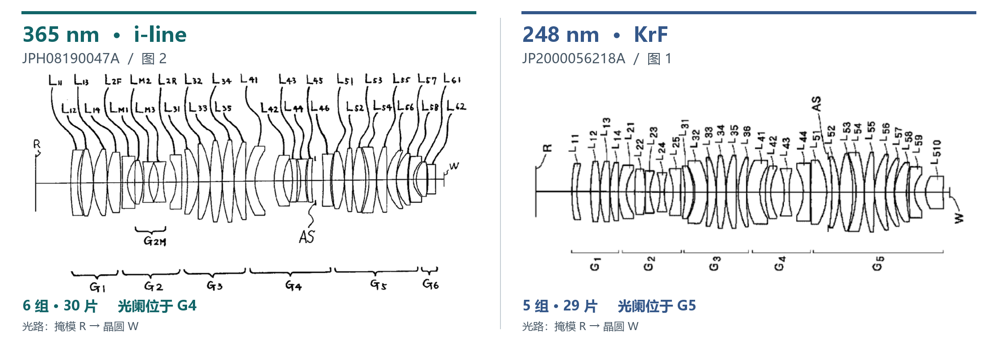

# 补充材料 · Nikon 的 365 nm 与 248 nm 投影物镜设计

[返回 ASML 报告与 ZEISS 主对照](README.md#optics-and-mounts) · [来源编号与原件](sources.md)

这两件 Nikon 专利来自不同 NA 档位，可独立核对同像高条件下的镜片数量与光阑位置。图中的 30 片和 29 片均不代表 ASML 两机的实装清单。[S18–S20][S38][S39]

**补图　同为 15.6 mm 最大像高，KrF 设计少一片镜片，光阑从第四组移至第五组。** 左为 [JPH08190047A 图 2](../../../materials/patents/JPH08190047A/figures/fig-2.png)，右为 [JP2000056218A 图 1](../../../materials/patents/JP2000056218A/figures/fig-1.png)。两图保留原编号，统一掩模 R 在左、晶圆 W 在右；右图旋转，各自缩放，不可用图上长度比较口径。[S18–S20]

| 同图可核的设计参数 | 365 nm · Nikon 第一实施例，图 2 | 248 nm · Nikon 实施例，图 1 |
| --- | --- | --- |
| 最大像高／像方 NA | 15.6 mm（综述）；0.57（表 1） | 15.6 mm／0.60（公报段 [0015]；综述图 5(e) 标 0.55） |
| 镜组／独立镜片 | 6 组，4＋5＋5＋6＋8＋2＝**30 片** | 5 组，4＋5＋6＋4＋10＝**29 片** |
| 开口光阑 AS | G4 内，L45 与 L46 之间 | G5 内，L51 与 L52 之间；处方第 41 面 |
| 处方给出的材料信息 | 表 1 有不同折射率，例如 1.53627、1.66638；不据此指定商业玻璃牌号 | 全镜合成石英；248 nm 下折射率 1.50839 |
| 掩模面至第一面／末面至晶圆面间距 | 94.97557／22.68864 mm（表 1 的 d₀、Bf） | 94.501／19.200 mm（表 1 面 0、59 对应的间隔） |
| 核对入口 | [实施例、原件与逐页稿](../../../materials/patents/JPH08190047A/README.md) | [实施例、原件与逐面处方](../../../materials/patents/JP2000056218A/README.md) |

**难度来自允许的误差，而不只是片数。** 在相同波前误差波数要求下，若举例取 RMS 光程差 λ/50，365 nm 对应 7.30 nm，248 nm 只剩 4.96 nm。全石英处方减轻多种材料搭配的问题，也让激光线宽和石英均匀性直接影响成像。这是公开设计解释的机制；λ/50 是算例，并非两机验收公差。[S18–S21]
