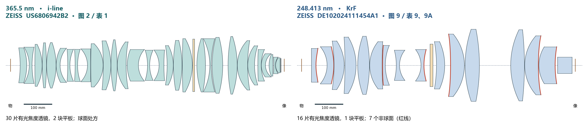

# ZEISS 两套主处方的 70 件玻璃

正文对比 US6806942B2 图 2 的 30 片透镜和 2 块平板，以及 US6522484B1 图 5 的 37 片透镜和 1 块平板。编号各按本公报，由物方排向像方，长度单位为 mm。[返回正文](README.md#optics-and-mounts) · [i-line 表 1](../../../materials/patents/US6806942B2/original.pdf#page=24) · [KrF 表 5 原页](../../../materials/patents/US6522484B1/figures/table-5.png) · [欧洲同族表 5](../../../materials/patents/EP1006387A2/README.md)

球面矢高按 z(h)＝(h²/R)/(1＋√(1−(h/R)²)) 计算，R 保留符号，平面矢高为 0。指定半径处的玻璃厚度 t(h)＝CT＋z后(h)−z前(h)。i-line 两面都有半口径，取 h＝min(H前,H后)，D＝2h，ET＝t(h)。后面的 KrF 表每行注明取值位置。机械外缘、倒角、装夹预留和公差需要加工图。[i-line 逐面输入](prescriptions/iline-surfaces.tsv) · [i-line 几何与 NA 复算](prescriptions/recalculate.py)

## 365.5 nm · US6806942B2 图 2／表 1

| 元件 | 前／后表面 | 类型／材料 | R₁ / R₂（mm） | H₁ / H₂（mm） | D（mm） | CT（mm） | ET（mm） | D/CT | D/ET | 非球面 |
| ---: | --- | --- | ---: | ---: | ---: | ---: | ---: | ---: | ---: | --- |
| 1 | S2／3 | LF5 | -407.432 / -190.764 | 64.233 / 67.088 | 128.466 | 24.124 | 18.080 | 5.33 | 7.11 | 无 |
| 2 | S4／5 | FK5 | -126.897 / 315.746 | 67.174 / 76.06 | 134.348 | 10.391 | 36.857 | 12.93 | 3.65 | 无 |
| 3 | S6／7 | LF5 | 2642.002 / -170.351 | 77.158 / 78.941 | 154.316 | 26.521 | 6.919 | 5.82 | 22.30 | 无 |
| 4 | S8／9 | LLF1 | 688.779 / -828.961 | 83.139 / 83.495 | 166.278 | 15.251 | 6.036 | 10.90 | 27.55 | 无 |
| 5 | S10／11 | FK5 | 253.049 / -247.630 | 84.172 / 83.655 | 167.310 | 34.467 | 5.681 | 4.85 | 29.45 | 无 |
| 6 | S12／13 | FK5 | 134.142 / 95.532 | 70.861 / 63.005 | 126.010 | 14.197 | 22.202 | 8.88 | 5.68 | 无 |
| 7 | S14／15 | FK5 | -738.224 / 139.763 | 62.611 / 59.263 | 118.526 | 8.000 | 23.569 | 14.82 | 5.03 | 无 |
| 8 | S16／17 | FK5 | -825.441 / 189.026 | 59.338 / 60.125 | 118.676 | 9.000 | 20.691 | 13.19 | 5.74 | 无 |
| 9 | S18／19 | LLF1 | -87.961 / -6356.791 | 60.608 / 77.138 | 121.216 | 11.530 | 35.454 | 10.51 | 3.42 | 无 |
| 10 | S20／21 | FK5 | 1948.325 / -112.462 | 79.527 / 82.798 | 159.054 | 44.977 | 10.410 | 3.54 | 15.28 | 无 |
| 11 | S22／23 | FK5 | -882.161 / -233.534 | 89.995 / 92.374 | 179.990 | 27.572 | 14.138 | 6.53 | 12.73 | 无 |
| 12 | S24／25 | FK5 | 474.300 / -575.154 | 94.138 / 93.991 | 187.982 | 22.467 | 5.329 | 8.37 | 35.28 | 无 |
| 13 | S26／27 | FK5 | 139.677 / 521.190 | 88.856 / 86.351 | 172.702 | 32.087 | 9.400 | 5.38 | 18.37 | 无 |
| 14 | S28／29 | FK5 | 153.135 / 87.933 | 78.332 / 58.278 | 116.556 | 40.741 | 51.304 | 2.86 | 2.27 | 无 |
| 15 | S30／31 | LLF1 | -186.852 / 131.053 | 57.642 / 55.746 | 111.492 | 8.000 | 28.957 | 13.94 | 3.85 | 无 |
| 16 | S32／33 | LLF1 | -94.088 / 748.500 | 56.315 / 71.079 | 112.630 | 17.769 | 38.605 | 6.34 | 2.92 | 无 |
| 17 | S34／35 | FK5 | -434.235 / -154.683 | 72.711 / 77.013 | 145.422 | 22.495 | 10.471 | 6.46 | 13.89 | 无 |
| 18 | S36／37 | FK5 | 537.928 / -355.890 | 91.846 / 94.426 | 183.692 | 31.248 | 11.293 | 5.88 | 16.27 | 无 |
| 19 | S38／39 | FK5 | 2563.091 / -199.037 | 98.052 / 99.134 | 196.104 | 36.288 | 8.584 | 5.40 | 22.84 | 无 |
| 20 | S40／41 | 平板 · SUPRA1 | ∞ / ∞ | 96.837 / 96.506 | 193.012 | 6.000 | 6.000 | 32.17 | 32.17 | 无 |
| 21 | S44／45 | FK5 | 314.515 / -506.854 | 98.49 / 98.2 | 196.400 | 31.425 | 6.098 | 6.25 | 32.21 | 无 |
| 22 | S46／47 | LF5 | -216.541 / 367.750 | 97.844 / 101.637 | 195.688 | 5.000 | 41.621 | 39.14 | 4.70 | 无 |
| 23 | S48／49 | FK5 | 389.910 / -402.292 | 102.687 / 104.102 | 205.374 | 38.818 | 11.727 | 5.29 | 17.51 | 无 |
| 24 | S50／51 | FK5 | 551.172 / -340.874 | 106.437 / 106.254 | 212.508 | 33.361 | 6.039 | 6.37 | 35.19 | 无 |
| 25 | S52／53 | FK5 | 132.912 / 540.348 | 93.647 / 90.723 | 181.446 | 37.466 | 9.358 | 4.84 | 19.39 | 无 |
| 26 | S54／55 | FK5 | 119.076 / 232.599 | 77.436 / 72.129 | 144.258 | 24.828 | 11.963 | 5.81 | 12.06 | 无 |
| 27 | S56／57 | LLF1 | 1290.377 / 146.400 | 69.928 / 58.321 | 116.642 | 12.237 | 23.037 | 9.53 | 5.06 | 无 |
| 28 | S58／59 | FK5 | 73.326 / 53.686 | 52.371 / 42.587 | 85.174 | 14.971 | 22.333 | 5.69 | 3.81 | 无 |
| 29 | S60／61 | FK5 | 98.429 / -1373.071 | 41.873 / 39.821 | 79.642 | 14.235 | 5.243 | 5.59 | 15.19 | 无 |
| 30 | S62／63 | FK5 | -380.732 / 52.895 | 38.039 / 30.452 | 60.904 | 5.842 | 16.707 | 10.43 | 3.65 | 无 |
| 31 | S64／65 | FK5 | 43.342 / 1336.072 | 29.613 / 27.286 | 54.572 | 16.092 | 6.703 | 3.39 | 8.14 | 无 |
| 32 | S66／67 | 平板 · SUPRA1 | ∞ / ∞ | 26.229 / 25.232 | 50.464 | 2.000 | 2.000 | 25.23 | 25.23 | 无 |

## i-line 图 2 的孔径核验

原文把 NA 0.65 直接写在图 1 的早期对照上。这里独立检查附有完整处方的图 2。按表 1 的带符号轴距、365.5 nm 名义折射率和通光半口径，从轴上像点向物方作子午光线追迹，逐面求交、按 Snell 定律折射，并检查每面的 |y|/H。解最大值等于 1 的边界，得 NA＝0.650126，限制面为 S42（H＝96.356 mm）。取 NA＝0.650 时该面光线高度 96.335 mm，取 0.652 时为 96.671 mm，已超过半口径。该计算核对轴上通光孔径；场内像差、MTF 和整机分辨率仍须单独验证。

## 248 nm · US6522484B1 图 5／表 5

半径、中心厚、轴上间隔取自美国公报第 15 页，并对读欧洲公开本第 15–17 页。Hmax 只在 8 片的单侧给出，其中 505、522 在后面，另 6 片在前面。下表将单面直径 2Hmax 记为 D*。t* 表示在同一 h 计算的名义玻璃厚度，须以另一面也延伸到 h 为条件。第 529 号的 D* 另取说明书所报镜片直径 341 mm，仅算 D*/CT。空栏用「—」标示。[输入 TSV](prescriptions/krf-figure5.tsv) · [Python 复算](prescriptions/krf_figure5.py)

| 元件 | 前／后顶点半径 | CT | 后间隔 | 半径依据 Hmax | D* | D*/CT | t* | D*/t* |
| --- | ---: | ---: | ---: | --- | ---: | ---: | ---: | ---: |
| 501 | -168.448 / 451.839 | 7.819 | 10.150 | — | — | — | — | — |
| 502 | -1469.667 / 507.556 | 12.827 | 9.846 | — | — | — | — | — |
| 503 | 3953.186 / -255.806 | 24.517 | 0.109 | — | — | — | — | — |
| 504 | 677.358 / -291.838 | 35.314 | 0.717 | — | — | — | — | — |
| 505 | 514.352 / -349.357 | 37.652 | 2.388 | 后面 102 | 204 | 5.42 | 12.215 | 16.70 |
| 506 | 47.966 / 4511.896 | 31.567 | 0.103 | — | — | — | — | — |
| 507 | 173.084 / 114.678 | 12.702 | 44.986 | — | — | — | — | — |
| 508 | -699.118 / -255.168 | 16.715 | 3.212 | — | — | — | — | — |
| 509 | -704.667 / 204.972 | 11.272 | 33.860 | — | — | — | — | — |
| 510 | -169.644 / 283.339 | 12.141 | 36.451 | 前面 71 | 142 | 11.70 | 36.753 | 3.86 |
| 511 | -164.668 / -1145.627 | 11.842 | 22.777 | — | — | — | — | — |
| 512 | -199.780 / -176.684 | 20.265 | 7.310 | — | — | — | — | — |
| 513 | 8844.587 / -273.661 | 46.194 | 0.761 | — | — | — | — | — |
| 514 | -1811.014 / -386.108 | 32.660 | 0.755 | — | — | — | — | — |
| 515 | 626.689 / -896.109 | 42.026 | 0.821 | 前面 143 | 286 | 6.81 | 14.009 | 20.41 |
| 516 | 336.397 / -1002.851 | 54.598 | 0.752 | — | — | — | — | — |
| 517 | 411.928 / 183.595 | 12.364 | 73.688 | — | — | — | — | — |
| 518 | -237.160 / 339.922 | 12.074 | 67.674 | 前面 110 | 220 | 18.22 | 57.417 | 3.83 |
| 519 | -181.378 / 3323.801 | 19.614 | 0.795 | — | — | — | — | — |
| 520 | 1648.704 / -259.967 | 72.249 | 0.772 | — | — | — | — | — |
| 521 | -3288.150 / -547.040 | 36.331 | 0.754 | — | — | — | — | — |
| 522 | 3160.321 / -337.191 | 71.293 | 0.750 | 后面 172 | 344 | 4.83 | 19.442 | 17.69 |
| 523 | 794.782 / 3890.718 | 31.332 | 55.484 | — | — | — | — | — |
| 524 | -273.219 / -316.643 | 30.190 | 0.894 | 前面 152 | 304 | 10.07 | 37.506 | 8.11 |
| 525 | -358.789 / 330.466 | 20.418 | 15.787 | — | — | — | — | — |
| 526 | 423.693 / -3000.977 | 48.720 | 0.034 | — | — | — | — | — |
| 527 | 584.671 / -341.375 | 78.378 | 13.393 | 前面 159 | 318 | 4.06 | 17.054 | 18.65 |
| 528 | -276.351 / -2430.384 | 6.015 | 49.784 | — | — | — | — | — |
| 529 | -282.253 / -247.816 | 33.801 | 0.751 | 说明书给直径 | 341 | 10.09 | — | — |
| 530 | 497.380 / -593481.158 | 43.718 | 0.762 | 前面 170 | 340 | 7.78 | 13.739 | 24.75 |
| 531 | 257.876 / 1283.553 | 58.302 | 0.760 | — | — | — | — | — |
| 532 | 192.763 / 379.416 | 41.022 | 1.212 | — | — | — | — | — |
| 533 | 158.692 / 318.371 | 33.559 | 10.419 | — | — | — | — | — |
| 534 | 602.941 / 312.341 | 22.348 | 0.449 | — | — | — | — | — |
| 535 | 151.612 / 94.174 | 13.858 | 13.001 | — | — | — | — | — |
| 536 | 178.383 / 47.957 | 6.551 | 2.052 | — | — | — | — | — |
| 537 | 47.759 / 457.020 | 28.153 | 3.585 | — | — | — | — | — |
| P5 | ∞ / ∞ | 2.000 | — | — | — | — | — | — |

以 530 号为例，R前＝497.380、R后＝−593481.158、CT＝43.718。表列前面 Hmax＝170，代入得 t(170)＝13.739，D*/t*＝24.75。说明书第 6 栏给 529 号最大直径 341；表 5 的 522 号后面 Hmax＝172，2Hmax＝344。两种读数和位置均保留在表中。全套共同口径边厚、最大 D/ET 以及实机可动框数量未公开。

## 补充处方 · DE102024111454A1 第四实施例 N801

这套 2025 年公开的 248.413 nm 设计用 16 片有光焦度的透镜、1 块平板和 7 个非球面。下图仅比较 N801 与 i-line 图 2，按同一毫米比例绘制。两者处方带符号轴距之和分别为 1000.000038 和 1000.000099 mm。N801 的非球面在球面基底上加上 Σ Cⱼh^(2j+2)，j＝1…6，K＝0。[N801 单独的逐面输入](prescriptions/krf-surfaces.tsv) · [非球面系数](prescriptions/krf-aspheres.tsv) · [复算方法](prescriptions/recalculate.py) · [图 9 与原件](../../../materials/patents/DE102024111454A1/README.md)

### 248.413 nm · DE102024111454A1 图 9／表 9

| 元件 | 前／后表面 | 类型／材料 | R₁ / R₂（mm） | H₁ / H₂（mm） | D（mm） | CT（mm） | ET（mm） | D/CT | D/ET | 非球面 |
| ---: | --- | --- | ---: | ---: | ---: | ---: | ---: | ---: | ---: | --- |
| 1 | S1／2 | SILUV | -7545.802 / 195.401 | 62.2 / 65.7 | 124.400 | 16.395 | 23.802 | 7.59 | 5.23 | S2 |
| 2 | S3／4 | SILUV | -106.240 / -222.418 | 68.2 / 85.2 | 136.400 | 24.661 | 40.214 | 5.53 | 3.39 | S4 |
| 3 | S5／6 | SILUV | -581.048 / -159.345 | 89.6 / 95 | 179.200 | 36.902 | 16.274 | 4.86 | 11.01 | 无 |
| 4 | S7／8 | SILUV | -1623.677 / -202.752 | 104.1 / 107 | 208.200 | 40.532 | 15.108 | 5.14 | 13.78 | 无 |
| 5 | S9／10 | SILUV | 319.890 / -481.822 | 108.2 / 106.9 | 213.800 | 42.863 | 12.465 | 4.99 | 17.15 | 无 |
| 6 | S11／12 | SILUV | 139.848 / 1823.280 | 92.8 / 87.1 | 174.200 | 45.280 | 16.926 | 3.85 | 10.29 | 无 |
| 7 | S13／14 | SILUV | 1808.544 / 187.744 | 84 / 73.3 | 146.600 | 10.000 | 21.921 | 14.66 | 6.69 | S13 |
| 8 | S15／16 | SILUV | -219.871 / 89.200 | 64.2 / 55.5 | 111.000 | 11.965 | 38.454 | 9.28 | 2.89 | 无 |
| 9 | S17／18 | SILUV | -93.794 / 201.275 | 57.9 / 70.1 | 115.800 | 10.838 | 38.854 | 10.68 | 2.98 | S18 |
| 10 | S19／20 | 平板 · SILUV | ∞ / ∞ | 78.4 / 82.8 | 156.800 | 10.000 | 10.000 | 15.68 | 15.68 | 无 |
| 11 | S21／22 | SILUV | -513.495 / -209.361 | 87.3 / 95.1 | 174.600 | 30.143 | 18.548 | 5.79 | 9.41 | 无 |
| 12 | S23／24 | SILUV | -1280.748 / -181.472 | 114.7 / 119.6 | 229.400 | 50.624 | 16.818 | 4.53 | 13.64 | S23 |
| 13 | S25／26 | SILUV | 410.838 / -695.862 | 132.5 / 132.5 | 265.000 | 52.299 | 17.614 | 5.07 | 15.04 | 无 |
| 14 | S28／29 | SILUV | 296.584 / -1203.568 | 132.4 / 130.7 | 261.400 | 50.328 | 12.858 | 5.19 | 20.33 | 无 |
| 15 | S30／31 | SILUV | 164.736 / 797.638 | 114.7 / 108.6 | 217.200 | 49.833 | 18.170 | 4.36 | 11.95 | S31 |
| 16 | S32／33 | SILUV | 127.014 / 409.578 | 89.3 / 67.9 | 135.800 | 59.300 | 45.234 | 2.29 | 3.00 | S33 |
| 17 | S34／35 | SILUV | -4555.158 / ∞ | 63.7 / 30 | 60.000 | 52.833 | 52.931 | 1.14 | 1.13 | 无 |

### N801 七个非球面的名义面形偏离

下表按各面自己的公开半口径 H 计算。Δz 是相对同顶点、同半径球面的矢高差（保留正负），不等同于最佳拟合球偏离或抛光误差。实际检测采用的参考球、轴向位置和可接受面形误差须由生产图纸给出。

| 原面号 | 顶点 R（mm） | H（mm） | Δz(H)（mm） | 切线角 atan(dz/dh) |
| ---: | ---: | ---: | ---: | ---: |
| S2 | 195.401276 | 65.7 | -3.6910 | +8.53° |
| S4 | -222.418004 | 85.2 | +3.6767 | -13.63° |
| S13 | 1808.544170 | 84.0 | +2.5001 | +9.07° |
| S18 | 201.274876 | 70.1 | -1.2454 | +15.97° |
| S23 | -1280.748131 | 114.7 | -1.8925 | -9.01° |
| S31 | 797.638491 | 108.6 | +1.7745 | +12.40° |
| S33 | 409.578089 | 67.9 | -0.0611 | +8.64° |
